# 蚂蚁｜玩转AI，探索绘图新世界

> 来源：[https://aiyanxishe.feishu.cn/docx/DlXJdkoaqoccIpxu1oycK4y1nDg](https://aiyanxishe.feishu.cn/docx/DlXJdkoaqoccIpxu1oycK4y1nDg)

AI技术近来风靡全球，蚂蚁设计内部也掀起了一股AI浪潮。在AI浪潮中，是否想过你的灵感瞬间化为一幅幅绘画作品，随手轻轻一挥即可浮现眼前？

在蚂蚁，一群充满创意和热爱绘画的同学们利用业余时间探讨AI绘画、交流工具使用、分享绘制作品。他们的AI作品，不仅有着星辰大海、动物人文、个性插画，还有着逼真的数字形象人物。

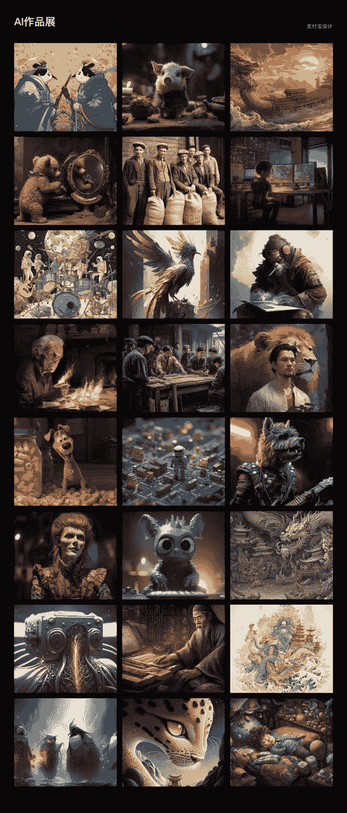

他们以每周一个话题展开趣味创作，让我们来欣赏一下他们近期的作品吧。

**Part 1**. 在《数字人》主题的创作中，大家为身边同学制作了独特的数字化人像，完美地展现了人物的外貌特征、神态和魅力。

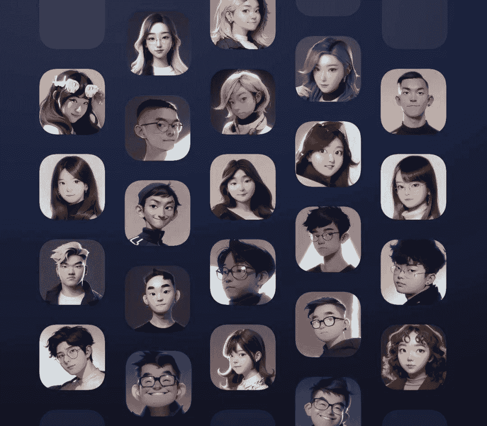

**Part 2**. 用脑洞描绘中国神话，《山海经》中的古老神话、麒麟凤凰、山川地理如何跃然纸上？

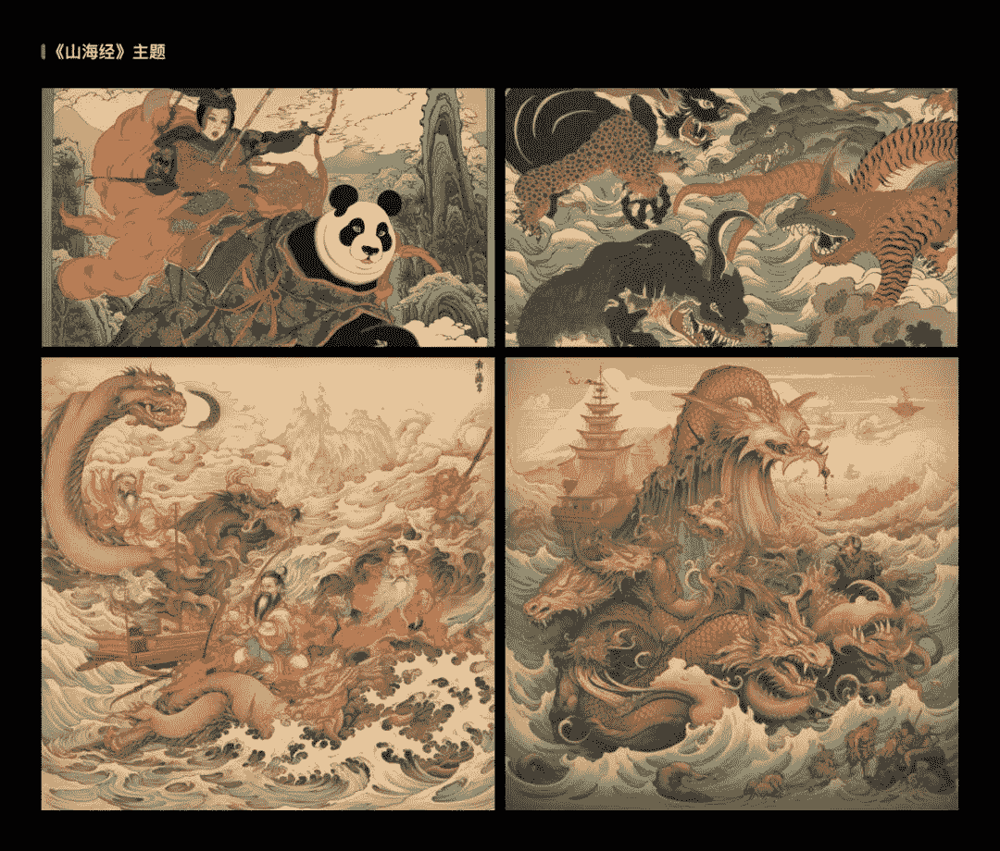

**Part 3**. 都说技术改变世界！你心中的程序员是什么样的？

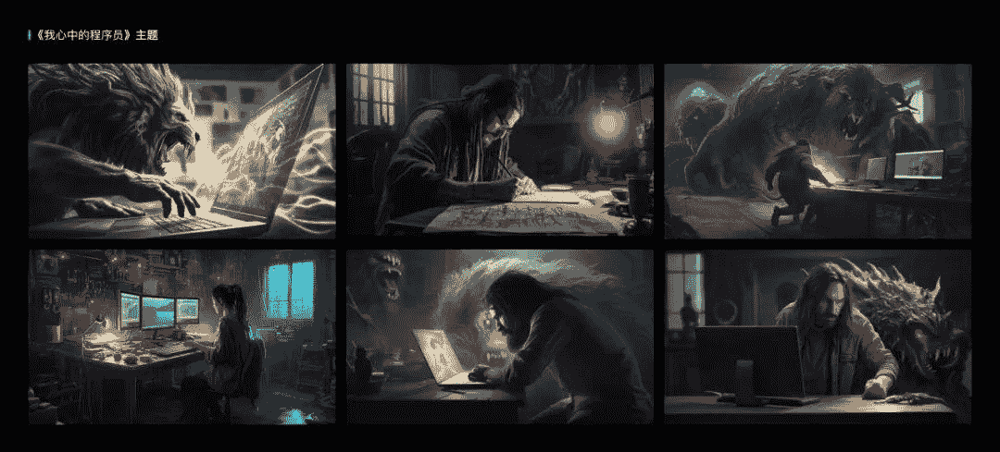

**Part 4.** 闭上眼睛，看到了我的童年时光……

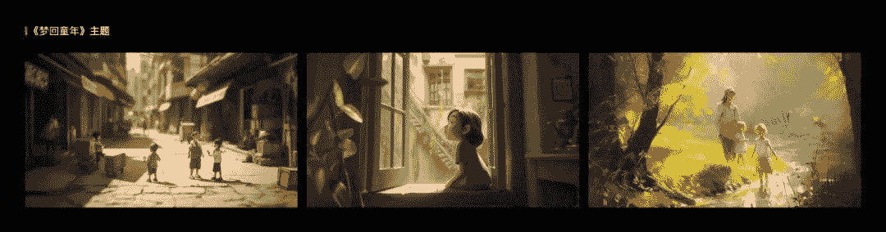

**Part 5**. 沉浸在神秘森林中的奇妙世界，树木可以说话，动物可以跳舞，花朵可以唱歌……

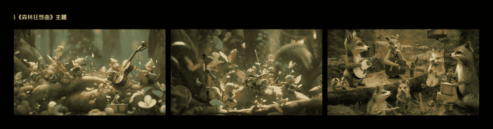

**Part 6**. 企鹅吵架是怎样的一种场景呢？

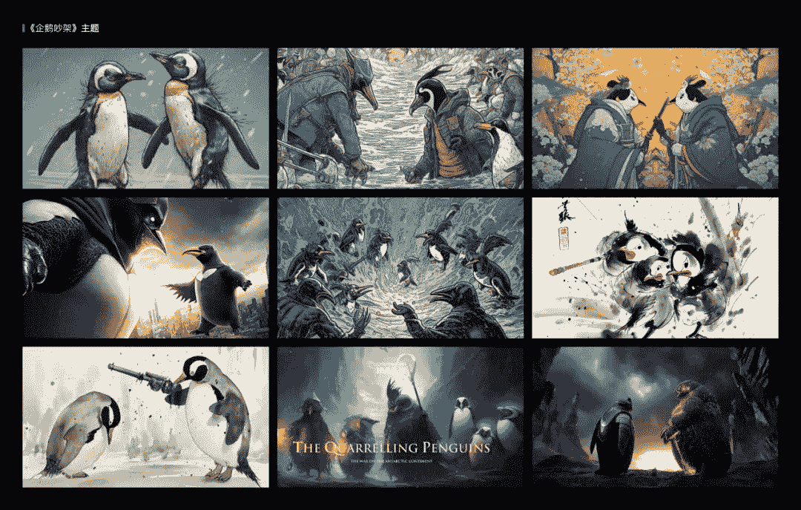

**Part 7**. 嚯！竟然有一家外星人在火星露营。

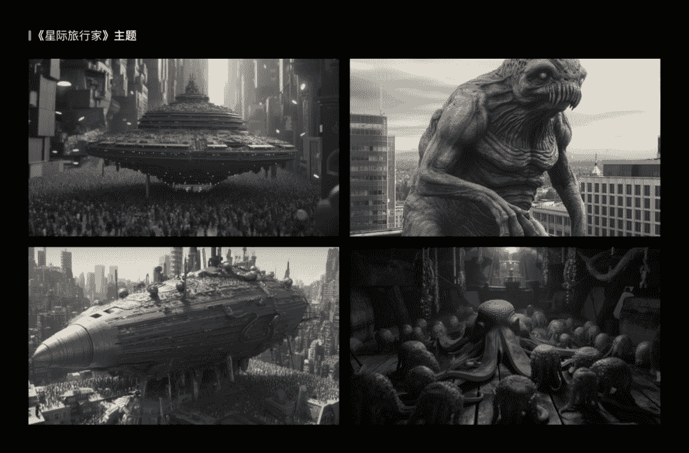

**Part 8**. 地球最后的夜晚，你会做什么呢？

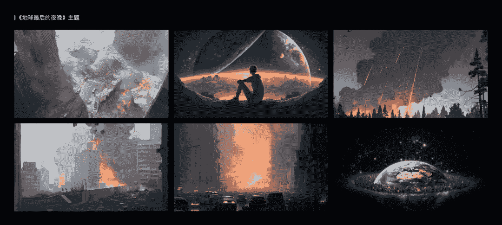

**Part 9**. 当我们凝视窗外时，眼前的世界是怎样的？或许是熙熙攘攘的街市，人们匆忙而行；或许是漫天星光，远处传来的轻吟浅唱。

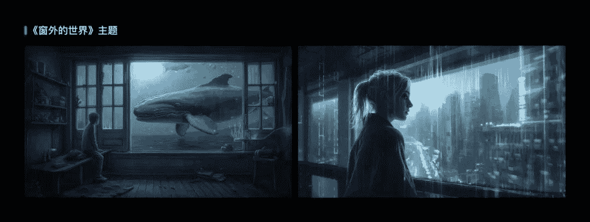

**Part 10**. 一锅神奇之物，你的料理，是否会发光？

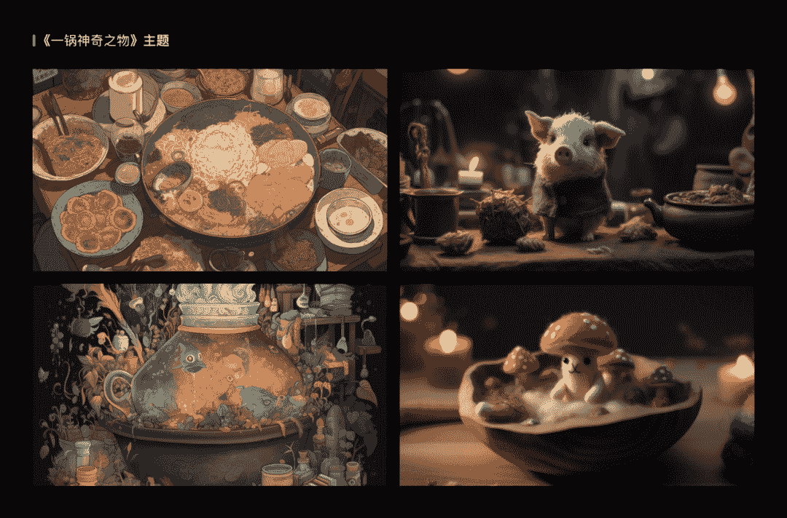

AI技术和工具的普及，让我们进入一个充满无限可能的时代。当创意想法与AI技术碰撞，将会产生一系列令人惊叹的火花。

<https://aiyanxishe.feishu.cn/sync/IaSadpoOOsopKab1ajKcz6z3nAb>