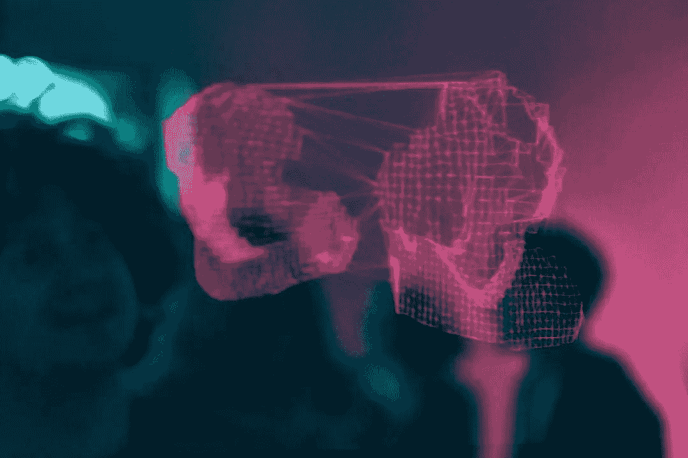
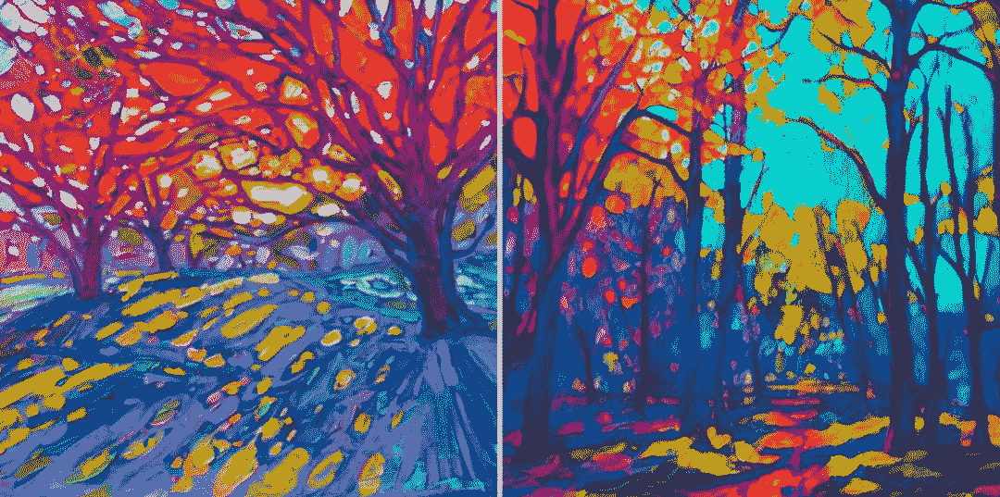
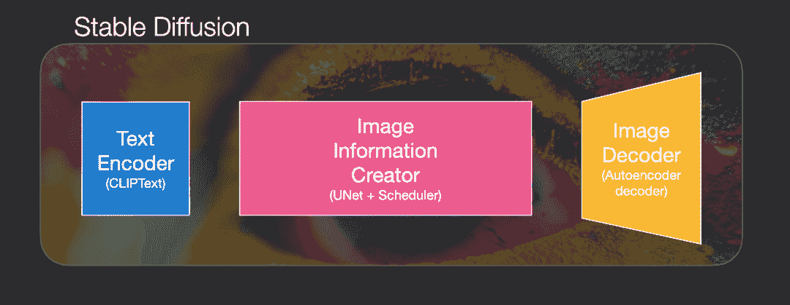
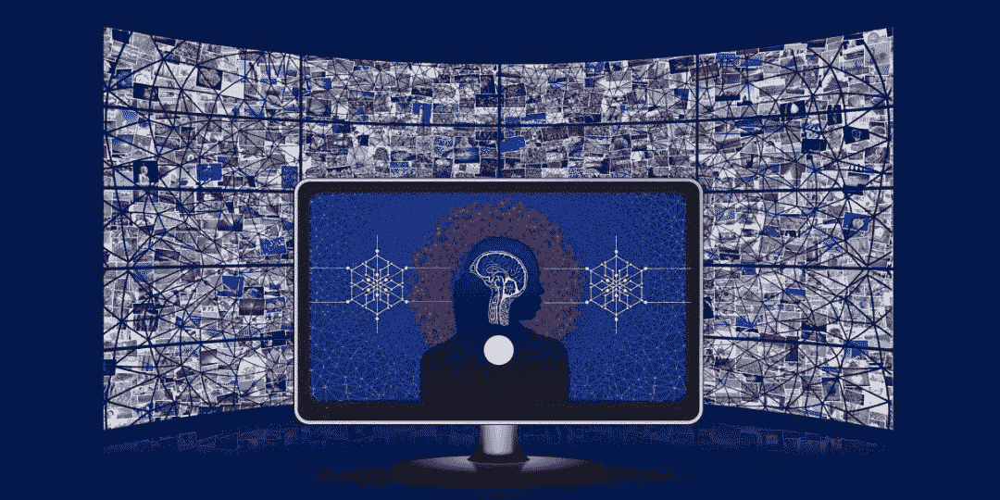
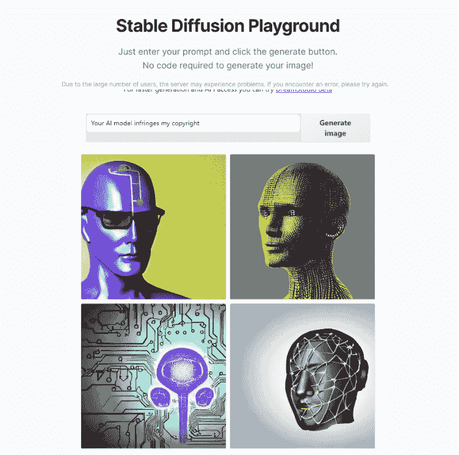
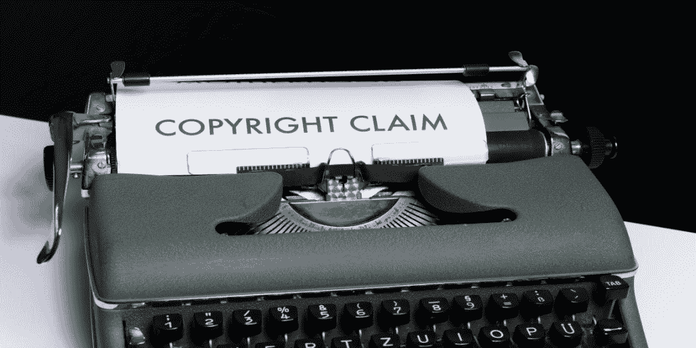
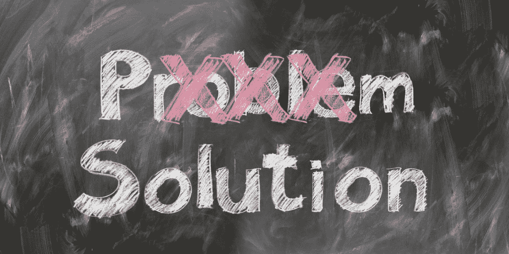

# 腾讯 | 你的AI侵犯了我的版权

> 来源：[https://aiyanxishe.feishu.cn/docx/VEd6dVSdKowLZTxuk83cbWH1ngg](https://aiyanxishe.feishu.cn/docx/VEd6dVSdKowLZTxuk83cbWH1ngg)

**朱开鑫** 腾讯研究院高级研究员

**张艺群** 腾讯研究院助理研究员

ChatGPT的大火，带来了AIGC技术及相关应用的“强势出圈”。除了感慨AI超强的内容生成输出能力之外，各界也开始思考AIGC可能产生的潜在风险。2023年1月23日，美国三名漫画艺术家针对包括Stability AI在内的三家AIGC商业应用公司，在加州北区法院发起集体诉讼，指控Stability AI研发的Stable Diffusion模型以及三名被告各自推出的、基于上述模型开发的付费AI图像生成工具构成版权侵权。无独有偶，2月15日《华尔街日报》记者弗朗西斯科·马可尼（Francesco Marconi）也公开指责，Open AI公司未经授权大量使用路透社、纽约时报、卫报、BBC等国外主流媒体的文章训练Chat GPT模型，但从未支付任何费用。[1]AIGC技术开发与应用中的知识产权尤其是版权侵权问题之所以受到高度关注，其根源在于AIGC模型的形成和完善依赖于大量的数据训练，而用于训练的数据往往包含受版权法保护的内容。AIGC是如何利用版权作品进行数据训练与输出成果的？这一过程存在哪些版权侵权风险？应当如何有效应对AIGC版权利用带来的侵权风险？本文以“Stable Diffusion案”为引，结合AIGC内容生产模式的技术原理，对上述问题进行探讨。

（左图：画家Erin Hanson在2021年创作的作品；右图：在Stable Diffusion中以“style of Erin Hanson”等作为提示生成的结果）[2]

### 全球首例：“Stable Diffusion”

### **AIGC模型版权侵权案**

作为全球首例知名的AIGC商业化应用领域，算法模型及训练数据版权侵权案，“Stable Diffusion案”自起诉书公布伊始便引起了各界关注与探讨，其最终判决结果亦将对AIGC产业和技术发展产生举足轻重的影响。回归到案件本身，我们发现：其一，从核心争议来看，当前国内外对于AIGC获取与利用版权作品进行算法训练是否合法存在诸多争议，尚无立法和司法层面的明确共识；其二，从涉案技术原理而言，Stable Diffusion模型训练过程中利用版权作品的方式、利用行为的版权定性仍有待分析明确。在本案中，原告围绕Stability AI公司未经权利人许可，获取与利用其版权作品作为Stable Diffusion的“训练图像”展开指控。原告将Stable Diffusion模型定性为“一个复杂的拼贴工具”（a complex collage tool）——“将无数受版权保护的图像存储和合并为训练图像后……生成完全基于训练图像的‘新’图像”。被告“从使用受版权保护的图像中获得商业利益和丰厚利润”，而数百万权利人则因生成的“新”图像对原作品交易市场的挤占而遭受损失。[3]

### **技术原理：AIGC模型涉及**

### **哪些作品利用行为？**

表面看，不同AIGC模型生成的内容形式各异，涵盖文字、图像、语音、视频等。但各类AIGC模型利用现有作品进行模型训练、生成最终结果的方式却存在异曲同工之处：将数据库中的作品数据进行一定程度的形式转换后输入AIGC模型，利用AIGC模型自主学习能力从中提取有价值的内容，再根据输入的指令生成与之相匹配的学习结果加以输出。以此次陷入纠纷的Stable Diffusion模型为例，其以包含数以亿计的图像数据库——LAION-5B[4]作为训练数据来源，原告主张的被侵权作品亦包含于内。简单来讲，Stable Diffusion模型对版权作品的利用存在于两个阶段。第一，AI模型训练阶段。Stable Diffusion利用版权作品训练内部组件“图像编码器”（U-Net模型），辅之以“Clip文本编码器”（Text Encoder模型），最终做到只需输入一段描述性文字，即可生成对应的图像内容。第二，AI模型应用阶段。Stable Diffusion经过充分训练后，可以依据用户给出的文本输出最终图像。但这些生成的图像内容，很大的概率包含并展现出作为训练数据的版权作品的元素及特征。

（Stable Diffusion内部结构图）[5]

### **AIGC模型训练阶段存在哪些**

### **版权侵权风险？**

在模型训练阶段，Stable Diffusion会将版权作品和与之对应的文本数据转换为同一个“图像信息空间”（latent space）的“潜在表现形式”（Latent Representations）。具言之，Stable Diffusion模型以从数据库中下载的作品作为输入对象，对其添加噪点并进行编码（压缩），使作品进入“图像信息空间”。进入这个空间的版权作品，会与被“Clip文本编码器”编码的描述性文本进行“交互”，得到两者信息融合的结果——“潜在表现形式”。简单解释，之所以Stable Diffusion模型训练涉及增加噪点和去噪点的过程，是因为：不同于人类作画的起点是“从无到有”，即在白纸上开始增加线条颜色等，最终形成图像；Stable Diffusion模型作画是“从有到无”，即从布满杂乱噪点的底板（类似于九十年代电视的“雪花屏”），不断去掉无关的噪点，直至保留最终目标图像的过程。

若将训练前数据准备过程，也囊括至模型训练阶段。则Stable Diffusion模型对版权作品的主要利用行为系“复制”与“改编”。相关行为主要体现于两个步骤中。

其一，是准备训练数据过程中的复制。由于LAION-5B数据库本身并不提供版权作品副本而仅提供版权作品在线URL列表的索引，因此在训练Stable Diffusion模型前，需要先将作为训练数据的作品从相应网络地址下载并存储，以形成版权作品的副本。

其二，是对作品进行编码后，将其输入至“图像信息空间”的改编。较之于对作品的直接下载与存储，过程对作品进行了噪声添加与编码（压缩），未在“图像信息空间”“无差还原”原始版权作品，但其仍保留了作品内容中最关键、本质的特征，应当认定为版权法意义上的改编。

### AIGC模型输出阶段存在哪些版权侵权风险？

在内容输出阶段，通过Stable Diffusion模型生成最终图像，首先需要先通过“Clip文本编码器”将用户输入的文本对应至“图像信息空间”的“潜在表现形式”。其次，由经过噪声输出训练的“U-Net模块”，对该潜在表现形式中添加的噪声进行预测。再次，对该文本的潜在表现形式减去“U-Net模块”所预测的噪声，根据用户的设定进行若干次“去噪”，最终得到新的图像内容。这一阶段，对原版权作品的利用需结合最终生成内容判断。若去噪与解码后生成的内容，与原作品在表达上构成“实质性相似”，则落入“复制权”的规制范围；若不构成“实质性相似”，而是在保留作品基础表达的前提下形成了新的表达，则可能构成对原作品“改编权”的侵害。在将讨论对象放宽至整体意义上的AIGC模型，谷歌公司的研究人员Kevin P. Murphy指出：机器学习模型有时会重建输入数据的特性，而不是反映这些数据的潜在趋势。此类模型可以视为生成作品的概率模型，落入原作“复制品”或“衍生作品”的宽泛定义，存在侵犯“复制权”与“改编权”的风险。[6]此外，依据Stable Diffusion官方网站的声明，Stable Diffusion生成的新内容会以“CC0 1.0通用协议”的方式呈现于互联网环境中，“完全开源”。[7]从版权法来看，根据上述传播生成内容的方式是交互式或非交互式，即是否能使公众在自行选定的时间和地点获取，还可能分别落入“信息网络传播权”与“广播权”（网络直播）的规制范畴。

### **AIGC版权侵权是小概率事件？**

有观点认为，AIGC输出内容侵犯版权是极小概率的事件，因为在数以亿计的训练数据前担忧生成结果与某一张或某几张作品相似，似乎过于“杞人忧天”。如英国萨塞克斯大学的Andrés Guadamuz教授便指出，“经过训练的机器模型，最终通常会产生与原始图像不同的新图像”。[8]然而，在最新一项以Stable Diffusion等AI扩散生成模型为研究对象的实验中，马里兰大学和纽约大学的联合研究团队指出：利用Stable Diffusion模型生成的内容与数据集作品相似度超过50%的可能性达到了1.88%，鉴于庞大的用户使用量，令人无法忽略这其中侵权问题的存在。研究人员表示，由于该项实验中对复制（版权作品）的检索，仅涵盖训练数据集中的1200万张图像（占训练数据集整体很小一部分），再加之有较大概率存在检索方法无法识别的复制内容等因素，该实验的结果实际上会低估了Stable Diffusion的侵权复制量。[9]由此可见，AIGC模型作品侵权风险不能为各界所忽视。

### AIGC能否构成“合理使用”免责？

在美国，虽然在合理使用认定标准上相较于其他国家更为灵活，更倾向于鼓励作品二次利用，但AIGC模型对于训练数据中作品的使用也难谓完全合法。“Stable Diffusion案”后，很多美国学者和律师认为，结合美国版权法上的“四要素分析法”[10]，很难将AIGC对于作品的使用纳入合理使用的范畴。一方面，Stable Diffusion生成的绝大部分内容并未在原作品的基础上增加新的表达形式，产生区别于原作品的新功能或价值，不符合“转换性使用”的要求。另一方面，在版权作品授权许可市场已经十分成熟的背景下，AIGC生成的内容很大程度上挤压与替代了被利用作品的原有市场。在我国，现行《著作权法》关于合理使用的规定，能适用于AIGC数据训练的情形主要有三：“个人使用”“适当引用”以及“科学研究”。[11]“个人使用”适用目的存在严格限制，而目前AIGC模型最终落脚于对不特定主体的商业性服务，难以与之契合；“适当引用”的适用前提“为介绍、评论说明某一作品”或“说明某一问题”，AIGC模型商业化领域的应用显然难以归于此类；“科学研究”对作品的利用限定在“学校课堂教学或者科学研究”，同时还强调仅能“少量复制”，AIGC模型大量复制与利用作品的现状无法满足该项要求。

### 传统的作品“授权利用模式”是否适用？

国内学者曾形象地将AIGC模型与海量训练数据的关系，比喻为“孩子”与“母乳”。[12]人工智能技术的发展与提升必须以体量庞大的数据供给为前提，而被提供的数据中不可避免地包括受版权保护的作品。若严格遵循现行《著作权法》，则人工智能合法获取与利用作品的方式似乎仅剩传统的“授权许可模式”。但对于AIGC内容生产而言，既有的授权许可模式又存在天然的适用困境。

一方面，授权许可模式可能造成AIGC研发的“寒蝉效应”。在面临版权作品高昂的授权许可费用时，AIGC研发主体往往面临两种选择：一是，放弃AIGC领域，进而转向其他行业；二是，坚守AIGC领域，但使用免费数据进行训练。然而，前者无疑阻碍了人工智能技术和产业发展的趋势，与科技进步规律相违背；后者则可能因训练数据的不足，而引发算法模型偏见等不良后果。

另一方面，授权许可模式在实操层面存在难以落地的问题。AIGC模型所需的训练数据中包含的作品数量众多、来源各异、权属不同，若采用事先授权许可的方式则：首先，需要精准地将受保护的作品从海量数据中进行分离、提取；其次，再找到每一部版权作品对应的权利人与之协商授权，并支付价格不一的授权费用。上述过程漫长且复杂，很难落地执行。此外，AIGC数据训练对作品数量的需求远超出著作权集体管理组织所能调控与规制的范畴，集体管理组织制度同样面临适用的“失灵”。不可否认，当前通过Stable Diffusion等AIGC模型生成的结果存在侵权风险，但可以预想随着AI算法的不断改进优化与训练数据的倍数增长，单个版权作品在这一过程中的价值将被“冲淡”，生成结果的侵权概率也将随之进一步降低。

### **国内思考：更加关注AI模型训练**

### **中的版权问题**

虽然国内目前尚未出现类似于“Chat GPT”和“Stable Diffusion”般的现象级应用，但AIGC领域的侵权诉讼也已出现。关注度较高的两个案件分别是2018年的“菲林诉百度案”和2019年的“腾讯诉盈讯案”。但上述案件涉及更多的是AIGC“小模型时代”，对于特定领域（法律、财经）内容的生成和输出，模型训练数据需求量仍较低。特定专业数据库和公开信息即可满足，不完全等同于当下AIGC“大模型时代”多类型、多领域海量数据的训练要求。“菲林诉百度案”涉及，在享有合法授权的“科威先行数据库”基础上生成输出的内容；“腾讯诉盈讯案”涉及，在“股市历史和实时数据”这类不受版权法保护的事实信息的基础上生成和输出的内容。各界的关注点，也多停留在AIGC输出内容“是否构成作品”以及“权利归属何方”。但随着国内AIGC技术的应用与发展，AIGC模型训练和构建中的版权保护也需要保持重视。国内重点科技企业和科研机构已经在AIGC领域完成技术、产业布局。在全球超千亿参数的大模型中，中国企业或机构占1/3，比如过去几年国内相继推出了百度文心大模型、腾讯混元大模型等。而我国发展人工智能具有的海量数据、丰富场景和用户基础，正是未来AIGC“大模型时代”发展和竞争的有力优势。

### **如何破局：AIGC内容生产模式**

### **的版权治理探索**

思考（一）：可否增加新的“合理使用”情形？在规则层面，2018年日本《著作权法》修订中增加了“灵活的权利限制条款”，为AIGC技术爬取与利用版权作品创造了条件。新条款规定，如果互联网公司对作品的使用“不侵害著作权所有者利益”或者“对所有权的损害程度轻微”，则可不经权利人许可而直接使用。欧盟则于2019年正式通过《单一数字市场版权指令》，创设文本与数据**挖掘（TDM**）的例外，支持数据科学和人工**智能的发展。**但如果权利人以适当的方式明确保留对作品或其他客体的使用，则不适用该例外。日本与欧盟在这一领域的做法，为当前AIGC版权侵权治理提供了一个可供参考的路径。整体来看，日本倾向于从结果出发具体认定AIGC技术利用版权作品是否合法，最终还是需要落脚到具体个案的分析；而欧盟则主张保障版权人事前选择权利以避免侵权的发生，强调数据的开发利用不得侵害权利人的利益。思考（二）：可否搭建有效的“作品退出机制”？在实操层面，据报道，Stability AI公司近期表示将修改《用户协议》中“数据库不得加入或退出”的规定，允许权利人从后续发布的Stable Diffusion 3.0的训练数据集中删除自己的作品。版权人可在“Have I Been Trained”网站上找到自己的作品，选择退出数据训练集。[13]具言之，在将版权作品纳入AIGC模型训练数据库前，给予版权人一定的期限，自由选择是否从训练数据库中将其版权作品删除。若版权人在规定期限内提出反对意见，则应当尊重其意愿，删除相关作品；若伴权人未提出反对意见，则默认允许作品用于数据训练。需要指出的是，在将版权作品上传至网络空间时已做出明确禁止使用声明的版权人同样应当视为“提出反对意见”的主体。在退出机制的具体建构上，应当尽可能保证版权人的知情权与选择权。在AIGC模型训练前，要及时通过各类渠道发布其训练数据库的搭建信息，并在技术上为版权人提供便利的作品查询与检索机制，保证有可靠的渠道了解到版权作品是否被纳入至相关数据库。思考（三）：可否优化AIGC模型的版权保护机制？在技术层面，优化与完善模型设计，也是AIGC避免版权侵权风险的重要途径。来自伦敦玛丽女王大学的研究团队指出，AIGC模型在创新能力方面存在固有的限制，无法以创造性的方式与训练数据保持差异。为了解决这些局限性，可通过对AIGC模型的优化与重写，使其主动偏离训练数据。[14]此种“偏离”作用于生成结果上，能在一定程度上避免对原版权作品的侵权。目前，鉴于AIGC生成内容是否构成版权法上的作品加以保护，仍处于探讨之中，未有定论。有必要通过外部检测技术或者完善AIGC模型标注机制，对AIGC内容进行打标，和自然人创作的内容加以区分，防止后续可能涉及的版权法律风险及应对处理。2023年2月1日，Open AI宣布推出名为“AI Text Classifier”的文本检测器，来辅助辨别文本到底是人类撰写还是AI生成。虽然目前这项技术的准确度仍有待提升，但可以通过机器学习自动优化，代表着一种“技术自治”的发展方向。

**

参考资料来源**:

[1]https://twitter.com/fpmarconi/status/1625867414410825728?cxt=HHwWgMC4_ZLznpAtAAAA.

[2]https://edition.cnn.com/2022/10/21/tech/artists-ai-images/index.html

[3]See UNITED STATES DISTRICT COURT NORTHERN DISTRICT OF CALIFORNIA SAN FRANCISCO DIVISION,Page3-4.

[4]需指出，LAION-5B数据库并非直接提供图像数据，而仅提供图像和对应文本的在线URL列表的索引。为获取图像数据和文本间的对应度，LAION-5B首先会下载图像，但在数据训练完后会进行删除.

[5]Alammar, J:The Illustrated Stable Diffusion,https://jalammar.github.io/illustrated-stable-diffusion/.

[6]See KEVIN P. MURPHY, MACHINE LEARNING: A PROBABILISTIC PERSPECTIVE ,2007,at 22, 593.

[7]https://stablediffusionweb.com/:”Q:What is the copyright on images created through Stable Diffusion Online?A:Images created through Stable Diffusion Online are fully open source, explicitly falling under the CC0 1.0 Universal Public Domain Dedication.”2023年2月10日访问.

[8]See Guadamuz A, Do androids dream of electric copyright? Comparative analysis of originality in artificial intelligence generated works, Intellectual Property Quarterly,2017,2:169-186.

[9]See Gowthami Somepalli , Vasu Singla , Micah Goldblum , Jonas Geiping , Tom Goldstein, Diffusion Art or Digital Forgery? Investigating Data Replication in Diffusion Models, https://arxiv.org/pdf/2212.03860.pdf, 2023/2/16.

[10]See Copyright Law of the United States, Chapter 1: Section 107.即，第一，这种使用是否具有商业目的或是为了非营利的教育目的；第二，受版权保护的作品的性质；第三，同整个有版权作品相比所使用的部分的数量和内容的实质性；第四，这种使用对有版权作品的潜在市场或价值所产生的影响.

[11]即《著作权法》第二十四条第一款之（一）（二）（六）项内容.

[12]参见吴汉东：《人工智能生成作品的著作权法之问》，《中外法学》2020年第3期.

[13]https://haveibeentrained.com/,2023年2月20日访问.

[14]See Sebastian Berns& Simon Colton , Bridging Generative Deep Learning and Computational Creativity, https://computationalcreativity.net/iccc20/papers/164-iccc20.pdf, 2023/2/20.

<https://aiyanxishe.feishu.cn/sync/IaSadpoOOsopKab1ajKcz6z3nAb>