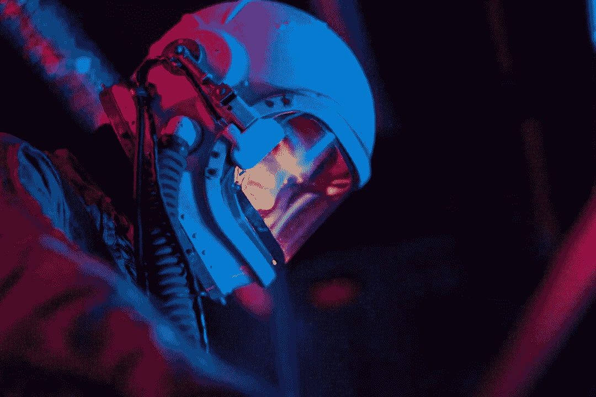

# 腾讯｜ChatGPT背后的AIGC，将生成怎样的浪潮？

> 来源：[https://aiyanxishe.feishu.cn/docx/EXZldzEQ5oMl9exNEOocY3t9nUW](https://aiyanxishe.feishu.cn/docx/EXZldzEQ5oMl9exNEOocY3t9nUW)

2022年，从引爆AI作画领域的DALL-E 2、Stable Diffusion等AI模型，到以ChatGPT为代表的接近人类水平的对话机器人，AIGC不断刷爆网络，其强大的内容生成能力给人们带来了巨大的震撼。

当AIGC成为社会各界关注的热点时，人们不禁发问，AI会成为新的造物者吗？AIGC为什么突然爆发，是否标志着AI正迎来下一个时代，又会如何走向？兼具大模型和多模态模型的AIGC模型是否会成为新的技术平台？AIGC技术和应用将给经济社会带来哪些影响，不同主体应如何看待与应对？

2023年1月9日，腾讯研究院举办《AIGC：AI新浪潮之下的趋势与展望》专题论坛，具体讨论了“AIGC”这一前沿科技趋势的技术现状和产业实践，发展机遇与未来挑战等问题。我们将会议实录刊发在这里，供各领域思想者参考。

**研讨嘉宾：**

- **姚新**：南方科技大学计算机科学与工程系讲席教授、系主任
- **段伟文**：中国社会科学院哲学所科技哲学研究室主任
- **王蕴韬**：中国信息通信研究院云计算与大数据研究所副总工程师
- **吴保元**：香港中文大学（深圳）数据科学学院副教授
- **殷俊**：腾讯游戏CROS研发效能部数字内容技术中心总监
- **史树明**：腾讯AI Lab自然语言处理中心总监、文涌产品负责人

**主持人：**

- **杨健**：腾讯集团副总裁、腾讯研究院总顾问

## AIGC的蓄力与爆发

**杨健**（主持人）：**如何看待AIGC在2022年下半年这一时间节点突然爆发？AIGC是否代表着AI技术的下一个时代？**

**姚新：**AIGC的爆发实际上是一个综合性的成功。AI虽然在内容生成方面有很长的历史，但过去因为数据、算力和算法技术等限制，一直没有发展到现在这个程度。现在大家对AIGC产生浓厚兴趣的一个重要因素是它超出了人们的预想，所以大家就觉得这东西特别有意思。但是仍需思考AIGC在技术上究竟有什么样的突破。

第一，在技术上，达到超出人们预想的效果相对比较容易。比如在图像、对话，甚至在音乐方面，它可以生成具有某个作曲家风格，但又是不完全一样的曲子。但是很多人认为AIGC可能是一个通向AGI的有效路径，其实是值得慎重思考的。因为现在AIGC生成内容是靠着大量的数据和算力堆出来的。而人在生成内容的时候，有时候是通过一个抽象的过程，比如我看了很多图像，脑子里面是有个抽象过程，然后从抽象过程再回到图像的空间，最后来创造生成一个图像。我还不是太清楚现在AIGC有没有这种抽象的层次在里面。你看了100万幅猫和狗的图像，机器是不会自己生成一个概念，如4条腿、有毛等。

第二，未来AIGC进一步发展，涉及到科学技术领域，或者真正关系到国计民生的应用领域，可能会有额外的挑战。因为AIGC生成内容难以保证保证它生成的内容满足一定约束条件。打一个比喻，我们现在可以把很多分子送到AI系统里面，它或许给你生成新的分子。从生成分子到生成药物是可以想象的，但是真正到最后落地，它的距离会在什么地方？真正要达到所谓的AGI的距离在什么地方？这是需要我们思考和探索的。

**殷俊：**首先，我跟姚老师的观点非常一致，无论从广义的基于人工智能做内容生成这件事情，还是比较狭义的做深层次大模型，其实都是厚积薄发，已经有了比较长的研究历史。AIGC到今天爆发是多方面的，一方面的确积累了非常大量的数据集，而且是公开高质量数据集；一方面是一些理论上的突破，比如以扩散（Diffusion）模型为代表；还有就是新的计算硬件，从2020年开始以GBT3为代表，模型堆得足够大，效果也足够好，以前可能并没有这么强的计算设备来支持这种规模的模型训练，即使到现在这个模型训练成本还是非常高的。几方面因素叠加，导致大家觉得以前可能比如说生成图片或者是生成文本是一个不太现实的一个东西，现在好像离我们很近了，我觉得今年AIGC爆发是这么一个状态。

目前AIGC的发展跟最早期的深度神经网络相比，并没有从范式上产生一个根本性的变化。我们不能从ChatGPT对话生成效果好、表现的很智能，就得出它真的是产生了通用智能的结论，因为它并不能真正知道它自己在说什么，只是给人们一种它已经理解其所生成内容的感觉而已，这跟人类智能还是有一定距离。

我认为AI的下一个时代，需要往几个重要的方向发展。一方面是它可以自主学习，它本身的一些推理逻辑要跟我们人一样要可解释或者可理解，真的能够做到跨领域等。另一方面就是从产业落地的角度来看，比如用人工智能的方法去辅助做游戏里面的内容生成，但是现在无论是AIGC生成图片、文本生成3D模型、去生成游戏里面的角色动画，或者是我们用ChatGPT来做游戏剧本或NPC对话等，其实离现在游戏的专业规范性还是有一定的距离的。

**杨健**（主持人）：谢谢两位老师的观点，总的来讲就是现在AIGC爆发可能还是在量变到质变的边缘，很难说它真正的完成了质变。它还在过去的范式基础之上，只是因为其他的技术条件进步了。但是AIGC到底是不是符合人类智能或者说是将来通用人工智能的真正的内在规律，现在还无法确定，可能还要根据后续的发展才能更好地判断。

**杨健**（主持人）：**AIGC的技术现状和产业实践如何，有哪些代表性的应用和方向？**

**王蕴韬：**首先从目前AIGC产业界的实践来看，AIGC的技术分类按照处理的模态来看，大概可以分成是文本类、音频类、图像视频类和虚拟空间类等：（1）文本类，主要包括文章生成、文本风格转换、问答对话等生成或者编辑文本内容的AIGC技术，典型应用包括写稿机器人、聊天机器人等；（2）音频类，包括了文本转音频、语音转换，语音属性编辑等生成或者编辑语音内容的，以及音乐合成、场景声编辑等生成或者编辑的非语音内容的，典型应用就是智能配音主播、虚拟歌手演唱、自动配乐、歌曲生成等；（3）图像视频，包括了人脸生成、人脸替换、人物属性编辑、人脸操控、姿态操控等生成或者编辑图像、视频内容，图像生成、图像增强、图像修复等技术都是相关联的，典型应用包括美颜换脸、捏脸、复刻或者是修改图像风格，AI绘画等；（4）虚拟空间类。主要包括了三维重建、数字仿真等生成或者是编辑数字人物、虚拟场景相关的，典型应用包括元宇宙、数字孪生、游戏引擎、3D建模、VR等。

从AIGC应用来看，目前在提供更加丰富多元、动态、可交互的内容有很大优势，在传媒、电商、影视、娱乐等数字文化程度比较高、内容需求丰富的行业，已经取得了一些比较重大的创新发展。比较具有代表性的包括AIGC+传媒，主要是在人机协同生产来推动媒体融合，这其中写稿机器人生成一篇深度报告的时间，已经由最初的30秒缩短到了两秒以内；还有AIGC+电商，比较核心的是生成商品3D模型，把它用于商品展示和虚拟试用，提升线上购物体验。还有虚拟数字人打造虚拟主播，赋能直播带货；另外一块就是AIGC+影视，主要是来拓展影视创作空间，提升作品质量。目前已经有产品在为剧本创作提供新的思路，比如小说选剧本的智能写作服务，其中包括《你好，李焕英》、《流浪地球》等。还有AIGC赋能影视剪辑、后期制作的升级服务，包括《厉害了我的国》、《马路天使》等多部影视剧都用到了基于AI的图像处理服务；AIGC+娱乐，主要是趣味性图像、音视频生成等。那么同时目前的话也是有这种开发这种C端应用的这种数字化身来布局相关元宇宙的相关的应用案例，这块可能大家还是见得比较多的。此外，AIGC在医疗、工业领域也有一些实践，但可能还仅仅是用在虚拟交互方面，对于深入行业、覆盖行业业务逻辑方面，还在探索中。

**史树明：**从整体技术进展来看，AIGC确实进展非常大。5年前，AIGC领域也只有文本生成语音（TTS）被认为是可用的。3年前，如果说AI根据文本来生成图片，生成的图片质量过关、相关度也比较高，人们是难以想象的。但是现在这些都已经变成现实了。此外，以前文本生成大多是基于模板，这种模式的通用性就非常差，只适用于非常狭窄的领域。现在随着大模型的出现，以及语言模型本身也在进步，所以AIGC让人印象深刻。不管是Stable Diffusion，还是ChatGPT，让人很惊叹于它们强大的文本理解和内容生成能力。

当然中国在AIGC发展中确实是还需要再努力。绝大多数工作都是美国的少数研究机构完成的，它们引领了整个AI技术的发展。所以我们也要努力，也要争取在AI发展史上能够有更多的贡献。

商业化应用方面，目前主要能看到的一个显著方向是辅助人来，如AI辅助创作，AIGC充当辅助的角色。AIGC如果自己独立生成很多图片不一定有意义。但当人有需要的时候，AIGC可以根据一些Prompt，也就是输入一些提示词及其组合，经过不停的测试、交互之后，最终能够产生精美的图片，并应用在具体的工作或者生活中。AIGC确实能够辅助大多数很不擅长画图的人去创作。文本生成也是一样，比如在AIGC的辅助之下，我们进行文本续写、文本改写的效率会更高，它也能够启发我们的思路。因此客观上AIGC提升了我们这种劳动生产效率，工作效率。从商业化应用来看，最直接的就是AI辅助创作，其他方面还需要进一步挖掘。当然，有人问ChatGPT是不是能够取代搜索引擎，但是现在看来可能性还不大，它只是可能完成搜索引擎中的一部分功能，但还不能取代。

总结一下，第一，技术进展非常快，超出预期；第二，商业化有很多的想象空间，但是目前我们似乎还没有挖掘到最关键的东西。

**杨健**（主持人）：虽然AIGC还在探索阶段，但是我觉得已经很让人心驰神往了。以前学设计、美术的都是要从素描开始学起，现在这些技法随着AI技术辅助好像变得越来越没有用武之地了，所以可能更需要人在创意方面的一些突破，这也是涉及到技术里面的术和道的关系问题。

## AIGC价值引领

**杨健**（主持人）：**我们回归到价值层面上来看，AIGC为什么会这么重要？它到底有什么样的价值和意义？它能够在哪些领域引发变革，除了物质层面，从精神层面价值层面能够带来一些什么样的更多的冲击和变化？**

**段伟文：**我主要从4个方面来谈：

第一，AIGC带来一种全新的内容创作，但是其实它还应该是一种全新的认知方式。现在让AIGC生成内容时，个人的Idea变得更重要了。

第二，AIGC是一种全新的学习和研究工具，因为它赋予了每个个体更高层次的创作能力。比方说最近有争议的是，很多本科生的论文已经可以用AIGC写出来了，大家认为这个是作弊。其实我们仔细去看现在大多数的本科生论文，它确实也就是这抄一段那儿抄一段，只不过他会抄的比较好，他归纳的比较合理。但实际上如果运用AIGC这样一个技术，它就能够让你比较轻松的完成文献搜集和处理的工作，提升学习效率。在研究工作中，AIGC的应用或许能够常规化的，成为人机认知的协同过程中的有利工具。

第三，会涉及到元宇宙，也就是可能世界的创造。AI绘画实际上是把各种可能性都结合在一块，类似于克里普克的可能世界理论。那么在以往的时候，个人大脑调用这些可能的数据资源的能力是非常有限的。而有了AIGC以后，它就可以完全是按照你的想象来进行组合，成为一种可能世界的制造机器。所以这样来看，元宇宙的视野就更开阔了，而是我们完全可以把人类所有的精神财富、思想创造，还有文化遗产等，经过组合方式，再加上人的灵感选择去进行创造。

第四，AIGC有一些有意思的应用，一个是可以用来防止孤独症。现在有很多人社交恐惧，所以他可以搞一个自己的数字人，然后自己跟自己聊天。还有一个艺术家用她小时候的日记去训练AI，最后实现了与小时候的自己对话，她就能够了解她在青少年时期担心忧虑什么，达到心理治疗的作用。因此，我觉得AIGC还有在精神的自我认知、自我疗愈发挥作用，甚至最后AIGC它会成为我们的好伴侣、好陪伴，能够让我们通过AI来自助来获得新生，来产生更大的精神力量。

**殷俊：**我认为AIGC对于整个包括元宇宙的虚拟内容生产来说，它可以把内容生产的门槛给降得很低。比如AI生成的太空歌剧院主题的画作拿了第一名。人们拥有AIGC之后看到一个新的可能性，是不是以后就变成了大众创作，只需要有一个好的Idea就可以去创作了。比如用ChatGPT把一整套剧本按照我的思路演绎出来。回到元宇宙这个话题，以往生产工具跟生产方式可能不能满足元宇宙的海量内容的生产需求。但是现在AIGC让大家觉得它可能是下一代生产工具。

**杨健**（主持人）：刚才段老师、殷老师更多的是从人类怎样去来提升自己、突破自己，利用新技术来实现这个目标的过程。但是不免的可能也会有另外的一面，它有可能对我们既有的生存方式、生活方式、以及生产方式有比较大的冲击，我们怎么样来消化这些可能的变化和冲突呢？

**王蕴韬：**我们接触产业界比较多一些，我第一次看到AIGC的时候，脑海中想到的第一个词是“超算”。AIGC很有可能会对我们目前已有的计算体系，包括计算系统，会提出新的挑战。其实我们真正在用一套计算系统，去把异构的AI系统做一个很好地并行部署时，会发现有很多的计算装置、数据储备、软硬件协同的不足之处。对于这些不足之处，可能都是需要我们去迎接的这么一个挑战。

另外从应用来看，AIGC对传统行业的最大挑战，是内容科技的挑战。其实就是整个内容的创造已经从平台的中心化创造，越来越走向分散式的用户创造，那么AI技术在这个过程中也是越来越起到了一种颠覆性的作用。无论是内容生成，还是内容传播、内容审核？AI的颠覆性作用是越来越强。

这里其实一个最核心的就是元宇宙，它一定是充满了各种内容的试验场。元宇宙与传统游戏不同的是，元宇宙似乎没有一个大家需要实现或完成的目标，这就意味着元宇宙来说这个游戏一定要不停的持续下去。那么如何才能在元宇宙场景下打造一个无限持续的游戏规则呢？AIGC就会有一个非常重要的作用，辅助人类在未来元宇宙的内容体系设计时，实现无限的滚动下去。

## 建立可信AIGC

**杨健**（主持人）：**AIGC现在有哪些潜在挑战？这些挑战分为两个层面，一个是技术和产业层面的难点有哪些，另一个是它可能会带来哪些法律和伦理和社会方面的问题，我们应该怎么样去应对？**

**吴保元：**首先，最近ChatGPT很火热，但是人们也发现它会带来很多的负面问题。最典型的就是它产生虚假信息、错误信息，它会产生一堆看似正确但又是错的内容。但是如果对这些挑战过于关注，就会对技术的发展多多少少产生限制。比如学术界在研究Deepfake的时候，做生成攻击的需要做伦理影响和技术潜在风险的声明，而做防御检测则不需要，导致大家更倾向于做防御检测方面的研究。但是攻击技术往往会启发防御技术。其次，在数字经济中，AIGC可以作为数据产生的工具，可以保护隐私、大幅度降低数据采集的成本、创造新的数据。总结来看，AIGC带来的社会问题以及它本身面临挑战，还有它需要更多的应用场景去驱动其正面发展。

**段伟文：**AIGC的法律、伦理和社会问题在很多讨论里面已经有了，比如在艺术创作里，已经有艺术家提出来版权问题。过去在搜索引擎、平台经济时期，我们实际上是在把世界变成数据，即世界数据化，相应的隐私、伦理法律问题也在不断深化和治理中。那么，进入到AIGC技术阶段后，就是在世界数据化的基础上进行生成，也就是二阶的世界数据化时代。那么，它的法律和伦理问题，应该是跟以前存在不一样的地方，因此我们需要有一些新的社会契约和共识，也就是哪些行为我们是可以接受的，哪些行为是不可以接受的。

AIGC生成内容如果从知识生产的一般意义上来讲，它生成的内容是在世界数据化之上，生产的新内容。这就好比欧几里得发明了欧式几何，欧式几何是原来世界上没有的，世界上原来只有测量，它是在测量基础上发展而来。那么现在AIGC也是这样的，它是一种新的认知或知识生产的新形态。所以在这种新形态下，我觉得在法律伦理治理方面，要给予AIGC一个创新的保护空间。为什么要讲创新的保护空间，它不仅仅是保护你的经济利益，而是只有技术为社会所接受，而且技术从一开始就重视伦理法律问题，才能够行稳致远。所以监管者、管理者和法律伦理的学者，以及产业界应该是协同的，一起来构建一个可预期的治理模式，通过法律和伦理上的探索，能够让AIGC有更好的发展。举个例子，现在经常说数据毒性，它其实就是现实生活中的毒性。这有两面，第一面是通过AIGC能够暴露出来数据毒性，社会中的一些偏见歧视等，反过来可以净化我们的社会生活。但是这种净化不可能是绝对的净化，因为绝对净化其实又违背了我们现代人生活的一些最基本的初衷。因为关于什么东西是干净的或不干净的，没有一个绝对的标准。最后还是有一个大家要共同接受的过程。所以在这种情况下，我们要认识到事物的复杂性，只有认识到这样一个复杂性，才能够开拓前进。在开拓过程中，我们就能够知道哪些东西是可以接受的，哪些东西是现在还不能接受的。

在我看来，法律、伦理和社会问题要纳入到AIGC带来新的认知范式背景下，新的认知方式对整个社会的法律伦理等方面的动态冲击，以及我们如何动态的应对。

**杨健**（主持人）：**很多时候技术问题确实是一个度的把握问题。AIGC作为新技术，要在法律伦理上给予一定的约束，但是又不能抑制它的发展。那么，未来怎么样能够安全、可信、负责任地发展应用AIGC就变得非常的重要，我们在这些方面应该具备什么条件才能够把它做好？**

**姚新：**我觉得从内容生成来说，安全、可信和负责任发展的确稍微落后了一点。第一个问题是，现在大部分数据来源于互联网，互联网中有不小比例的数据是错误或者是不准确的，但这些数据用于训练AI大模型，然后用AI大模型生成新的数据，最后这些生成的数据也会被新一代的AI大模型用来训练。所以可以想象，就像做计算的时候误差会叠加，有一些错误在大模型中会被固化，一旦固化了以后就比较难解决。

第二个问题是，AIGC如果真正有一些工业应用，或者应用跟人相关的比较密切，安全性和可信性问题应该在哪一个阶段考虑？不可能是在AI生成以后，再去找办法来判断它是否安全、可行。肯定是在整个模型的建立和训练过程中都要考虑。

第三个问题是，比如有一些学生写毕业论文也是这里抄一下，那边抄一点，没准他最后写的还不如ChatGPT，那么为啥不让他用这个工具？这里有一个比较深层次的问题。教育应该教学生什么？应该怎么教学生？这是挺重要的问题。因为依赖某一个AI大模型去生成知识，会不会损失产生知识的多样性，假如失去了产生知识的多样性，会对我这个社会有什么影响？这都是AIGC发展之初应该考虑的，否则就有可能走推荐系统老路，好像咱们的世界视野被一个个推荐系统封闭了，将来会不会被一个大模型给封闭住。

**杨健**（主持人）：谢谢姚老师。姚老师提的三个问题都是非常重要的。首先是数据源头污染的问题，这个问题进入到整个内容基因里是非常可怕的；第二是对技术的干预到底是在什么样的阶段，要以一个什么样的度来把握；第三是AI大模型会不会从人类助手变成人类的一个桎梏，成为约束人类的牢笼。

**吴保元：**我从自身研究的可信AI领域来探讨一下。可信AI的定义已经很明确了，鲁棒性、公平性、隐私和可解释性等。然而这些仅限于此前判别式、决策式AI，AIGC的相关研究还比较少。第一，如同姚老师所言，AIGC的安全问题更可能是在源头上制造的，危害可能更大。所以针对AIGC的可信问题，除了以前的老问题，还应该关注新的挑战，比如版权问题、责任追溯问题等。因此，需要先把它的问题定义清楚，后面技术解决方案可以进一步探讨。

第二，AIGC有个特点是它的危害性好像不那么直接，即AIGC的衍生问题，作为技术人员而言，他可能想不到那么清楚，所以AIGC治理需要更多的交叉学科更早的参与进来，共同把问题定义清楚，从源头上去管控它，这样有助于AIGC健康发展。

### AIGC 未来可期

**杨健**（主持人）：对AIGC和人工智能领域的未来发展有何期待和展望？它对人类社会的未来影响可能会是怎样的？

**殷俊：**整个AIGC，以及未来人工智能技术，一定会给我们现有的生产工具跟生产力带来一个根本性变革。这些变革一定会引起生产关系的变化，这可能会对人类未来以及社会产生比较大的影响。

**王蕴韬：**AIGC可能对于未来数字原生世界而言是一个重大的机遇，同时也是一个全新挑战。相对于物理世界的数字化转型来说，未来数字原生世界很有可能就是元宇宙世界，人类可以凭空创造出很多新应用、新业态、新商业模式，而AIGC是不可缺少的一环。

那么它也存在着很多挑战，包括对传统经济理论的挑战，也就是AIGC可能改变未来人类生产生活的成本结构，未来智慧能力的成本会下降很多，也就是对智慧使用的边际收益会增长很多，因此人类会面临一个更加复杂、更加多元的新世界。

**姚新：**第一，应该拥抱AIGC技术，这是毫无疑问的。第二，在拥抱AIGC的过程中一定要明确它潜在的挑战，当然也不是一定要解决这些挑战才可以推广AIGC应用。

**史树明：**第一，我相信AIGC和整个人工智能技术还会持续高速发展；第二，我很期待这种发展会有利于提升整个人类的生活品质，让我们的生活更加舒适便捷。

**段伟文：**AIGC主要是带来了一种内容生产自动化，那么这种自动化实际上会彻底改变人和机器的认知协同过程。它真正的挑战是，AIGC作为一个内容生产或者知识生产的引擎，我们有没有在内容本身上做好准备，包括法律和伦理规则等。

**吴保元：**AIGC对于人工智能而言，应该是又一波热潮。这里也有一个潜在影响，就是目前人工智能教学和教材需要大幅度的更新修改。以往我们的教学重点是在判别式网络，但现在可能需要增加生成式AI方面的内容。

**杨健**（主持人）：感谢各位嘉宾的精彩分享！可以说我们正是在经历着这么一场AIGC引领的生成大浪潮，它不只是科技行业的进展，也是整个社会都要面对的一个趋势，我们要用更加开放的心态去认知它，用乐观而且谨慎的态度去接受它，可能这样才能够看清，并且受益于这个浪潮。

https://aiyanxishe.feishu.cn/sync/IaSadpoOOsopKab1ajKcz6z3nAb
