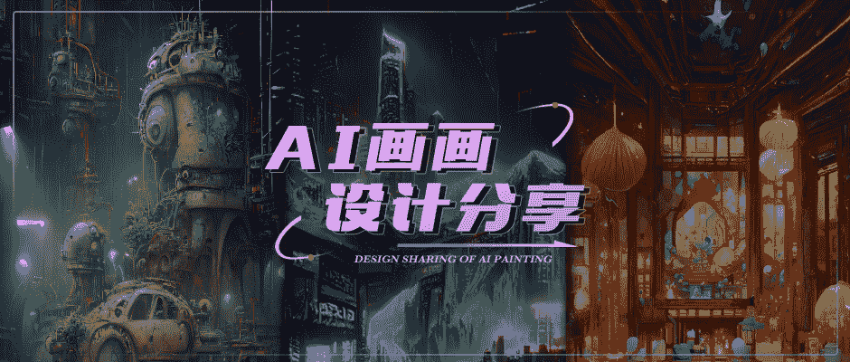
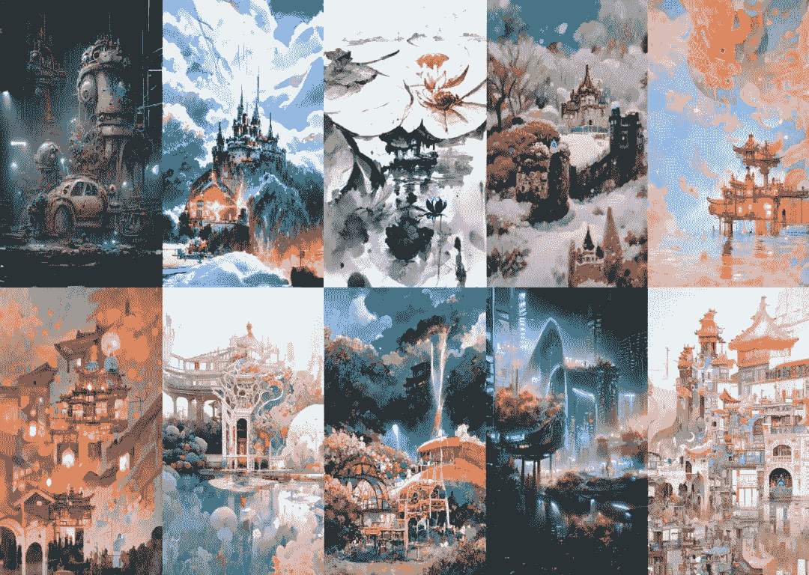
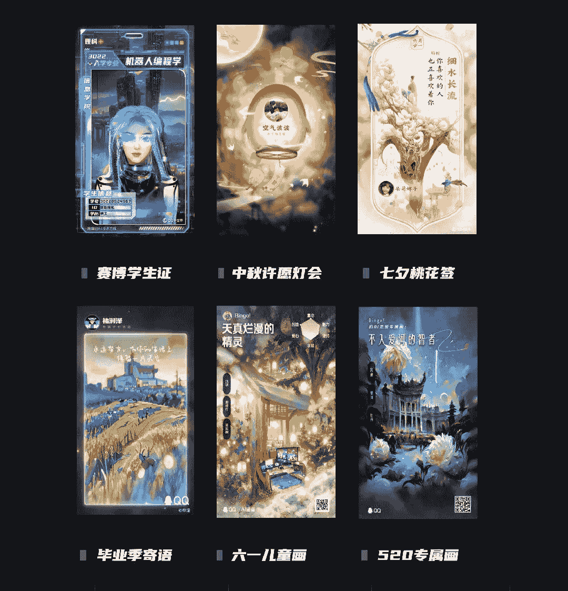
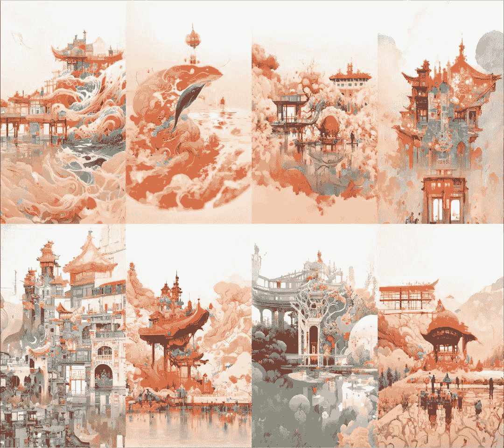
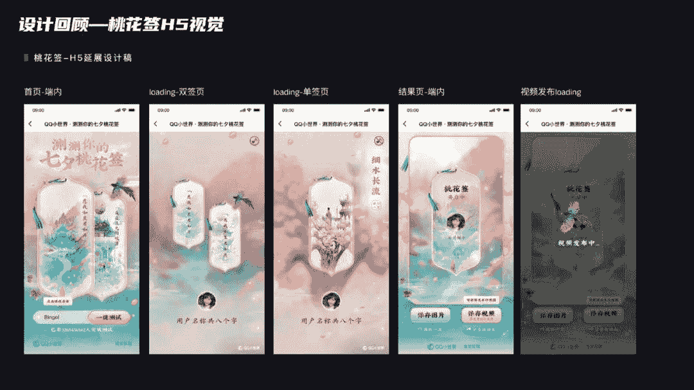
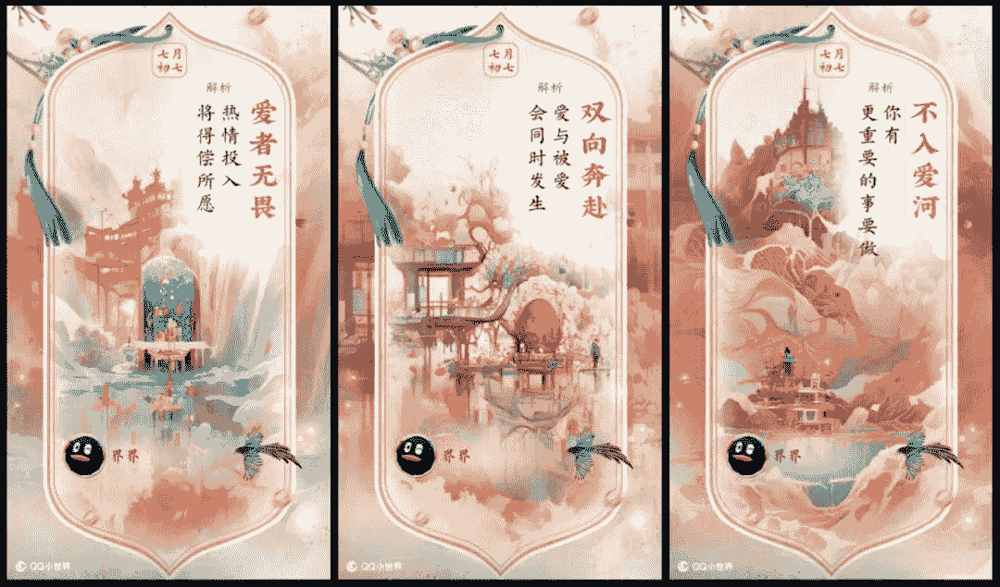

# 腾讯｜AI画画，探索机器创造力

> 来源：[https://aiyanxishe.feishu.cn/docx/O2JmdBENuopbMHx7NLDcgwITnwc](https://aiyanxishe.feishu.cn/docx/O2JmdBENuopbMHx7NLDcgwITnwc)

## **前言：**

当我们谈论画作，会醉心于印象派光影斑斓的色彩，会惊叹于国风文人画如诗如歌的构图，会震撼于画师笔下一个又一个充满想象力和创造力的世界；而当我们提及AI，脑海中浮现的是前沿深奥的大数据云计算，是冰冷严谨的逻辑思维能力。两者碰撞交织，让AI学会“通感”，AI画手们带着惊人的机器想象力和极具冲击力的刻画刷新着我们的感官体验。与此同时居高不下的热点讨论也一遍遍提出质疑：AI让艺术沦为了单纯的数据游戏，使绘画失去了灵魂。那么如何为AI创造力赋能，将其转化为视觉传达的生产力，成为设计师探索的新方向。

AI画画结果图美图欣赏

## 一、从小范围的数字艺术到千人千面的艺术感知

“用嘴画画的绘画神器”disco diffusion算法面世之后，惊人的技术迭代使得热衷探索前沿技术的设计师和艺术家们在各大平台掀起展示AI生成作品的热潮，让观者跃跃欲试。有此契机，团队构建出了开盲盒式的AI画作抽取玩法——通过用户简单点选关键词即可得到独一无二的专属艺术体验。简洁的文字信息外加一点点好运，诞生出数以万计的犹如梦境一般的画面，在QQ小世界中飞速扩散开来，为用户提供了短视频表达的新鲜方式，好评如潮。那么就让我们跟随接下来的几期活动介绍，一起感受AI呈现的独特艺术影响力。

小世界AI画画h5活动的美图展示拼图

## 二、七夕桃花签：艺术化的情感抒发助力用户传递心愿

“牛郎织女”的美丽爱情传说，赋予了七夕节日传统中式的浪漫情怀。将这份祈求美好的心绪诉诸诗词歌赋、寄情山水楼阁，团队精心打磨国风绘本、古风彩墨画等绘画风格。温润空灵的中式经典色彩搭配融合于古建筑与风景的刻画之中，AI画手为用户献上了诗意盎然意境绝佳的描绘。

国风绘本&水墨风格的Goodcase效果图展示

以桃花签作为载体，配以诗作签文，为用户带来别致的抽签体验。双签合并的解签环节，更是为用户表达感情提供了窗口。用户在发布时纷纷自主解析起画面的含义，为作品添加独属于自己的色彩。

用户输入不同的昵称，会获得不同的签文结果，带来具有惊喜感的盲盒体验。

桃花签H5的视觉展示

桃花签结果视频展示

## 三、中秋灯会：寓情于景，演绎中秋氛围

中秋节作为有着团圆美好寓意的传统节日，祈愿更加必不可少。我们以中秋灯会作为演绎情景，为用户提供沉浸式的花灯放飞环节，用户在观赏灯会夜景氛围画作的同时，也将中秋祝福分享给好友，以画会友祝福翻倍。

灯会的AI画卷以夜景为主，结合中国风的经典配色，点缀灯火以烘托花好月圆的中秋氛围。

国风绘本&水墨风格的夜景效果图展示

作为品牌彩蛋，视频包装中的孔明灯也采用了企鹅的造型，更具有创意性和QQ品牌感，并运用光效叠加、发光粒子等元素，打造热闹的中秋灯会场景。

桃花签H5的视觉展示

用户选择不同的愿望后，ai来为用户描绘带有浓郁中国风格的许愿画面，定制个性化灯会。

最后来一起看看在小世界中秋灯会许愿后的视频效果吧！

## 四、赛博朋克学生证：与AI共同畅想未来时空的开学新体验

结合AI突出的画面想象力，我们与AI画手一起，打造了更有情节代入感的开学季学生证玩法。基于AI绘制的未来学科专业的专属科幻场景，搭配以实时生成的用户动漫形象，为用户制作独特的具有科技赛博感的入学证件。

赛博朋克效果图展示

活动采用入学邀请的形式，用户可以上传自己的形象或者点选默认形象制作自己的证件，AI画会根据设定好的专业划分色系，像构建一个真正的学科体系一样，为用户打造个性化的标签，更好得让用户在小世界平台彰显自己的性格。

开学季H5的视觉展示

用户选择四个不同专业会相应获得四个不同色系的学生证结果。

除了选择默认形象外，用户还可以定制各种各样“特别”的赛博学生证。

（以下图片来自脑洞大开的小世界用户）

开学季结果视频展示

## 五、新次元房产：携手AI初探元宇宙

八大社区、上百种房型，AI勾画出了虚拟世界中的梦幻社区。用户只需要通过简单点选，即可获得“冰雪王国的独栋洋楼”、“漫画部落的花园洋房”等充满新奇元素的奇妙组合。完成选择后，系统会为玩家自动生成房产，会显示房产形象、面积以及房产价值（为小世界火箭的虚拟积分）

视频的展示将元宇宙社区氛围拉满，让用户更加期待“专属地产”向小世界数字藏品的概念转变。

## 六、春节异次元：国潮漫画华丽变身

接力异次元的我，春节档的AI作画推出了国潮漫画变身的全新风格亮点。用户上传照片之后，万物皆可在动漫的世界中享受新年的快乐气氛。平行时空里，用户收获了华美的中国风服饰，春节装备的萌宠，甚至还有浓浓节日气氛的年夜饭美食～

变身漫画以春节幸运签的方式呈现，更是为用户提供了对于新的一年美好期盼的短视频打开方式，在小世界中火热传播。

## **结语：**

随着技术的层层迭代，团队也将探索更多有趣有情节的玩法，与AI共同创作出新的整活爆款。同时我们也将继续通过活动玩法邀请用户们为AI画作赋予更多的艺术灵魂。或许不久后，AI画手将为我们带来崭新的3D艺术体验、Q萌的毛绒宠物、亦或是专属于用户的动漫演绎呢！

<https://aiyanxishe.feishu.cn/sync/IaSadpoOOsopKab1ajKcz6z3nAb>