# 京东｜IP-Adapter，新一代“垫图”神器

> 来源：[https://aiyanxishe.feishu.cn/docx/HRjWdDtGxocFb4xKQ2fcKguBnRm](https://aiyanxishe.feishu.cn/docx/HRjWdDtGxocFb4xKQ2fcKguBnRm)

不用训练lora，一张图就能实现风格迁移，还支持多图多特征提取，同时强大的拓展能力还可接入动态prompt矩阵、controlnet等等，这就是IP-Adapter，一种全新的“垫图”方式，让你的AIGC之旅更加高效轻松。

都是“垫图”，谁能还原你心中的图

“垫图”这个概念大家肯定都不陌生，此前当无法准确用prompt描述心中那副图时，最简单的办法就是找一张近似的，然后img2img流程启动，一切搞定。

可img2img简单的同时，也有它绕不过去的局限性，比如对prompt的还原度不足、生成画面多样性弱，特别是当需要加入controlnet来进行多层控制时，参考图、模型、controlnet的搭配就需要精心挑选，不然出图效果常常让人当场裂开…

但现在，我们有了新的“垫图”神器——IP-Adapter，在解读它之前，先来直观的感受一下它的效果。

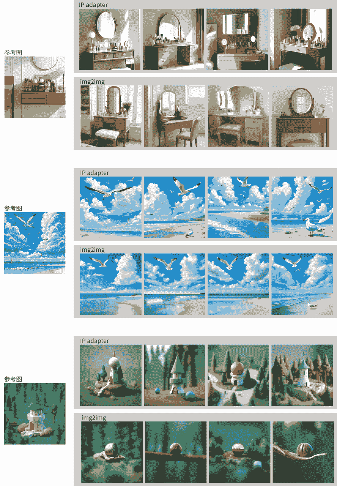

效果可以说相当炸，那IP-Adapter就是终极答案了么？它的泛化性如何？兼容性是否足够？对prompt支持怎么样？当真的要接入现实工作中它还有什么拓展的能力呢？让我们一一来看。

IP-Adapter的核心优势，只画你关心的事

IP-Adapter和img2img虽然在操作上都是“垫图”，但它们的底层实现可以说是毫无关系。

用个不严谨但好理解的例子，“IP-Adapter”和“img2img”就是两位画师，现在给出prompt要求它俩画一个男人，在不提供参考图的情况下，它们大概都会画成图1的模样，但是当我们加上参考图2的时候，两者的区别就显现了。

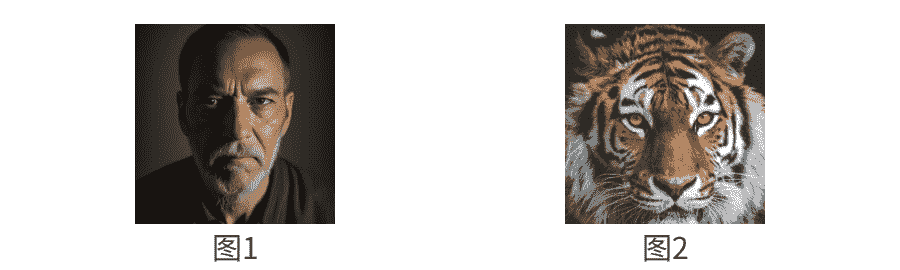

img2img相当于直接盖在参考图上开始临摹，虽然知道要画个男人，但会在老虎的基础上去修改，始终会很别扭，中间不免出现老虎和男人混淆的情况，画出一些强行混合不知所谓的图来。因为在这个流程中，参考图更为重要，一切是在它基础上画出来的，结果也更倾向于参考图。

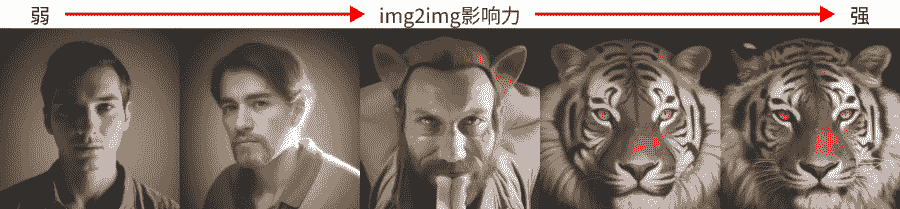

IP-Adapter则不是临摹，而是真正的自己去画，它始终记得prompt知道自己要画个男人，中间更像请来了徐悲鸿这样的艺术大师，将怎么把老虎和人的特点融为一体，讲解得偏僻入里，所以过程中一直在给“男人”加上“老虎”的元素，比如金黄的瞳仁、王字型的抬头纹、虎纹的须发等等。此时，prompt更为重要，因为这才是它的始终目标。

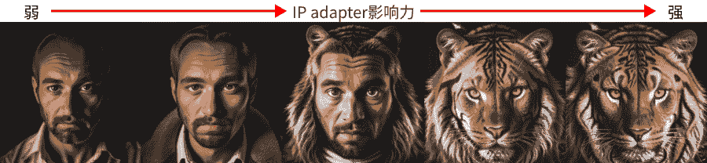

当然这些都是在一定的参数范围内，超过了阈值，那必然是要走极端的，照着参考图去copy了。但即便这样也可以看到img2img只是1:1的复制，而IP-Adapter有更多prompt的影子。

把简单的“垫图”，拓展得大有前途

在理解IP-Adapter的逻辑之后，会发现它带来的改变可不只是“垫图”，这里先展示一下它在我们工作中的实例，然后再和大家一步步的去拆解它。

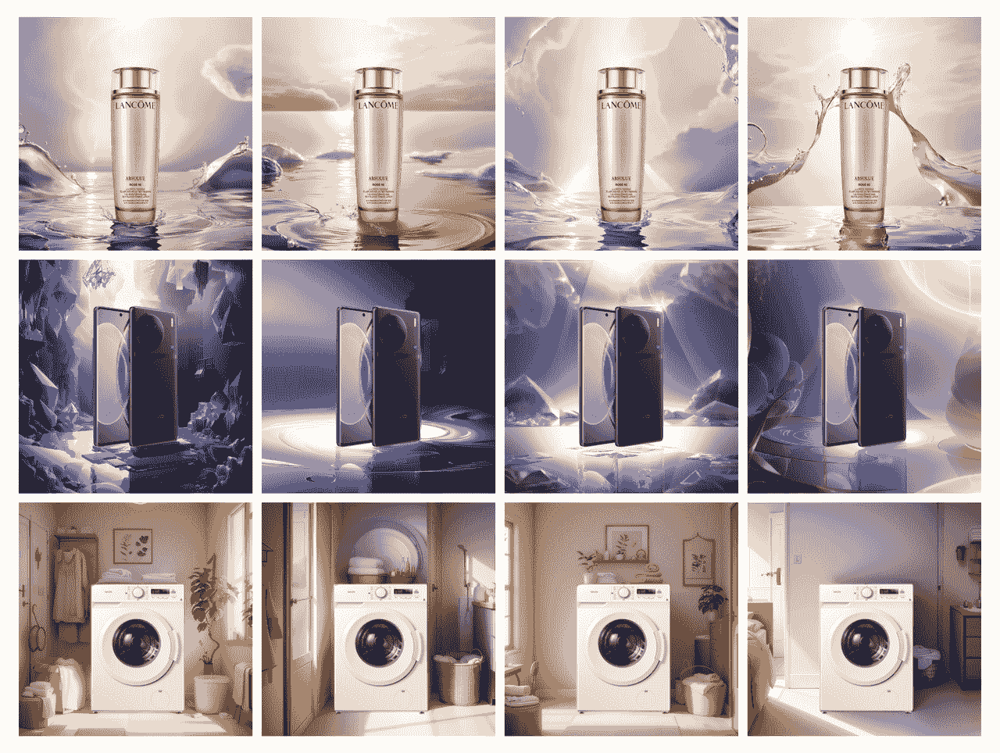

以上这些效果实现很简单，只需要添加两层controlnet，一层用来提供IP-Adapter，一层利用canny用来对需要添加的商品进行绘制、固化即可。

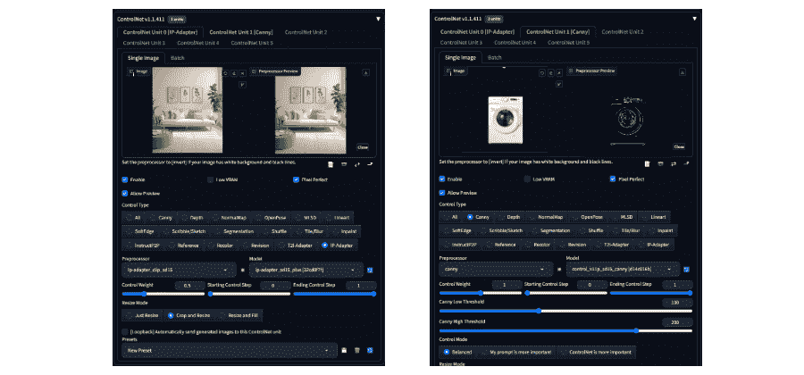

如果只是在webui中应用，那到这里其实已经ok了。但这次我们要更进一步，利用新工具，去实现更有创造力的能力。

以下重点想分享的更多是工程搭建的能力和效果（具体的方法，我们会放到以后详细的讲解）：

① 一张图就是一个lora，大大降低了训练的成本

② 多参考图接入，提供更丰富的生成结果

③ 利用对prompt的强注意力，提供prompt matrix丰富结果

④ 基于comfyui的工作流部署，实现多步骤自动化生成

以往要想实现一个具体的设计风格，需要针对性的训练lora，背后涉及训练素材的搜集、打标、模型训练、效果检验等多个环节，通常要花一两天，并且结果还存在很强的不确定性。

但现在，通过IP-Adapter这一个步骤，在几分钟内就直观的看到结果，大大节省了时间，敏捷程度简直天壤之别。

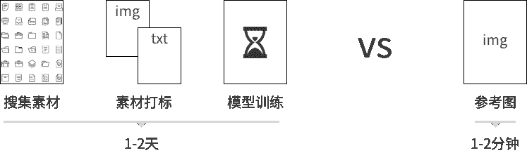

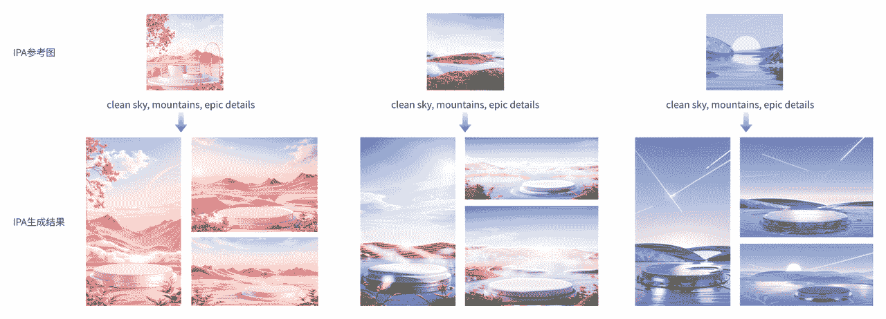

**当我们拥有这些特征，几乎就得到一个“即时lora”，而需要**付出的成本只是去找几张符合预期的参考图。

同时IP-Adapter还能一次读取多张参考图，让生成的结果拥有更丰富的多样性和随机性，这是在img2img流程中无法实现的，也是两者之间区别最大的地方。

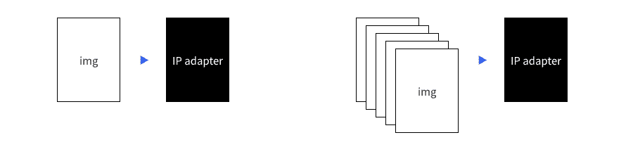

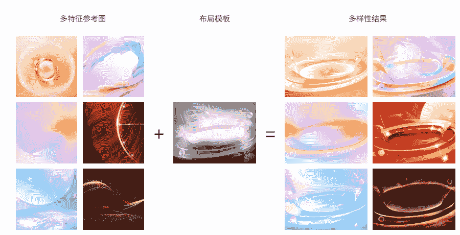

此刻，让我们把思路再打开一些，因为IP-Adapter对prompt的强注意力，prompt中的信息能更直观的反应在结果中。于是我们可以在继承img风格的同时，通过替换prompt里面的关键词，指向不同的结果，形成prompt的组合矩阵，更进一步的拓展生成结果的多样性。

更进一步，再加入不同的controlnet和批量素材读取，来实现对生成结果的可控引导，以及利用批量读取能力，来提供更加丰富的模板。一套”0成本即时lora + controlnet可控生成 + prompt matrix多样生成“的自动化流程就搭建完成了。

这个流程我们已经用在项目中，至于效果，大家的反馈概括为一句话就是——一键三连。

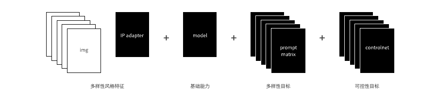

下面这张图就是上述流程部署在实际工作中的样子，载体是comfyui，它和webui都是基于stable diffusion能力，但和webui的网页化界面不同，它将SD的能力分解成不同的节点，通过节点关联搭建来实现各种功能。所以更加开放、自由、多源，并且可以实现流程的自动化，极大的提升了实际应用中的效率，下一期我们会专门针对它来进行解读。

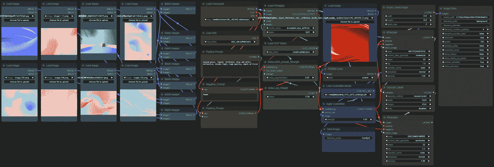

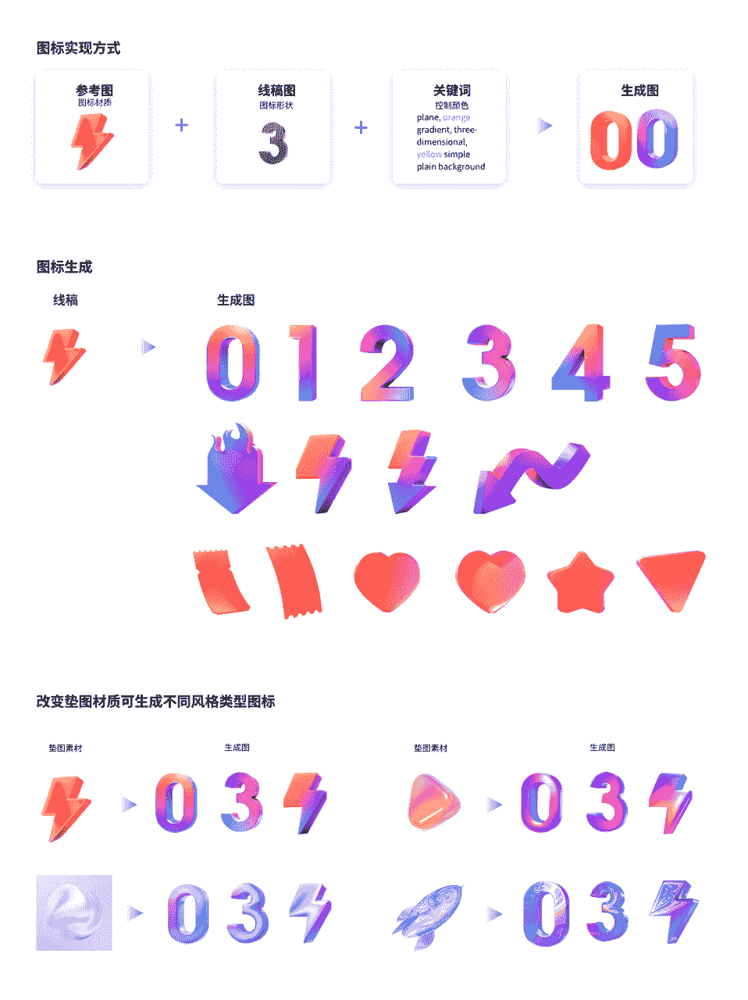

到这里，关于IP-Adapter背后的原理和应用就整理完了，它有非常多的优点，但也非常需要结合实际的场景来应用，还是那个观念，没有最好的方法，只有适合的方法。

希望大家用的开心，有什么想法建议，十万吨的欢迎，我们下期再见。

这里是枯燥的分割线

**

有点无聊，但也很有得**聊

看过它的表现的效果之后，再从底层原理看看IP-Adapter到底有什么特别。

我们知道stable diffustion是扩散模型，它的核心作用机制就是对噪音的处理，prompt可以看做是我们的目标，通过不断的去噪过程，向着目标越来越靠近，最终生成出预期的图片。

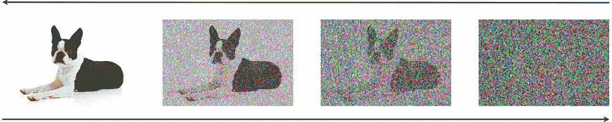

IP-Adapter则是将图片单独提出作为一种提示特征，相比以往那种只是单纯的把图像特征和文本特征抽取后拼接在一起的方法，IP-Adapter通过带有解耦交叉注意力的适配模块，将文本特征的Cross-Attention 和图像特征的Cross-Attention区分开来，在Unet的模块中新增了一路Cross-Attention模块，用于引入图像特征。

相当于将原本SD中img和prompt拼合成一个向量的做法分开来, img和prompt都会单独的组成向量, 然后交给unet层, 这样img中的特征就可以更好的被保留下来，从而实现对图像特征更显性的继承和保留。

本质上IP-Adapter就是txt2img的流程，流程中prompt还是最关键的，只是中间利用IP-Adapter强化了参考图的提示作用。

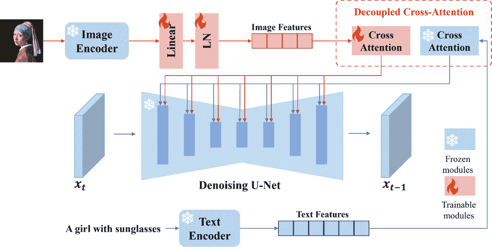

作为对比，img2img是直接将参考图传入unet，去替换了原始的随机噪音，这样所有的生成结果都是建立在它的基础上，于是有了前面人和老虎混杂的现象就比较好理解了。

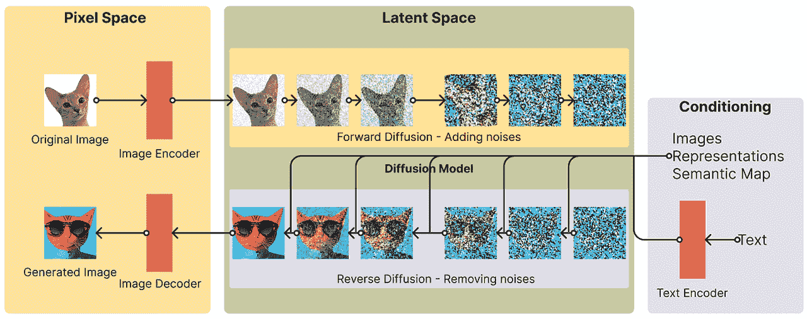

以上，真的结束了。see you soon

<https://aiyanxishe.feishu.cn/sync/IaSadpoOOsopKab1ajKcz6z3nAb>