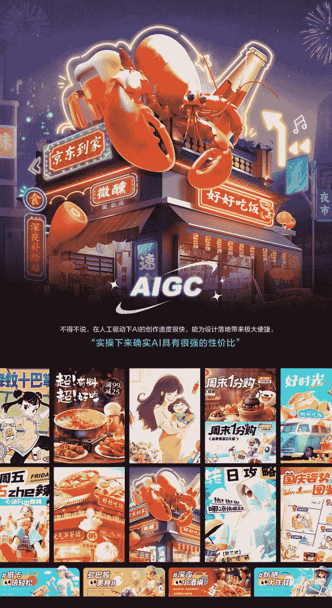
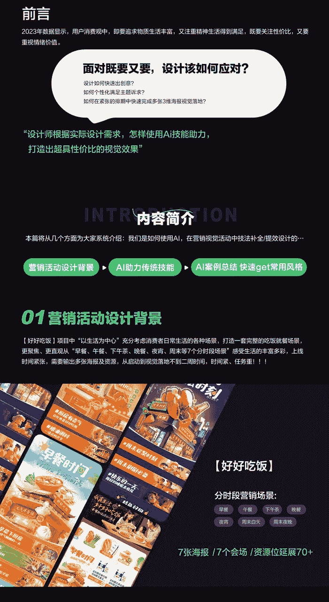
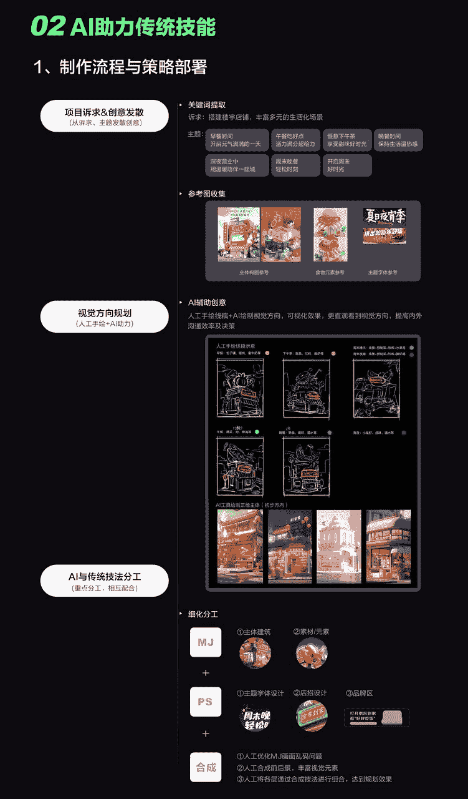
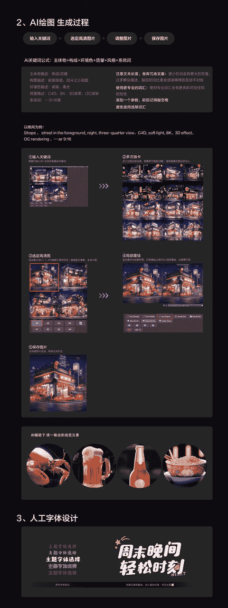
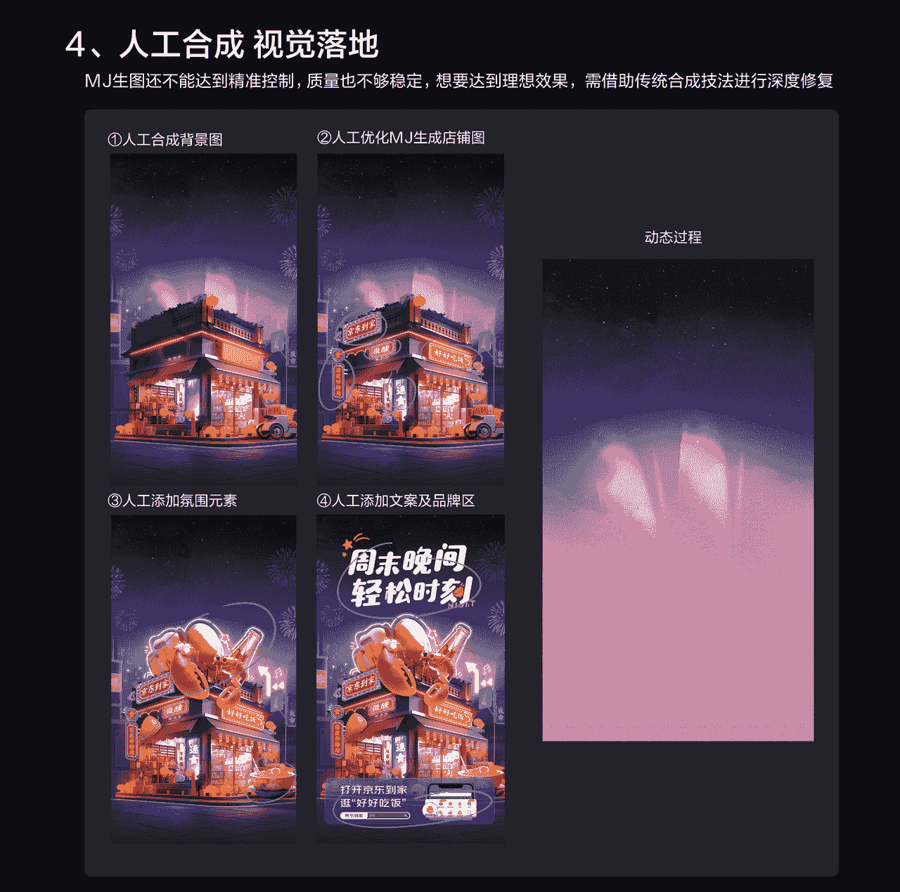
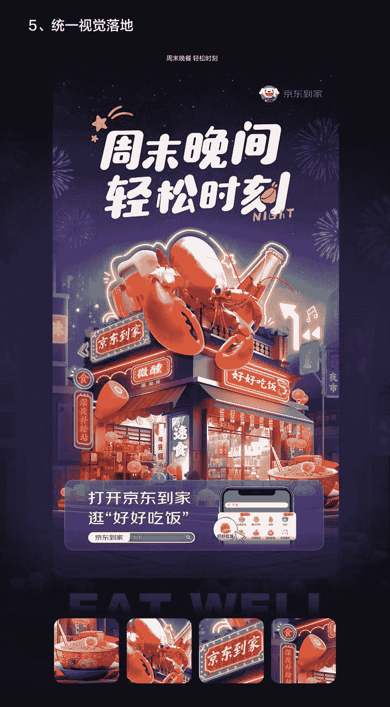
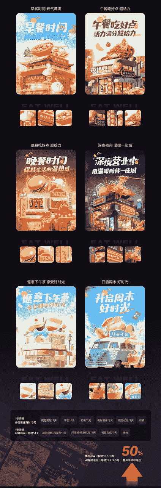

# 京东｜京东到家AIGC实践案例总结

> 来源：[https://aiyanxishe.feishu.cn/docx/GyvCdtWK0oYfyNxDWvqcgywZnsb](https://aiyanxishe.feishu.cn/docx/GyvCdtWK0oYfyNxDWvqcgywZnsb)

现阶段，AIGC在设计行业的影响速度非常快，大环境背景下，我们在营销设计上也不断使用AI助力。AIGC设计流程中，想精准落地视觉需要结合传统设计手法，相互配合。 那么对于设计师来说，想要提高工作效率，掌握AIGC能力也是必然的！！

#

#

#

<https://aiyanxishe.feishu.cn/sync/IaSadpoOOsopKab1ajKcz6z3nAb>