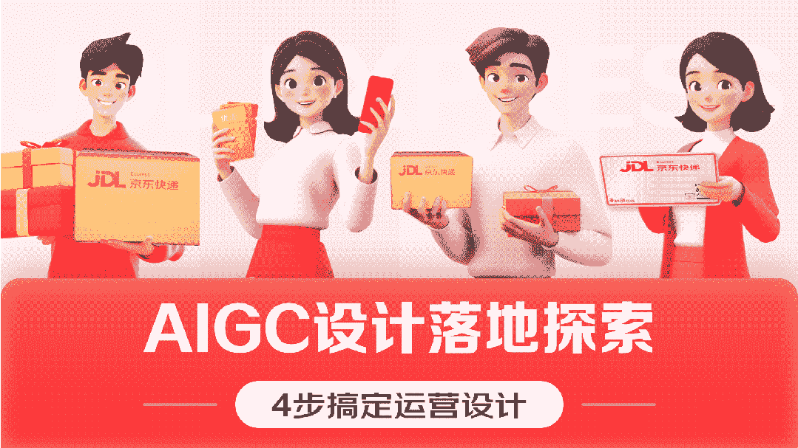
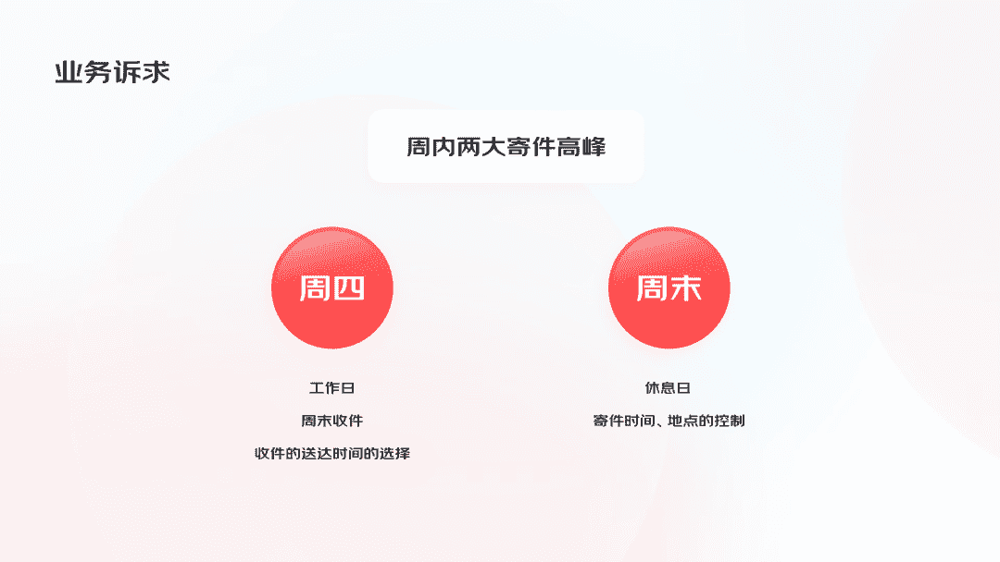
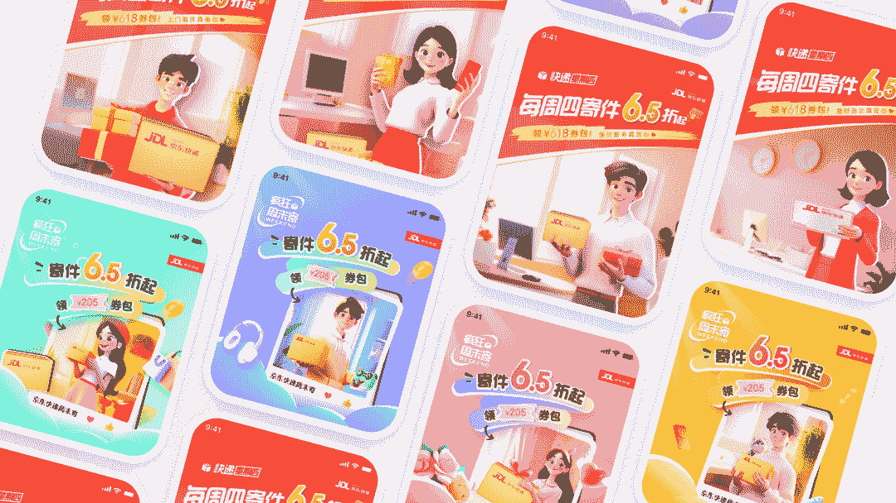
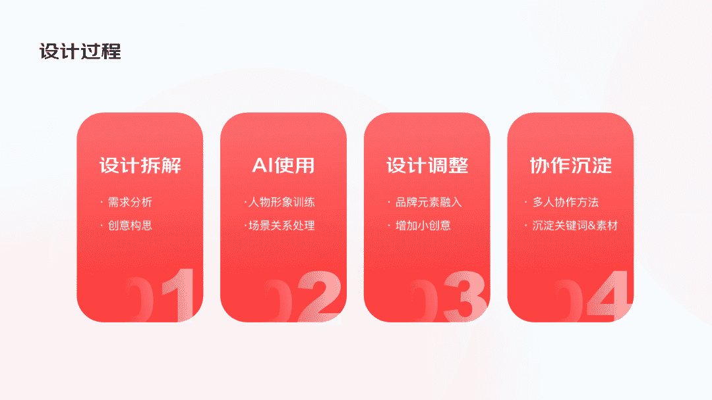
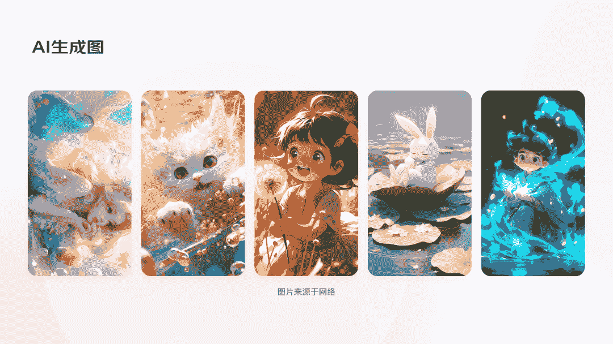
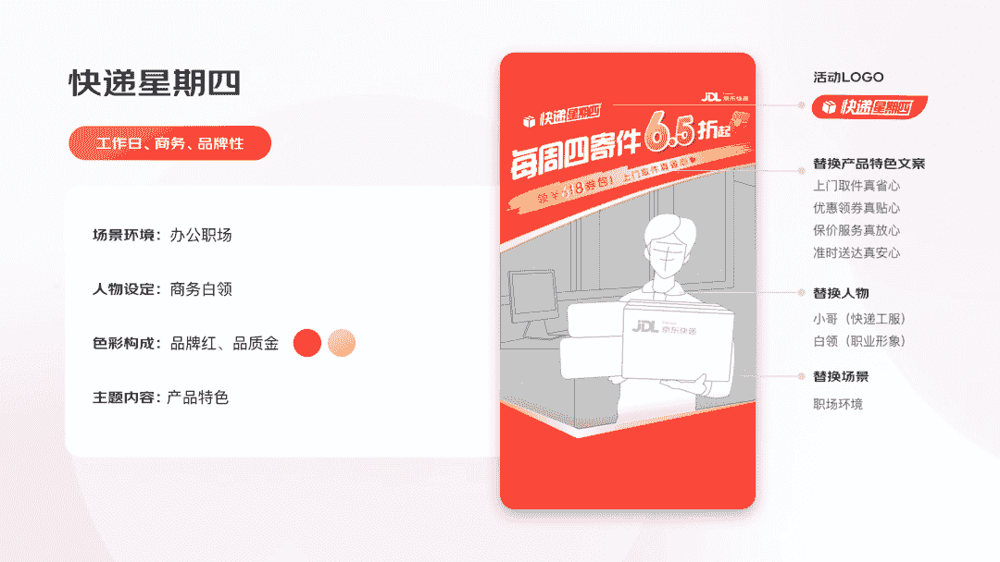

# 京东｜AI助力，4步搞定运营设计

> 来源：[https://aiyanxishe.feishu.cn/docx/SuLmdrd0qovYPfxtBXxc20zdnOg](https://aiyanxishe.feishu.cn/docx/SuLmdrd0qovYPfxtBXxc20zdnOg)

8月初，我们团队同时接到的快递快运事业部【快递星期四】【疯狂周末寄】的业务需求，从数据分析，周四与周末分别是一周内的两个寄件高峰，也对应不同寄件场景。经分析周四的寄件高峰源于周末收件人可以收到快递，是对收件的送达时间的选择；周末的寄件需求则更多是受寄件时间、地点的控制。因此业务同学提出这两个主题，希望以用户寄件场景，通过活动运营吸引用户提高优惠券核销率，提升单量。

由于更新频率本身较高，且一周内需要周四、周末两个主题，加上日常活动主题的更新，排期较为紧张，给设计工作带来了一定压力，我们决定此次活动使用AI辅助设计以提高效率。AI无疑是今年设计圈的大热话题，从年初开始可以看到越来越多的应用于实际项目中，在此之前我们已经进行了一段时间的学习交流，并在项目中开始小范围应用，这次是大家正式配合使用，活动最终也取得了不错的效果，用户数据有明显提升。

现在网络上已经能找到很多优秀的Midjourney、Stable diffusion的基础教程了，所以这次我们主要分享的是使用AI助力落地项目的设计过程与思路，具体分为以下四个步骤：设计拆解，AI使用，设计调整，协作沉淀4步。

#

# **设计拆解**

---AI生成≠不思考

随着AI在设计工作中的大量使用，不断生成令人惊艳的画面效果，人们对此也产生了不同看法。有些人觉得AI的出现，让设计师甚至是非专业人员都可以简单高效的完成设计工作，轻松获得自己想要的方案，是对设计生产力彻底的解放。有些也为前路担心，恐惧焦虑自己是否会变得没有价值，终将被AI取代…

确实现在通过Midjourney、Stable diffusion等工具，能够比较轻松获得一张美图，前提是主题、要求等比较宽泛，没有特殊限定。但往往真实项目中，会存在更多特定要求，有各种条框束缚，设计师需要在限定内发挥让设计方案与需求契合，其实并不如想的那么容易。在各种限制内找到最优解，需要我们在设计开始之前，进行分析与思考，将业务需求转换为设计方案，AI的辅助反而是为我们提供了更多思考的时间与尝试的机会，让接下来的工作更加顺利。

以【快递星期四】【疯狂周末寄】为例，我们的拆解过程是这样的：

**快递星期四：**由于周四工作日的属性，我们将其定位于商务办公场景，向用户传递产品的商务属性与品牌性，由此推导出活动视觉的色彩构成，人物形象等。并提炼了“上门取件真省心、优惠领券真贴心、保价服务真放心、准时送达真安心”的产品特性为主题，设计系列视觉。

**疯狂周末寄：**时间点为周末，场景更多为温馨的居家场景，我们对其的定位为向用户传递产品温度，用户群体设定也偏年轻。与周四的商务风格不同，更加贴合生活场景，强化场景代入，选择热度高的购物、电玩、爱情、萌宠等主题。因此色彩设定使用吸睛的多巴胺色彩，抓人眼球，并以当下年轻用户喜爱的“打卡”为表现载体，设计系列视觉。

# **AI使用**

---是设计师的好工具

有了以上完整的设计构思，AI可以说是设计师的完美助力，帮助我们在短时间内完成了两组系列视觉。两组视觉都以Midjourney生成，在使用过程中不可避免的也遇到了一些问题，这里也分享一下我们的解决经验。

## **·人物形象稳定输出**

在刚开始使用Midjourney生成人物时，我们遇到了各种问题，生成出来的形象总是不太理想，相信也是大多数人在刚开始使用时都遇到的问题。

如何更好的将人物“本地化”符合国内的审美风格，生成一套符合我们要求且较为稳定的视觉风格呢，喂图训练是不可缺少的。与AI的磨合过程中，这里我们把每一次觉得可用的图存下来，不仅作为下一次垫图的资源，AI也会记录这些偏好，逐渐调整使人物的面部轮廓、年龄动态、视觉风格。

这个过程中固定出一个较为稳定的关键词结构以生成形象，并以此为基础，继续衍生拓展，缩短每次成功出图时间，生成更多符合我们要求的图片。

固定关键词：a Chinese young man in a shirt，holding a box，being happy，broad smile，clean background，clay, blind box toys，bryce 3d，best quality, 4K。以这组关键词及基础人物垫图，替换人物动作描述，生成出星期四活动中需要的一组人物形象。

## **· 场景空间与人物关系**

在图片生成过程中，我们遇到的另一个问题是，人物与场景关系的处理。场景的简繁和色调在与人物融合在一起时，调整起来花费大量时间精力。

我们在经过尝试过后，决定将背景与人物、元素等分开生成，后续设计处理拼合。这样就把一个复杂关系的场景简化为多个单一元素，降低了生成难度，变得更加灵活，出图速度与画面整体的可控性都得到提升。设计师只需要再生成过程中，注意每组素材的风格保持统一，色彩搭配和谐即可。

# **设计调整**

---后期调整不能少

有了完整的构思和相应的设计素材，不能少的还有我们后期的处理调整，这是保证设计统一性与完整性的关键步骤，在这个步骤我们也加入独特性，是让AI变得不那么AI的过程。

## **· 品牌元素融入**

人有了名字的那一刻，就与世界上其他千千万万的人区分开，拥有了自己的独特性。AI生成每天生成的图片也千千万万，要让它与我们产品更加契合，当然需要赋予它更多的品牌元素，为它增加更多品牌视觉。除了品牌色、品牌LOGO的使用，融于画面本身的元素也是重要的一环，图中快递箱、快递信封、小哥的着装都是通过后期处理完成的，让我们的视觉更加品牌定制化。

## **· 增加小创意**

虽然是系列视觉，但也可以来点不一样的。在周末寄萌宠主题的视觉中，我们将点赞的大拇指变成了猫咪的爪印，做出了一点小改变，让萌宠主题更加鲜活有趣。

善于发现突破制式的限制，任何时候都可以融入小巧思，为自己的设计增加一些趣味灵动。

# **协作沉淀**

---团队的力量

两个项目中涉及到的素材，由我们团队中小伙伴合作生成，做到了多人风格的统一，最终形成系列视觉，这与我们紧密的交流配合是分不开的。过程中小伙伴们一起讨论，沉淀统一设置参数与关键咒语，选定统一源图，保持相同步调，分享扩充有效垫图，逐渐积累了我们的AI素材库，形成了团队有效的设计资产。

有固定的关键词与源图，多人合作产出一组风格统一的默认用户头像。

我们也逐渐将AI应用于更多项目，有效提升了设计效率。

# **结语**

AI的出现帮我们提升了工作效率，为设计师解放了很多“手”的能力，或许不久的将来也会为我们解放更多“脑”的能力。但我们不能放弃的也是“脑”的能力，即使唾手可得，也应该保持独立的思考，求新求进，在任何环境下都不放弃孜孜以求，躬耕不辍…

<https://aiyanxishe.feishu.cn/sync/IaSadpoOOsopKab1ajKcz6z3nAb>