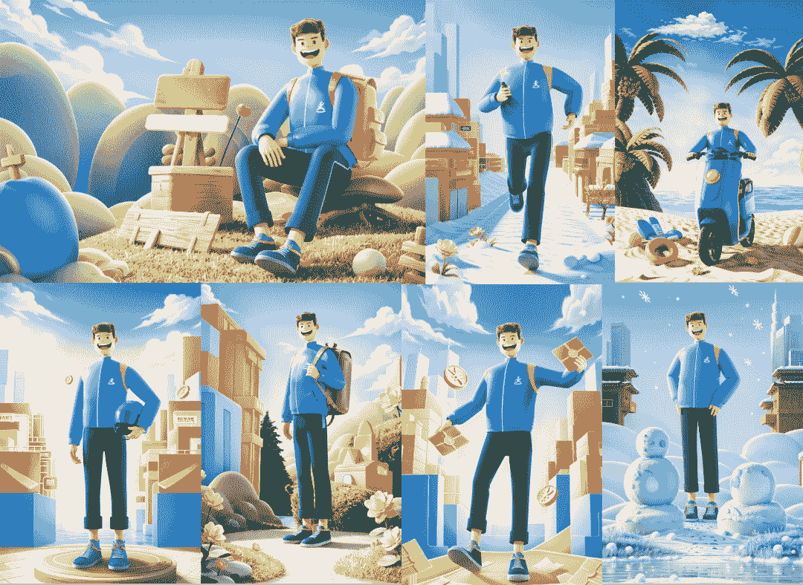
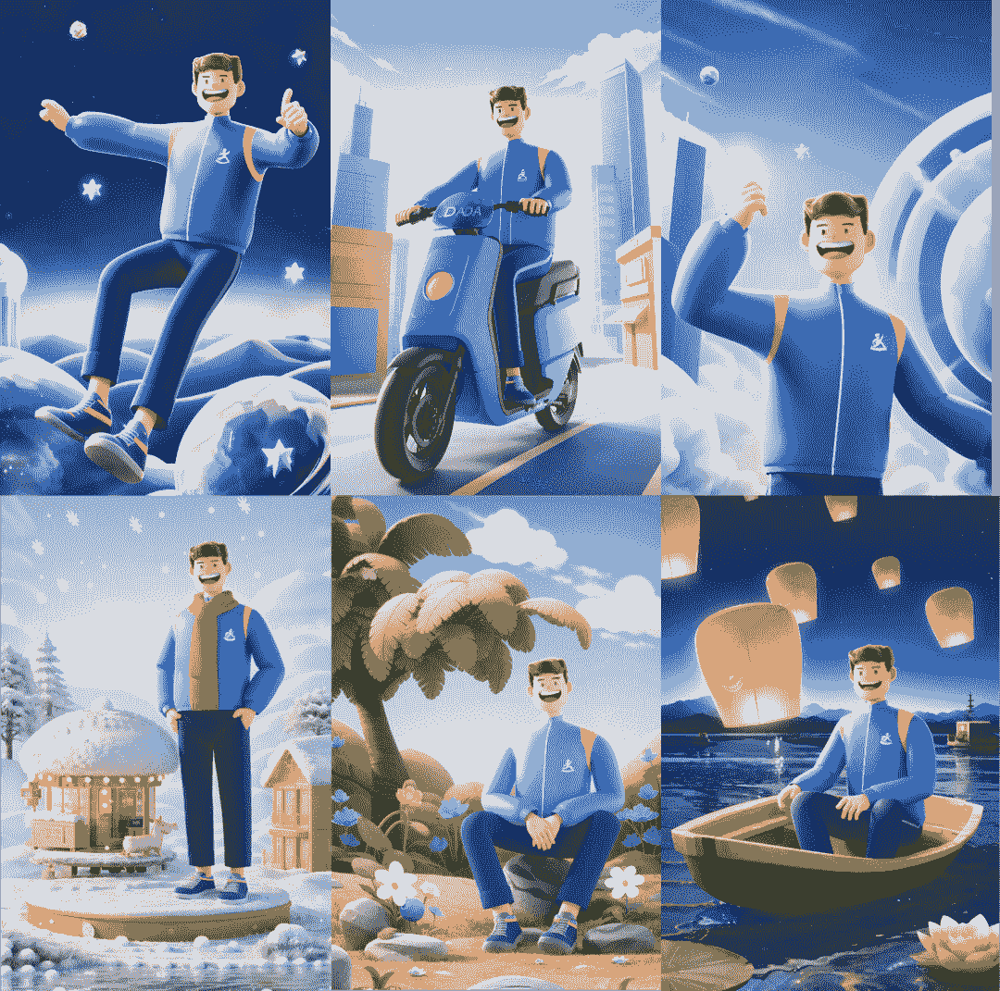
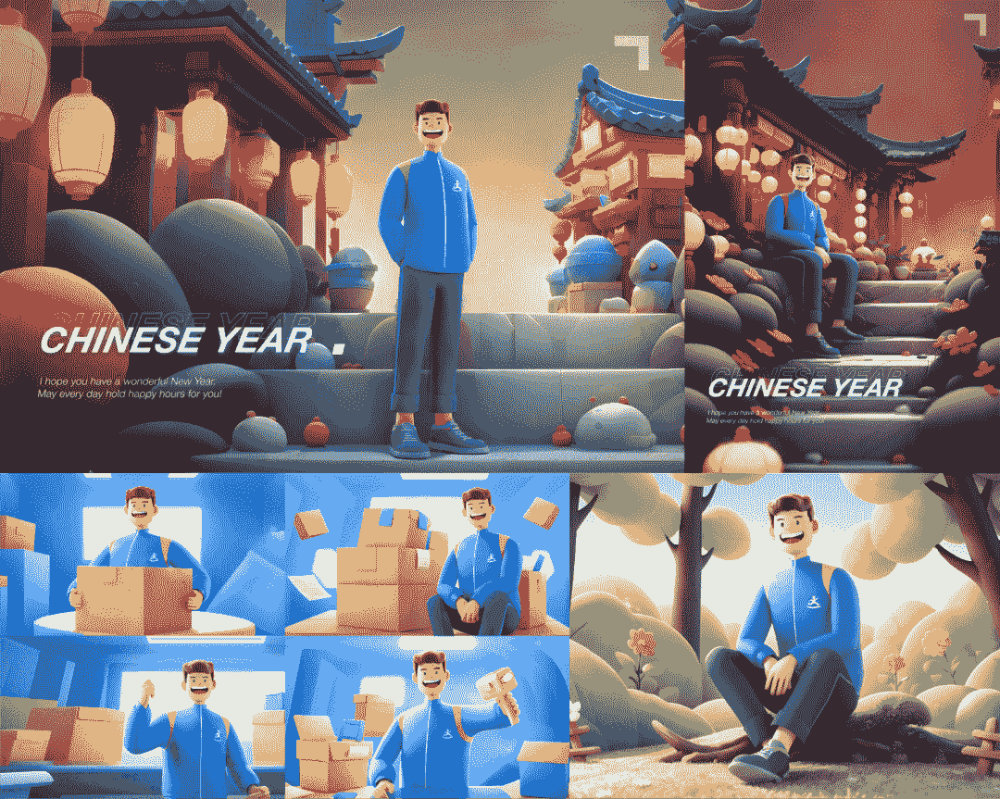
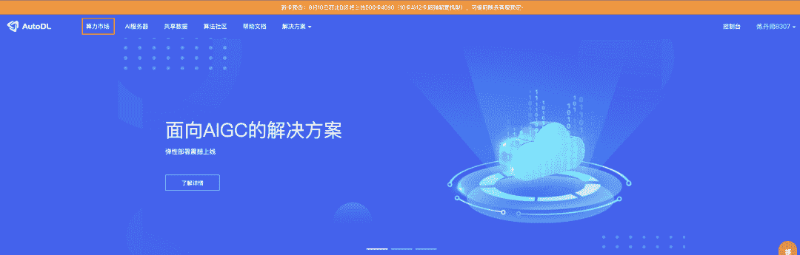
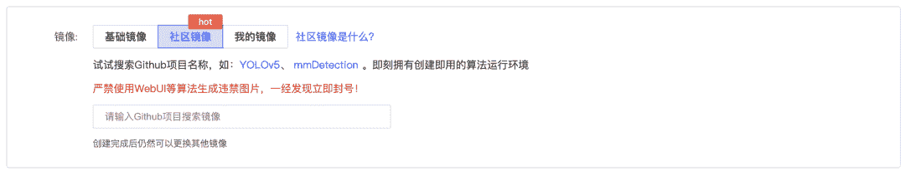

# 京东｜只要10秒，AI生成IP海报

> 来源：[https://aiyanxishe.feishu.cn/docx/DgJ3dpQwboYnP8xnEWBcJNFhnpr](https://aiyanxishe.feishu.cn/docx/DgJ3dpQwboYnP8xnEWBcJNFhnpr)

看完这篇文章，你将学会以下价值连城的内容

1、云端部署（配置不行的小伙伴看）+ 云端模型放置位置

2、本地部署（配置达标的小伙伴看）

3、运用SD训练IP的流程和技巧（LoRA篇）

4、运用SD稳定生成高质量IP海报

众所周**知，各大厂目前都在**AIGC的领域探索实践，也有非常多的外部设计师制作了大量的AIGC相关授课，很多同学因为不清楚具体能得到什么价值或者收获而停止了脚步。今天我来为大家分享一下经过实际探索且落地的Stable diffusion的IP海报生成流程，内容很干请上车坐稳

# 📌 先来看一下达达骑士IP的效果：

**· V1模型生成**

**· V2模型生成**

**· V3模型生成**

**1、云端部署**

应**该有很多小伙伴苦于没有一个**趁手的电脑配置，以及繁琐的本地配置，最终卡在了配置这个环节，今天我将带大家完成SD的云端部署，看完你就能完美的打开SD了

1、打开云端地址：https://www.autodl.com/home

1、注册登陆后，点击算力市场

2、选择按量计费、内蒙A区（注：不要选北京区可能需要SHH企业打开的问题）

3、点击社区镜像

4、输入搜索关键词vel，找到并选择最新stable-diffusion镜像

5、点击立即创建

6、命名自己的服务器，等待创建完成和开机

7、点击JupyterLab，进入MainUI.ipynb

8、左侧目录下，打开MainUI.ipynb，点击第一**行代码区域，然后点击上方的**“运行”三角，显示“移动完成”后刷新页面

9、将右上角python 3，改为xl_env

**10、点击第二行**代码区域，然后点击上方的“运行”三角，等待功能模块出现

11、选择“启动WebUi”，然后**勾选前4个常**用功能，点击运行WebUi，等待代码运行

12、当看到蓝色的URL时，则表示运行成功了，然后返回AutoDL下自己的服务器

13、点击“自定义服务”，**恭喜你成功进入云端SD了**

**2、云端基础模型的放置位置**

1、大模型放置位置：dutodl-tmp——stable-diffusion-webui——models——Stable-diffusion

2、lora放置位置：dutodl-tmp——stable-diffusion-webui——models——Lora

3、VAE放置位置：dutodl-tmp——stable-diffusion-webui——models——VAE

4、ControlNet模型放置位置：dutodl-tmp——stable-diffusion-webui——extensions——sd-webui-controlnet——models

5、起手式位置：dutodl-tmp——stable-diffusion-webui

**

2、本地部**署

秋葉Stable diffusion一键包

百度链接https://pan.baidu.com/s/1A4xSvlLHUJ8uplOc7WjZqg；提取码：sejt

夸克链接：https://pan.quark.cn/s/1dd4f17b3504；提取码：yBRx

3、运用SD训练IP的流程和技巧（LoRA篇）

**先来介绍一下什么是LoRA**

大家刚接触stable diffusion时，会听到很多专业术语，其中LoRA模型必定是会被提及到的，那么什么是LoRA模型？它有什么作用呢？

LoRA模型全称是：Low-Rank Adaptation of Large Language Models，可以理解为Stable-Diffusion中的一个插件，仅需要少量的数据就可以进行训练的一种模型。在生成图片时，LoRA模型会与大模型结合使用，从而实现对输出图片结果的调整。

举个例子：大模型好比没有修饰过的人物、物品、场景、等；LoRA模型好比是改变人物、物品、场景等内容的形色质构的因素，但仍然在大模型的底子下。当然LoRA模型不仅仅限制于人物，场景、动漫、风格。

###

### **1、训练环境的搭建**

· 本地：可下载秋葉SD trainer训练器一键包

· 云端：AutoDL云端配置，社区镜像中找到Train进行部署

###

### 2、训练集处理（图片处理+打标+训练参数）

#### **· 图片处理**

· 首先我们需要准备训练的IP（也可以是**：物**品、场**景、风格等**），训练图的尺寸需要统一，且以64的倍数设置：常用分辨率为512*512、512*768、768*1152。因为如果尺寸不统一或不是64的倍数，AI在训练过程会对你的图片进行裁切，导致你想要的画面细节被裁减

· 其次我们需要有3种类型的图：白底IP图+场景IP结合图+单独场景图，整个训练集的数量可以有多少准备多少，越多越好（但是要保证差异性，重复的动作或角度需要剔除）

**· 打标**

· 当我们准备好需要AI训练的图以后我们需要对这些训练图进行描述，可使用自动打标工具或手动打标（手动打标训练效果会更好） ，准备一个txt文本（保证和你描述的图片命名一一对应），然后进行详细的描述，以下是我的一些举例：

· 在打标描述里需要注意格式：我们常用的格式是“触发词”+“自然语言”+“单词”，并且保证全程英文输入，包括标点符号

**3、模型训练&参数设置**

（注：这里的参数需要根据自身训练的IP或内容进行调优，存在是错成本，这里给大家科普一些基础）

· 补充2个概念：欠拟合、过拟合

· 过拟合：指AI只会生成你给他提供的训练集内容，比如IP动作、场景、元素、等

· 欠拟合：指AI生成的内容和你训练集的内容完全没关联，或者说收敛性很差导致IP不像

**· 基础训练参数**

• repeat次数（每张图训练的次数，次数不是越高越高，训练太多会导致过拟合，训练太少会导致欠拟合）

• epoch训练轮数（训练集训练的轮数，轮数不是越高越好，训练太多会导致过拟合，训练太少会导致欠拟合）

• dim值（dim代表了训练的精度）

• alpha值（alpha用于控制模型复杂性和约束性，alpha 必须≤dim）

• learning rate、unet lr、text encoder lr（学习率决定模型学习的程度，影响训练效果，比如稳定性、泛化性、收敛性）

• 训练优化器（自适应优化器和非自适应，决定了AI学习节奏）

**· 训练过程中的观察**

· 需要观察训练的Loss值，Loss值需要成递减状态（正常状态），曲线波动不易较大。并且需要记录每一次训练的参数和Loss值来分析后续模型调优的方向

**4、模型测试**

· 模型测试阶段，我们需要启动SD，并且运用XYZ轴来测试每个版本的模型搭配的LoRA权重，以及大模型，最终沉淀出我们最优版本的模型。

· 在测试阶段我们需要围绕着3个核心的点：稳定性、泛化性、以及收敛性进行测试

· 稳定性：模型是不是在大多数prompt输入下，都能够出现好的效果

· 泛化行：生成的内容是不是有AI创新的内容（动作、场景、元素、等）

· 收敛性：生成的IP以及特征（或其他核心内容）是不是你想要的效果

4、运用SD稳定生成高质量IP海报

**1、模型&提示词**

· 生成环境模型主要包括3类，底模、LoRA模型、以及VAE（可以理解为滤镜），我们可以尝试各种不同的大模型，比如二次元的anything、目前用的最多的Rev、或者真人类的real

· 提示词分为2部分，正向词为你想要的内容，负向词代表你不想要的内容

· 正向词：会出现3种类型：触发词+提示词+LoRA，越靠前的词汇权重就会越高

· 在生成出好的效果后大家可以对自己的prompt进行保存

**2、采样方式**

· 简单来说，这些采样器是算法，它们在每个步骤后获取生成的图像并将其与文本提示请求的内容进行比较，然后对噪声进行一些更改，直到它逐渐达到与文本描述匹配的图像

· 常用的采样器如：Euler a、DDIM、DPM++系列，可以根据自己模型来调整尝试出最好的参数

####

#### **3、采样迭代步数**

· SD通过从充满噪点的画布开始创建图像，然后逐渐去噪以达到最终输出。Steps就是控制这些去噪步骤的数量。通常，越高越好，但一般情况下，我们使用的默认值是20个步骤，这其实已经足以生成任何类型的图像

· 如果在测试新提示希望快速得到理想的构图或结果，可使用15-20steps

· 当找到确认的seed后，可将步骤增加到20-30steps

**4、面部修复**

· 面部修复可改善脸部特这个以及细节，让人脸更自然和美观，建议当找到确认的seed后打开

#### **5、高清修复**

· 通过使用算法,AI可以首先在较低的分辨率下对图片进行部分渲染,然后将其提升到高分辨率，并在高分辨率下添加细节，建议当找到确认的seed后打开。

· 常用高清算法如：R-ESRGAN 4x++

**6、重绘幅度**

· 可以理解为AI在创作过程中的发散幅度，越高的值会带来越大的创意，反之会更精准。

**7、随机种子**

· Seed可以理解为你生成图的身份ID，每个生成图都有自己的seed，当确认了基础构图以及想要的基础效果后锁定种子，从而完成微调

**8、尺寸、批次、批数**

· 尺寸：一般会以64的倍数去递增，常用尺寸在前期确认seed之前会用到512*768，512*512，等

· 生成批次、每批数量：每批、每次次生成的图像数量，建议在前期找画面之前可以开大数量去抽卡，找到自己想要的画面，然后锁定seed

9、点击生成，完成IP海报（记得记住&保存自己的参数模版）

到这里我们整个流程就走完了，接下来我们就可以不断的生成和创新我们的IP海报了

<https://aiyanxishe.feishu.cn/sync/IaSadpoOOsopKab1ajKcz6z3nAb>