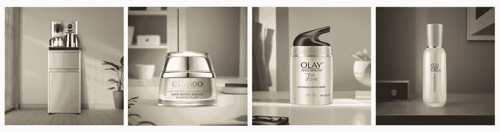
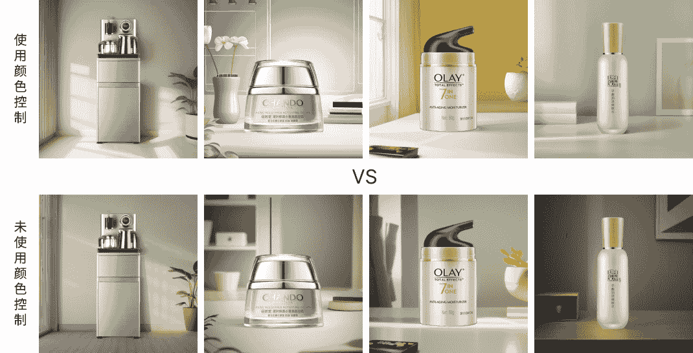
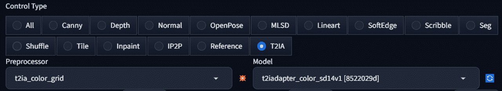
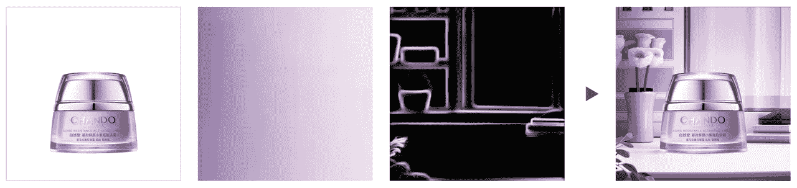

# 京东｜分分钟带你拿捏SD中的色彩控制

> 来源：[https://aiyanxishe.feishu.cn/docx/U5eJdk9PYoWEJUxMASpc8jnVnZe](https://aiyanxishe.feishu.cn/docx/U5eJdk9PYoWEJUxMASpc8jnVnZe)

颜色控制一直是AIGC的难点，prompt会污染、img2img太随机… 今天带来利用controlnet，实现对画面颜色的有效控制。都说AIGC是抽卡，但对把它作为工具而非玩具的设计师，必须掌握如何控制它，让我们一起开始可控AI生成。

**想给AI点颜色瞧瞧，怎么这么难**

大家或许已经通过各种《三分钟包会》《五分钟出道》的教程，可以手拿把掐的将一张商品图，完美植入需要的背景中。客观的说，无论从角度、投影、还是商品与背景的语义关系，以下都能算是合格的图片。但是作为视力255³的设计师，总能发现它的不完美——颜色，更准确的说是商品和背景的颜色关系。

但是，只要我们加亿点点细节，就可以让商品和背景的融合更为自然，减轻AI生成的割裂感，让它更像一张出自人手的精修图片。

通常，要做到这样的效果，或是去stable diffusion中尝试大量色彩的prompt，但因为SD机制的原因，污染会很严重，效果难得理想；或者在midjourney中，通过反复的垫图反推+ps，抽卡一张合适的效果，总之是费时、费力，更费人。

现在，我们有了更简单、更可控、更出效果的方法，如果你也深受上述问题之苦，那就让我们一起来，给AI点颜色瞧瞧。

**颜色就这招，简单可控效果好**

这张是我们的对照组，没有添加任何的色彩控制手段，接着我们撸起袖子开干。

① 提取商品主色调，作为色彩控制基础

首先我们先吸取商品的主色调，然后顺着商品色彩变化的方向，做一张全尺寸（等同最终完稿尺寸）的渐变效果，渐变主要是为了效果更加自然。

② 添加controlnet，实现色彩控制效果

这一步是重点，它会完成色彩融合，在controlnet中，加载这张色彩渐变图片，并添加预处理器t2ia_color_grid和对应模型，具体的模型和参数会在后文有详细解读，这里我们先看效果。

③ 并入生图流程，完成全图色彩管理

最后，补全背景生成的流程，就可以得到一张色彩和谐，又没有割裂感的商品主图了。

将这套流程应用到不同的商品和场景图中，实现如下效果。可以看到，经过颜色控制后，商品图的融合效果都有了显著提升。利用上述方法，设计师就能非常可控的来对图片进行颜色管理了，特别适合当商品本身色调鲜明多样，对放置的场景又有较高要求的需求中。

**操作不再黑箱，用着才算真香**

下面，详细介绍下中间的参数和步骤：

预处理器我们使用t2ia_color_grid，它的功能是对颜色进行网格检测，用来生成与原图色谱一致，分布近似的图像，所以它会呈现一个马赛克效果，在它的作用下，重新生成的图片会按照它的色彩特征进行重绘。（延伸思考：在一些特殊场景，你设置可以手绘一个颜色分布非均匀的模板，并以此产生更加丰富的效果）

其中最重要的参数是weight、starting control step、ending control step

weight是这个controlnet在整体中起到多大的作用，下图可以看到weight从小到大的分布对画面的影响。

starting control step控制了controlnet从什么时候开始介入生图的步骤，越早介入对画面的影响越深远，毕竟从一开始就参与其中了嘛。

ending control step控制了controlnet在什么时候退出生图的步骤，越晚退出则会将影响保留的越完整，它意味着把控制留到的画面生成的最后一刻。

这里经过测试，为了保持比较和谐的效果，三个参数分别是（0.7，0.3，1），但需要注意，这套参数适配的是案例中色相柔和、饱和度较低的情况，如果在实际应用中遇到的色彩很重，那针对参数也要进行相应的调整。

搭建好控制色彩的controlnet之后，补上针对商品和布局的controlnet，整个对色彩控制的流程就完成了。

点击generate，就能得到一张色彩和谐的完稿啦。

**效果一键实现，用户无感体验**

以上方法主要用在本地操作，一些步骤还需要人为参与。当要把这套逻辑工程化、线上化，自然没法再靠设计师吸取颜色了，中间过程会用一些简单的算法和代码，比如对sku主色的选取，可以用octree或colorthief。

提取出的色值也需要经过一定的优化和映射再用到controlnet中才会取得比较好的效果，毕竟商品的情况多且复杂，单纯的依靠机器识别，可能出现偏颇，所以为了最终效果，必须要做更精细的管控。

到此，整个色彩控制的流程完结，或许你也常听闻AIGC是黑盒、是随机、是抽卡，但对要把它作为工具而非玩具的人来说，就是要探究从各个维度、各个环节，控制它的手段。虽然科技改变生活，但不能改变你的绝活。

<https://aiyanxishe.feishu.cn/sync/IaSadpoOOsopKab1ajKcz6z3nAb>