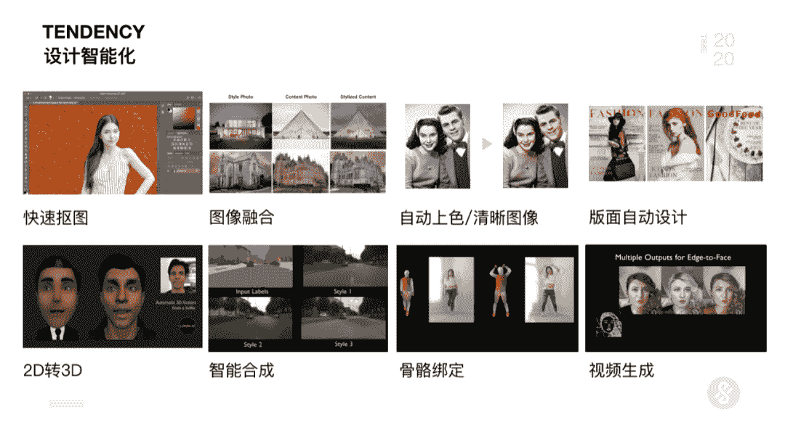
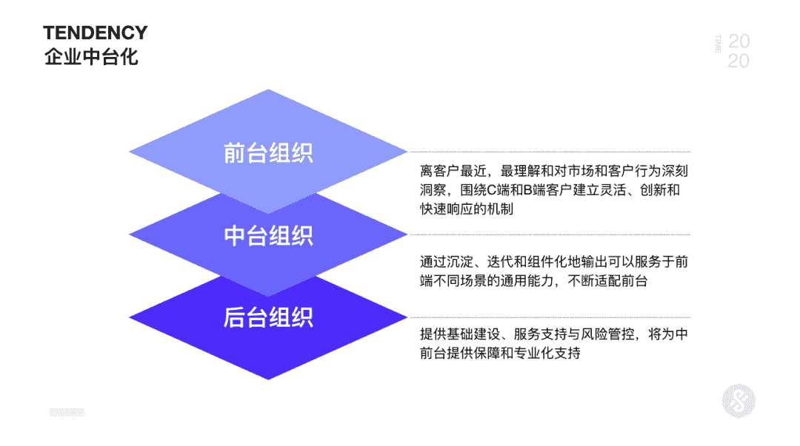
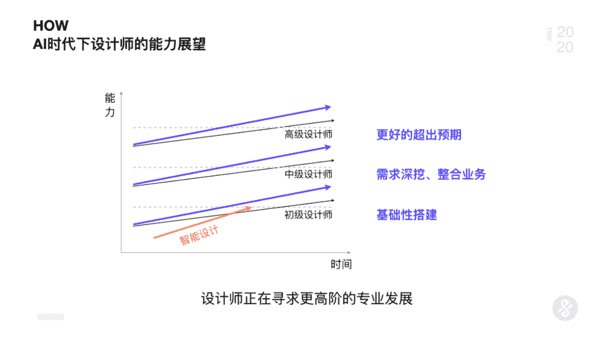
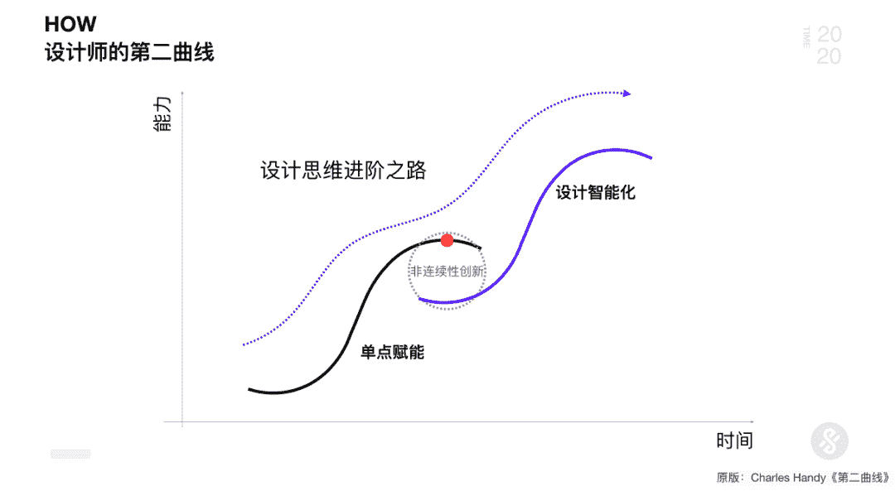
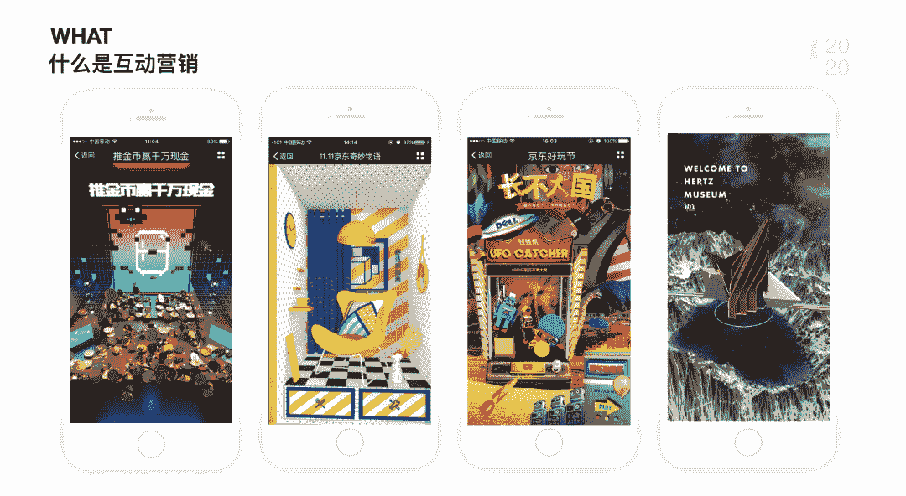

# 京东｜AI+UED思维革新与设计突破2.0

> 来源：[https://aiyanxishe.feishu.cn/docx/ME14dIXwSoRsuGxqIJ4cdBNbnBb](https://aiyanxishe.feishu.cn/docx/ME14dIXwSoRsuGxqIJ4cdBNbnBb)

三大红利消退后互联网进入下半场，产品类型趋于稳定、用户增长放缓；从敏捷分析到智能决策，人工智能时代下，设计师应该如何转化思维拥抱变化？设计如何助力增长？我们尝试打破传统套路，进行创新探索，将设计原则、用户洞察、数据分析、运营决策等领域专家的先验知识公式化/规范化，落地于产品设计中，策划设计出更高效率的赋能工具&平台，为业务焕发新的生命力和增长点。

两个趋势一个概念

先来回顾一下《AI+UED思维革新与设计突破1.0》中所提到的两个趋势与一个概念；一个是设计智能化，在20世纪90年代早期，人工智能开始逐步应用于设计工作中，例如我们经常接触的快速抠图、图像融合、视频生成等领域。

另一个趋势就是企业中台化，它通过制定标准和机制，把不确定的业务规则和流程通过工业化和市场化的手段确定下来，来减少沟通成本，提升协作效率；狭义上讲中台可以是一个具象的设计系统，它能帮我们解决效率问题；从广义上讲中台是一种思维，能在反复的重复劳动中寻找“偷懒“的方法。

在设计智能化和中台化的趋势下，智能设计正在逐渐取代初级设计师所承担的基础性搭建工作，而我们应该寻求更高阶的专业发展

如何寻找更高阶的专业发展？这里不得不提Charles Handy所著的《第二曲线》；S曲线是每个组织和企业在预测未来时会参考的工具，一切事物的发展都逃不开S型曲线（“第一曲线”）；然而从公司组织、市场变化，到个人职业发展、社会人际关系，需要多维度地以不同的角度来思考问题，因此不能总是停留在“第一曲线”的世界，此时需要进行创新和变革，来转换到新的S曲线上。

在此背景下，我们早在18年就提出以AI+UED新型设计模式进行方向探索，接下来我将从互动营销设计来分享我们是如何践行AI+UED的思维革新与设计突破的。

**互动营销设计**

什么是互动营销？它是以人为中心，通过“利益/情感驱动”让他们去主动传播，从而实现圈层裂变，这就是互动营销；在电商环境下，流量和奖品是互动营销实现圈层裂变的核心点。

关于互动相关的设计方论我们每年都会根据市场趋势及用户变化做迭代，至今已迭代至4.0；其中明确增长目标、定位精准用户、裂变模型、转化模型、用户与奖品这五大关键因素是至今仍在使用的；因篇幅原因这里便不展开来讲了。感兴趣的小伙伴可以在JELLY design 官网阅读《解构社交电商营销生态（营销互动项目 设计方法论V4.0）》

https://jelly.jd.com/article/5cc5945fa3137601507fcba1

移动时代走过十年，市场从增量转变为存量；平台或店铺的每一位顾客都在被其他电商平台、店铺、短视频、📕🧣大V等等等所争抢；挖掘老用户更多的价值成为共识，于是私域流量的概念开始大行其道。

在流量红利殆尽的当下，从公域流量池的获客成本变得高昂，相较而言尽管私域流量也需要运营维护，但它能够带来直接的销售转化，并且运营成本相对低廉且更为长期。而私域流量的用户触手中，粉丝互动起着至关重要的作用。

在这种趋势下，平台的流量运营策略也相应发生转变；当我们聚焦到互动营销时，这种转变更为明显；过去平台级互动营销主要以流量裂变、优惠发放为核心目标，以左脑黑帽核心驱动力为主的邀请有奖、砍价免费拿、一元礼盒、签到领现金等互动玩法大行其道；但现在，平台目标更加注重平台粘性、广告收入，以右脑白帽核心驱动力为主的东东农场、多多果园、芭芭农场、多多爱消除等游戏化互动玩法开始盛行。

从18年开始我们就尝试做过很多游戏型互动玩法的策划及设计，结合现在的市场变化梳理出游戏化互动设计模型。

在此模型下，今年上线的长期活动【幸福家·养成游戏互动】数据表现出色，得到业务侧的广泛认可。

当以商家角度来看私域流量运营时，会发现商家目标和用户目标将更加聚焦；用户更加关注优惠获取、内容获取、精神认同等三个目标；而商家更加关注以用户运营为主的留存、活跃和拉新，以及以商品成交为主的清仓、促销、日销和打新。

针对这种变化，总结出商家店铺的互动设计模型，一个是以用户体验为核心做减法，内容更聚焦；另一个是以商品成交为目的做乘法，提升销量。

**设计与技术协同创新**

从S曲线的概念来看，我们在互动营销这条曲线上不断的沉淀和迭代，如何进行创新和变革，来转换到新的S曲线上？我们尝试将专业沉淀+技术手段进行协同创新探索。

羚珑互动营销智能设计是我们将专家经验通过技术手段变为智能化设计工具的尝试，真正实现利用AI+UED思维实现降低开发成本，提升生产效率，稳定设计质量的目标。

我们以结构化的思维归纳总结找出营销互动共性，来抽离出以组件为单位的模块颗粒度；像积木设计一样，开发人员只需在夸克系统开发和维护组件，在Atom搭建系统使用不同组件即可搭建发布不同的互动工具，开发效率得到极大提升，同时节约了大量开发成本。

同样，对于工具的服务端接口也是采用积木化的设计准则，来实现以最小成本达到最大化的产品目标。

除了在产品设计层面的探索，我们也在逐渐构建营销全域体验；在数据方面，提供从数据采集、数据处理、数据分析于一体的完整数据监控可视化分析；全面解读用户/商家/活动行为数据，构建产品数据生态。

在用户赋能方面，从单点式商家赋能，到解耦智能编辑器、嵌入服务、接口服务，全方位构建产品赋能生态，实现从1到无穷。

在用户增长方面，从平台用户增长，到渠道用户增长，通过产品底层架构嵌入服务，提供赋能全域营销中台的互动营销智能设计解决方案。

对于AI+UED思维革新与设计突破的践行除了在互动营销领域，我们也在羚珑直播间装修做了相应的尝试，这里就不再展开讲；相信坚持阅读到这里的小伙伴们对「AI+UED思维革新与设计突破」已经有了简单的了解，希望这些思考能够给你在工作中带来一些帮助。

<https://aiyanxishe.feishu.cn/sync/IaSadpoOOsopKab1ajKcz6z3nAb>