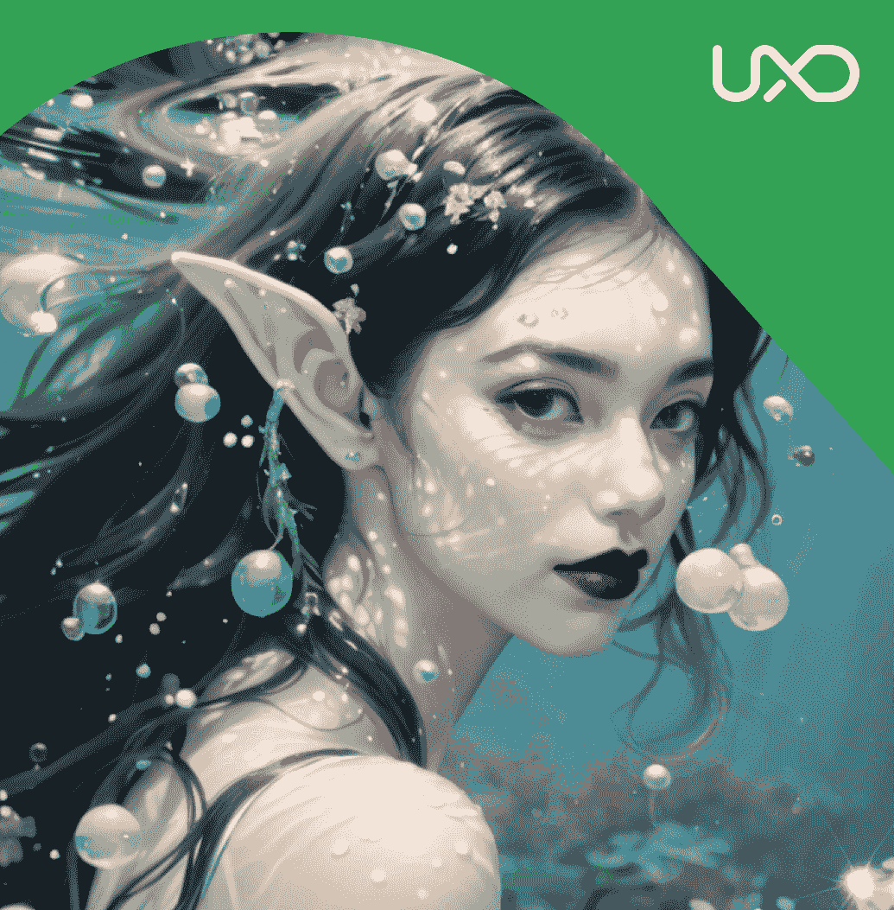
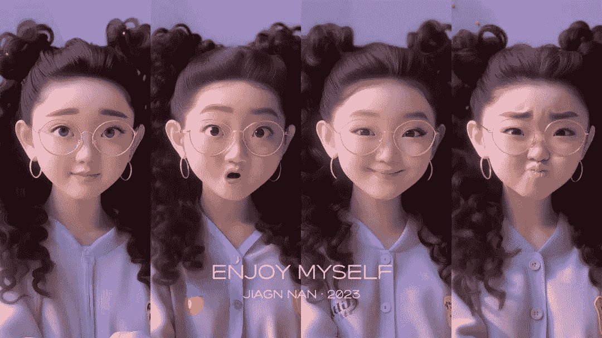
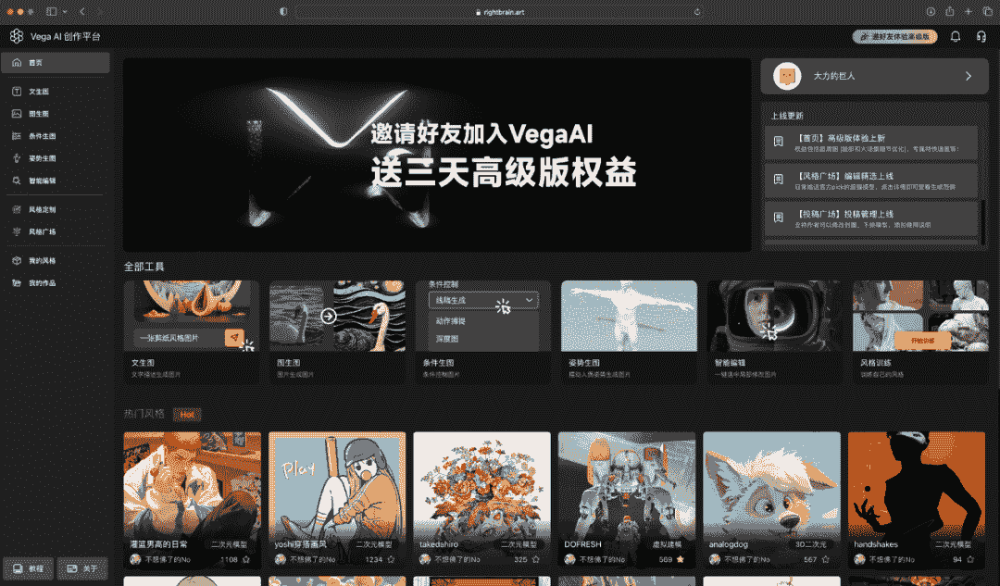
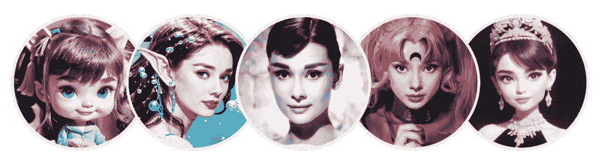
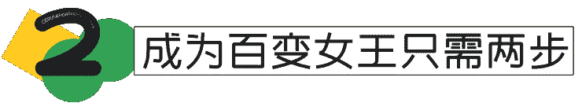

# 58 UXD｜AI头像看这一篇就够了！100%像！

> 来源：[https://aiyanxishe.feishu.cn/docx/LxCnd0evvoFQO1xYKa7cPExJn5d](https://aiyanxishe.feishu.cn/docx/LxCnd0evvoFQO1xYKa7cPExJn5d)

是不是每个女生都想成为百变女王？每个男生都有个英雄梦？看到很多人做的卡通头像自己也想拥有？自从AI绘图工具出现，定制属于自己的形象就更加便捷了。看下Midjourney通过喂图生成的卡通形象，有没有很心动，也想拥有自己的头像呢？

说到如今大火的AI绘图，不得不提最热门的两款工具Midjourney和Stable Diffusion，他们强大的功能不必多说，关注AIGC的同学就算没有用过肯定也看过不少炫酷的画面和教程了。

但是这两款工具都有一些使用门槛：MJ需要翻墙并付费办理会员使用，描述词只支持英文且有一定的技巧；SD需要高性能电脑，需要看一些对设计师不友好（看不懂）的界面…… 头像要想做的真的像自己，也有一定难度，上图也是经过多次训练才得到的。

今天为大家介绍一款上手非常简单的ai绘图工具**，对AI小白十分友**好，关键还是免费的——Vega AI平台 www.rightbrain.art（单纯私人分享，右脑科技应该考虑给我点广告费）。

Vega AI平台，支持文生图，图生图，姿势生图，风格定制等多种功能，对标Stable Diffusion，可贵的是，它无需翻墙和下载，网页打开即可操作，支持中文输入，并且操作界面十分便捷，交互设计通俗易懂，左下角有教程指导，基本的使用方法这里就不多做介绍了，咱们直接来说说怎么能做出这些风格多样的头像吧。

**第一步：制作专属模型**

高级却十分简单的应用方法——风格制定

1.准备图片：选择8-80张自己的照片，需要脸部清晰，高清彩色的写真最好，数量越多效果越好（这里我准备了十几张奥黛丽赫本的照片，像素不是很高，且主要是黑白照片，应用时效果有些受限）；

2.上传到风格定制界面中；

3.设置：起个风格名称（赫本真人），基础模型选择“写真”；如果你想训练的模型不是真实人物，而是一个卡通形象，这里就选择“虚拟建模”或者“3D二次元”，选择基础模型很重要，训练效果差别很大！

4.点击“开始训练”，等待生成（用时大概0.5-1小时），等待时间内可以进入其他页面进行操作，训练完成后会有弹窗提示。

接下来就可以在每个功能的风格中看到啦！

官方教程里训练了一个石膏像模型，脑洞很大很有趣～

第二步：通过不同功能助你华丽转身

方法一：文生图

1.左侧工具栏选择“文生图”；

2.选取训练风格，输入文案（文案：一个穿着晚礼服的模特戴着黑色手套，为电影中的女演员摆姿势拍照）；

3.基础模型：虚拟建模（基础模型就是SD中的“大模型”，决定了整体的大风格，选对十分重要！）；

风格：Q版盲盒0.5；赫本真人0.5

可以多刷几次得到满意的效果～

方法二：图生图

1.左侧工具栏选择“图生图”；

2.点击画笔涂抹变换的区域；

3.在右侧工具栏选择基础模型-写真，搭配你想要的风格模型；

4.在文案中描述你想要的画面，只是想换脸的话，简单描述就可；

5.点击生成，等待十几秒就好啦！

此功能不仅能换脸，可以替换画面中任何的部分，脑洞有多大创作就有多宽广～

方法三：使用以上两个功能，就可以实现无限可能性!

风格受本身的模型库的限制，很多时候直接生成的效果不尽如人意，我们自己做的风格也是如此。这时候可以采用以上两个功能结合的方式，多次组合达到我们想要的效果。

以做一款形象是自己的手办为例：

1.先使用“文生图”制作一个喜欢的3D盲盒形象

文案：一个姑娘，有着紫色长发，是个长袍法师，身边围绕着小猫咪

基础模型：虚拟建模

风格：Q版盲盒1.00

2.把满意的图下载下来，上传到“图生图”

基础模型：写真

风格：赫本真人0.65

做出自己样子的手办啦！

***小提示**

1.生成的图片如需高清，可以直接点击图片上的HD,即可生成分辨率更高的图片；

2.生成的图忘记下载不要紧，历史记录里有做过的图片，可以再次查看下载；

方法四：风格广场

风格广场有大量的各类风格案例，可以查看并直接采用；用户也可以训练模型并上传。

比如我看中了一款风格，点击采用，设计一个画面如下

重复上文的手办操作，下载喜欢的图片，上传到“图生图”，再次编辑，即可得到有创意的图片啦～

此款ai平台功能强大，除了上文提到的功能外，还有很多高阶功能可以深入研究：

1.条件生图

条件控制有三种方法：线稿生成，动作捕捉以及深度图。

线稿生成：上传图片后选择“线稿生成”，系统会自动提取它的线稿，根据选择的模型类型，生成新的图片。

生成的线稿也可以下载后，再进行创作。

动作捕捉：和线稿生成一样，根据上传的图片，系统会捕捉动作，生成新的图片。

2.姿势生图

这个功能类似3D软件中的人物骨骼，可以自由拖拽模型上个每个关节，摆出你想要的姿势，还可以变换人物角度和构图，选择风格后生成你想要的画面。此功能整体操作十分流畅，调整的姿势也很舒适，不过生图的还原度还有待提高。

***小提示**

1.图片质量分成：普通，高清和超清，每日普通/高清生成次数上限为200次，超清上线25张。不过做图时系统默认在超清选项上，不注意的话很快就用没有了；

2.关于高级设置，官方建议使用默认值，一般可以不用调整；

3.微信小程序已上线，可以在手机上试用～

今年无疑是个ai年，面对飞速迭代的智能工具，作为设计师感受到生存危机的同时，同样面临着很多新的机遇。找到适合自己的学习/工作的工具，以“创意”为主导，相信我们可以用工具创作出无限可能的作品！

<https://aiyanxishe.feishu.cn/sync/IaSadpoOOsopKab1ajKcz6z3nAb>