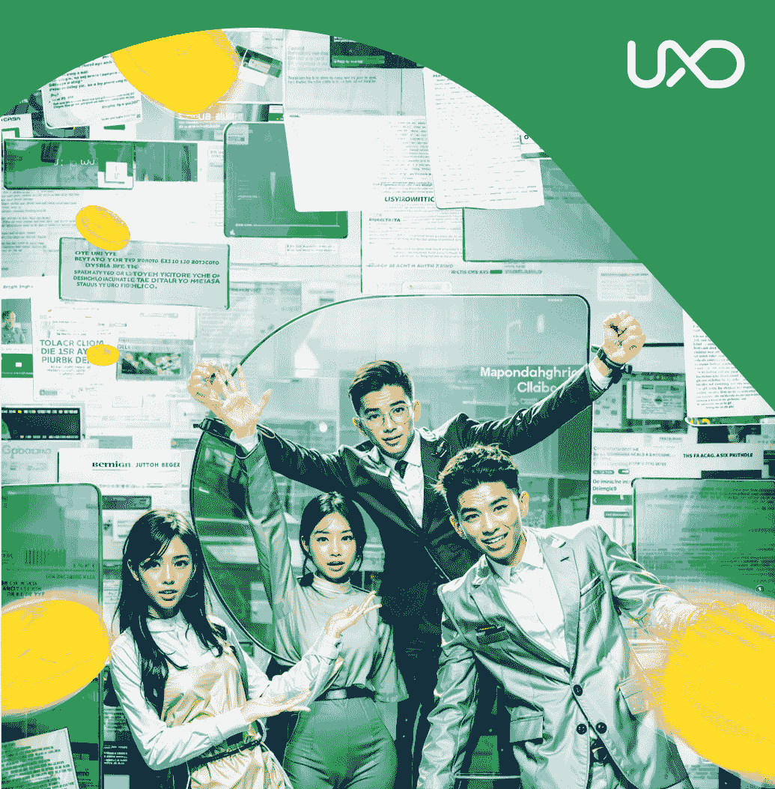
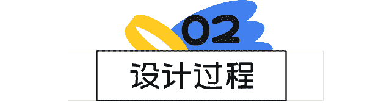
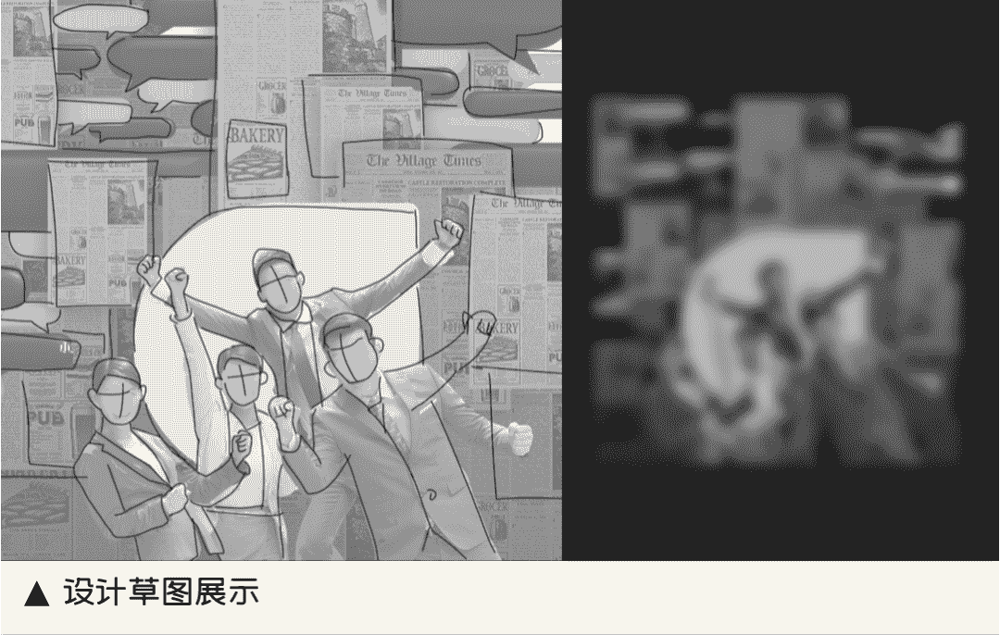
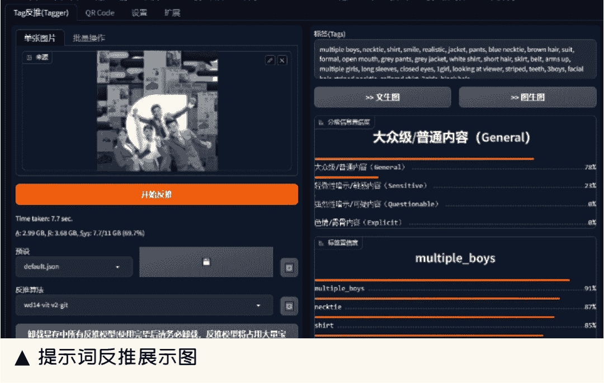
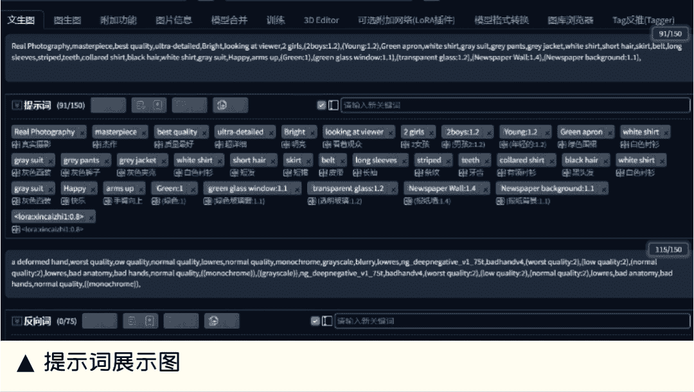
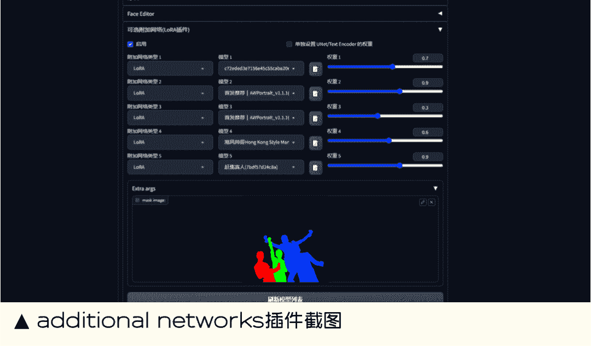

# 58 UXD｜实战 控制多个lora助力运营活动

> 来源：[https://aiyanxishe.feishu.cn/docx/SxDVd5ycBo2wAWxGc72cR5dIncd](https://aiyanxishe.feishu.cn/docx/SxDVd5ycBo2wAWxGc72cR5dIncd)

随着人工智能技术的迅猛发展，各大企业纷纷借助AI技术来增强运营活动的设计。在这个趋势下，赶集直招也在积极探索如何运用AI辅助设计师的工作。以赶集9月秋招活动页为例，分享一下我的思考与落地。

**项目背景**

为满足9月黄金招聘季的招聘需求，推进招聘专场活动，引导用户行为转化提高用户价值，以及提高用户次日留存。

**设计策略**

持续强化品牌形象-品牌符号与品牌色双重加持，强化赶集品牌与招聘平台

视觉概念-9月多行业招聘黄金季，打造岗位多、行业多的画面感知

技术探索-尝试多重lora应用技术与沉淀的专属lora模型融合，从而提升设计效率

**具体落地拆分**

**持续强化品牌形象**

品牌符号：延续玻璃质感

延续视觉语言：通透&人物情绪积极

颜色配比:8:2

**视觉概念**

背景层：利用报纸、消息框等巨像的物体，表现岗位多、信息丰富

人物层：利用多人表达平台可帮助提供丰富职位的视觉感知

前景层：利用飞舞的金币强化活动氛围

**技术探索**（图片产出于9月中旬）

控制多个lora应用技术：与赶集玻璃质感lora、人物lora、报纸背景·摄影lora结合（此lora来自于Lib原创者重楼），尝试SD直出画面与后期精调，提升设计效率

**设计草图&确定构图**

由于视觉概念已经思考的较为清晰，所以先搜罗具体意向图片，利用PS拼接，搭建画面构图。

**提示词填写**

草图构图确认后，利用SD提示词反推，确定AI可识别的部分提示词，方便后续文生图的精准应用。

**具体正向提示词填写**

提示词的填写对SD出图效果的影响较为重要。通过查询资料确定出了符合该活动画面的一套提示词架构。确定好符合画面的正向提示词类别：画面质感+主体+主体服饰+主体情绪+色调+环境

**人物姿态提取**

通过海量搜索，确定四个人物姿态组合，利用openpose提取出四个人的姿态与面部表情。

**品牌符号控制**

再通过seg框定人物位置与玻璃质感的符号。

**多个lora应用**

利用additional networks插件设置lora不同控制比重（文章最后会放下载与安装地址）把相应的多个lora选用，并调节好权重，由于质感Lora影响较小，所以我选择了在正向提示词后再叠加一次并调节合适的权重。人物是画面的主体对象，lora值可控制的大一点。报纸背景·摄影lora根据测试和抽盲盒的形式去找到最优效果。

**设计初稿完成**

由于是SD直出的图片，难免会有瑕疵和不符合预期的细节，此时先找到最符合草图和审美的设计图，完成初稿。再通过图生图中的局部重绘修复面部和手部。最后利用图片放大脚本增加图片细节与质感一致。

**与PS结合修缮瑕疵与氛围营造**

最后使用PS给画面加入烘托氛围的金币元素与活动主标题。

从业上看9月黄金招聘季活动效果均达到预期。设计方面的努力不仅推动了业务数据，同时在探索新技术应用方面也取得了令人欣慰的成果。然而，AI在运营活动中的潜力依然巨大，我们将持续不断地探索，激发更多可能性。让我们共同努力，不断进取。

additional networks插件介绍

1.它可以做什么？

-能帮我们控制多个LoRA模型生成混合风格的图像。

2.下载与安装

-下载方式有两种，一种是在“扩展下从网站安装”输入https://link.zhihu.com/?target=http%3A//github.com/kohya-ss/sd-webui-additional-networks安装。另一种是下载压缩包解压放到SD的extensions目录下。

3.LoRA模型安装位置

此插件，只有把lora放到extensions\sd-webui-additional-networks\models\lora目录下才可以应用。

tips:颜色需要是标准的rgb颜色

引用-知乎迹寒-AIGC初体验——Stable Diffusion（五）Additional Network教程

<https://aiyanxishe.feishu.cn/sync/IaSadpoOOsopKab1ajKcz6z3nAb>