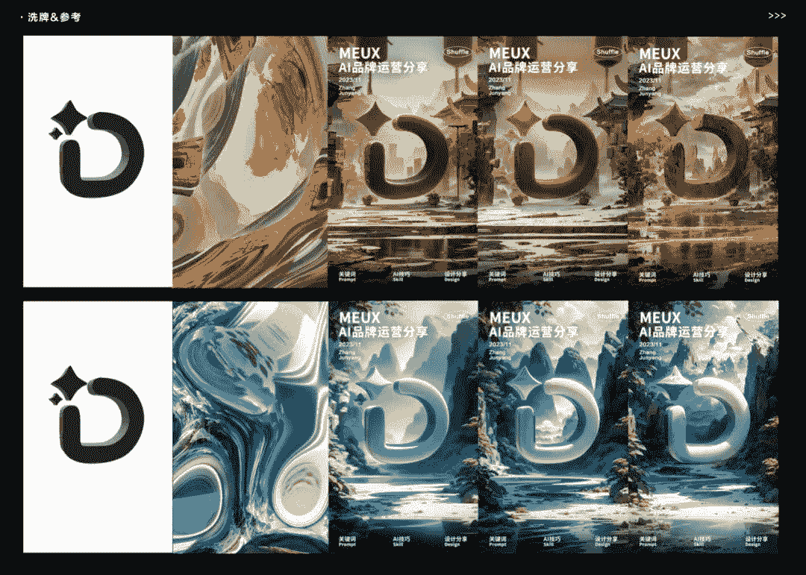

# 百度｜用AI玩转品牌符号—SD超级符号案例分享&方法论

> 来源：[https://aiyanxishe.feishu.cn/docx/FBqFdFhu2o5A5OxPXiFcjZ5anse](https://aiyanxishe.feishu.cn/docx/FBqFdFhu2o5A5OxPXiFcjZ5anse)

品牌符号宣传海报作为品牌运营很重要的曝光手段，随着AI技术的不断发展已经逐渐替代传统设计方法，质量、效率方面的提升使它成为热门的超级符号延展的设计方式，今天我们就来了解下这套设计方法论，解析利用AI生图制作超级符号海报的方式。

一、SD品牌运营实例——抖音+天猫+文字

我们可以看到各大设计网站展示的用AI制作的符号海报，有文字、图形等，它们大多设计样式丰富，成矩阵展示，画面精致度很高，充满想象力，并且耗时特别少，产量很丰富，那么这样的海报是怎么生成制作的呢？下面带来一步步的解析。

**

二、SD符号演绎****解析

2.1、基础教****程分析

基础理****论分析：在文生****图模式下，通过**大模型+prompt+controlnet（lineart控制外轮廓）的组合设计品牌符号海报，同时可以辅助lora、以及设计师创造力。

总结基础公式：logo+lineart/canny

基础公式生图：

基础公式下设计的百家号符号海报：

**

三、SD符号进阶版****理论

3.1、入门SD符号生****成模式

在基础公**式下，我们需要加入深层controlnet来控制画面的前后关系。

进阶版入门公式：logo+canny/lineart+depth

进阶版入门公式下设计的度加符号海报：

**

3.2、进阶门槛——深度图**（depth map）

作为进阶入门我们需要了解一个概念就是“深度图”：

深度图（depth map）

深度图指存储单视图所有像素的深度值的二维图像，是空间单位，比如毫米。

1）深度图是一张二维图像，和原图等大小

2）深度图每个位置保存的是该位置像素的深度值

3）深度值就是相机坐标系下的Z坐标值

深度图上对应的区域越浅（深度值接近1），越远则越黑（深度值接近0）。也就是说深度值从0到1代表的是从远到近。

**

SD深度图解析**：

controlnet插件中有四种处理器，分别是midas、zoe、leres，leres++四种，精细度是递增的，随之而来的模型的生成时间也是成倍的增加，我们可以根据需求进行选择，其中以符号来说选择midas和zoe比较适合。

**

进阶版入门公式生图**：

我们在SD的controlnet插件中选择depth可以自动生成的深度图，我们可以通过预处理的效果进行跑图，然后挑选一张比较满意的生成一张海报，当然自己做深度图对于画面精准度的控制会更好。

**

3.3、初级S**D符号生成模式（建模辅助）

在AI生成的符号立体度不能满足我们设计创意的需求时候，我们需要自己进行辅助建模。

进阶版初级公式：立体logo+depth+canny

建模辅助1.0——进阶版初级公式：

建模辅助2.0——进阶版初级公式：

我们还可以生成倒下的两点透视的符号视角，但是相应的视角是需要考虑到生图时候会出现的遮挡和识别性问题。

**

3.4、中级SD符号生成模****式

在日常生图的过程中会，我**们会经常花很多时间进行抽卡，幸运的抽到S卡，生图时间减半，如果不幸抽不到S卡那生图时间加倍，这里我给大家介绍一个自研是符号生成方式，有效帮助提升概率，抽S卡卡池。

3.5、进阶门槛——语义分割

作为进阶中级生成模式需要了解一个概念就是“语义分割”：

语义分割（Segmentation）

语义分割是计算机视觉中很重要的一个方向。不同于目标检测和识别，语义分割实现了图像像素级的分类。它能够将一张图片或者视频（视频以帧来提取的话其实就是图片），按照类别的异同，将图像分为多个块。

语义分割即能够将整张图的每个部分分割开，使每个部分都有一定类别意义。和目标检测不同的是，目标检测只需要找到图片中目标，打上框然后分出类别。语义分割是以描边的形式，将整张图不留缝隙的分割成每个区域，每个区域是一个类别，没有类别的默认为背景background。

**

加语义分割的画面对比**：

中级SD符号方式设计的度加符号海报：

这里我们可以自己根据设计方案画出黑白灰的depth深度图，这里的深度图只有黑白灰的轮廓，并没有具体的元素的含义，所以生成的图只有构图和光影。

中级SD符号方式设计的度加符号海报：

在黑白灰的depth深度图的基础上我们将各个部分进行颜色分割，可以参考网上的语义分割表，这时候我们除了构图和光影，也赋予了每个元素的具体的含义，进一步的控制住画面的构成。

**

+LoRA**

我们可以用这个方法加上各种LoRA就可以稳定生成很高品质的海报图，在S卡池中选择合适的图进一步精修，加上排版就是一套品牌符号宣传海报图。

3.6、高级SD符号生成模式（风格控制）

当我们想要某种风格的时候，但是没有适合的LoRA，我们需要自己研究办法去提取风格，这也就是自研的高级符号生成方式，这里介绍两个特殊的controlnet控制，shuffle和Refrence。

shuffle是洗牌，就是把一张图打乱，只保留风格；Refrence是参考，整个风格、构图颜色等按照参考走，例如下面的两张图，我们可以通过这两个插件进行风格提取：

shuffle和Refrence生图：

运用高阶的符号生成模式，我们可以同时跑出一系列的品牌符号海报：

**

3.7、后期处理&图生****图

后期主要是通过图生图模式**下进行的，常见的后期方式有放大算法，tile加细节，后期合成，局部重绘等方式。

这里介绍一个增强细节的插件模型tile：

tile模型本质上是一个重绘模型，但是会在保持原图构图、画风、人物主体等基础上，为画面增添更多的细节，提高图像的画质。

1）增加细节，比如高清放大、修复照片、补齐草图、增加画质等

2）配合其它放大算法进行超高清放大（tile模型可以抑制全局提示词对局部图像的污染）

3）根据画面自动推断内容，消除违和感

四、SD符号生成项目中的应用

度加、多艺、新原计划logo演绎：

**

**结语

单纯用AI设计方式设计视觉只能让你跟上设计步伐不掉队，MEUX内容生态设计团队致力于研究出更多方式控制AI的创意、风格、品质和效率，探索AI生图中更多可能性，让AI成为设计师手上一款好用的设计工具。

<https://aiyanxishe.feishu.cn/sync/IaSadpoOOsopKab1ajKcz6z3nAb>