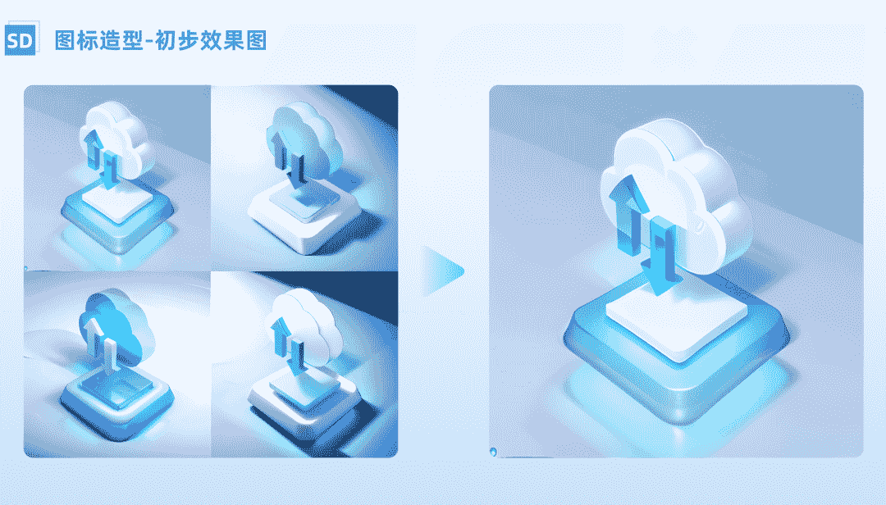

# 网易 | 使用AI制作B端和C端图标全流程

> 来源：[https://aiyanxishe.feishu.cn/docx/Wajcd7kFsov4t9xMd0bcsUkanWf](https://aiyanxishe.feishu.cn/docx/Wajcd7kFsov4t9xMd0bcsUkanWf)

伴随着AIGC异常火爆，各种各样的AI工具如雨后春笋般涌现，除了各位设计师知道的Midjourney（以下简称“MJ”），同样还有十分亮眼的Stable Diffusion。所以今天我们的课程主要教大家如何使用Stable Diffusion（以下简称“SD”）来进行B端图标和C端图标的创作，充分将AIGC灵活的运用在项目的工作流程之中。本次课程需要用的知识点主要有以下三个：1、`ControlNet`-硬边缘检测的使用

2、`Checkpoint`、`Lora`模型运用调试

3、矢量图转换工具


## B端图标

那首先我们先来看看B端图标，有哪些特点？


从上图可以发现主要特点为：立体块面感、轻科技、材质多为毛玻璃、光泽金属、轮廓光源。

UI的使用场景多为功能模块辅助装饰、官网开屏页等……

以下图的数据云图标为例：

制作同等设计质量的图标，从三维建模到渲染最后到后期调整，平均需要2.5小时制作周期。而且设计师需要有一定的三维软件设计能力。


我们先看看MJ的使用效果，这里我们使用常规的操作流程，直接使用关键词生成，这里我使用了两种不同的关键词：

第一种：

A cloud Ul icon, blue frosted glass white acrylic material, white background, sense of technology, studio light, blue frosted glass white acrylic material, white background, sense of technology, `--ar 1:1`

对照翻译：一朵云Ul图标，蓝色磨砂玻璃白亚克力材质, 白色背景, 科技感, 影棚灯光, 蓝色磨砂玻璃白色亚克力材质, 白色背景, 科技感, `--ar 1:1`

第二种：

Cloud icon, blue, frosted glass, transparent technology sense, white background, studio lighting, 3d, c4d, high detail, `--ar 1:1`

对照翻译：云朵图标，蓝色，磨砂玻璃，透明科技感，白色背景，影棚灯光，3d，c4d，高细节，`--ar 1:1`


我们可以看出上图直接生成的图标，偏差较大，且形式、角度、质感、颜色无法很好的控制，基本不能使用。


首先使用垫图的第一种方式，将想要生成图标的参考样式上传到MJ，接着配合关键词进行操作：

图片链接 + A cloud Ul icon, blue frosted glass white acrylic material, white background, sense of technology, studio light, blue frosted glass white acrylic material, sense of technology, `--ar 1:1`

右边便是生成的效果（下图中右边）：


MJ学习了参考图片后，在质感的使用和色彩上也比较靠近想要的风格了，因为参考的图片和需要生成的图像，在造型上有一定的不同，只是用关键词来进行生产，随机性比较强，所以造型不够可控。


接着我们蚕蛹垫图的第二种方式，将想要生成图标的造型样式上传到MJ，配合关键词进行操作：

图片链接 + A cloud Ul icon, blue frosted glass white acrylic material, white background, sense of technology, studio light, blue frosted glass white acrylic material, sense of technology, `--ar 1:1`

右边便是生成的效果（下图中右边）：


MJ学习了参考图片后，在造型上靠近了想要的造型，但是在颜色和质感上，就无法学习到了，不太能够使用。


接着我使用组合垫图法，将两张素材都上传到MJ，接着配合关键词进行操作：


图片链接1 + 图片链接2 + A cloud Ul icon, blue frosted glass white acrylic material, white background, sense of technology, studio light, blue frosted glass white acrylic material, sense of technology, `--ar 1:1`

得出的结论就是：MJ学习了两张参考图片后，在想要的造型上靠近了一些，在颜色和质感上也靠近了，但是在细节的把控上还是有一定的随机性，还是不能直接使用。


小结一下，MJ在进行B端图标设计的使用中，主要有以下不足之处：

1.可控性不够高 ；2.随机性较强 ；3.无法局部调整 ；4.风格不符

下面我们来看看SD的效果如何？


我这边使用的SD版本是：秋叶V4；

Checkpoint大模型使用的是：DDicon；Lora模型使用的是：Playstation5DesignAI。


使用的流程我已经在上图标记出来了，大家可以根据步骤进行操作。

这里的正向提示词：

```
best quality, many details, 4k, blender, octane render, C4D, transparent glass texture, DDicon, blue, frosted glass, transparent technology sense, industrial design, white background, studio lighting, sunshine, flat, minimal, quasi-object, axisymmetric, Data, cylinder, file, [lora:Playstation5DesignAI:0.8](lora:Playstation5DesignAI:0.8)
```

反向提示词：

```
lowers, bad anatomy, ((bad hands)), (worst quality:2), (low quality:2), (normal quality:2), paintings, sketches, lowres, bad anatomy, bad hands, text, error, missing, tingers,
```

直接输入进SD即可。


这里要提前准备好两张图：线稿图和黑白造型图，同时需要在`ControlNet`里启用两个类别，分别是`lineart`与`canny`，将准备好的两张图分别导入进`ControlNet`，并设置好参数；

首先采样方法选择`DPM++ SDE Karras`，选择`Canny`的`invert`预处理器以及对应的`Canny`模型，最后记得勾选“完美像素模式”。


然后我们就可以点击生成了，选好生成后觉得比较OK的图片，发送到图生图中，接着再进行一次`ControlNet`的设置。



上图就是生成的效果啦。

后面可以将符合预期的效果图发送到图生图的局部重绘，涂鸦选择效果图需要重新优化的小细节点。

生成出来的效果图有更好的设计兼容性，最后我们再进SD的后期处理进行放大就可以使用啦～


采用SD工具辅助B端图标的设计，整个设计过程只需要0.5小时，主要工作量主要在于前期的黑白线稿绘制。大大降低了设计成本与制作门槛。


## C端图标

C端图标与B端图标最大的区别点在于视觉风格更为多样，整体风格配色与造型更为年轻化。视觉表现形式目前主流为2.5D与3D类型较多，通过同色系轻渐变塑造体现体积感。接下来我们再看看C端图标应该如何用SD进行创作绘制。


我们找素材的时候，图片主体物材质的质感不需要保持相似，这一步只是确保外形调性一致；需要注意的是，找的这一套图标，都需要有共同点，这是为了确保后续生成图标结构造型的一致性,使整套图标形成统一的视觉系列感；例如我找的这几个，它们的共同点就是：轴侧构图、低多边形、圆润规整；之后我们便可以运用`ControlNet`-硬边缘检测功能，从而“锁定”图标的大致外轮廓，用SD对这些图标进行风格样式的重绘。


使用步骤 - 打开SD后

第一步：点击展开`ControlNet`，将图片拖动至预览选取框，（注意，我们要上传的图片有几点要求：1.背景干净没多余的元素或文字、2.图片尺寸比例1:1，最好为`512x512`大小、3.图片清晰度不能过于模糊，保证外轮廓清晰）

第二步：选择预处理器`Canny`（硬边缘检测）以及对应的`Canny`模型

第三步：勾选启用`ControlNet`


关于Checkpoint（俗话叫“大模型”）、Lora模型，可以在C站进行下载，网址为：`https://civitai.com/`；目前“C站”的模型不断迭代出新，视觉风格包罗万象，本次课程将会通过运用不同的Checkpoint大模型及Lora进行视觉调配，生成我们所期望的C端图标效果图。


我们先来说说3D直播礼物图标类型的图标，这类的图标可采用真实系大模型Deliberate，搭配造型圆润可爱、质感材质偏向粘土手办的Blindbox盲盒和3D rendering风格的Lora模型。

接着我们来了解下提示词，这里的正向提示词能更好的帮我们确定想要的风格，这里要注意的一点是：对词语使用双括号意味着让生成的画面更加聚焦于生成的物体，这里的“Polaroid camera（拍立得相机）”如不使用双括号的话，就可能生成：一个人拿着拍立得相机或者拍立得相机放在场景中，为了避免这样的情况，就可以使用双括号；

而反向提示词也比较通用，主要是在正向提示词中加入想要生成的风格。


在使用Lora模型时候，可以在正向提示词区域调整Lora模型的效果权重数值，直接影响生成图的视觉风格比重。要注意：Lora权重默认为 1，最低不能低于 0.2，否则没效果影响。


迭代步数指的是Stable Diffusion生成图像所需的迭代步数。每增加一步迭代，都会给AI更多的机会去比对提示和当前结果，并进行调整。更高的迭代步数需要更多的计算时间。但高步数并不一定意味着更好的结果。当然，如果迭代步数太少，会降低生成图像的质量。

这里以 迭代步数20 和 迭代步数40 为例子，可以看出 迭代步数40 生成的图片细节丰富、高质量，反观迭代步数20的造型轮廓模糊，缺少细节。


下图便是我们生成的3D直播礼物图标，可以看出生成的图标风格还是十分统一的。


下面我们再看另外一个案例：赛博机械图标。

这类图标我们选用的大模型是：MechaMix  Lora模型为：Real Mechanical Parts。

这里要说的一点是关于触发词，很多创作者在C站上传模型时，会带上触发词，我们可以在右边的介绍中直接查看，并将触发词加入到正向提示词中，这样能让SD更准确的识别模型的预设效果与参数。


有一个知识点要注意一下叫`canny`权重，因为机械风格往往造型结构相对复杂夸张，这里我们把`Canny`控制权重从默认的1调整为1.5。原因是控制图标外形变化差异不要过大，使得与参考图不符。

这里以 控制权重0.6 和 控制权重1.5 为例子，可以看出控制权重0.6生成的图片剥离外轮廓造型，造型自由发挥，比较浮夸、反观控制权重控制在1.5的图片则更注重外形轮廓，生成的比较靠近我们想要的。


下图便是我们生成的赛博机甲图标，可以看出生成的图标风格无论是在造型、配色、视角都十分统一，下面我罗列一些目前市场上比较流行风格的提示词，按照上面教的步骤就可以生成对应风格的图标了。


### 描边厚涂手绘图标

正向提示词：

```
((图标内容:1)), isometric view, paint material, glossiness, cartoon, clay material, (cute), white background, fine luster, mockup, behance, dribbble, soft circularism, (low poly:1), jim lee
```

*其中：jim lee为触发词

反向提示词（通用）：

```
Grayscale, low saturation, (worst quality, low quality:2), ((character:2)), EasyNegative, bad_prompt_version2
```


### 国风水墨图标

正向提示词：

```
((图标内容:1)), isometric view, paint material, glossiness, cartoon, clay material, (cute), white background, fine luster, mockup, behance, dribbble, soft circularism, (low poly:1), shuimobysim, wuchangshuo,
```

*其中：shuimobysim, wuchangshuo 为触发词

反向提示词（通用）：

```
Grayscale, low saturation, (worst quality, low quality:2), ((character:2)), EasyNegative, bad_prompt_version2
```


### 扁平轻渐变图标

正向提示词：

```
((图标内容:1)), isometric view, paint material, glossiness, cartoon, clay material, (cute), white background, fine luster, mockup, behance, dribbble, soft circularism, (low poly:1), vector, 2d, geometry, Flat Style, Colorful gradient, game icon institute,
```

*其中：game icon institute 为触发词

反向提示词（通用）：

```
Grayscale, low saturation, (worst quality, low quality:2), ((character:2)), EasyNegative, bad_prompt_version2
```


### 像素风格图标

正向提示词：


((图标内容:1)), isometric view, paint material, glossiness, cartoon, clay material, (cute), white background, fine luster, mockup, behance, dribbble, soft circularism, (low poly:1), pixel art, 2d, Low Resolution, pixel, pixel sprite, 16bitscene,

其中：`pixel`, `pixelsprite`, `16bitscene` 为触发词

反向提示词（通用）：

Grayscale, low saturation, (worst quality, low quality:2), ((character:2)), `EasyNegative`, `bad_prompt_version2`


我们可以将AI生成的位图通过这个在线网站（https://vectorizer.ai/）工具转换成可编辑的SVG矢量图，该网站不需要注册，而且完全免费的，我们将下载好的SVG矢量图拖至Figma或者Adobe AI软件，便可以编辑对应的路径及视觉样式。

<https://aiyanxishe.feishu.cn/sync/IaSadpoOOsopKab1ajKcz6z3nAb>
