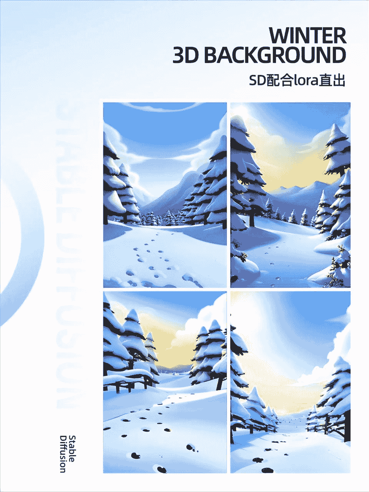

# 智行｜智行多种AIGC工具实战应用解析

> 来源：[https://aiyanxishe.feishu.cn/docx/FlACd3AbNo1SgsxBl99cwLkJnwd](https://aiyanxishe.feishu.cn/docx/FlACd3AbNo1SgsxBl99cwLkJnwd)

# **导语**

随着AIGC浪潮的爆发，通过AI辅助设计师提高工作效率已然**成为一种趋势。本次**分享一些日常工作中使用AI工具的提效案例，包括思路与探索过程等，希望给大家提供一些启发。

文章概况:

#01. SD助力营销活动

#02. AI生成动态海报

#03. 实现营销活动3D背景自由

#04. 专属头像生成

# **#01**

# **SD助力营销活动**

Stable Diffusion作为一款融合了人工智能与艺术的绘画软件，为设计师带来了前所未有的创作方式。

**🎨 2D色****稿转3D**方面，Stable Diffusion技术高效且稳定。可以节省大量作图时间并获得令人满意的3D效果。

👀 在智行集卡牌活动中，卡牌的制作上我们尝试运用Stable Diffusion将插画转为3D风格，以节省更多出图时间，一起康康我们是怎么做的吧！

**左右滑动查看完整教程**

**1.首先，**Stable Diffusion2D转3D作图时，选择的设计草图应具备结构方面的清晰度，以确保在转化为3D时能够保持细节的准确性。这样在运用Stable Diffusion算法进行处理的时候，会使图像更加立体、更贴合设计稿。

**2.其次，**对于复杂场景，采用拆分元素的方式进行逐个生成，以确保生成的稳定性。**这种自动**处理深度和透视效果的优势减少了手动绘制的工作量，可以节省大量的出图时间。3.最后，对生成的元素进行必要的合成，统一元素的光影和环境关系，以确保最终的3D效果符合预期。

# **#02**

# **AI生成动态海报**

熟悉 Runway 的小伙伴一定对 Runway 公司推出 GEN-2 的 AI 工具不陌生，它可以实现从文本/图片到视频的生成。也就是说，它可以根据你输入的文字或提供的图片，自动合成一个符合你想象的视频。

在沉浸感强的旅游类营销海报里可以用gen-2强大的生成视频能力，生成连贯逼真的景点动态海报，那看看该怎么实现吧！

左右滑动查看完整教程

*查看动态效果点击👉AI生成动态海报-Runway gen2使用教程

**1.拆分海报：**分为文案、主体人物和背景。

**2.分析场景：**根据画面内容确定用背景生成视频，预设背景变化为星移斗转的效果。

**3.明确生成模式：**用图+文模式，上传背景图再输入描述词“a yurt in the desert with lights and a sky full of stars,the stars are twinkling, in the style of hyper-realistic”再点击生成图片。

Runway GEN-2这次的更新，让生成视频在真实性上实现飞跃，设计师可以更加方便地将创意转化为视频形式，同时也提供了更多的创作可能性。

# **#03**

# Lora模型训练 | 实现3D旅游背景自由

在日常营销设计项目中，3D旅游背景是使用频率高、耗时较长的场景，为此智行UED针对这细分场景训练定制化Lora风格模型，来快速、低成本的完成背景生成，高效进行后续的合成设计。

左右滑动查看完整教程

Stable Diffusion训练风格模型，分为以下六大步骤：

**1.收集训练集：**收集风格统一的3D旅游素材，图片收集原则宁缺毋滥，需高清

**2.训练集处理：**删除多余复杂干扰元素，图片格式统一为jpg或者png

**3.添加Tag：**Stable Diffusion 反推获取基础关键词，在手动编辑关键词（可结合Midjourney中Describe命令）

**4.参数调整：**大模型选择：model.ckpt 、分辨率设置：768x1152、 最大训练轮数epoch：20 、总步数：36000步

**5.模型测试：**选择脚本XYZ轴测图测试，对比分析在不同模型与Lora权重下效果，选出最佳模型与之匹配的权重值

**6.模型迭代优化：**根据业务场景应用反馈，优化训练集素材和标签，重复训练，直到最终训练的Lora稳定性、泛化性较好

# **#04**

# AI定制头像风格—生成专属写真照

今天与大家分享使用Stable Diffusion生成定制头像的教程！在这个数字时代，创造个性化内容已经成为一种潮流趋势。通过AI的帮助，我们可以一键转换生成不同风格的头像。接下来，请跟随我们的步伐，开始探索AI头像世界的无限可能！让我们一起打开AI头像世界的大门吧！

左右滑动查看完整教程

**1.模型选择：**清新**漫画风格：anythi**ng-v5-PrtRE元气漫画风格：toonyou_beta6迪士尼风格：sdxlNijiSpecial_sdxlNijiSE唯美减龄风格：sdvn7Nijistylexl_v12.提示词模版（正）：通用正向提示词+Tag 反推提示词通用正向提示词：3d renderng,C4D,best quality,high quality,asian girl

Tag反推提示词：1girl,solo,braid,glasses,twin braids,brown hair,realistic,simple background,long hair,shirt,parted lips,green shirt,upper body,lips,looking at viewer,brown eyes

1.  **提示词（反）：**

通用反向提示词：(worst quality, low quality, normal quality, bad quality:1.4),(lowres:1.3),(extra fingers, missing fingers:1.2),(poorly rendered hands:1.2),(mutation:1.1),(mutated hands:1.3)

**4.启动 ControlNet**预处理器：Depth(深度)/Lineart (线稿)

# **写在最后**

以上案例是工作中应用AI工具的探索案例，灵活运用AI工具可以为我们提供更高效的工作方式和创意灵感。未来我们将持续关注AI领域，分享更多的相关工具和应用场景。

<https://aiyanxishe.feishu.cn/sync/IaSadpoOOsopKab1ajKcz6z3nAb>