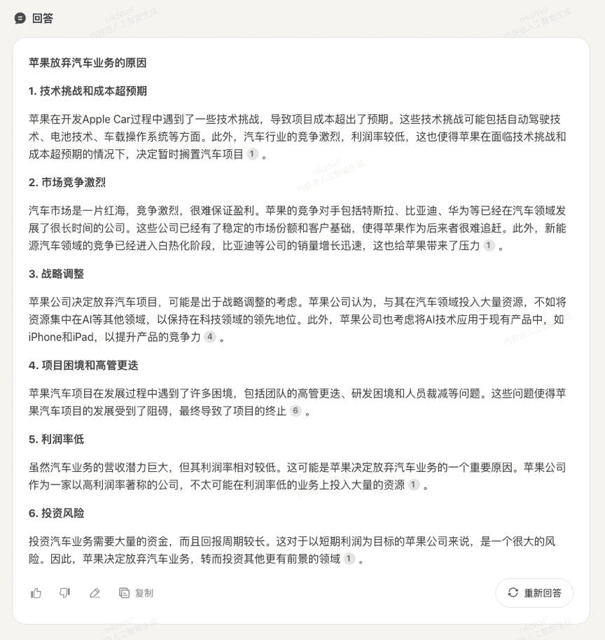

# 周鸿祎｜免费课AI系列第一讲实录

> 来源：[https://aiyanxishe.feishu.cn/docx/C14bdAZ6FoE0qbxegG0cNLVVnPc](https://aiyanxishe.feishu.cn/docx/C14bdAZ6FoE0qbxegG0cNLVVnPc)

2月29日，周鸿祎免费课AI系列第一讲直播3.5个小时，干货满满。互联网行业自身老兵周鸿祎系统性分享他对大模型、AGI以及未来人工智能发展的趋势判断，详解Sora创新突破的本质。关于AGI的全面深度思考，3万5千字完整版吐血整理，全网唯一无损版！建议收藏，反复学习！

**现场实录：**

我受李一舟这个事儿的启发，我发现大家对于AI的知识了解不多，尤其对于前沿AI的了解更是摸不着头脑，我想我有必要做一个科普课。首先，我不会像李一舟一样割韭菜，所以我做的是免费课，在AI时代，学习AI知识很有必要，我希望跟大家分享AI知识，共同交流。

另外，我其实想分享一个学习方法给大家。当我进入一个新领域的时候，我先要学习框架，中国有句古话：一叶障目，或者只见树木不见森林。无论云计算、大数据、网络安全、物联网，包括人工智能，很多新技术层出不穷，首先要在整体上对它有一个整体的把握，这个整体把握住了，就不会出大方向的偏差。

所以我的课程会先从宏观开始，比如今天我们演讲的主题《预见AGI》，我从大框架上跟大家讲讲创新趋势，这些创新带给我们的启发，后面我会宏观、微观结合，系统性的就几个主题展开系列免费课。我们安排人工智能研究院的产品经理、技术专家会跟我配合，会讲一些基本产品的一些使用方法这些微观层面的内容。

当然，我一个人的力量也是不够的，我对人工智能的理解一定是比较片面的，大家都知道盲人摸象的故事，AI走到最前面，实际上大家都在摸着石头过河，科技的发展本来也是这样 。但是，我跟一个普通做知识博主的人相比，还是有点资源，行业里我还是认识很多行业的专家。所以我会邀请一些这样的专家给大家讲讲课。

那么大家为什么要来听我的课，我的观点是，在人工智能的技能和知识面前人人平等，这是一种专业技能，就像学会开车一样。所以，我认为学会人工智能是每个人在未来自己职业发展生涯里一个必备的基本能力。当大家都掌握工具之后，工具都先进了，谁进步谁退步其实和工具没有关系。但如果你不懂人工智能，不会用人工智能工具，那可能就会被淘汰。

下面我们的免费课开始了，关于我的免费课的几个关键词就是：免费、分享、科普、交流。

最近很多单位请我去做交流，前几天我去居然之家，我讲了AI的三大心法，我反复都在讲AI的三大心法，其实最重要的是“AI信仰”，在座各位有没有AI的信仰？你所在的公司有没有AI的信仰，你的老板有没有AI的信仰？我认为，AI这件事信仰非常重要。

# 前言——360**AI三大心法**

# AI信仰

AI信仰这件事我列了几句话：

##  **一、你相不相信大模型是真智能。**

Sora一出来网上争论很多，GPT也有很多争论。不怕争论，真理越辩越明，但通过争论你会发现，很多人脑子里没有真正引入现代人工智能发展，缺乏真正的认知，还停留在搜索引擎阶段。比如很多人认为GPT能回答问题，实际上它读了很多书，它把不同书里的段落拼起来回答问题，这个理解对吗？这个理解是不对的。GPT最震撼的是你给它读了100遍文言文之后，可能你问它某一篇文言文，它不见得会记得很清楚，它不是一个死记硬背的孩子，但是它具备了写文言文的能力。你让它拿一篇文章把它翻译成文言文，从来没见过的，他能把它写出来，这才是真智能。

所以，很多人谈Sora，老把Sora理解为是像素级工作，他们老画一个狗，拿鼻子拱雪，拿一段雪的视频，再跟一个狗的视频，他以为是视频合成。所以，这样的人每天也都在谈GPT，在谈Sora，一句话就暴露他们的无知。对不起，我没指名，大家也别对号入座。

所以，我回到这个心法，第一，你相不相信大模型是真智能？比如在座的相信是真智能的举个手？只有一半。

## 二、你相不相信大模型是一场工业革命？

技术创新有很多，区块链，元宇宙、VR，创新很多。但是，大模型是一场，你可以认为是不亚于蒸汽机、信息化带来的工业革命，你信不信？

## 三、你相不相信大模型会重塑我们所有的产品跟业务？

## **四、你相不相信人工智能经过大模型的发展，过了**这个拐点之后，会快速的向AGI时代来临。

今天的标题预见AGI，AGI原来我们估计的比较悲观，认为还有十年、二十年。但是，从最近技术的进步，我的推断，我再说一遍，我说AGI一年是误读，我觉得大概两三年。所以，AGI是叫通用人工智能。所以，你相信通用人工智能正在来到，通用人工智能比大模型对我们整个社会、世界的影响更大。

## 五、还有就是你相不相信不拥抱AI的公司会被淘汰？

不拥抱AI的个人，可能会被会AI的人取代。所以，我列了这几条，有了AI信仰你才可能All in AI。

# All in AI

+          **All in AI**什么意思呢？

+          你的公司从上到下的人是不是都在思考AI？

+          业务内部流程能不能用AI来加持？

+          产品不能用AI改造？

今天AI不是要做新东西，大家可能都错误地理解，拿AI做个新产品。今天世界上所有的公司基本都是在拿AI改造自己原有的业务，原有的产品。我举个最典型的例子，昨天最热门的事件是什么？苹果放弃造车。

苹果为什么放弃造车，理由有很多，雷军也出来讲话了，李想也出来讲话了，小鹏也出来讲话了，几家欢喜几家愁，埃隆·马斯克也发了🧣，我对汽车工业了解不多，我们不多做评价。我从AI的角度，如果你是乔布斯在世，或者如果你是蒂姆·库克，你就想想他为什么要放弃造车。我认为，最重要的就是答案就是他要All in  AI。苹果是个很专注的公司，乔布斯回到苹果就把很多产品线都砍掉了，苹果不相信自己能一边造车，一边把AI做好。为什么？AI的竞争对手是谁？美国现在有7个大的指数级公司，我忘了哪七家，包括OpenAI、Google、微软、Meta，还有英伟达。所以苹果不想落伍，苹果就必须All in AI。你们同意吗？所以，他造车的这几千人都要回到（AI），苹果为什么要All in AI，设想一下，如果他不All in AI，这不光是股市概念的问题，他的核心业务会遭到打击。为什么呢？AI在重塑所有的产品和业务，那对苹果来说，他最担心的是AI重塑什么？重塑手机。

今天的智能手机已经从苹果iPhone第一代发布到现在多少年了，到现在十五年了。实际上十五年来，虽然叫智能手机，其实手机并不智能，它是软件定义了手机，手机变成了一个电脑。但是，三星最近在展柜展出了AI手机。手机算力的芯片发展到现在已经能够支撑大模型上手机了。这两天有一个新闻，有个叫Mobile  LLaMa的开源软件只有几亿参数进行了优化，已经能在手机上跑起来。对苹果来说，苹果发布了M3 CPU之后，它的M3 CPU有个特别的架构，显存跟内存是打通的，苹果的CPU架构特别适合做大模型的推理。所以，苹果All in AI的思路一定不是再跟OpenAI对标做一个类似的大模型，这可能是他的长线战略，短期内他一定会做出一个大模型的小数据量的版本，一个专业的版本，替代Siri的版本。因为Siri对苹果来说，起了大早，赶了个晚集。Siri概念很好，但技术不支持，所以Siri成为了不是人工智能的代表，在很多场合被我嘲笑成叫“人工智障”。所以，苹果公司无论怎么推实际也没推起来。

当然，如果用大模型重新改造Siri，再把手机上的所有东西都控制起来，手机就真正变成了你的智能助理，你用什么东西来指挥手机，可能APP变成底层插件了。如果各位有钱，雇一个小秘书，给你订餐，帮你叫车，给你处理日程，你还需要自己操作手机吗？小秘书非常可信，尤其本地大模型，不上传到云端，苹果又号称特别重视个人数据保护和隐私，它的大模型一定是本地化的。所以，我觉得苹果及把在汽车战场上的人力抽回来All in手机我认为是非常正确的，不All in手机会进入新的智能手机2.0时代，就不再是软件定义手机，或者手机不再是电脑，而是大模型重新定义手机，或者AGI重新定义手机。

这次CES出现了一大堆硬件跟大模型的交叉组合，但是这做得比较浅，苹果有一半是做硬件的公司，他的Vision Pro经常被很多人诟病，但是苹果下了很大的决心，做了耳机，这些硬件都和大模型结合，会产生什么样的爆发力。所以，苹果现在的策略，我认为用脚指头想想都能猜的出来，他一定是All in AI，而且All in AI的第一步战略一定是把他的产品用大模型重塑一遍。

# 含AI量

所以，我们现在正在做一个指标，在公司内部我们做含AI量。

+          如何评估一个公司的含AI量？

+          如何评估一个部门的含AI量？

+          如何评估一个员工的含AI量？

含AI量不一定是你买了多少显卡，花了多少钱，重要的是看公司里对AI的这种学习、讨论，包括公司里现有业务的改造，包括产品是否用AI来驱动。包括员工的含AI量，比如员工消耗Token的数量，一个部门消耗Token的数量，比如财务一点Token都没消耗，证明他们根本没用大模型，设计部门也从来都是手工绘图，也不消耗算力，这个含AI量就有问题。包括大家参加AI的培训课程，不是参加我的培训课程，AI账号的订阅费，包括现在很多AI的，其实网上有很多免费的AI视频、问答、OpenAI的手机专家他们都很喜欢做一些科普视频，但是这些科普视频一般长达30分钟，大家可能要耐心看下去，今天我会给大家推荐一个工具，帮你来看下去。所以，我的广告嵌入能力还是挺强的。

今天大概讲四个部分：

**第一，AI发展新洞察**。为什么要讲洞察？就是看表象不用跟我来沟通，因为网上公号的文章特别多，比如Sora能力、长达1分钟的视频，这些是人都知道。大家要学AI，要透过现象看本质。

第二，Sora给我们带来的启发。

**第三，我们该怎么做？**

**第四，360的AI新产品**，我们秀一秀推出的两个AI的成果，我忽悠大家的东西，像王阳明一样学以致用，言行一致，我们自己对外讲的是什么？我们内部也是这么说的。

# 第一部分：2024年十大AI发展趋势预测

你们都看了那场风吗牛对吧？整个一场闹剧，唯一有价值可看的不是我跟别人的PK，实际上是我在前面讲的一个36分钟的脱口秀，我预言2024年十大AI发展趋势。

当然，策略十条花了很多时间，我这十条观察了很多现象。钻研不是为了别的，我跟大家分享一个学习方法，有两种思维，一种叫总结性思维，就是站在现在看过去。这种思维不适合创业者和创新者。为什么？你容易用过去的东西来推导现在的发展曲线。

还有一种思维是站在现在想未来，就是做一种推演，说这个事情再往前发展，未来会怎么样，虽然未来会比较难以预测，马后炮比较容易总结，但马后炮没有意义。

今天是2月29号，是个特殊的日期，四年才来一次，和奥运会似的。所以到今天，2月的最后一天，这十大发展预测，大概有七八个都被验证了，所以是我太鼠目寸光，目光短浅，还是时代发展特别快？大家有没有感受到度日如年的感觉。哪些预测被验证了？

## **预测一：开源大模型爆发**

最典型的是Google是不愿意开源的。我们国内像阿里，包括小川的百川都在开源。我之前说了一句话，在外网被人骂成狗了，我们跟国外的差距有的时候是一个方向上的差距，当然一旦把方向指定，一旦开源了，我们进步就很快。我这话没说错吧？开源不是抄袭，开源是集中力量办大事，不同公司，不同的学校，产学研用，大家一起在开源社区的团结下，大家充分的共享知识，共享成果。为什么人工智能发展这么快？跟开源脱不开关系。如果就是OpenAI一家闭源，很多知识出不来，它就实现了垄断，它的发展速度发展不了这么快。而且OpenAI自己就是开源的受惠者，它用到的很多技术都是Google开源的，每个人都踩着别人的成果不需要发明轮子，而且思想充分的交流，技术充分的交换，使得这两年，整个像寒武纪，生物大爆炸一样，整个的大模型为核心的开源成果层出不穷。

所以，我认为我们国内第一步借鉴国外开源的成果。第二，要积极加入大开源社区。第三，我们不要再关起门来闭门造车，重新发明轮子了，在超级通用大模型问题上，要坚持开源。

## 预测二：小模型涌现 运行在更多终端

大模型会两个极端，一个极端是越做越大，一个极端是越做越小。

这里的小模型是个不准确的说法，大跟小，都是对的。所谓小模型就是“小参数的、小数据”的大模型，它的架构是大模型，但是它的规模比较小。比如说，英伟达推出Chat with RTX，大模型在终端上跑，**像三星对苹果的刺激，没有**人评价这个事儿，但是这个事儿很重要。现在手机的算力已经过剩了。如果手机就给大家刷视频，玩游戏，实际上手机的算力是过剩的。所以，手机上现在已经能，刚才讲了Mobile LLama的版本不到1B的参数量已经能在手机上跑。这个小模型的概念是什么？

我和大家讲两点：

+   它不是和OpenAI去比全功能，它往往是一个垂直模型，是个专业模型。

+   它不是用在最高精尖的领域，比如苹果，让Siri更好地理解人的讲话，根本不需要GPT4，甚至GPT3.5都不需要，一个小模型就完全可以来胜任。

所以，包括杨元庆，联想在搞AI  PC。大家说AI  PC有什么价值呢？你们将来搞家居自动化，家里的东西最终都要有一个家庭大脑把它控制起来，家里要有一个助理，现在的家庭音响的算力是不够的。最终你家里一定要有个大模型。如果再发展五年，家用机器人进到家里，进入老龄社会了，你们都享受看护机器人的服务，这个机器人的驱动核心一定是个大模型。但是，这些大模型因为在你家里工作，你带什么女孩儿回家，大模型都知道。所以，这些大模型数据是不能上传到公有大模型云端的。包括手机侧大模型都要在终端上。

当然，我讲一个预言，有一次我上问界M9，那天我喝了点酒，就跟小e聊了半天，聊得很尴尬，我也有问题，小e也有问题，说明小e还不是大模型驱动的。有一个真正的大模型上车之后，包括智能座舱，未来的自动驾驶，都会起到很大的推动作用。你现在跟目前人工智障的那些产品要说什么指令呢？你就说，请把屋里的温度调到22度，其实这不是我们人的习惯，你要说太热了，我要脱衣服了。传统的AI是听不懂这句意思的，它可能就跟你瞎聊了，但是大模型肯定能准确地理解你的意图，自动把温度调到16度。

##        预测三：大模型企业级市场崛起，向产业化、垂直化方向发展。

我觉得国家搞大模型应该多条路并进，而不是只走OpenAI  GPT4一条道路。最近发改委发了一个文件，号召国企都要做产业大模型、行业大模型。我也跟一些国企领导聊了一下，他们不做通用大模型，大家明白说，真正大模型要成为生产力工具，要真正赋能产业，真正的点是在企业侧、产业侧，这个是我下次课要讲的企业方法论，就是企业如何用大模型来改造自己的业务，来提升自己的生产力。

在企业侧，我们也做了一个实验，360是一家做安全的公司，我们打造了一个安全大模型。我们发现在企业侧，不要追求用大模型解决企业所有的问题，解决企业某一个场景用到的垂直问题，它也不用像GPT4一样追求又能写诗又要解奥数，又能说外语。它就解决企业里一个垂直场景问题的时候不需要万亿、千亿的模型，这样算力的问题迎刃而解。垂直大模型，参数只要做小，在一台手机上都能跑起来，企业几台服务器有什么跑不起来的呢？所以，对企业最大的妨碍是成本，原来一说做个大模型都要千万美金，如果是这样的一种产业格局，大模型跟我们绝大多数人都没啥关系。

第二个关键是，在企业里面训模型，需要企业专有的知识。我们称之为暗知识，这些知识在网上是找不到的，只有在企业里边有。在企业里边，很多企业也未必都能及时的汇集起来。当然你一旦把企业里独有的知识，外面找不到的行业知识训练进去，再跟业务深度融合，你的单向能力超过GPT4是完全密谋问题的。

所以，我觉得今年会是很多创业公司的热点，也是很多传统企业的热点。

##         预测四，多模态成为大模型的标配。

GPT3.5，GPT4出来的时候大家的感觉是什么？处理文字很牛。实际上，后来大模型从理解语言到理解图片、视频、听筒、声音，OpenAI的产品密集地发布，Meta发了一个V-JEPA，这是杨博士推崇的世界模型打造的多模态。Google推出Genie……这个写错了，Genie是新的，是世界模型，实际Google的Gemini里号称强大的就是对视频和图片进行深入的解读。Stable Diffusion发了最新的版本，也是有很强大的对视频和图片的理解能力。注意，我强调一下，文生图和文生视频严格说不难，Diffusion算法都能支持。最难的是你得画对一幅图，你对这幅图相应得有理解。如果你对一个图都没有理解，想把一个图或视频画对是根本做不到的。所以，我们看Sora表面上看起来是一个做视频的工具，Sora背后意味着OpenAI对视频的阅读能力、解读能力、分析能力有了非常大的质的提升。

##          预测五，文生图、文生视频等AIGC功能突破性增长。

这类预言是无意中“打中”的。其实我没有预言Sora的问事，这完全出乎我的预料，但我们认为文生图、文生视频、AIGC的功能会突破性地增长，当时看Pika、Runaway，Steam radio也正式开放了公测，再加上Sora的登场，Sora本身这个工具也很值得称道。如果这真的能投入使用，它对今天的影视、游戏、设计、短视频，特别是短视频今天无处不在，短视频重塑了我们连接信息的方式。所以，公司的宣传部门和短视频有没有关系？做电商的和短视频有没有关系？做工业设计的几乎所有的行业，在线教育、家装，你要设计一张家装装修图可能也得只给视频了。前两天和居然之家的老板在讨论这个问题，这都面临巨大的变革。但是，AIGC强大的能力不代表这个行业会被干掉，现在有的人不再投资好莱坞了，这是一个应激反应。

##         预测六，具身智能赋能人形机器人产业蓬勃发展。

原来我不太看好人形机器人这个产业，你如果投过类似的公司，在大模型出来之前，人形机器人做玩具还可以，因为没有办法训练它干一万件事儿，你训练他干一万件事儿，还有第一万零一件事，它就干不了。所以，对具身智能或者对人形机器人来说，最致命的问题是，他原来不仅和人无法沟通，对这个世界的观察、模仿、理解都是没有能力的。但大模型出来之后，大模型成为了人形机器人的灵魂，成为了核心。所以，人形机器人这个产业在未来两年获得突破性的增长。

所以，DeepMind与斯坦福团队推出二代家务机器人ALOHA。家务机器人的唯一出路是遥控，或者模仿，就是教它一次它能学会。比如你教你们家小孩子煎鸡蛋，你身为爸妈，是不是得身体力行教他一遍，光给他一篇文章，小孩子也学不会。我们不能期望机器人的水平比人类要高。所以，观察就意味着它的视觉分析能力就要从感知层面转变到认知层面。

举例炒个鸡蛋西红柿，它需要的知识太多了，它得知道这玩意儿装在冰箱里，冰箱可能装在不同的格子里。另外，西红柿不会捏碎，生鸡蛋掉在地上会打碎的，它得有这些知识，光识别一个图上有没有鸡蛋，光这个知识能力是不足以产生家用机器人的。所以，最近一个最热门的叫Figure AI获得了很多大公司的投资，就是手腕机器人。这个产业本来都已经快要消亡了，因为大家认为短期内不可能。

GPT的突破，我感慨一下，最大的失误就是把GPT看成一个聊天机器人，你如果把它当成一个玩具就错得很离谱；第二个失误就是你把Sora看成一个做视频的智能化工具，没有了解它背后秀的这种肌肉代表了技术在什么样的进步，从而带来对产业的推动。

##         预测七：大模型推动基础科学取得突破

这是我的一个美好期望，也是一个共识。很多人问做通用人工智能为了啥目的？我认为本质上AI for Science，这是人类的终极梦想。后面我会讲为什么是人类的终极梦想，AI成为科学家研究的工具，因为人类在基础科学上如果没有突破，人类所有的应用科技都会停步不前。我们现在能享受互联网是因为有计算机，计算机因为有芯片，芯片是来自于物理学的很多突破，才能在硅片上把这么多的晶体管做在上面。这要感谢大概100年前，像奥本海默或者爱因斯坦、波尔、费曼这些物理学家取得的进展。那个时代是人类智慧的一个大爆发。

最近50年，人们在算力粒子方向，在可控核聚变方面，在常温超导方面都没有取得突破。如果这没有突破的话，AI是否能帮助人类有所突破。最近有个案例，美国普林斯敦大学通过训练大模型，提前300毫秒预测了等离子体的撕裂问题，帮助他们攻克了可控核聚变反应不稳定的问题。我觉得这样的例子还会更多。当年Alpha Go利用人工智能解决了蛋白质折叠的分析问题，这对于研究很多新药，研究人类很多疾病，和大家有没有关系。如果AI for Science获得共识，对人类基因的研究，可能让更多人的癌症得到医治。

刚才预测七个都验证了。有人问我，你再预测十个。我说这也不像老母鸡下蛋说来就来，我得花点时间回家去攒，我得看文章。我再和大家分享一个经验，就是要广泛地阅读，一定要加大自己的阅读量，为啥我在内部还讲一个“盲人摸象”的故事。认知上来说，这个故事完全可以有一个光明的结尾，盲人们不是互相抱怨谁是对的，而是把他们的结果拼在一起，我们就知道完整的大象大概是什么。你通过广泛地阅读，广泛地热烈，把它们都集中起来，可能对你了解AI的全貌有帮助。

# 第二部分：Sora的创新启示

**所以，Sora的出现确实超出我的预料，超出所有人的预**料，看起来是一个剪视频的工具，其实不是。

你们看过国产007吗？我最喜欢的产品经理叫周星驰，《国产零零漆》里面有很多有创意的产品，比如太阳能手电。我们公司也做过类似的东西，还有“要你命三千”，这是很多互联网公司都在做的东西，就是1个功能没做成，把10个功能绑在一个超级App里把它推出来。当然，它最有意思的作品，一会儿会播，那是我最爱说的桥段，我给很多产品经理讲过，就是它看起来是一个吹风机，实际上是一个刮胡刀，或者它看起来是一个刮胡刀，实际上是一个吹风机。所以，GPT看起来像个聊天机器人，它实际上是机器对这个世界的观察能力和长时的总结工具。

别人谈Sora，有两个极端。今天“出门问问”的李志飞发了一篇文章，本来我想请他讲一下，但是他要收费。那篇文章写得很好，就是太技术范儿了，但是有一个观点我非常同意。OpenAI的技术文档表面上是技术文档，最关键的地方它一句话也不会给你透露的。奥特曼是最聪明的人了，奥特曼最善于做营销，你们得承认吧，他是营销大师，他怎么可能傻乎乎地做个创世界的东西，发一篇技术文档，让全世界的同行一看就能复制呢？所以看技术文档，有的时候他会故意把你往沟里带。有人就谈一分钟长度，镜头稳定感，其实都不是本质的东西。下面我介绍一下我的观察，我的眼睛虽然近视，但是我老能看到别人看不到的地方。

你们看过Sora的视频吗？有没有没看过的举个手？依然有人没看过，赶快在我这儿补看一下。其实你们觉得它真正的逼真是什么？画面的华丽，有人浑水摸鱼，说Stable vedio也做得很好，Stable video做一个图绝对漂亮，Midjourney做一个图绝对漂亮。“漂亮”是很容易做到的，最难做到的是逼真，有时候我们看电影会说这个电影是五毛特效，你管什么特效是五毛特效？你看着特假，你判断真和假的依据率什么呢？其实不是物理规律，你都不懂物理谈什么物理规律？实际上是常识。每个人生活这么多年，我们已经建立了常识，我们知道水倒在桌上会形成一摊水渍。比如知道雪是松软的，你知道一只狗到草地上，拱一拱不会把草拱起来，不会把泥土拱的满地都是，但是雪地里就会。这些都是就叫常识。所以，当你在场上转弯的时候会看到物体不同的面。事实上除了Sora，市面上，包括这两天刚发布的新的做视频的工具做的视频，我都看了一遍，本质不在于多少秒，本质在于他那个视频里基本上要么后景在动，要么前景在动，基本上都是平行。比如后景在动，那个图本来就是透视的，只不过迅速的伸缩了一下。但是，让它转到街边后去，基本上做不到。所以，这已经算最本质的差别。

## Sora的视频为什么逼真？

这个逼真是什么？狗身上的毛茸茸，这是真实吧？雪往下掉，雪被抛起来，雪流到狗头上，狗鼻子上。有人看起来，这个狗画着画着三只狗变两只狗了，这个出错不重要，这是一个可以改进的东西。所以，再给大家分享一个认知点，挑毛病是特别容易去挑的，你可以对一个出生的婴儿横挑鼻子竖挑眼，把他说的一无是处，但是你改变不了20年以后他成为一个优秀的青年，我们对新生事物横加指责的认知，就导致自己的思维老龄化。所以，我是主张，大家一定要有认知，看任何新东西看优点，因为缺点只要不是致命的。

有人写文章写得很对，说Sora是视频的GPT2时刻，因为GPT3.5太成功了，GPT4太牛了，但是GPT2是什么概念？是人类历史上第一次让机器能写出完全有逻辑、有条理的句子和文章，这就代表了实现了零的突破。一旦实现了零的突破，再往下就是一个顺理成章，不断地加算力、加训练的一个增长，但零的突破是最难的。莱特兄弟的飞机最简陋，为什么我们要纪念呢？因为它第一次让人类飞上了天，飞上天之后，这个原理就可以不断地被优化，不断被改善。第一台电脑是不是像玩具一样，第一台汽车是不是比马车跑得慢。所以，GPT2刚出来的时候，除了少数人慧眼识珠，大多数人看它的缺点都觉得不过如此，就错过了OpenAI的机会。

下一个视频，这是赛车开在旧金山的街道，看到里面的光和影，有速度的时候，地面的表现是模糊不清的质感。镜头跟着转，这个3D的视角。这下面是真的。有很多人怀疑，它太逼真了，有人用旧技术来穿插，怀疑它内植了一个引擎，换句话说，它每一个视频都是3D建模，拿引擎像游戏一样把一个真实的场景搭出来，然后渲染出来的。所以，它产生了一张静止的图片。这张图片你们没有找到原版的。这是一个厨房的照片，产生了360度环视的效果，那个人在火上烧自己的手。这个视频也被人批评，对于那些喜欢批评的杠精，他们说厨师看着忙忙碌碌，不知道在干什么。我们看到的是一个2D的照片可以生成一个三维的360度的景致，而且照片非常逼真。

下一个视频，猫走路的样子，土地上的质感，包括猫的爪子，毛发很逼真，猫在里面移动，还有传统叶子的光泽，叶子的质感，叶子的晃动，传统的CG做到这样的效果没有两个月的建模是做不出来的。

下一个视频，猫的毛发很真实，猫也很像真的。我让你们看枕头，枕头的质感，它过来的时候枕头有个被压下去的感觉，有没有人做3D动画，3D建模这样一个枕头不难做，表面的图案用纹理也可以做，但是当一个人把枕头压下去，枕头以什么样的速度往下运动，以什么样的函数能描述呢？这个是怎么做出来的呢？你可以观察观察这个细节。

这是古建筑的无人机飞跃、穿越，鸟瞰，随着镜头的转移，我们可以看到更多的新东西，看到不同的面，特别像一个3D渲染的模型。

所以，通过刚才看的模型，我问大家一个问题，一个视频虽然是一帧一帧画出来的，画出来一张静止的照片和画出来一张动态的照片难度在哪里？大家想一想。比如说，Stable Diffusion今天画一个狗在雪地上的照片，比Midjourney画得更漂亮，因为它拿了很多照片去训练。但是，它知道雪的颜色和样子，知道狗的毛发和样子，这都能够画出来。但是，为什么画不了动的？因为一旦让狗动起来，毛发飘动的感觉，可不是这样的。雪的质感和土地的质感和沙子不一样，如果没有对这个知识的理解、掌握你觉得能画出来吗？有人解释说，他看得视频很多，靠不同的视频做拼合，这还停留在PhotoShop（PS）的认知水平，他就是对人工智能最大的误解。我自己刚接触人工智能思维也转不过来弯，后来就想把它当作黑盒子，先接受它的结果，就是说它看了100篇法律论文能写出第101篇；它看了无数狗和草地的照片、猫的照片，能画出来一只你从来没见过的猫和狗，这就是它学习以后对能力的泛化。这才叫智能。

为什么我上来就讲它是真智能，不是假智能。搜索是假智能，搜索只是检索。所以，我们对大模型做训练时，跟大家读书是一样的，为什么不要死记硬背？死记硬背是把知识Download到你的脑子里存起来，这是没有意义的。理解是把知识放到你的脑子里进行泛化、分析，进行相关的联想，跟你很多原有的知识建立了连接，这样你才能实现新的联想力和创造力。为什么人类的小孩儿看过一只猫，一只狗，不同花色的猫跟狗就能准确地辨出来就是猫跟狗，这就是人的泛化能力，原来识别需要一万只猫的图片，一万只狗的突变，才能训练出一个识别猫跟狗的程序。但是，如果把羊稍微抹一样它就认不出来了，这是对人工智能的局限性。而GPT和Sora显然突破了这两点。

## Sora创新突破的本质是通过观察理解了世界常识

所以，我的结论是Sora能够画出来，就意味着它一定理解了某种常识（我用的这个词可能不准确），这个常识会知道水倒在桌上会形成水渍，水会流动，雪会掉下来，雪是松软的。所以，再往前推理一步，Sora能画出来，真的有这个能力，这个知识，这个知识从何而来呢？应该不完全是GPT灌给它的，因为GPT通过文字描述，像我给一个从来没见过雪的人描述雪，让他画出一个雪和狗的交互，我认为真人也未必能画得出来。大家去想想看对不对。

我的理解就是Sora的训练过程中，Sora应该在多模态的输入，不仅理解了视频里有什么，它应该把它背后的一些规律做类似人类常识给学到了。所以，我认为，它“理解”了世界的一些运行规律。

第一、理解了规律，不见得理解了公式。我从来没有说Sora理解了公式，地球人都没有能力看见苹果掉下来就总结出F=MA的公式。这么几万年来才出来一个牛顿，你说GPT或者Sora达到这个能力，那肯定没有。当一个老农民，一个小孩儿没有学过牛顿定律，并不妨碍他观察一个东西从桌子上掉下来会掉到地上，会垂直下落。这种规律不需要公式的了解，人是不是也能建立这个常识。甚至猫没学过牛顿定律，但猫能准确地预言老鼠的速度，能计算一个提前量。这是生物的本能。

**所以，为什么我说AGI会来临？**因为电**脑只是跟人能沟通是不够的，**那得像一个只有大脑的东西，它能跟你说话，能跟你交谈，他对这个世界根本不能了解，它没有这个常识，真把它赋体到机器人身上，它出去看见水不知道会掉下去，看见雪不知道会陷进去，看见沙子不知道会摩擦，看见硬地才能支持能支撑。它没有知识怎么做具身人形机器人呢？所以，它还没有到理解公式这一步。

**第二，Sora做的视频里有些东西它理解的不太对，我觉**得这跟训练有关系，因为毕竟现在算力有限。举个不恰当的例子，如果有人没有到过沼泽地，没有这种经验，没看过电影，沼泽地有一种看着很平实的地方，一踩下去能把自己陷下去，有的人就会误踩，那你就是没有经过这种经验，没有经过这种训练，人也会犯错误。所以，Sora今天在视频里犯的一些错误，我可以把它归结为训练量不足，就像GPT有时候会“胡说八道”一样，就是还是不要因为它某些小的缺点就把这个技术贬低为一个产品的创新。如果就一个产品的创新，全世界为什么只有一家公司做出来呢？为什么Sora做了这么久还没有人跟进呢？

## Sora与Pika、Runway、CG 有何不同

所以，为什么Sora对Pika和Runaway形成了降维打击呢？Pika和Runaway，还有Stable Diffusion，原来这种文生图、文生视频的产品没有对这种世界运转、交互规律的理解和常识的积累，它才是真正在像素层面一帧一帧地选。换句话说，它知道自己画的是个猫，也知道自己画的是个狗，但是不知道猫跟狗互动起来会怎么样。比如说，狗在雪地里走的时候，爪子是怎么样的，他对这些是没有认知的。所以，这种只用像素来渲染的工具，未来做图是没有问题，但是做视频是肯定不行的，就不逼真，或者做一些简单的动画型的，就是一些简单的动画，人在图形上移动，或者两个小腿交替的做简单的动画这是可以的。

还有一种方式是CG特效，大家看过《阿凡达》都知道，好莱坞工业一个重要的花钱就是在特效工业上。特效怎么做呢？特效用一种最笨的方法，你不是要毛吗，要头发吗？我一根一根都给你做出来。然后用一个光照的公式来算头发的光泽，如果风吹起来，毛发飞动，它有些粒子特效，实际也是数学函数来驱动，计算每个头发的摆动，最后一帧一帧把头发渲染出来。所以，为什么拍一部电影，比如说一部30分钟，像《流浪地球2》的特效有的人要做两年，有的人把电影花几个亿的预算，80%的人工做特效，因为这是一种最笨的方法。

Sora如果是这么做了，Sora就没有颠覆性了。我猜测Sora没有建模的作用，因为它的投像一些看起来像建模的，是因为它的训练数据用了一些建模的3D游戏画面来做训练，这大家可以理解吧。像我拿一些3D建模的游戏画面在里面操纵一台赛车，把这样的画面拍成视频给它看，用来做训练素材。当然我不认为它里面会内置一个3D引擎，因为内置一个3D引擎的算力成本和复杂度可能比Sora本身只高不低。

**Sora的原理，它通过对图像和视频的学习和训练**，它知道世界里面一些常见物体的交互关系。比如说，篮球打到篮板会反弹回来，篮球扔出来走的路线是抛物线，这些知识用语言描述恐怕都很难理解，必须通过看图。你们有人打篮球，如果带你孩子打篮球，不带他到篮球场，光语言上说，篮球像抛物线一样，你扔给我传给我，永远学不会打篮球。所以，如果开放账号以后，让他生成一段MBA的篮球赛，你就可以知道。再生成一个世界杯足球赛的判断，就知道如果它没有对足球、篮球不同规律的理解，它是画不出真实视频的。当然，我这里是合理的猜测，大胆地猜想，它肯定要符合逻辑。所以，我认为它通过现象理解了，通过运动的常识来驱动。

** **所以，它为什么是一个世界模拟器，你们模拟世界必先了解世界，而了解世界不一定是了解语言，要了解世界基本的规律。

举个不恰当的例子，像《盗梦空间》，我觉得它很像人做梦，你在梦中会把白天见到的很多场景和常识在梦中构造一个无比真实的世界。当然，人脑是3D建模的吗？人脑不会3D建模，为什么？因为人脑没学过3D建模的公式，人脑也没学过光照的模型、算法，最重要的是人脑算力不够。所以，人脑利用常识就能脑补出很多缺失的画面。我觉得Sora的目标和路线应该是跟这个比较类似。

## 像素论 or 理解论？

最近我怼杨立昆，天天说OpenAI的坏话，OpenAI刚出来，他就说这玩意儿不行，是个填空器，它虽然能写文章，回答问题实际上没有智能，不能理解。最近Sora出来之后，他又说Sora是个骗人的东西，只操纵了像素，对世界没有理解。他自己推了一套世界模型，我也看了，似懂非懂，我感觉想法很美好，但是做不出来，停留在文字上。

所以，**Sora是不是操纵像素？我已经给大家证明了，如只操纵像**素，而不能理解，是做不出这么逼真的图的。杨立昆为了批评Sora，又拿GPT做例子，因为Facebook主力LLaMa的产品走的跟GPT一模一样的架构。

这里边有一个关键的问题，GPT到底理解了语言没有，或者Sora到底理解了这个世界没有？就回到一个哲学语言上的争论，如何定义理解，比如它是个计算机，和我们大脑的原理不太一样。我的观点是这样，像图灵实验一样，不管对方是个什么，哪怕对方号称是周鸿祎，你啥问题他都回答不出来，那你的结论是周鸿祎理解了，你可能会觉得他是个傻子，一个问题都回答不出来。

但是相反，如果一个小朋友只有3岁能够回答你所有的问题，我们是不是觉得他理解了？不理解就不能回答。所以，理解常识不等等了解物理公式和定义，所有GPT都是一个黑盒子，但是能够对我们的要求给予正确的反映，我认为这就是理解。

所以，拿GPT的例子来讲，比如很多人拿最典型的情商的例子，说Tom生日收到一盒巧克力，但是打开是爆米花，为什么他会感觉很伤心？这个问题它都能准确地回答。包括最近大家PUA大模型，承诺给它小费，说回答不出问题，手要被老板剁掉，大模型回答问题的能力就提升了一些。就是你运用大模型就越感觉，如果你不歧视它，它真的对很多问题的理解，包括OpenAI，网上有很多人做视频，跟OpenAI用语音互答，你觉得那像是一个没有智能人的回答吗？它绝不是把它存了很多文章，重新做了一个拼放，完全不是这样的。

我再举个例子，你们都用过压缩软件，最大的压缩比是多少？你能压缩一万倍，一千倍吗？压不到吧。但是，当你拿100T的知识训练GPT的时候，出来的大模型只有100G，100T的资料变成100G，信息少了1000倍，说明什么？说明它的训练过程不是把信息存到大脑里，它对信息是作为阅读理解，把信息重新做分解，重新做了重组，它把这些信息代表的能力在大脑里建立了起来。但是知识它都丢掉了。

所以，我再举个不恰当的例子，我越研究GPT，越觉得跟人的大脑工作特别像。比如在座的都念过大学吧，都参加过高考，都是小镇作题家，这话没有贬义，我也是一个小镇作题家，我们做了1000张卷子。今天还有谁记得自己做的某一道题呢？肯定不记得了，所以这个知识你丢掉了。当然，通过做1000道题之后，你对这一类题的解题的能力肯定还在脑子里，你儿子学奥数，拿一个题让你来回答，你就能解出来。GPT就具备这个能力。顺道说，很多家长以为有了GPT的工具小孩儿就不需要学习了，这是错误的（看法），学习起到的作用不是学知识本身，是学知识本身背后泛化的能力。你们大学学过高数吗？高数有用吗？

我原来也这么认为，买菜用不上高数，做编程这么多年，用到10以内的加减法，也用不到高数。但是，学高数实际上是对你大脑做了一次重新的泛化，就是你大脑因为学高数会产生很多新的神经元，会把你的脑细胞做了很多没有学过高速的人没有过的连接，这些连接在你大脑里组成一个神经网络，使得你分析问题的能力，解决问题的能力得到了一些提升，只不过你自己没有意识到而已。

我们在训练GPT的时候发现一个很奇怪的现象，用英文训练的知识在中文上表达的能力很强，GPT就是这样的，中文语料很少，就是跨语言的能力，这是不是很神奇。GPT学编程，它的条理性、逻辑性得到了极大的增强，程序员做事儿都是1、2、3、4、5。虽然将来可能不需要程序员了，还是要学学编程。我们很多学习的过程，我们不是要把那个东西记在大脑里，而是通过在大脑过一遍，对大脑产生变化。所以，我们对GPT做预训练，把很多知识灌进去，真的不是download下去，真的不是保存下去。你要真去想人工智能，那就大错特错了。智能为什么要耗算力，它真的把每个字和每个字的相互关系要啃一遍，要建立联系。当然大家知道学校跟学生关系很密切，学生跟老师关系很密切，学生跟考试关系很密切，它才能建立这些联想和推理。

所以，我经常举例子，如何定义飞，鸟的飞是怎么定义的？鸟是有翅膀。那飞机的飞是直接就飞起来了，那请问飞机的飞叫不叫飞？按照杨立昆他们的说法，那不叫飞，因为你没有按上翅膀。人类后来发现说，人类造机器，装上鸟的那种翅膀的方法，人类飞行器也没飞起来。我认为，机器的工作基本器械和人的大脑不一样，但是逻辑上工作原理一样，它能准确地回答问题，能理解世界，这就叫理解。

## 多模态发展的五个层次

**        所以，做一个**总结。多模态我觉得有五个发展层次，这是我的版权。比如说，我举个例子，如果有一场篮球赛，机器识别，多模态识别分为五个层次。

1.  第一层次是最早期的人脸识别阶段，就是能识别有运动员，有篮球，注意，早期的识别都不一定能识别出运动员，它能识别出有人，有一个人和周鸿祎长得很像，可能有一个篮球，有一个运动场，它能实现对象。这是最早期的识别。

1.   到OpenAI的思维版本，它又有一定的逻辑推理能力了，就是它增加了大语言，跟大语言模型结合之后，它能认出来，这是一场篮球比赛，可能能识别出是MBA还是CBA。

1.  第三层，它能对逻辑的合理性进行推断了。比如我们做过一个实验，PS一个蒙娜丽莎，肌肉很发达，它就识别出来蒙娜丽莎是女的，不应该有肌肉这么发达的手臂。当然，不排除真的有女的长这样的手臂，所以我们PS了蒙娜丽莎。比如我们在球场上搞了一个球员3米高，现在的多模态识别就能出来这不合理，世界上没有这么高的球员。

1.  最近Google推的Gemini多模态能力到什么程度呢？看一个NBA的录像，它能识别出里面30个最漂亮的进球，就是它有了一定的评价能力。我也不知道怎么识别的，是不是掌声最响亮，还是观众最热烈。这里面的能力都是从图上读不出来的，都是对这个世界模型和知识的理解。

1.  我认为，Sora能到第五层，到什么能力呢？就是它能了解物理规律，它可能识别篮球在地上会弹起来，比如篮球飞行的抛物线，比如篮球到篮板上，篮板上都是透明的，篮板是能反弹回来的。但是，到篮框上的小方块里边，它会垂直下坠，会掉下来，我猜测Sora基本上具备这种能力。这种能力用在机器人身上是不是跟人类就会越来越像，否则你的机器人在你家啥也不能干，因为它眼里只看到了目标和对象，它不知道什么东西会动，什么东西动起来是什么样子，杯子掉下来是往上飘还是往下飘。

所以，这是我们认为的多模态的五个层次。拿这个可以对标国内外的多模态的产品，Sora肯定是最遥遥领先的。这都同意吧。

## Sora翻车，瑕不掩瑜

杠精老是喜欢说Sora翻车，它有个视频做的，比如有的视频出错，比如3只土狼，在那儿混着混着变成4只了，有些厨师消失了，突然做了一个厨师。最近有一个视频，是一只鹦鹉飞的树说，跟猴子之间好像发生了点图像的重叠。

我的感受是什么呢？第一，有可能像GPT这是幻觉，GPT的“幻觉”你们都知道吧？知道“幻觉”的概念吗？我补充讲一下幻觉，就是GPT会胡说八道，简单的能力，说好听点叫杜撰，说不好听叫幻觉。你们觉得幻觉是好事儿还是坏事儿。“幻觉”是个双刃剑，在创意领域，幻觉绝对是个好事儿，它能无中生有。当然，在一些企业内部场景说，幻觉是个坏事儿。因为你给人开药产生了幻觉，出了错，内容不安全，会胡说八道，会惹祸。但我告诉你，人和动物最大的差别是人有语言。人语言一个很大的特点，人语言不仅能描绘这个世界的模型，描绘这个世界的知识，人能拿语言描绘不存在的事儿，人能拿语言说假话，这都是叫幻觉。所以，幻觉是智能体固有的特性，搜索引擎从来不会产生幻觉，你搜的东西有就是有，没有就是没有，所以它不叫智能。包括创新力，什么叫创造力？很多创造力不就是把两个不相关的事儿放到一起，就成了创意吗？虽然99%的证明不靠谱，但是1%的概率就有可能成功。

所以，人类有了幻觉的能力，有了语言的能力之后，人类跟动物有了本质的差别，差别是什么？在《人类简史》那本书里，他讲人类因为有了这个能力，所以人类才有了社团、宗教、社会，才有了公司。每个要想当公司创业的员工来找我谈话的时候，我都说要有现实扭曲力，一个老板不会描述不存在的事情，怎么来激励员工呢？每个老板都会画饼，画饼的能力就是幻觉，就是杜撰。

所以，在视觉训练和产生视频的方面，我认为就像做梦，有的梦非常真，有的梦非常假，或者我梦的很高的楼跳楼，竟然没有摔死，这就叫幻觉。第二个问题就是它训练样本不够，比如你从来没见过沙子里面挖东西，你产生一个沙子里面刨东西的视频，肯定死活做不出来，肯定就会做成像雪，或者像土地，无中生有的东西。

还有一个，我觉得Sora这批人是天底下最聪明的一批人，至少之一了，他们有瑕疵的东西为什么也往外放呢？为什么不经过严格的审查只放完美的东西呢？我猜了一个主意，他来告诉你说，我没有内置3D引擎。因为内置3D引擎的渲染画面是不会有任何错误的。所以，瑕不掩瑜，就不要因为一个新生事物的一些缺点去否定它的全貌，批评是容易的，创造是困难的，反对是容易的。因为反对它对我们来说，除了发泄情绪价值，得不到任何的成果，但是分析它未来的发展，看到它有很多成长点，可能对我们的成长，对我们的创新可能会带来大的帮助。

## 关于Sora技术实现的猜想

对它的几个技术实现的猜想，一个是电影，TikTok、YouTube、还有3D引擎生成的视频，我觉得这个解决了我一个什么担忧呢？原来我天天替大模型操心，GPT4大概把人类的知识训练的快用完了，人类产生知识的速度并不高，并不是每个网页，每个抖音的视频都可以叫知识的，我现在传授的是知识，但是很多视频里，很多网页里是信息，是数据，不一定有用。大家也证明，为什么模型都一样，训练方法都一样，但训出来的效果不一样，就跟孩子都是人体的一模一样的大脑结构，上了学念课本也差不多，为什么成绩不一样？我觉得还是跟教育内容有非常重要的关系，这证明了用高纯度、高价值、高含量的知识训练的GPT就比用聊天记录训练的GPT要聪明。但是Sora解决了什么问题？解决了训练数据不足，也就是当大量视频都能作为训练的知识输入，这是什么概念？实在这个没有了，还有啥方法呢？接摄像头。所以，你就理解为什么特斯拉马斯克很骄傲，这个东西我们也有，就理解特斯拉车上摄像头大量记录各种路况、车内、车外的信息，这些信息都是训练的素材。

当然，这里面有一个问题，李志飞今天讲，说以后的一个趋势是人工智能自产自销，自己产生训练数据，要拿来训练自己，这件事到底可不可行？我觉得还需要再讨论。但是交叉训练是可能的，把A模型训练的数据拿去喂B数据。我们国内很多模型实际上偷偷的用GPT4产生的结果来训练自己的模型，但是带来的效果就是可以速度很快，很省事，但是你的模型的聪明度永远超不过你的老师。

还有一个算力成本，现在猜Sora的模型参数多大，我觉得没有意义，因为视频模型和文字模型的参数是不能等同对比的，但是我认为它的成本应该会超过GPT4。为什么？处理视频的难度要比处理文字，比如说都用Transformer来处理，文字是一个一维的，只有前后关系。比如说，小明在老师的前面。图像就具有二维特征了，视频有三维的，视频每个像素在第一秒是什么情况，第十帧是什么情况，它是一个3D数据。所以，为什么它做1分钟就不能多做了？我觉得能做1分钟，就能做60分钟。不能多做就是因为算力的问题。最近美国布隆伯格杂志获得了一个测试账号，能产生4个视频，他们实验成功的做了两个，时间特别慢，时间特别长。按照目前的成本是以什么为单位？万亿，基本上是以万为单位。所以，我今天感慨，贫穷限制了我的想象力，也不是以亿为单位，是以万亿为单位。

最近Jensen  Huang也在配合他，说要打造新的算力的芯片架构，包括如果现有的算力要求7个地球，还是3个地球都不用。所以，唯一欣慰的是人类虽然比它算力要差，但是我们人脑的功耗比较小。

所以，事实证明，GPT用的Transformer的模型是一个正确的选择，GPT和Sora里面都用了Transformer架构。为什么Transformer架构的证明是正确的呢？因为在神经网络早期，Transformer有很多变形。比如说，目前GPT用的Transformer只带Decoder，不带Encoder。但是，Transformer还有一个变形，比如说，Berd自带Decoder，又带Encoder，还有一个T5模型，包括神经网络还有RNN、CNN叫做卷积模型。但是，最后为什么OpenAI选中的并不是自己发明的自Decoder的Transformer模型呢？我觉得有两个最大的效果，就是说训练数据不需要标注，这是很伟大的一件事儿。如果我们要把YouTube的数据请人再标一遍，再进去训，这个工作量太大了。所以，GPT就把知识往里狂灌，书读千面，其义自见，不需要去做标注。当然，这次Sora要不要做标注，现在说法不一，但是至少GPT可以帮助它来做标注。

**还**有一个哲学就是大力出奇迹，暴力美学，就是计算单元可以很简单，但是可以无限叠加，这个原理我觉得符合造物主造我们这个世界用的哲学是一模一样的。比如说，生物基因不一样，我们人和老鼠的差别千变万化，但是要归其本质，都是由蛋白质，蛋白质可能都是由氨基酸，氨基酸是由四种碱基对分子构成的，也就是四种碱基对构成了这样一个丰富的世界，而不是靠集成单元太复杂来构成。人类大脑的计算单元特别简单，人类大脑的神经元非常简单，就是一个重组作用，还有一个轴突，一个树突，一个接收信号，一个往外传递信号，但是架不住人大脑里的神经元上百万亿个，还有这里面建立了很多的连接。

所以，人脑里面起作用的不是像我们物理硬盘和存储器那样光存储，在不同的存储单元之间它会建立起各种各样的神经网络的连接，这个神经网络的权重和传递信息我认为是人脑产生智能最关键的东西。所以，Transformer在这点上，我觉得跟人脑非常像。

**  **      而OpenAI最近的一个成果，就是Sora证明了什么？它实际上用一个架构，对文字、图片、视频、音频统一的处理，这个很了不起，过去我们做多模态，很多多模态是假的，就是一个模型处理图片，一个模型处理视频，这样它互相无法打通，也无法帮助。

所以，用Transformer模型这个方向没错，关键是在这个赛道上，你怎么样先能够吸收，先能够借鉴，然后再超越。如果都没有任何的积累，对这些技术都不了解，凭空像从石头缝里蹦出来一样，说我自己要搞一个新的架构，这不是骗人吗？全世界那么多优秀的公司，花了那么多钱，也就出了一个OpenAI，而OpenAI这两年的发展证明了这个技术方向绝对是我们从业者应该去至少先追寻的方向，在追寻的过程中熟悉它了，掌握它了，有了更深的了解，可能才能谈超越。

## GPT解决机器和人的交流问题，Sora解决机器和世界的互动问题

所以，GPT的智能问题不要再有质疑了，再质疑的人就不要当我的粉丝了，咱们没有共同语言。GPT解决了什么问题呢？GPT和Sora，我刚才讲奥特曼是一个营销天才，他暗藏杀机，把这两个产品都包装成两个小玩具，所以让大家带来很多误解。我们今天讲这么多，透过现象看本质。

GPT解决了机器和人的交流问题，它解决了语言层面对人类语言的理解。我就说语言不是一个小问题，人类用语言描绘世界，人类用语言相互沟通，人类用语言来做各种逻辑推理，人类用语言来描述人类整个知识的积累。所以，GPT解决的是AGI的第一步，解决了跟人的沟通问题。而Sora解决了跟世界互动的常识问题，实际上它的能力是通过观察世界来总结对这个世界的常识。

我画了一个图，这个图也是在网上看到的，GPT大脑模型左脑解决语言逻辑和记忆的问题，而Sora解决右脑问题，右脑是解决形象、创意和美术和感知。所以，Sora把左右脑的能力都统一了起来，这个是超越人的能力，又更进了一步。所以，Sora引起了比GPT更大的轩然大波，大家感觉好像机器离人的能力更近了一步。

## Sora的出现加速AGI时代到来

刚才提到理解的能力，所以我得出一个结论，当这两步完成之后，人类朝通用人工智能的目标就前进了一大步。

所以，开个玩笑，Sora看起来是个吹风机，实际上是一个刮胡刀，Sora背后我认为有一个大东西，加速AGI时代的来临。我理解的AGI不是造一个牛顿那样的人就叫AGI，那叫超级人工智能。有人说牛顿时刻来到，我觉得稍微有点早。我理解AGI就是能够像人一样的沟通交流，分解任务、执行任务，对我们这个世界可以进行观察、学习和模仿。

做模拟器不是为了给大家做一个虚拟空间，做一个世界模拟器，我的理解，因为能理解这个世界，才能跟这个世界进行交互。所以，我觉得AGI的突破，原来我觉得需要十年、二十年，现在看按这个发展速度，每天这么多新成果，这么多成果不断地在交流，在共享，大家不用重复发明轮子。我觉得全世界，包括像苹果这样的公司，英伟达这样的公司，到上万亿美金市值的可能要拿出上千亿美金投入到AI里发展，你觉得发展速度下面会加速还是会减速呢？

所以，摩尔定律有一个指数曲线，科技一旦过了这个拐点之后，下面是指数级的发展。我们人不是指数思维，人的本性是线性思维，但是要学会用指数来看。所以，不会再花十年，我认为两三年可能就会取得AGI的突破。

OpenAI可能也看到了网上很多争论，它很巧妙的公布了一个他争取商标的一个说明，在这个说明里，它证明了它不光要产生视频的能力，它还有分析、解读、采集视频的能力，还有收集知识的能力。所以，这个基本上就验证了透过它比较复杂的技术原理。所以，这一页还是让大家理解，就是Sora，为什么我今天没有教大家怎么用Sora做视频，用Sora怎么做短视频，做电影，这都是术，今天我们还是想讲一些道上的东西，让大家理解，从Sora和GPT背后看产业的发展，对这世界的改变将是不可逆转的。

## AI发展的五个阶段

我试图总结AI发展的五个阶段，供大家参考：

第一，小模型阶段，能力单一，无法泛化，无法做到理解，只能干点活儿，就像原来的人脸识别。所以，我早期的人脸识别公司为什么没有掀起工业革命，虽然他们做的也很辛苦，但是很不幸出现在人智障阶段。

第二，GPT出现，AGI迎来拐点，机器实现与人类的交流。

第三，Sora的出现，打开了AGI的大门，能够认知世界，跟世界互动。所以，未来五年，我觉得Sora加大算力，加大训练，跟具身机器人结合在一起，我认为户加速智能的提升。我觉得现在Sora的训练算力可能还受到一些限制，所以这是第三个阶段。

第四，我觉得是强人工智能。现在机器已经能看懂一些常识了，也能交流了，机器还缺什么？大家想象，还缺对这个世界的一些力量的感知，比如说，加速度，比如重力，机器人自己摔了一跤，比如有人推动它怎么办？所以，现在热炒具身智能，这是理解世界的互动，但还不能与世界互动。下一步是能够跟物理世界互动，这样知道别人推它是怎么回事，拿一个鸡蛋是什么总量，怎么打一个鸡蛋？

最后，我幻想，如果它最后能够总结出来世界的规律，幻想它能达到爱因斯坦的水平，能够总结出公式，能够像牛顿一样看到苹果从树上掉下来，能够总结重力的公式，这已经超越地球上的所有人了，因为牛顿和爱因斯坦一万人各出了一个，这就叫超级人工智能。

所以，我为了让自己的预言能够成功，我们对AGI的要求不要太高，不要到第五步才叫AGI，第五步叫超级人工智能，到那一步大家再担忧硅基生物是不是会消灭碳基生物，到那一步才需要担心。第三步、第四步都可以定义成AGI。

## 为什么要发展AGI？

我分享一点感性的东西，为什么要发展AGI，AGI跟我们每个人有什么关系？就是要推动基础科学取得进展，今天人的寿命延长，医疗的改善，生活水平的提升，你去追踪，根本在物理、化学、数学，根本底层技术的突破，但人类现在变得比较功利和实用主义，这几十年好像爱因斯坦这种人基本上不太多了。所以，基础科学面临巨大的瓶颈，包括人类为什么要搞超低对撞机，人类为什么要研究基因，人类为什么要探索宇宙，都是人类作为文明想摆脱今天的这种很多物质条件的这种掣肘。但是，这里面我觉得AGI可能是人类研究这个世界最有力的工具。

事实上，原来我就不提名字了，一些生物学家花几十年才能研究一个蛋白质的折叠结构，像Alpha  Go一样，把几百个折叠结构都给算出来了，导致很多生物学家不得不转行了，这就是AI的强大性。所以，我觉得做AI不是为了光给大家做个视频。

所以，我认为首先要解决一个能源问题，人类为了能源问题，实际上说得直白一点，今天所有新能源都架构在碳基能力基础之上，如果碳基能源没有了，新能源就没有了基础。因为你造新能源都要消耗传统能源，就跟今天你这么多电车在街上开着，还是要靠火电厂烧煤、发电给大家充电。所以，真正的问题要解决掉。为什么奥特曼要投资核聚变？假设他真的拿到7万亿美金，把显卡都点亮，我估计大家都没电用了。AI是好，就是耗能，因为很简单，只要这个世界的能量、物质和信息三者守恒，虚拟循环，产生这么多信息，必然要耗掉很多能量。

黄仁勋鼓励大家去学生物学，我刚才讲了，人工智能之父Hinton是生物学背景，所以GPT成功是生物学、脑科学和计算机科学的结合。我自己的一个感觉，生物学的研究对人脑的研究，包括今天在座的脑机接口，对人工智能一定会带来促进。比如我们老谈人工智能的意识问题，人对自己怎么产生意识，产生智力都没有了解清楚，你怎么可能去指导人工智能的发展呢？

反过来，生物学是不是也应该改变一些做法，比如生物学现在可能还是做实验，但是生物学有没有想过用人工智能的工程化的方法，用大数据的批处理的方法，用人工智能的功能化的模型帮助生物学取得突破。生物学取得突破，肯定让大家更健康的活150岁，让人类更好的攻克癌症，更好的让人体对基因的改造，对新型制药的支持，我觉得这些东西都是未来人工智能要突破的。

所以，我特别反对网上制作焦虑的人，一说人工智能大家都要失业了，一说人工智能要毁灭人类了，为什么我们不能看看美好的东西呢？人类发明了蒸汽机，当年有很多导致一些人暂时的失业，但是又创造了很多新的职业。电气化、计算机，每次都会有负面的渲染，但是最后这些工具让人类获得了更好的生活水平，更好的生产力。今天人工智能还不光是提高生产力，我觉得如果提高整个人类的科研水平，比如能源实现自由，生物学上实现让人体更加健康，我觉得这是每个人幻想的一个期望的一个美好未来。

## 互动时刻——AI对未来生活带来什么影响？

我讲了半天，我们留点互动的时间，我讲了这么多，大家是不是焦虑感好一点呢？在人工智能时代，在AGI会加速到来的时代，AI对生活，对我们每个人到底带来什么影响，你到底对什么东西感到焦虑，我们也回答几个问题。

** Q**1：周总您好，我有一个教育方面的问题，教育行业应该怎么样去应用什么方式来应对这场技术革命呢？因为刚才您也谈到了应该如何去学习。未来是不是有可能说我们的教育重点是要从传授知识到传授思维方式转变？

周鸿祎：我这次去亚布力的时候，路上我跟俞老师在一起，我们俩聊了很长时间关于教育的问题，俞老师是一个教育专家，我必须要找到相应的专家，我是人工智能专家，我们俩要碰撞，可能有些问题能回答你，有些问题我现在也回答不了。所以，我简单地说一下，下次我们做次直播，欢迎大家来听，我们专谈教育问题。

但是，我有几个观点，第一，我觉得大家对GPT还是有误解，小孩儿如果不用各种知识来进行学习，就像不经过训练一样，它没有办法在大脑里形成新的神经网络的连接，他是不能凭空创造出创造力的，一个脑子空空如也，脑子中没有神经网络经过历练的一个小朋友他不可能有想象力，想象力不是胡思乱想的能力，一个人有想象力还是要见多识广。所以，我认为不能一概说，因为不能思想准备，把所有知识都抛掉了，尽管这些知识在搜索里可以查到，大模型也可以回答你。但是我认为小朋友学习一定必要的知识，通过这些知识来作为一种预训练的方式，我认为还是非常重要的。

第二，人的大脑的工作过程跟GPT训练非常像，读书就是预训练，做题就是微调。师父批评你一些想法不对，就是校正、对齐。所以，包括通过一些考试或者做题来使你能够整理你更容易使用你知识的这种能力，我认为也是必要的。我比较反对说因为有了GPT工具，人就啥也不用学了，只要会指挥GPT就可以。因为GPT的发展，人工智能的发展是在降低使用的门槛儿，每个人都会使用人工智能工具，最后比的我觉得还是人的创造力和解决问题的能力。

所以，我并不认为人工智能能取代人。所以，我觉得小海孩儿要的学习还是非常重要的，一定要广泛地阅读，越是在人工智能时代，越要广泛，跨学科，跨领域地阅读，读各种书，这是第一个建议。

我跟俞老师讨论，他认为有些人工智能小孩儿应该用，有些不应该用，比如我们做的很多工具，小孩儿自己不思考答案，直接搜答案，这会非常有害。它带来两个害处，小孩儿都是即时满足，他没有任何耐心去花时间思考这个问题怎么解决。比如说，有一道题，做题的过程就是叫微调，你花半个小时考虑不出来，你就把你大脑里很多知识又重整了一遍。如果我直接就能找到答案，用GPT写的作文直接代替我的答案，这种是致命的，这种小孩儿长大了也会被人工智能淘汰，因为用人工智能工具的其他的同学会比他更聪明。

但是，人工智能工具如果换一种用法，如果我们不要基于大模型直接给他找答案，而是把大模型能够取代老师，能够变成一种追问、反问、问答、交流，在解题过程中，像老师一样，让小孩儿通过跟GPT做交流，我觉得这种工具是值得大家去开发的。所以，GPT在教育上不能直接使用，我认为还有很多可以创作的空间，现在的一些教育软件，直接小孩儿拍照解题，纯粹就把小孩儿往死里害。

当然，整个来说，我个人觉得，有了计算机之后，有了互联网之后，有了GPT、Sora这工具之后，如何能正确的使用这种工具，对小孩儿整体还是帮助大的。比如我女儿前一段很郁闷，她是一个艺术家，画的画参加比赛，第一名被同学得到了，同学是拿AI画的，她们学校也没有规定。后来我就跟她解释，我说AI对技术的颠覆，对艺术的颠覆是必然的。所以，你要学会用Stable  Diffusion去作画。但是，你跟别人不一样是说，你可以先做一个构思创意，让计算机帮你完善，或者计算机出一个创意，你来完善细节，变成人和计算机合作来作画，你相信你的创造力比只会用AI的人还是作的画要更好，所以要把它结合起来。所以，家长更要去了解AI的有限和缺点，这样你才能很好地引导小孩儿怎么正确的。有的学校要求完全不能用人工智能的工具，这也是不对的。另外一个极端，小孩儿干什么都依赖人工智能的工具，可能最后真的地球硅基生物就出问题了。

**Q2：**周总，您好，我是AI大模型工厂的记者，刚果您也从宏观方面讲述了大模型和AGI。我想问的一个问题是一个比较具体的问题。就是我们普通人学习和运用AI的时候，帮助我们的生活和工作应该是从哪里入手？用什么软件来学习什么样的内容来帮助我们自己来提高工作效率？

周鸿祎：这个问题我挺难回答的，我说360的软件，你又嫌我广告多。是这样的，今天我就不做广告了，下面会有广告时间。我的建议，我是觉得大家目前如果有可能，对网上能找到的大模型的工具，不一定都需要上课，最好的课是自己弄个账号去试一下。第二，我建议大家用大模型的心态变一下，不要叫用大模型，叫玩大模型，让我们用一种玩的心态。在用这些大模型的过程中，你就会了解到有了大模型，比如说，你用360智脑，你去用它了，玩熟悉了，把它当个玩具用了，你才知道它的优点是什么，缺点是什么。然后在你的工作中找一些具体的场景，比如说，出一个PPT的过程中，它能不能帮你做点背景图，或者能不能产生一个文案。

还有一个目标，我觉得2024年很重要的一个任务，就是2023年大家谈了一年的大模型，大家可能就有你这个错觉，大模型各家公司出来都吹嘘很牛掰，就是都很好玩，但是不好用。可以作诗，不能做事，是玩具，不是工具。所以，2024年我觉得创业者也好，互联网公司也好，不要光去秀大模型了，大模型是个发动机，发动机再强劲，跟你也没有什么关系，一定要给它装上轮子，变成拖拉机，变成跑车，变成SUV，变成皮卡，变成车你才能用。

所以，2024年我觉得以360为首，会出来一系列的工具，工具是结合场景深化来做的，不用了解背后它是个大模型还是小模型，背后套的什么功能，关键它能解决你自动讲PPT，帮你自动解析英文视频，这样的工具我认为会越来越多。所以，我们的培训也会围绕这样的工具做一些工具的介绍。

**Q3：周总好，刚才您也提到每个人都可以利用AI工具提效，这是很好的一面。可能还有一面，有**一些人也利用AI来诈骗，有一些不法分子。我们怎么去识别，或者怎么更好的去应对呢？

周鸿祎：你说的实际上是人工智能安全的问题，这个问题非常好了，也是360要立志解决的一个问题，就是360必须要研究弄通大模型，措施解决大模型的安全问题。大模型的安全问题其实比较复杂，不能笼统而论，也不能一个很宏观地说叫硅基生物战胜碳基生物的安全问题，这种问题无解。

所以，我们把问题分成三类：

+           一类是大模型在运用过程中遇到的数据隐私泄露，数据污染，或者网络攻击的问题，我们定义为叫传统技术安全问题，这个360传统的安全解决方案都能解决。

+           从中期来说，你说到的是一个内容安全问题，比如一个是大模型自己会胡说八道，会产生幻觉问题，这个幻觉问题在一些关键敏感场合会带来很致命的影响，这个我觉得现在通过外部知识对可以解决。

+           还有大模型会被人PUA，因为大模型的能力很强，会成为好人的助手，也会成为坏人的帮凶。比如杨子超问如何做一个炸弹带上飞机，大模型肯定刚开始不告诉它，但是他通过花言巧语的PUA大模型，有可能让大模型成为他的帮凶。所以，我们现在用一些大模型监控的方法，使得增强大模型自我的抵御能力。

+           最严重的是Sora这种偏AIGC为代表的出来的双刃剑，过去有个词叫深度伪造，后来这个词不用了，他们换了一个名字叫AIGC。AIGC的名字高大上，伟光正，谁也不敢反对，但是实际上好的叫AIGC，坏的叫深度伪造，过去只是做换脸，现在Sora这种东西出来以后，做啥事情不行？用Stable  Diffusion、Midjourney，你想做一个什么样的图，所以这个还不光是牵扯到个人诈骗，它都会牵扯到国家安全。

今天到了这样一个全民短视频时代，今天都有很多骗子立个手机在那儿直播，也对Sora能一本正经讲很多，还有很多点赞，比我的点赞还多，这种识别能力本身就很差，再加上Sora即可乱真的工具，所以大到国家安全，小到个人欺诈，或者拿这个造谣，或者网暴一些人。所以，你说的这些问题，现在我们也在跟有关部门积极的建议讨论方法，这个方法一定是创作工具自己产生内部不可撤销的水印ID，因为靠大家每个人都变成慧眼，或者靠一个外部软件去不断地像识别病毒一样识别它，这事儿太难了，因为做病毒的毕竟是少数，我们还得靠很多技术识别。如果每个人都有这个工具，都在做虚假视频，这个巨大的生产量靠一个安全公司做一个工具去鉴别，实际上是不可能的。所以，这个既要靠法律法规的改善，也要靠一些技术的配合。

所以，未来再加上硅基生物，真正到了超级人工智能，AGI的强人工智能阶段，怎么让人工智能始终不被害人类，始终把它的能力放在一个受限制的圈子里面，这也是我们现在很多行业里边人在讨论和想解决的问题。所以，人工智能问题是一个长期伴随着人工智能发展不断地道高一尺魔高一丈，一个矛和盾的不断攻坚的游戏。

有很多人因为Sora出来有两种态度，一种是极度乐观，说Sora没有什么了不起，我们分分钟能做出来，这就是误导国家，误导产业。但是，另外一个极度悲观，说我们被人落了几十代了，我觉得这个也是过于悲观了。GPT出来之后，国内奋起直追，用了一年多的时间，实话说，GPT4还没有赶上，但是达到GPT3.5的能力我认为是绰绰有余的，这个最远速度在全球来看，欧洲就出了一个Mistral，日本、韩国还都没出相应的成果，全世界除了中国、美国之外，最多的人工智能公司不都出在我们中国了吗？

# 第三部分：我们应该怎么做？

所以，我是觉得中国如何走出有自己特色的发展之路。

##         中国如何走出有特色的大模型发展道路之一——超级通用大模型

第一，我为啥用了一个词叫超级通用大模型？我觉得一般的通用大模型里没有意义了，因为都开源了，代码都开放了，这块儿没有太多可以值得竞争的东西。重要的是Sora给了我们一个启发，OpenAI现在在搞算力集群，在搞超级通用大模型，这种超级通用大模型，我指几千亿、万亿以上的参数，而且具有非常强的多模态的能力。

最近美国有一个人很骄傲地说，别再做大模型了，做大模型十万块卡是标准装备，是起点。大家在玩一个比算力的游戏，在这个问题上，超级通用大模型如果做万亿以上的模型，对算力的渴求，可能会变成国家层面的问题。

所以，我的建议就不要百模大战了，在国内有没有可能借鉴开源的思路，使得大家充分的能够共享和分享技术，把一些巨头公司团结起来，云端算力互通有无，发挥新型举国体制，我吸引人才，合力做1-2个超级大模型。

360在里面发挥什么角色呢？我们是要解决安全问题。所以，作为安全国家队，我们要参与其中，将来大模型能带来巨大安全问题的恰恰是超级大模型，企业里面用到的垂直模型是不太可能给人类带来大的危害的。真正有一天模型崛起了，变成硅基生物了，一定是超级通用大模型，所以它们的安全问题我们来解决。

## 中国如何走出有特色的大模型发展道路之二——发展企业级大模型

第二条路，就是扬长避短，就是找自己的优点。所以，我觉得走企业发展之路，大模型要走向垂直化、产业化、行业化，国家之间谈数转智改，你们都知道新质生产力，其实大模型是发展新质生产力的最好抓手，说白了就是科技创新，现在科技创新，大数据很多政府部门企业有了，如何把大数据进一步提升到大模型里，用大模型来真正实现整个产业互联网向智能互联网、产业智能化的转移。所以，这就是我说的前面一个是原子弹工程，这个要把它变成“茶叶蛋”工程，而且工业革命的机会恰恰不是超级电脑的发明，工业革命的机会是PC的发明，PC进入百行千业，进入千家万户，改变了整个的产业，这个场景特别多。

所以，在这个领域，我觉得2024年可能是360和很多创业公司的一个焦点，就是把大模型往垂直化，往深了走，往垂直的场景化走，这会带来很多好处。第一，不需要万亿、千亿的模型，在企业内部只需要百亿模型，因为我不需要又会写诗，又会读英语，又会写文言文，还会解脑筋急转弯问题，就帮助企业解决企业内部一个比较重要的应用场景的问题。像我们不需要在每个公司雇一个爱因斯坦，我们雇一个大学本科生，在税务、财务、HR方面专项培养一两年，有企业内部知识的加持，他在垂直领域可以成长成在企业独当一面的一个优秀人才。

所以，前一个的焦点是算法、模型、算力、数据和安全这五个关键词，在这个领域，最重要的是什么？是场景选择，企业知识积累，还有业务融合。

大家知道，现在百亿模型已经是免费了，LLaMa2，国内的百川，李开复同志还搞了一个，他的模型名字里有YI，我一看这不是我的名字吗？反正叫YI的都不错了。所以，这些开源的模型都可以在企业端来进行定制，这个把企业的成本就降到很低。

我前面讲过，很多企业的业务没有那么复杂，不需要买100台A100，不需要买的00百H100，用几台服务器装3090就可以跑得起来，这样让企业进入大模型的成本，瞬间就降到极低。

而且我不是吹牛，我们用内部安全知识训了一个百亿模型，专门解决攻击发现，攻击预测，攻击抵御、攻击阻拦，百亿模型加上自己独有的数据，训出来之后，它的能力，再加上我们内部很多安全工具的加持，就比GPT4在这方面的能力要强很多。所以，一个更懂企业，有内部知识支持的大模型，我觉得实际上是在局部，在垂直领域可以超越GPT4。所以，我们不要宏观地谈整体超越GPT4，可能需要两年，但是带垂直领域现在就可以做。

##   中国如何走出有特色的大模型发展道路之三——加速场景落地

还有最后一个，我觉得大模型道路之三，是加速场景落地，2023年的重点是大模型本身，大模型光做一个聊天机器人是没有意义的，在企业内部你光跟机器人聊天，聊得最多，它跟你的业务系统无法融合，跟你的应用无法结合，还是没有用。

所以，2024年我觉得在场景应用，场景应用除了To  B的场景，很多传统的To  C的场景都值得重做一遍。大家想想，苹果肯定要把它的手机场景重塑一遍，微软把它的Office365，浏览器、Bing搜索重塑了一遍，所以我讲的不是加持，是重塑。你要重新思考，如果我有一个专有大模型，我这个大模型怎么改变我的功能和用户体验。所以，我很赞同国际上一个公司说的话，我先找场景，场景找好了，再训一个自己的大模型。

##         给创业者的建议

所以，**对创业者来说，我有几个建议，**第一，创业者不要再去碰通用大模型了，没有意义。第二，创业者我认为也不要在通用大模型之上做一些简单的套壳、很薄的应用，这样传统大模型只要出一个工具，你就完蛋了。我的建议是两个：第一，在企业级上找方向，因为企业级的市场，场景非常丰富。我们这么多大型央企，大型民企，都要做数转智改，这里面会有非常多的机会。所以，过去很多SaaS小公司，如何用大模型把自己的SaaS能够两个结合，我觉得是很重要的方向。还有一个就是找这种To  C的场景，一定要把场景做得非常重，做得非常垂直，做得非常浅的场景都没有价值的，因为别的公司稍微在浏览器里加一个功能，你就走了。

所以，给创业者的建议，套壳没有意义，做很薄的应用层没有意义，应该做应用的深度改造。我举个不恰当的例子，Sora出来了，视频剪辑也一样有空间，因为Sora只能做素材的产生，但是你真的拿它做一部纪录片，这里面还有特别多的工程化的工作。比如说，配音、剪辑、多人协作、视频修改，你在这些方面做得越重，大模型只是你功能的一个“发动机”。如果把大模型看成“发动机”大家就理解，你纯做发动机要加个扇叶，你是没有办法跟它竞争的。所以场景化要做得重度、垂直，做得太薄不行，这是我们给创作者的建议。

# 第四部分：360AI产品

360下面会有两个场景，我们讲讲我们的实践。下面讲讲360今天要演示什么，第一，我们要立志于解决大模型的安全。第二，让大模型提高安全网络攻防能力，网络应对攻击的能力。第三，我们在搜索上积累了很多做大模型，自然语言处理的基础。所以，我们怎么All  in  AI的呢？AI信仰我们也在逐渐的建立，再过一段时间，没有AI信仰的人可能就消失了。所以，我先身体力行，我每天勤奋地讲AI，我们的战略实际上就是在我们目前的通用大模型，我们是决定跟大家合作，跟清华合作，还是要共享大家的成果，把大家的算力集中起来。

我今年重点做三件事：第一，做大模型安全，这是我的一个使命。第二，做安全的大模型，使得安全即服务，通过大模型的加持，大模型加上几千名安全专家，可以为全国几十万家企业，上百万家中小企业提供安全的实时服务。互联网上我们挑了两个场景，一个搜索，一个浏览器，这两个场景我们现在都有日活过亿，月活在4-5个亿规模的用户上，我们做场景的改造，用AI来消灭搜索，用AI来消灭浏览器，下面讲讲怎么做？在我们其他领域，我们也在要求他们探索，比如说，怎么样结合它的场景，用AI、大模型去改造它的业务。我上次在美国看的Social  Force的一个内部的东西，它也没有做新东西，也是把它的CRM系统，在内部把该用AI加持的环节全部做了一个改造。

所以，第八个被验证的十大趋势，我前面故意漏了没进，我觉得To  C一定要出现杀手级的应用，比如腾讯肯定会到🛰️里面做一个入口，京东或者拼多多，或者阿里会不会在他们的购物应用里会把大模型加持，这个大模型加持，不再是原来简单的加一个大模型的入口，而是整个用大模型来颠覆它的用户体验，升级它的功能。所以，360我们把两大互联网入口全面AI升级，这是我们今天最后讲的一个实例。一个是我们在PC端和移动端推出了360AI浏览器，还有360  AI搜索的用爱发电终于实现了，我们欢迎大家来试用。

我们下面来演示一下它的功能。

**2**024年我觉得大模型必须跟场景结合，否则大模型永远都是大公司不断秀自己技术实力的一个玩具。所以，我们做了这两个场景：

第一，试图重塑搜索的体验，让用户直接通过对话找到答案

**第二，把浏览器定位成学习、生产力工具，能够帮你快速阅**读长视频、万字论文、大部头书籍和长网页。

## 一、**为什么用大模型重塑搜索**

#### 1、**用户痛点和刚需**

搜索依旧是用户的刚性需求，但是目前的搜索有几个问题：

第一，搜索关键词需要很准确，如果关键词不准确，出来的结果会非常不同。

第二，搜索结果需要一个个点击，在无数个链接里找到需要的结果。

第三，需要用户自己对搜索结果归纳总结。

#### 2、**AI+搜索能做到什么**

有了AI加持，**搜索可以变成一个个人智能助理。**

举个例子：今天苹果宣布取消造车，你想搜索一下网上对这件事有什么评价。普通搜索会给出无数相干或者不相干的链接。但AI搜索作为你的助理，可能会用苹果造车、小米造车、理想股价等不同关键词进行无数次搜索，理解行业对苹果取消造车是什么反应、对用户有什么影响等等，然后写一篇综述，直接给你一个答案。

#### 3、**AI重塑搜索的产品理论**

**大模型最先颠覆的应该是搜索**，因为搜索从1998年1999年Google问世到现在没有任何变化，一样的配方，一样的味道，一样的搜索框。而60%的用户在搜索时其实是在找“答案”。

于是我们提出了2个重塑搜索的理论：

**1.对话式搜索 **

**2.答案引擎**

如果我对答案不满意，大模型更了解我的想法，能通过追问和反问知道我想要什么。我还可以追问它更多的问题。

## 二、**应用案例1：360AI搜索**

360 AI搜索的定位是**新一代答案引擎**，在传统搜索的网页检索能力基础上，结合大型语言模型意图识别、信息提炼、归纳整理、生成文案等一系列技术能力，学习人类的思维和语言组织模式。生成有理有据、逻辑清晰的优质答案。用户测试结果显示，答案引擎可显著用信息获取的效率。

对比传统搜索引擎和大模型，答案搜索具有以下四大特点，颠覆了传统的产品功能和用户体验：

1.  针对模糊问题，可通过反问和几轮交互理解问题，给出答案

1.  搜索全网上万条相关内容，深度阅读20+网页，生成的答案非常丰富

1.  对比大模型产品特别是聊天机器人，回答更具时效性

1.  通过主动追问帮助用户延展学习，了解更多周边信息

-**Web端&H5端**：https://www.sou.com/

**-手机端**：扫码下载 360 AI搜索 APP

#### 功能1：阅读提炼全网内容，并归纳总结

相当于替用户读了几十个精选网页，并进行归纳总结。

**AI搜索工作流程：**

分析问题语义→提炼搜索关键词→查询全网相关内容→精选出参考价值较高的网页→进行结构化总结，重点突出，详略得当

#### 功能2：答案比大模型具时效性，可溯源考证，有权威依据

以“苹果为什么放弃电动车业务”举例：

AI搜索通过提炼多个关键词，阅读上万条相关内容，深度阅读和理解超过20个权威信源包括最近的新闻、权威解读等，进一步总结后给出答案。只阅读一两个网页是无法搜集甄别和筛选权威信源，给出可靠答案的。

**但如**果你对答案不够满意，或者好奇心旺盛，还可以通过「追问」发现更多相关内容，延展阅读。

#### 功能3：以后搜索引擎不存在“搜不到的问题”，“无中生有”也能得到答案

举例：“我想去迪士尼，请给我做一个旅游攻略”

去日本迪斯尼还是上海迪斯尼，攻略肯定不同。AI搜索作为答案引擎可以做到通过反问和不断交互，确定你的意图和需求，直接给出📕式的答案攻略。

## 三、**应用案例2：360AI浏览器**

浏览器作为“阅读器”，早期主要以新闻资讯为主，如今随着专业长文和视频增加，用户浏览消耗的时间也在逐渐增加。但每个人的时间是有限的，无法做到“一目十行”。

用户浏览提效需求迫切，希望浏览器能够把深度文件、长视频自动看一遍，总结核心要点和高潮片段，从而实现学习工作效率提升。

今年浏览器的很多功能都被APP取代了，要赋予浏览器新的概念。我们要把浏览器真正变成一个学习工具。

官网地址：ai.se.360.cn

#### **功能1：看长视频，敲黑板划重点**

很多长视频从头看到尾浪费时间，全部快进又看不到重点。比如网上讲人工智能视频非常多，奥特曼开会、吴文达讲课，都是非常好的视频，但其实每个人的时间都有限。

AI浏览器帮你观看B站的字幕视频，短短几秒就能总结概要生成脑图，告诉我们视频的重点和高潮剧情在哪。

举例：

用360AI浏览器观看《2007年iPhone发布会》，生成内容摘要和思维导图，视频全程20个看点，点击其中任一看点，就能定位到进度条对应位置，直接观看感兴趣的重点内容。

还可以对英文字幕进行翻译，帮助用户理解内容。同时可通过AI助手对话，就视频内容进行追问和扩展提问。

#### 功能2： 阅读国内外长论文和著作，自动翻译自动提炼，3分钟get要点

PDF论文往往是最困难的阅读场景，长篇著作也需要耗费大量的阅读时间。360AI浏览器目前支持360k长文本阅读。以《三体》为例，360AI浏览器可以呈现《三体》两册完整的故事框架，还支持生成思维导图。这样即便你没时间阅读，也能对书籍核心内容有一个大概的了解，即使没读过《三体》，也能谈论《三体》。

# 互动时刻

提问：国内开源社区，提示词普通人应该怎么学习？

周鸿祎：我先替它回答一下，我的普通人是正确的，我认为普通人不应该学提示词，提示词就是大模型技术没有做好之前，对普通人提出特别高的要求，像咒语一样，自然语言听起来很简单，它的二义性非常强，你想准确地描述你的需求是很难的。所以，我们现在要把这个跟场景结合，就是大模型藏在后面，整个它可能大模型、浏览器、PDF文档分析，还有搜索引擎在背后协同工作，而且很多界面操作不一定需要提示词，还有传统的图形界面，最后你完成你最简单的工作就可以了，而不要变成提示词专家，提示词专家真的很难。这里面可能搜了一些场景提示词技巧。大家想想如果这是新一代搜索，你有什么问题？

**提**问：好不容易来一次，我是周老板的粉丝，我同时也是一个医疗行业的产品经理，很荣幸今天能来到这儿，并且向周老板提问。

**我的一个问题就是，目前AI的兴起就意味着改变，改变不管是企业还是个人都会面临这个改变。想要做出改变**，应对的方式其实是需要一些基本素质的。您觉着如果让您去面对一个窘境、困境、改变，乃至失败，您的心态、原则和策略是什么呢？

周鸿祎：第一，你应该读读我的书，为什么我号召不装不端呢？因为你越装，越端，你就会窘境。当然，你觉得自己不是什么somebody，而是nobody，首先你就不会觉得窘。

第二，所谓面临困境的时候，每个人都会有企业的这种事业的，有成功的时候，也有低潮的时候，在低潮的时候我认为要找方法，不能消极的活着。所以，我现在的方法就很简单，我们的业务有不错的业务，也有遇到挫折的业务，大家今天讲的就很明确，先建立AI的信仰，如果AI不给这个机会，你传统互联网竞争的一些格局，To  B的格局，To  C的格局很难撼动。但是，有了人工智能之后，有了大模型之后，大家掌握技术的能力不一样，对技术的使用深度不一样，最重要的是企业的认知不一样，有些企业更加满足于现状，既不窘，又觉得很舒服，也不觉得是困境，这恰恰是我们这种企业的机会，就是利用AI来重塑业务。

所以，今天尽管演示有点问题，但是我们还是努力的，借这个机会告诉我们所有的粉丝用户，我们在大模型上一直没有放松，也一直在努力，很快我们还会推出更多的用AI来改造。我认为这次我们对浏览器和搜索的改造是比较彻底的。我记得我们第一版发智脑的时候，在搜索右边放了一个对话框，今天看来那时候把智脑和搜索的结合是非常幼稚，也是非常浅薄。这次我们做了一个新的创新，这个创新也不一定要成功，因为需要用户的验证。所以，做企业和做产品经理，生命在于运动，创新也在于折腾，要不停地折腾，不停地去尝试。突然哪天找到PMF，可能你就有机会脱颖而出。所以，我觉得还是要调整一下自己的心态。我不觉得尴尬，那尴尬的就是你们。我现在在努力学习和研究人工智能，尽管有很多人在指责我，但我不觉得我很失败，我还觉得我一直在努力，我就能带动这个公司和业务往前走。

刚才演示不小心网址泄露了，很多用户瞬间把我们服务器就冲垮了，原来我们是明天、后天正式发布，今天只是演示一下。

**提问：周**总您好，我也是您的粉丝，也是您的清华小学弟，现在也是自己在AI垂直应用发展上创业，以创业角度问您一个问题，Sora的问世是不是标志着国内纯技术的研发的初创团队机会变得更渺茫了？因为迟早大家都会有一个预期，是会被OpenAI在未来降维打击，像Pika在一定时间窗口上取得成功的公司是否在未来还能够持续的成功？这是我想问的问题，谢谢！

周鸿祎：我觉得创业公司应该稍微要抬头看看路，为什么要关心宏观的，我见过太多的创业公司在某一个技术细节上觉得自己有点收获。但是，如果你挡在OpenAI这种巨头发展之路，比如，数据库等，这个我觉得可能对创业公司来说，你在它的主航道上肯定是要有很多会被干掉的。

第二，核心技术上，如果说能在一些垂直领域能够有一些核心技术深入的独特的技术的积累，我觉得应该还是不错。但是，你应该想一想，今天AI不是一个技术诀窍就能决定的，即使你有了Sora的技术诀窍，依然需要足够的算力、足够的数据、足够的训练的反馈，这些如果超出你拥有的资源肯定也不合适。所以，我觉得如果有核心技术，杀鸡用牛刀，反而到垂直化，刚才我讲的浏览器和搜索这两个场景的例子里，还是找重度垂直的场景结合。因为OpenAI在核心技术上不断做大的通用大模型，它不可能在应用领域，在垂直领域做得很深入。

**提问：我是从重庆过来的粉丝，也是得到AI学习圈的小伙伴。我发现您对于AI有很多深度的思考，我想请问您，我们普通人如果想在20**24年All  in  AI加某一个细分领域，比如说教育，我们不想只做一个吃瓜群众，怎么去修炼像您这样的深度的思考能力？

周鸿祎：我纠正一下，刚才那个小伙子给我挖了一个坑，我真的不是中国最懂AI的人，中国有很多懂AI的人，人家作为科学家不爱表达，不说。还有很多懂AI的人不屑于跟你们交流，还有很多懂AI的人他讲你也听不懂。我只是恰好喜欢思考，用普通老百姓的语言能够把一些东西会的由浅入深。

第二，我觉得要弄AI就上我的课，我今天讲了AI认知方面的东西，先建立AI的信仰，然后要去使用一些AI的产品，建立一些基本的了解，下场我专门讲企业级AI如何做，你就参加下一节课好了。

**提问：我是在北京做拍卖公司的，江苏有一个数字科技公司。所以，我想问一下，做我们普通企业，对**底层的基础设施还有没有什么样的一个前景？底层的基础设施和应用场景不是两个入口吗？

周鸿祎：小公司肯定就不要碰基础设施了，基础设施现在要么是做云，在云端有很多显卡，智算中心的服务是非常巨大的，我不觉得会有小公司的机会。但是，如果给当地的企业做AI训练，提供一些算力支持，我觉得可能是有一定的机会。但是，你就要提供一支服务团队，因为你光有算力是不够的，当地的企业需要有人帮他整理知识，寻找业务场景，做垂直训练，做微调，最后做业务的融合，你得有一支服务的力量才能把你的算力能发挥出来，所以你应该找个合作伙伴。

**提问：**中国互联网现在过度移动化，导致PC上，很多巨头网站，像新浪、京东，PC端网站十几年都不更新了。但是，我们看到AI也好，国外很多创新的产品也好，都是从PC端开始参与的，这个趋势在您看来是一个不好的，是未来会扭转的，还是说中国来说就是一个合理的现象？

周鸿祎：这个问题比较复杂了，简单回答，中国互联网的娱乐和生活应用基本转到手机上了，这一点我们比国外做得要充分，并不是叫过度移动化。但是国外一直很重视生产力工具，所以大小企业的生产力工具基本都是基于PC，基于浏览器的SaaS化为主，只要中国公司未来要坚持做数字化，整个工作平台不可能全部转移到手机上，还有以PC和SaaS化为主，特别AI作为生产力工具，很多功能在PC上用起来可能更方便，国外新兴的AI场景公司的第一个版本也都是基于PC的。所以，我觉得这对国内来说，对PC会意味着一个机会，因为我讲的这是生产力的革命。

第二个PC的机会，虽然手机上也能上大模型，但是手机上大模型毕竟比较弱，更多发挥智能助理的作用。但是，如果将来很多大企业，从隐私保护的角度，肯定会把大模型私有化，大模型也会在PC上落地。所以，PC未来在智能家居，在中小企业内部可能会成为大模型的一个基础平台。

所以，我觉得PC版和手机版从生产力工具角度都应该发挥作用，但是如果从生活和娱乐角度来讲，应该是手机，但是未来可能手机商店的模式也不一定会存在，手机智能助理可能把人机界面都给管起来了。所以，在这个行业里稍微一不小心就会变成颠覆。

**提问：大模型情况下，原来很多分析师做一些对APT攻击方面的一些工作。我想问一下，大模型未来对AP**T攻击安全师方面的哪些工作能够取代和代替，并且现在我们在网络安全、数据安全、信息安全方面已经做到一个什么样的状态？谢谢！

周鸿祎：这个下次再讲，今天广告已经做了不少了。我们做了安全大模型，已经能够基本上把360的很多安全专家的经验，做了大模型之后，能替代和辅助安全分析师完成对攻击的捕获，对攻击的分析，而且已经投入用户使用了，已经产品化了。下次课会拿这个案例讲讲我们是怎么做的，有人想做医疗大模型，有人想做什么大模型，可以借鉴我们的做法。

后续还会讲，下个月把企业级大模型落地方法论会做一堂课来讲一下，欢迎企业的朋友来参与，就是我们也大概在过去一年里边，跟差不多上百家企业做过交流沟通，一直在找一个如何把看起来很神奇的大模型在企业里边跟它的业务能准确地融合。还有一个我们把自己做安全大模型的创新实践的方法也准备分享一下，还是希望能够在国内推动大模型的产业化和落地化。

终于讲完了，谢谢大家！

<https://aiyanxishe.feishu.cn/sync/IaSadpoOOsopKab1ajKcz6z3nAb>