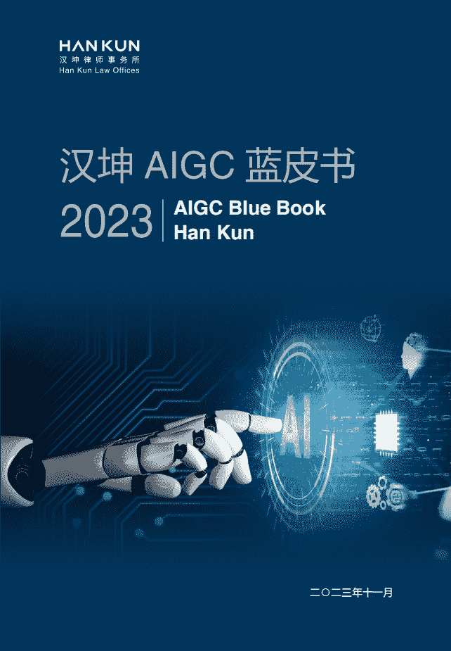
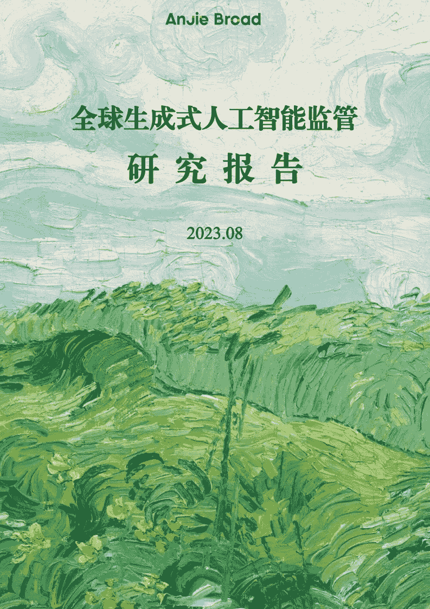
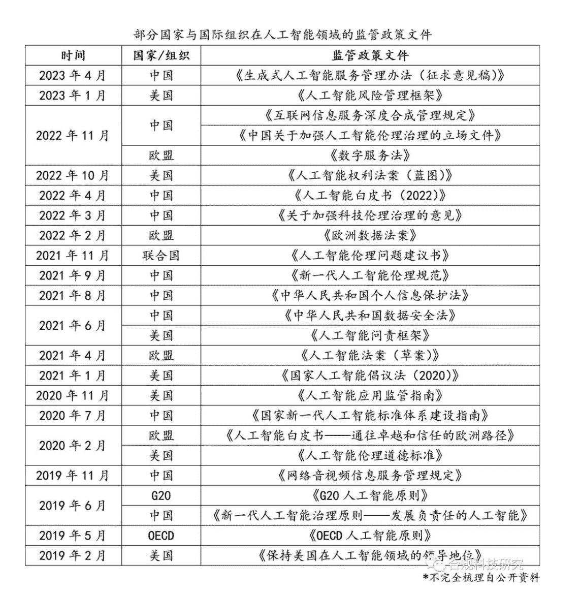

# 各国法律法规

> 来源：[https://docs.feishu.cn/docx/FuIAdUBskoqbb3xasDlcaimAnZg](https://docs.feishu.cn/docx/FuIAdUBskoqbb3xasDlcaimAnZg)

汉坤，

[汉坤AIGC蓝皮书（2023）.pdf](https://internal-api-drive-stream.feishu.cn/space/api/box/stream/download/all/MxFgb1mIIoWoQxxmlJec5NRGnFf)

安杰世泽，

[全球生成式人工智能监管研究报告.pdf](https://internal-api-drive-stream.feishu.cn/space/api/box/stream/download/all/YfSnbqs3xooTKSxjw01cJrq4nxb)

Global AI Regulation Tracker：https://www.techieray.com/GlobalAIRegulationTracker

一直在持续更新中

七国集团(G7)数字与科技部长们周日在日本本州岛高崎开会后也发布联合声明，表示应该对人工智能采取“基于风险”的监管。虽然部长们认识到，“实现值得信赖的人工智能的共同愿景和目标的政策工具，可能会在七国集团(G7)成员国之间存在差异”，但该协议为主要国家如何在隐私担忧和安全风险的情况下治理人工智能，树立了一道里程碑。

在《G7广岛领导人峰会公报》中，七国集团领导人表示将创建一个名为“广岛人工智能进程”(Hiroshima AI process)的部长级论坛，在今年年底前针对生成式人工智能导致的版权、虚假信息等问题展开讨论。

人工智能伦理问题

联合国教科书**人工智能伦理问题建议书**

https://unesdoc.unesco.org/ark:/48223/pf0000380455_chi；https://news.un.org/zh/story/2023/03/1116697

### 资料：

朱玲凤老师提供的资讯，https://mp.weixin.qq.com/mp/appmsgalbum?__biz=Mzg2NTU1NjgzMQ==&action=getalbum&album_id=3135749414234406919&scene=173&subscene=227&sessionid=1710642259&enterid=1710642264&from_msgid=2247484371&from_itemidx=1&count=3&nolastread=1#wechat_redirect