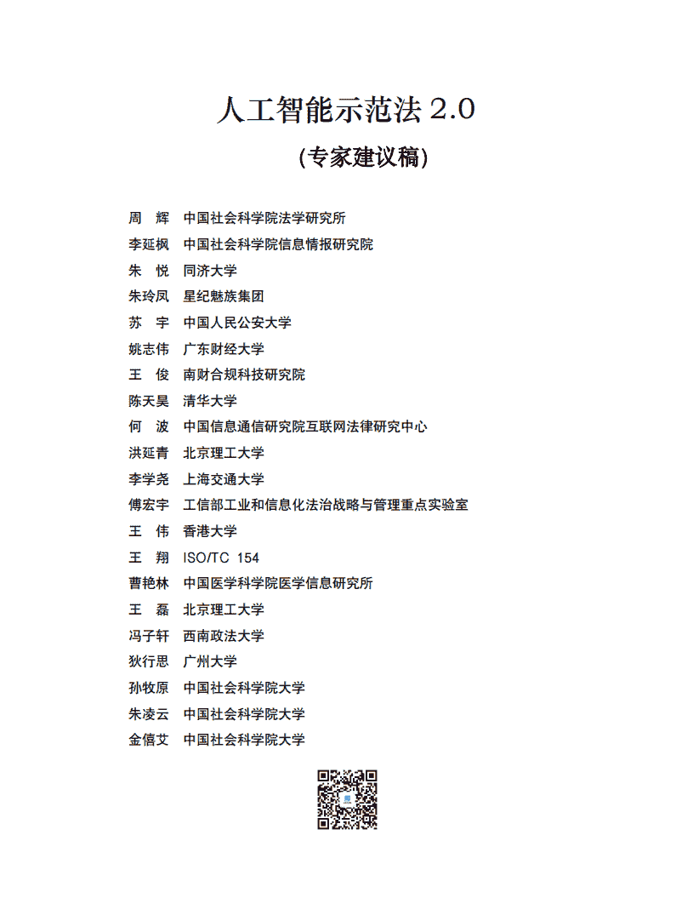
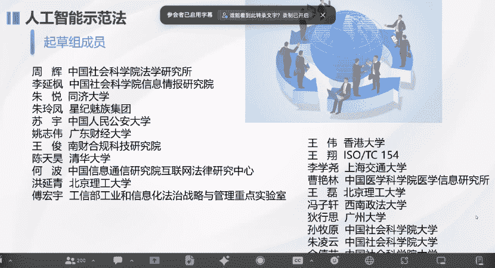
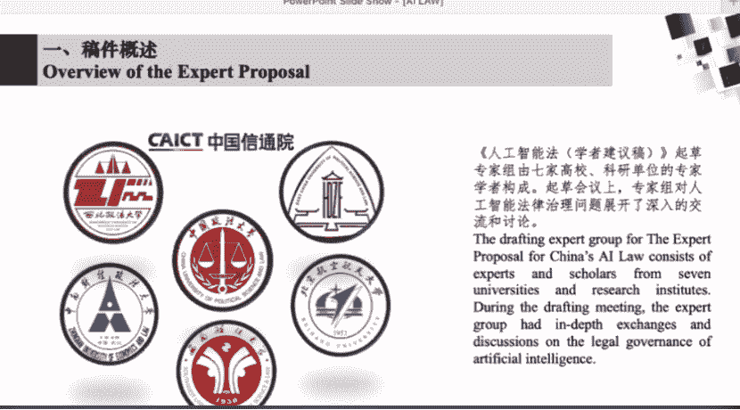

# 人工智能法（示范法）

> 来源：[https://docs.feishu.cn/docx/Gw8ddFWHMo2stDxCAxNcQecdnqf](https://docs.feishu.cn/docx/Gw8ddFWHMo2stDxCAxNcQecdnqf)

《[讲座回顾 | 张凌寒：中国需要一部怎样的《人工智能法》?](https://mp.weixin.qq.com/s/KWqQW3iarxEVOIL2lvs5vw)——中国人工智能立法的基本逻辑与制度架构》

张凌寒，《[中国需要一部怎样的《人工智能法》？](https://mp.weixin.qq.com/s/hqbxoX64NvIxSRmKi6SE7g)——中国人工智能立法的基本逻辑与制度架构》

## 人工智能示范法（社科院版）

### 1.0

+   原文：《人工智能法（示范法）1.0》（专家建议稿）起草说明和全文

+   [附答记者问](https://mp.weixin.qq.com/s/455NyK5UKXabD1Y6HhTVvA)

### 2.0

+   原文：

+   [《周辉 |《人工智能示范法2.0（专家建议稿）》——](https://mp.weixin.qq.com/s/SyWsYerjM4vSzGnnwVXwKw)人工智能法的立法架构：原则、体例与创新》

+   欧洲中国法研究会对AI示范法2.0进行专访：《人工智能法的制定—与中国人工智能法律专家草案的制定者进行问答》

[人工智能示范法2.0(专家建议稿).pdf](https://internal-api-drive-stream.feishu.cn/space/api/box/stream/download/all/IdD5bALAboS78dxSPZzcwbgKnUb)

在起草第70条时，该条款涉及人工智能生成的内容侵犯他人知识产权时人工智能开发与知识产权保护之间的平衡。这直接受到广州互联网法院关于人工智能生成内容引发争议的裁决的启发。

我们还为人工智能开发者和提供者的义务建立了负面清单制度()。对于进入负面清单并作为基础模型的人工智能，我们将进一步补充和加强这些义务。负面清单由国家人工智能监管部门根据人工智能的重要性，以及攻击、篡改、破坏或非法盗窃和利用对国家安全、公共利益、社会稳定、环境保护等造成的潜在危害，制定负面清单，内容定期更新。

###  3.0

原文：[《人工智能示范法3.0》全文](https://mp.weixin.qq.com/s?__biz=MzU1NDY3NDgwMQ==&mid=2247551154&idx=2&sn=6b7de6f914bdc24974f40ec149127a25&chksm=fa20078f812dc26eb71de5384d36cae280e1803b8cd1104a43f7d569980bcde3efd56ba01557#rd)

## 人工智能法（学者建议稿）

+   原文：《中华人民共和国人工智能法(学者建议稿)》

+   张凌寒，《[探索人工智能治理的中国路径](https://mp.weixin.qq.com/s/qP_F-i9iq6HQzBqGplh6dw)》

