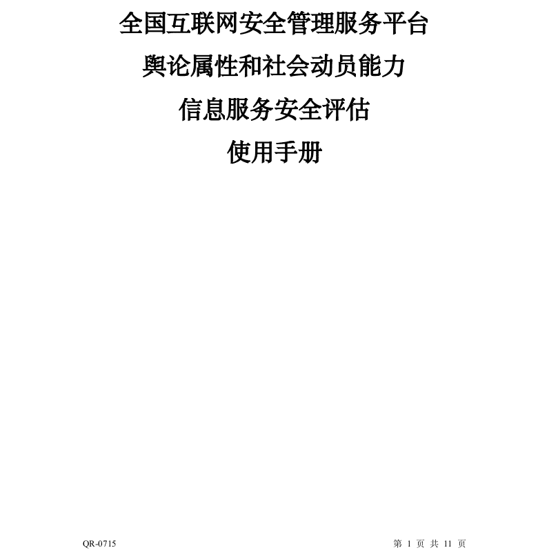

# 算法安全评估

> 来源：[https://docs.feishu.cn/docx/BxhmdVgMxofXDpxLCKZcnVuLnwd](https://docs.feishu.cn/docx/BxhmdVgMxofXDpxLCKZcnVuLnwd)

具有“具有舆论属性或者社会动员能力”的互联网服务都要进行安全评估，并提交评估报告。

**依据：**《具有舆论属性或社会动员能力的互联网信息服务安全评估规定》

**评估报告提交：**全国互联网安全管理服务平台（https://www.beian.gov.cn/）

**填写手册：**

[安全评估使用手册 (1).doc](https://internal-api-drive-stream.feishu.cn/space/api/box/stream/download/all/MEU2bsRC5oQymQxoNvAcr7TknVc)

### “具有舆论属性或者社会动员能力”解释

+   **《互联网信息服务算法推荐管理**规定》第二十四条：“具有舆论属性或者社会动员能力的算法推荐服务提供者应当在提供服务之日起十个工作日内通过互联网信息服务算法备案系统填报服务提供者的名称、服务形式、应用领域、算法类型、算法自评估报告、拟公示内容等信息，履行备案手续。”

+   《具有舆论属性或社会动员能力的互联网信息服务安全评估规定》第二条 本规定所称具有舆论属性或社会动员能力的互联网信息服务，包括下列情形：

+   （一）开办论坛、博客、🧣客、聊天室、通讯群组、公众账号、短视频、网络直播、信息分享、小程序等信息服务或者附设相应功能；

+   （二）开办提供公众舆论表达渠道或者具有发动社会公众从事特定活动能力的其他互联网信息服务。

+   电话咨询的口径【联系方式(010)68359892】：

+   《算法推荐服务管理规定》第24条规定的算法备案前提“**具有舆论属性**或者社会**动员能力”的含义是“面向公众**服务”，即**“产品或服务允许公众**注册、使用”，或者“向用户发布、推送信息”都属于需要备案的算法。