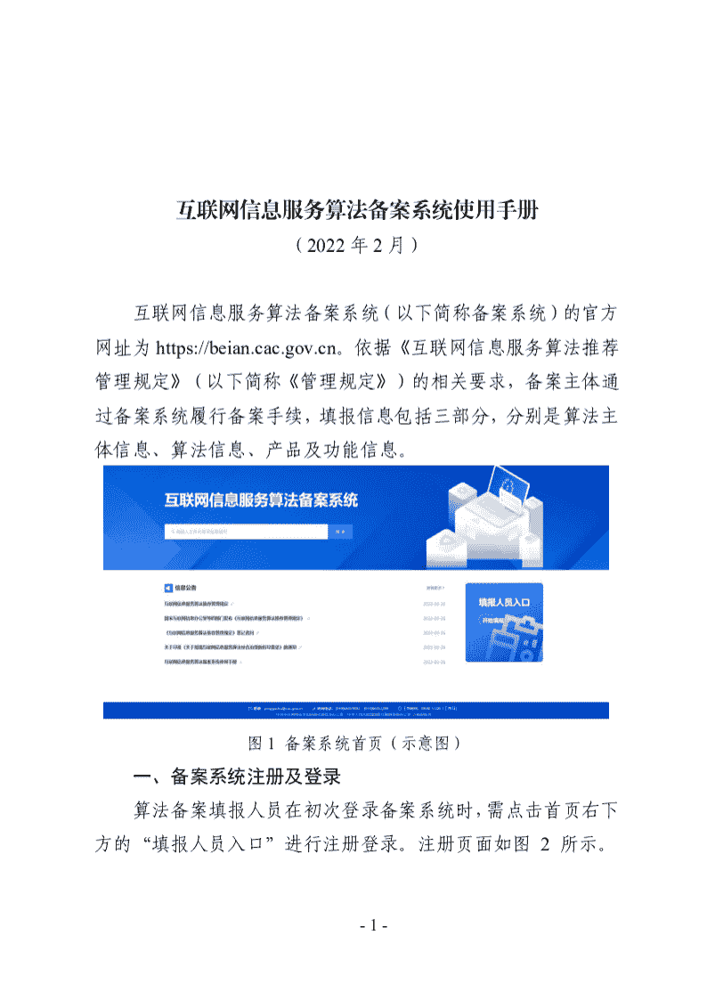
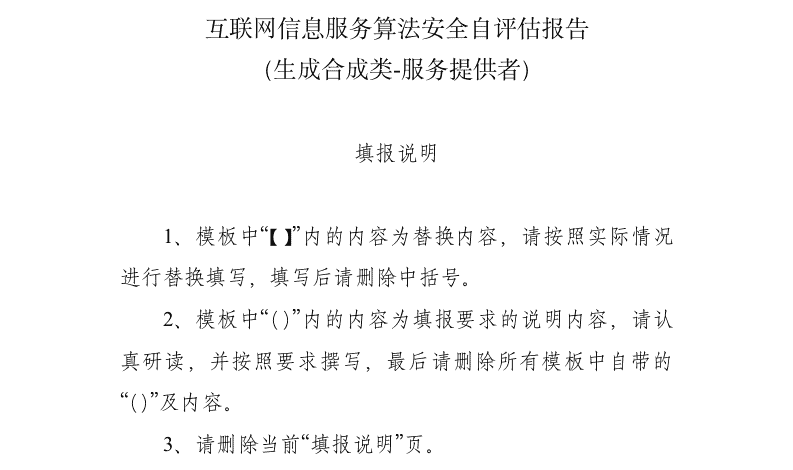
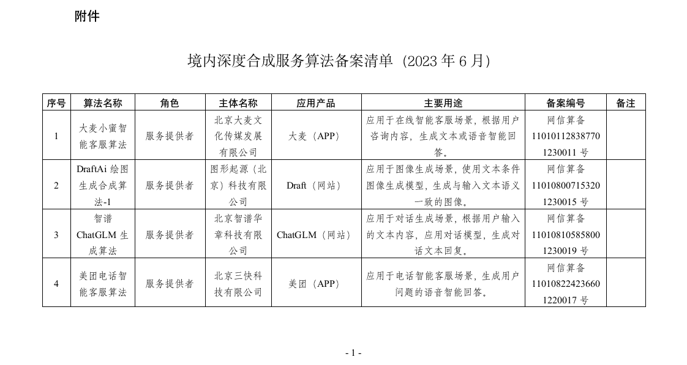
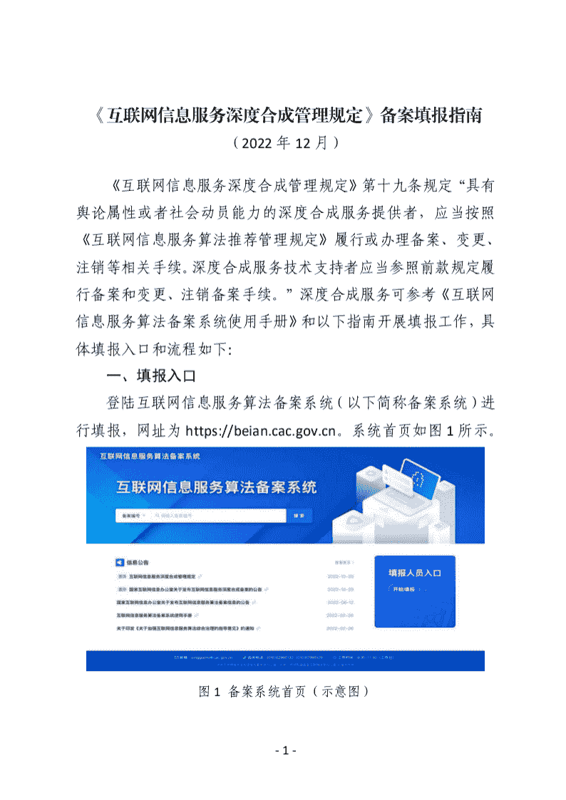
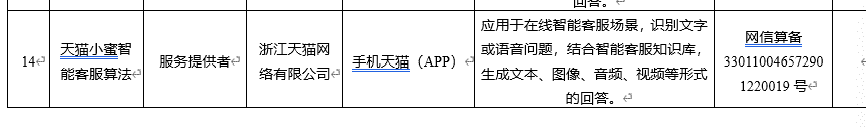
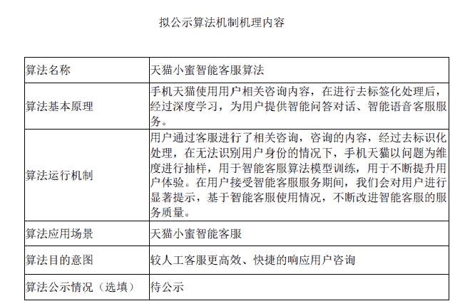
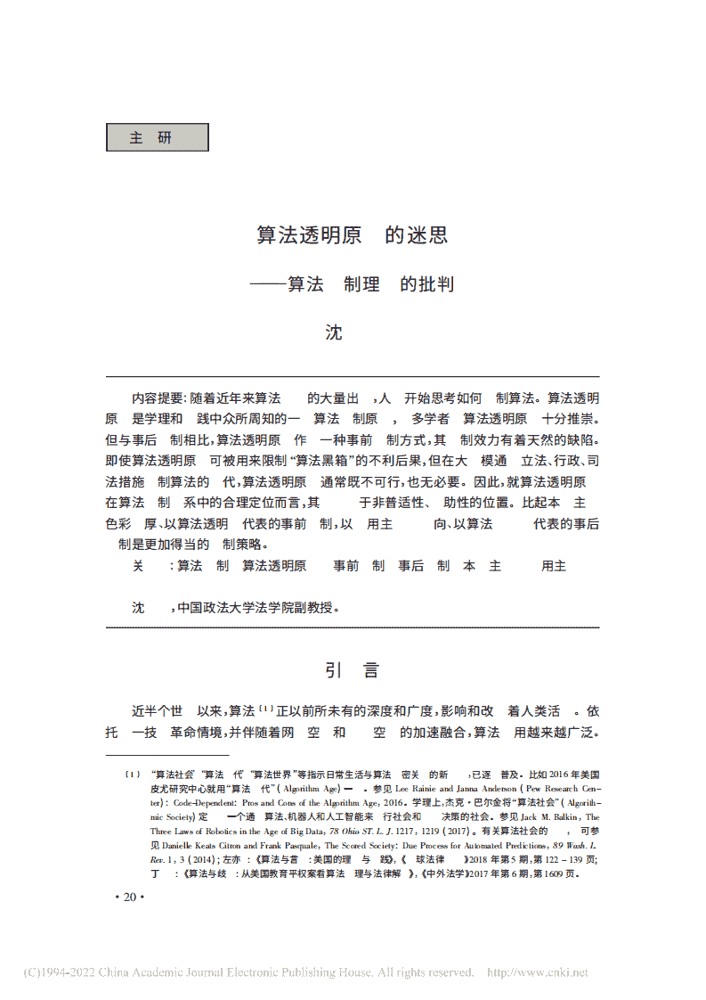
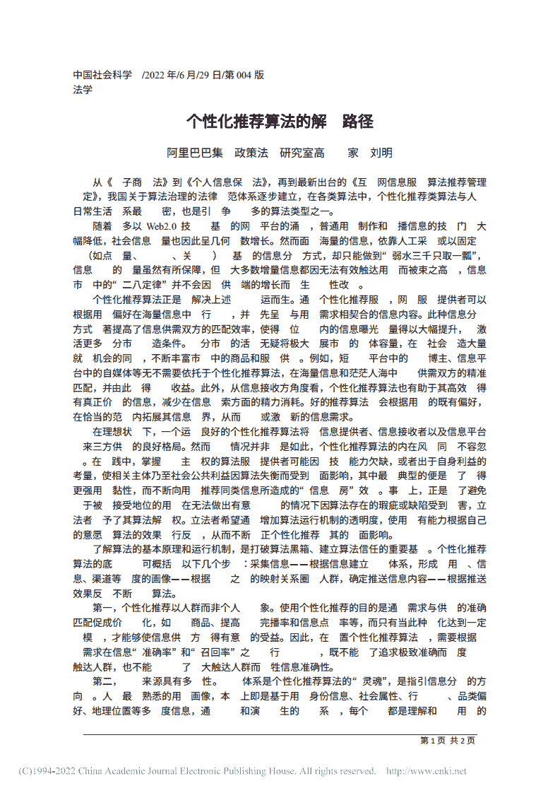

# 算法备案

> 来源：[https://docs.feishu.cn/docx/KBdwdoeJco9Cb8xuw8BcM1fznic](https://docs.feishu.cn/docx/KBdwdoeJco9Cb8xuw8BcM1fznic)

**法律依据：**

+   四部委《[互联网信息服务算法推荐管理规定](http://www.gov.cn/zhengce/zhengceku/2022-01/04/content_5666429.htm)》

+   《互联网信息服务算法推荐管理规定》答记者问

+   解读：【官方】《互联网信息服务算法推荐管理规定》系列专家解读；

### **算法推荐服务备案**

+   12月份发布《互联网信息服务算法推荐管理规定》，并与3月1日生效；

+   2月份起开始了系统内的备案填报

+   填报信息包括三部分，分别是算法主体信息、算法信息、产品及功能信息。

+   具体填报流程可参见：

[互联网信息服务算法备案系统使用手册.pdf](https://internal-api-drive-stream.feishu.cn/space/api/box/stream/download/all/Ty9ybu4wOoCFJPxqr0ncDV7qndg)

+   8月12日，国家互联网信息办公室公布了首批备案信息，包括境内互联网信息服务算法名称及备案编号。

+   参见公告：http://www.cac.gov.cn/2022-08/12/c_1661927474338504.htm

+   备案平台：互联网信息服务算法备案系统（https://beian.cac.gov.cn）

+   自评估文件示例：

[生成合成类自评估报告模板.docx](https://internal-api-drive-stream.feishu.cn/space/api/box/stream/download/all/IzNnbjcGJoePMfxCHxQcG67SnFk)

+   公示清单：“国家互联网信息办公室关于发布互联网信息服务算法备案信息的公告”

+   解读：数据合规，《[对首批算法备案公示的梳理与思考](https://mp.weixin.qq.com/s/MZdZtLGHR9dhehTQ-_fpig)》；蔡鹏团队，《简评与关注：国家网信办发布互联网信息服务算法备案清单》；财经E法：《算法备案落地，夯实算法治理基础｜Mr.陈的E法空间》

### 深度合成服务备案

国家互联网信息办公室关于发布深度合成服务算法备案信息的公告

备案公告：http://www.cac.gov.cn/2023-06/20/c_1688910683316256.htm

+

[境内深度合成服务算法备案清单（2023年6月）.docx](https://internal-api-drive-stream.feishu.cn/space/api/box/stream/download/all/PzhHbdiGfoz9N5x69K8cZg7PnZc)

+

[《互联网信息服务深度合成管理规定》备案填报指南.pdf](https://internal-api-drive-stream.feishu.cn/space/api/box/stream/download/all/X5q1b1650oqm7gxW7WQcNooonRg)

天猫小蜜智能客服算法去年十月份做了生成合成类算法的备案，上次发的深度合成备案里也有它

**备案的法律性质：**

目前法律性质不明确[。“陈兵表示，目前的算法备案可能还是一](https://mp.weixin.qq.com/s/_G9e6VzUPK8a6WBY1li6jA)种形式备案，对于备案的法律性质，是否具有对抗效力、免责效力、备案内容是否属于商业秘密需要进行严密保护等问题，还需进一步加以明确。” ( from 《算法备案该怎么作？！腾讯、阿里、字节、百度等30条互联网应用算法机制同步公开！》）

**重要文献：**

+   沈伟伟：

+   批判了算法透明原则的实际价值。

[算法透明原则的迷思——算法规制理论的批判_沈伟伟.pdf](https://internal-api-drive-stream.feishu.cn/space/api/box/stream/download/all/HPBXbQKszo6RLBx2RUmcQIP6nge)

+   阿里巴巴集团政策法规研究室刘明：

[个性化推荐算法的解释路径_阿里巴巴集团政策法规研究室高级专家__刘明.pdf](https://internal-api-drive-stream.feishu.cn/space/api/box/stream/download/all/Qx25bKgBUo6xc6xqPGOcl6qhnQd)

+   实务解析：植德，《《算法新规》实施后，首批算法备案名单公布：八问八答》

+   送法上网，《[非正式研究：算法备案的分析统计](https://mp.weixin.qq.com/s/RDnp-lT0bQKwbByx1RlZIQ)》

+   数据研究，实例统计，很有意思。

---

“数据法协作知识库”是公益性行业知识汇编

©️ 汇编版权归本知识库所有，内容只能用于学习、交流、分享

未经同意不得私自搬运、转载并用于商业用途

---

> **关于我们**

> DLaw Hub（数据法协作知识库），是以中国《个人信[使用指南：给数据法朋友们的一封信](https://s3zdtatd2r.feishu.cn/wiki/wikcnvMxVO7Zt3XAHYklOfmsDSe)保护法》为核心，可供所有人自由编辑、阅读的共享文档集合而成的知识分享库。（  ）

> 包括“个人信息保护法法条释义”、“便捷工具”、“数据跨境”、“域外概览”、“数据权”、“算法治理”、“隐私计算”等多个板块内容。

> 它是一幅数据法的知识地图，是公共的学习资料集中地。

> 我们希望您能自由地使用、编辑该知识库，分享自己的学习笔记和见解，填补知识库的大量空白。