# 中国香港

> 来源：[https://docs.feishu.cn/docx/B7tgdoI5EohAG5x6fyFcnX9bnZf](https://docs.feishu.cn/docx/B7tgdoI5EohAG5x6fyFcnX9bnZf)

> **综述：**

> Legal 500介绍：[Hong Kong](https://www.legal500.com/guides/chapter/hong-kong-artificial-intelligence/?_gl=1*1xouqvk*_up*MQ..*_ga*MTY2NzczOTUxMy4xNzE3MTE5Mjc4*_ga_JFNJC5V947*MTcxNzExOTI3OC4xLjAuMTcxNzExOTI3OC4wLjAuMA..)[: ](https://www.legal500.com/guides/chapter/hong-kong-artificial-intelligence/?_gl=1*1xouqvk*_up*MQ..*_ga*MTY2NzczOTUxMy4xNzE3MTE5Mjc4*_ga_JFNJC5V947*MTcxNzExOTI3OC4xLjAuMTcxNzExOTI3OC4wLjAuMA..)Artificial Intelligence

香港对28家机构开展关于人工智能对个人信息影响的审查

在2023年8月至2024年2月期间，香港的私隐专员公署对28家机构开展了人工智能（AI）使用对个人信息/隐私影响的合规性审查。此次审查覆盖了电信、金融与保险、零售等多个行业，旨在评估这些机构在开发或利用AI时，对个人数据的收集、使用和处理方式，以及它们的AI治理结构。私隐专员公署在此次合规性检查过程中并未发现违反《个人资料（私隐）条例》的行为。监管部门进一步强调了数据使用者在开发或使用AI系统时，负有确保数据安全的责任，并提出了一系列建议措施，以促进AI的健康发展和使用，同时确保符合《个人资料（私隐）条例》的规定。

**更多信息：**[https://www.pcpd.org.hk/sc_chi/news_eve](https://www.pcpd.org.hk/sc_chi/news_events/media_statements/press_20240221.html)nts/media_statements/press_20240221.html

香港私隐公署开展人工智能合规检查，明确AI发展指引和提升产业信心

https://mp.weixin.qq.com/s/OUPHs7yuh0tVQDlChxpJtw

2024年2月21日，香港私隐公署完成了对28家机构的人工智能（AI）合规检查。该检查自2023年8月启动，历时半年左右，主要对相关机构开发或使用人工智能系统时，收集、使用或者处理个人信息（香港称为“个人资料”，本文不做区分）的风险和影响进行检查和评估。这是人工智能合规实践的一次官方行动，且给出了整体结论和合规建议。行政行动是企业合规的外源性动力和重要合规价值之一。香港私隐公署此次对人工智能的合规检查行动，无疑对于人工智能健康发展，以及如何在人工智能环境下合理使用数据具有典型的指导借鉴意义。

# 现实

人工智能冲击就业市场

https://zijing.com.cn/article/2021-01/13/content_926245498859384832.html

分析香**港经济结构，四大支柱产业（金融服务、旅**游、贸易与物流、专业服务）虽然贡献了香港GDP的56%，却只雇用了47%的就业人口，这些工作，平均而言，面临更高的被智能化技术取代的风险。而不容易被人工智能冲击的产业，比如文化艺术、医疗、教育和创新科技，只贡献了8%的经济和11%的就业。也就是说，当面对技术进步可能带来的技术性失业，香港经济承受冲击的风险面比较大。

不仅如此，香港的持续教育参与率比其他主要发达地区低，劳动人口投入持续教育的人数连年下降，缺乏技术升级，劳动人口面临技术冲击的风险承受能力较弱。而香港的科学基础教育较弱。根据国际水平测试，与其他主要发达地区相比，香港中学生的数学和科学能力竞争力不强，科技人才后继不足，制约长远人工智能产业的发展。

https://www.itib.gov.hk/zh-hk/publications/I&T%20Blueprint%20Book_TC_single_Digital.pdf

吸引和挽留人才的力度不足：香港亦缺乏成熟的科技產業群，年輕人才畢業後選擇投身科研和 創科事業並不熱衷。同時，政府過往缺乏進取的激勵性政策來吸引 和挽留創科人才，令不少本地理工科畢業生轉往其他行業發展，

科研成果轉化動力不足

香港對數據中心設施有龐大需求。根據《2022年數據中心全球市場 概覽》21，香港的數據中心市場位居全球第六、亞太第二。在「一國兩制」下， 香港有獨特優勢和條件把國內與海外的數據交匯。

**科研能力强**

例如发挥自己在学术方面的优势，吸纳大陆的支持。其实即使香港在科技产业上成就不多，但在科研创新能力上还是不差的，在有IT界奥斯卡的APICTA大会上，香港几乎每年都能取得不错的奖项。就像在去年，香港的SmarKie的智能自动售货机、法诺实验室有限公司的多语言人工智能客户服务系统和智能RFID嵌入式机场行李装载机器人等等，都获得了奖项。

香港在人工智能領域的研究有深厚基礎。本港大學有關人工智能的論文 在國際間被引用的次數及其影響力排名全球第三。

**香港本地人工智能市场规模较小。**

**香港发达的金融市场也通过为相关企业提供融资便利，为**人工智能产业的发展提供了良好的融资环境。2019年，港股迎来了首只来自本地的人工智能概念股赤子城科技，其产品吸引了来自全球各地近10亿的用户。而由本地研究团队创立的商汤科技（SenseTime）已成为中国最大人工智能独角兽企业之一及全球顶尖的深度学习和电脑视觉平台研发商，并计划未来在香港上市。在此之前，已有多家人工智能相关的中国内地企业来港上市，包括硬件相关的中芯国际、中兴通讯等、技术应用相关的腾讯控股、阿里巴巴、小米集团、平安好医生等（图2-3）。在绝对数量上，虽然港股的人工智能概念公司比A股少，但是其中有一些优质企业并未在A股上市，给内地投资者提供了投资高品质人工智能企业的机会。

香港本地制造业基础薄弱。受限于以服务业为主的经济结构，香港的人工智能产业链并不完整，大多集中在技术层和应用层方面。

像阿里和商汤就联合在香港成立了香港人工智能实验室，大陆企业开放应用场景，香港科研人员获得数据、算力方面的相关支持。

是香港人工智能及数据实验室（HKAI LAB），由阿里巴巴香港创业者基金（AHKEF）和商汤科技共同合作投资，获得香港科技园公司（HKSTP）及阿里云支持。

InnoHK是香港特区政府的创科旗舰项目，致力于促进环球科研合作，让香港在全球高科技版图中占据重要席位。据了解，该项目由特区政府创新科技署推动，自推出以来获得全球多家顶尖院校和科研机构的积极回应。经过严谨的筛选及审批程序，28所研发实验室获选进驻，汇聚七家本地院校和研发机构，以及30多家来自全球11个经济体的机构，参与的本地和海内外科研人员共约2000人。

中国科学院香港创新研究院人工智能与机器人创新中心、

2023年6月15日，FLAIR与中国科学院深圳先进技术研究院、深圳市人工智能与机器人研究院、香港华为国际有限公司、西门子有限公司、思谋物流科技集团、域塔物流科技集团有限公司、诺言科技有限公司共7家世界知名研发机构及企业达成合作，并举行了协议签署仪式。

人工智能技术在金融领域广泛运用

金管局2019年的调查中，89%的参与调查的零售银行已经或计划在其业务中采用人工智能应用程序。

# 监管机关

https://www.pcpd.org.hk/

### the Office of Privacy Commissioner for Personal Data

an independent entity responsible for monitoring, regulating, promoting, and ensuring compliance with Chapter 486 of the Hong Kong Laws, the Personal Data (Privacy) Ordinance.

The Commissioner can inspect and investigate data users and impose fines or even imprisonment on violators.

https://www.itib.gov.hk/

### the Innovation, Technology and Industry Bureau

a decision-making body of the Hong Kong Special Administrative Region government, responsible for the development policies of innovation, technology and information technology in Hong Kong.

It promotes science and technology and coordinates related affairs within the government.

https://www.ogcio.gov.hk/

### **t**he Office of the Government Chief Information Officer

a department under the Innovation, Technology and Industry Bureau of the Hong Kong government, responsible for leading the implementation of information and communication technology within and outside the government, and formulating information and communication technology policies, strategies, plans, and measures.

https://www.pcpd.org.hk/sc_chi/about_pcpd/our_role/what_we_do.html

个人资料私隐专员公署是一个独立机构，负责监察、监管、促进及确保香港法例第486章《个人资料(私隐)条例》（《私隐条例》）获得遵从。

专员可以对资料使用者进行视察和调查

可处罚款甚至是监禁。

https://www.itib.gov.hk/zh-cn/about_us/role.html

**创新及科技局**（简称**创科局**；英语：Innovation and Tec[hnology B](https://zh.wikipedia.org/wiki/%E9%A6%99%E6%B8%AF%E7%89%B9%E5%88%A5%E8%A1%8C%E6%94%BF%E5%8D%80%E6%94%BF%E5%BA%9C)ureau，I[TB](https://zh.wikipedia.org/wiki/%E9%A6%99%E6%B8%AF)）[是香](https://zh.wikipedia.org/wiki/%E5%89%B5%E6%96%B0)[港特](https://zh.wikipedia.org/wiki/%E7%A7%91%E6%8A%80)别[行政区政](https://zh.wikipedia.org/wiki/%E8%B3%87%E8%A8%8A%E7%A7%91%E6%8A%80)府的决策局，专[责香](https://zh.wikipedia.org/wiki/%E7%A7%91%E5%AD%B8)港的创新科技及资讯科技发展政策，推动科学及科技，及在政府内部统筹相关的事务

香港特区行政长官[林郑月娥](https://zh.wikipedia.org/wiki/%E6%9E%97%E9%84%AD%E6%9C%88%E5%A8%A5)[于《2021](https://zh.wikipedia.org/wiki/%E5%89%B5%E6%96%B0%E5%8F%8A%E7%A7%91%E6%8A%80%E5%B1%80)年施政报告》提出重组政府架构，将创新及科技局改组为创新科技及工业局，以阐明“再工业化”为该局推动创科发展的其中一个恒常政策职能和工作重点([1])。

https://www.ogcio.gov.hk/tc/about_us/

在政府內部提供資訊科技服務及支援外，政府資訊科技總監辦公室負責制定資訊科技策略、計劃和措施，以協助鞏固香港作為亞洲領先數碼城市的地位。

政府資訊科技總監辦公室確保政府適當運用資訊科技，方便快捷地為市民提供資訊和服務，並協助各局／部門善用資訊科技，以達到其政策目標。

（简称**资科办**，英文：**O**ffice of the **G**overnment **C**hief **I**nformation **O**fficer，缩写：**OGCIO**）是[香港特别行政区政府](https://zh.wikipedia.org/wiki/%E9%A6%99%E6%B8%AF%E7%89%B9%E5%88%A5%E8%A1%8C%E6%94%BF%E5%8D%80%E6%94%BF%E5%BA%9C)[创新科技及工业局](https://zh.wikipedia.org/wiki/%E5%89%B5%E6%96%B0%E7%A7%91%E6%8A%80%E5%8F%8A%E5%B7%A5%E6%A5%AD%E5%B1%80)辖下的[部门](https://zh.wikipedia.org/wiki/%E9%A6%99%E6%B8%AF%E7%89%B9%E5%88%A5%E8%A1%8C%E6%94%BF%E5%8D%80%E6%94%BF%E5%BA%9C%E9%83%A8%E9%96%80)，[政府资讯科技总](https://zh.wikipedia.org/wiki/%E8%B3%87%E8%A8%8A%E5%8F%8A%E9%80%9A%E8%A8%8A%E7%A7%91%E6%8A%80)监办公室负责统领政府内外推行资讯及通讯科技。政府资讯科技总监办公室作为中央的专责机构，负责制定资讯及通讯科技政策、策略、计划和措施

帮助政府进行数字化转型、为信息科技产业发展提供帮助

负责建立电子政府服务

# 立法

+   就香港而言，个人资料私隐专员公署（私隐公署）于二○二一年发布《开发及使用人工智能道德标准指引》（《人工智能指引》），目的是协助机构在开发及使用人工智能时，明白并遵从《个人资料（私隐）条例》（第486章）（《私隐条例》）就保障个人资料私隐的相关规定。 《人工智能指引》的内容包括数据管理价值及人工智能道德原则，并提供人工智能策略管治的实务指引，以协助机构制订合适人工智能策略及管理模式，并作出风险评估及制定相关监察安排等。

+   政府资讯科技总监办公室经咨询私隐公署及参考其《人工智能指引》后，亦制订了《人工智能道德框架》，为各政府决策局／部门在推行应用人工智能技术的项目时提供指引，识别和管理有关项目的潜在风险及其他事项（例如个人私隐、数据安全和管理等）。

+   根据香港现行法例，大部分在现实世界用以防止罪行的法例，原则上均适用于网络世界。现有法律框架下有若干条文可处理散播不实或不当资讯。例如《2021年刑事罪行（修订）条例》就加入未经同意下发布或威胁发布私密影像的罪行，该罪行也适用经修改或移花接木（包括使用人工智能技术）的私密影像。

立法會十題：規管人工智能技術生成的內容

2023年5月31日

https://www.info.gov.hk/gia/general/202305/31/P2023053100249.htm

从合规，到问责，再到数据道德

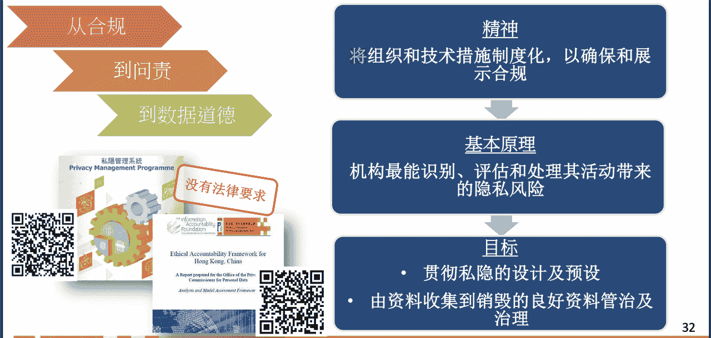

香港前个人资料私隐专员黄继儿大律师在2020年1月“大湾区数据互联互通与安全发展高峰论坛”上的报告

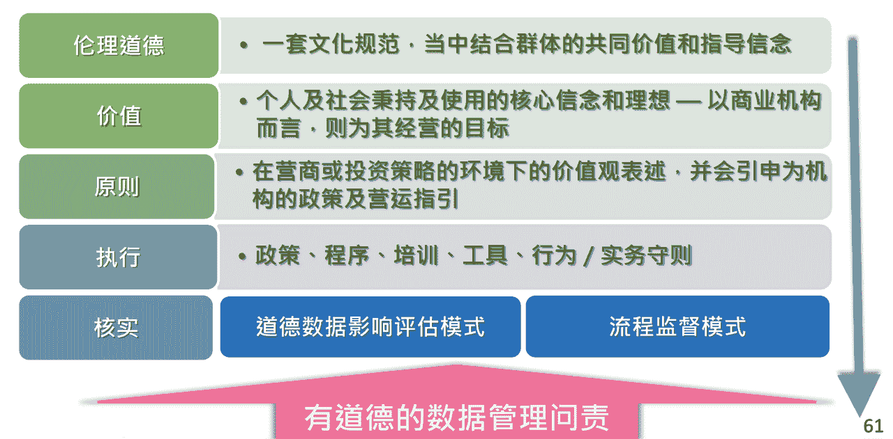

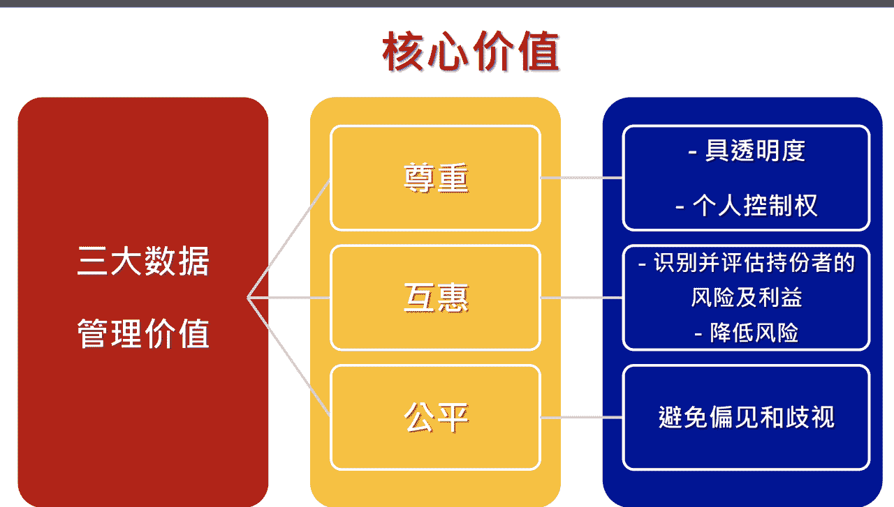

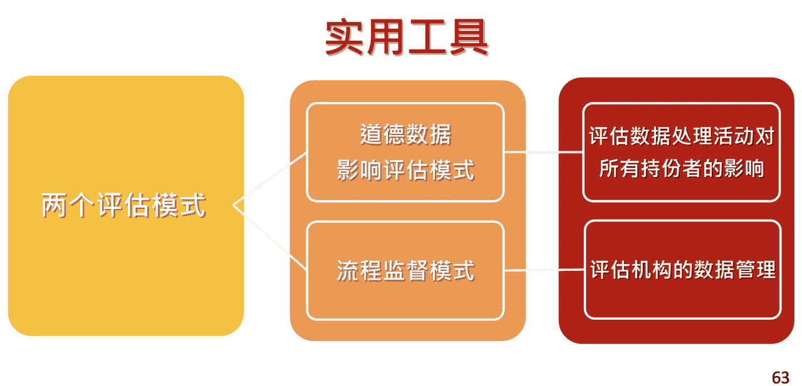

### **《中國香港的道德問責框架》**

我相信数据伦理将是长期的解决方案。

一般来说，从个人数据中积累和获取利益的企业或组织不能有只满足最低监管要求的心态来开展业务，因为最近发生的一起涉及社交媒体平台的事件表明，利益相关者的期望与社交媒体平台的数据实践之间存在很大差距。他们应该遵守更高的道德标准，与法律法规一起满足利益相关者的期望。

從個人資料獲取利益的中小企應摒棄 在營運時只達致最低監管要求的想法。相 反，他們應恪守更高的道德標準，在符合相 關法例和監管要求的同時，亦符合持份者的 期望。因此，數據倫理道德可填補法例要求 和持份者期望兩者之間的落差。

道德数据管理 ethic data stewardship

实践中的应用，2019年5月3日，香港金管局（简称HKMA）发布通告，鼓励各认证机构在金融科技产品和服务开发过程中积极采用上述道德问责框架机制，合理规范地收集用户个人资料。

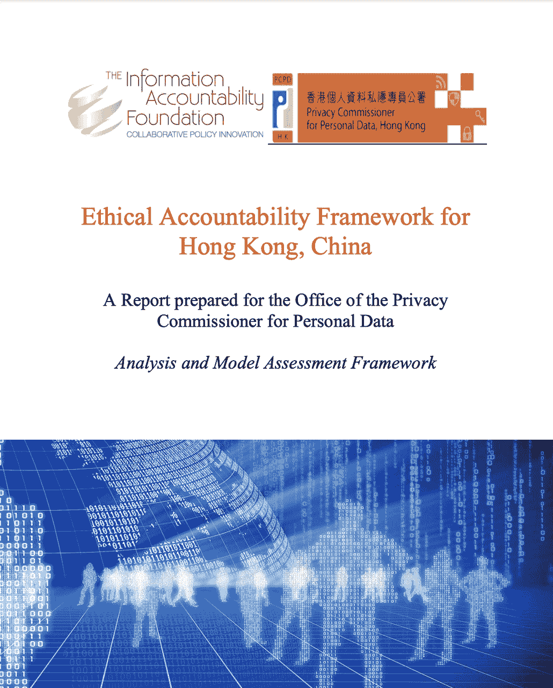

**私隱公署在2018年10月**發表的《中國香港的道德問責框架》。該報告建議機構在使用數據科技的時候，恪守三個基本的數據管理價值，即以尊重、互惠和公平的方式對待持份者。

https://www.pcpd.org.hk/misc/files/Ethical_Accountability_Framework.pdf

该报告概述了一些道德数据管理问责要素，呼吁组织：

定义数据管理价值观，将其发展为指导原则，然后将其转化为道德数据处理的组织政策和流程

#### 亮点：EDIA 和 流程监督模型

https://www.pcpd.org.hk/misc/files/Ethical_Accountability_Framework_Detailed_Support.pdf

As part of the Study, this Report asks: How can data-intensive activities and technologies that have an impact on individuals be conducted in a fair and ethical manner while achieving the desired benefits?

ThisReport is accompanied by the Enhance**d Elements, the Data Steward**ship Values, the Model EDIA and the Model Oversight Process. Altogether the documents accompanying thisreport provide a workable framework encompassing data-privacyvaluesand ethics along withfairness suitable for flexible adoption for the whole life cycle in processing personal data.

I**n order tohelpimpleme**nt the Enhanced Elements and the Values, a Model EDIA and a Process Oversight Model have been drafted.

1.  **道德数据影响评估模型。**这评估了数据收集、使用和披露以及数据驱动活动对所有利益相关者利益的影响。

1.  **流程监督模型。**这着眼于组织如何将组织道德价值观转化为原则和政策以及“设计道德”计划。它还考虑如何实施内部审查流程，例如进行 EDIA 和建立有效的个人问责制度。

强调“Ethics by design”

The Model EDIA consists of four sections:

I. Purpose of the activity

**II. Data – a full understanding of **the data, data use and parties involved

**I**II. Impact to parties and in particular individuals

**IV. Decision – whether an appropriate balance of benefit**s and mitigated risks supports the data processing activity.

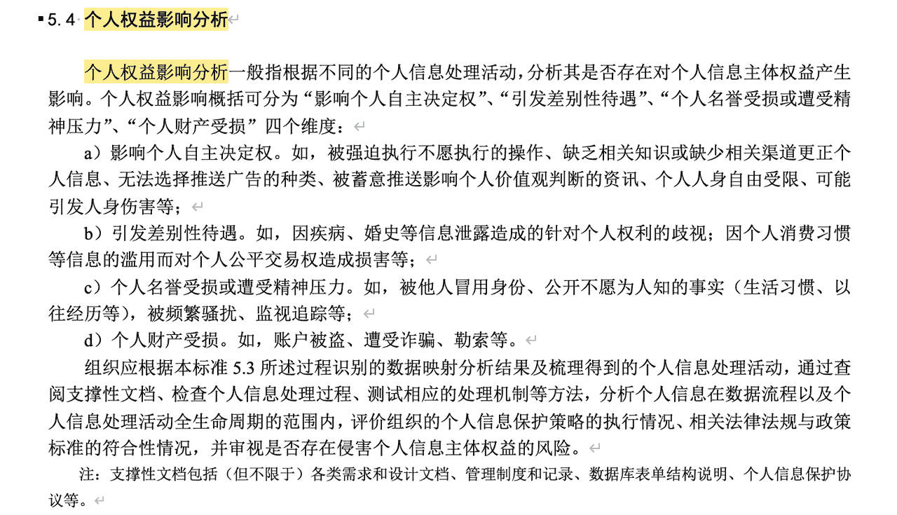

EDIA

What are the benefits to the individual or groups of individuals?

What are the benefits to society?

What are the benefits to the organization?

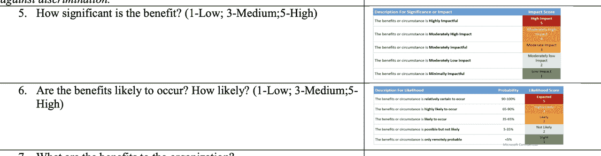

相较于个人保护法中的安全影响评估，以风险防范为导向，侧重于对各方的伤害

EDIA中还会考虑其中带来的收益项

EDIA是PIA的补充，通常用在情况较为复杂的情形中

正如完成PIA并不等同于符合PDPO的要求一样，完成EDIA也不等同于符合。然而，PIA和EDIA的完成证明了一个组织在遵守PDPO和其他监管驱动的问责要求方面的诚意。

EDIA的**目标是通过证明一个组织在决定从事先进的数据处理活动之前已**经考虑了各方的利益，来鼓励IT创新和竞争

The Model EDIA consists of four sections: I.Purpose of the activity,II.Afull understanding of the data, its use and parties involved, III.Impact to parties and in particular individuals, and IV.Whether an appropriate balance of benefits and mitigated risks supports the data-processing activity.

EDIA适合任何需要进行数据处理和分析的场景 —— 例如人工智能的风险评估，可以借鉴

继公署报告后，香港金融管理局（金管局）发[出题](https://www.hkma.gov.hk/media/eng/doc/key-information/guidelines-and-circular/2019/20190503e1.pdf)为《在金融科技发展中使用个人资料》的通函，鼓励认可机构采用公署的道德问责框架。

cf：个人信息安全影响评估

《信息安全技术 个人信息安全影响评估指南》

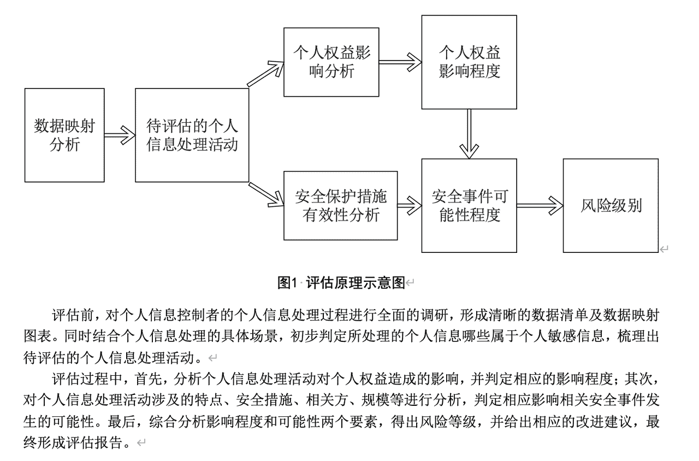

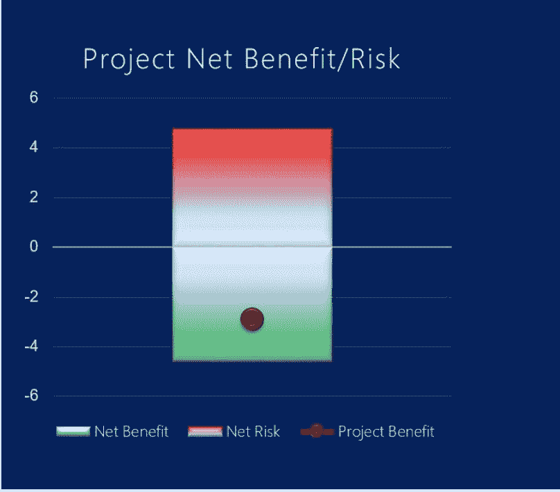

**数值评估：**

收益（显着性和可能性）- 风险（显着性和可能性）

风险 = 固有风险 - 控制有效性 = 剩余风险。

### **《應用人工智能的高層次原則》**

香港金融管理局，《應用人工智能的高層次原則》 (2019)

https://www.hkma.gov.hk/media/chi/doc/key-information/guidelines-and-circular/2019/20191101c1.pdf

金管局明白過份規限或硬性的規定，或會窒礙人工智能相關科技進一步發展，因此金管局將這些原則制定 為高層次原則。銀行可按情況相稱地採納這些原則，以反映其人工智能應用程式 的性質及所涉風險水平

1.  董事局及高级管理层须为应用人工智能所引致的结果负责

1.  银行应确保相关开发人员具备所需的专业能力及经验

1.  银行应于设计阶段采取足够措施，确保应用程式具适当程度的可解释性， 与有关程式的重要性相称。

1.  银行应制定有效的数据管治框架，确保使 用高质量和相关的数据。

1.  银行应严格核实及测试已受训的人工智能模型，确保准确合适才投入运作使用。

1.  人工智能应用程式的使用结果应可以接受持续稽查，并保存记录

1.  对第三方供应商实施有效的管理监察

1.  在提供相关服务前，向消费者披露该服务是以人工智能技术推动和当中所涉及的风险

1.  定期检视及持续监察，遵守数据保护规定，实施有效的网络安全措施，制定风险缓减措施及应变计划。

### 《開發及使用人工智能道德標準指引》

2021年9月，香港个人资料私隐专员公署（「私隐公署」）最近发表《开发及使用人工智能道德标准指引》（「《指引》」），目的是促进人工智能在香港健康发展及应用，同时协助机构在过程中遵从《个人资料(私隐)条例》的规定。

https://www.pcpd.org.hk/tc_chi/resources_centre/publications/files/guidance_ethical_c.pdf

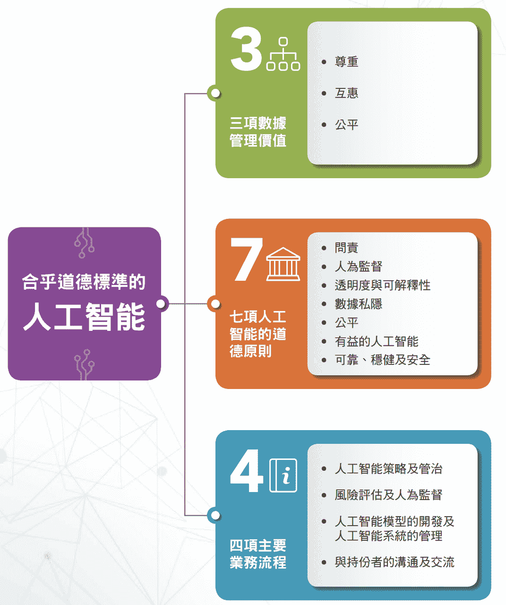

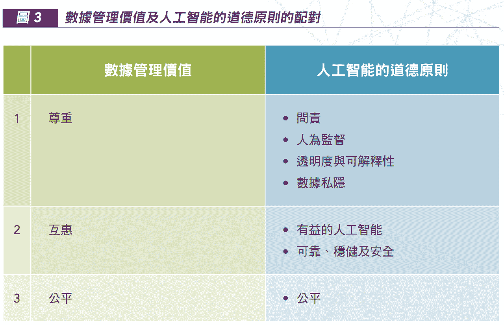

私隱公署於2018 年10月出版的《中國香港的道德問責框架》9 建議機構採納三項數據管理價值，分 別是尊重、互惠及公平。這三項價值是制定有關開發及使用人工智能的道德原則 和措施的出發點。

**建議措施︰ **

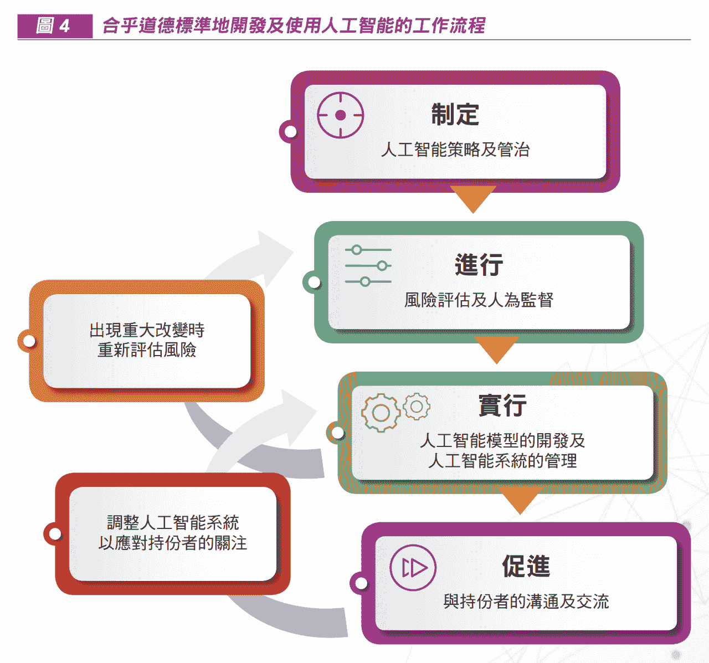

+   人工智能策略及管治；

+   機構應制定人工智能策略及成立人工智能管治委員會 （或類似組織），以引領人工智能的開發及使用。

+   機構應制定人工智能策略。人工智能策略亦應包含使用人工 智能的目的以及如何使用人工智能的相關指引。

+   應為所有相關人員提供 相關和足夠的培訓

+   風險評估及人為監督；

+   人工智能模型的開發及人工智能系統的管理；及

+   與持份者的溝通及交流。

一般來說，機構應以風險為本的方式開發、管理及使用人工智能系統。因此在考 慮及採用下述建議措施時，機構應務求所採取的措施與人工智能系統可能構成的 風險相稱。

#### 核心一：问责

非常类似于数据保护中对于数据处理者的要求！

在人员方面，提及了审查员

為負責監督人工智能系統決策的審查員提供培訓，讓他們能夠在 人工智能系統所作的決定中查找並糾正不義的偏見、非法的歧視 和錯誤。

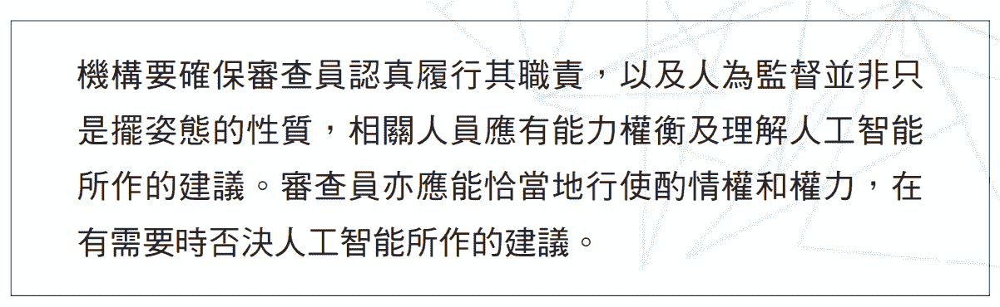

#### 核心二：风险为本的人为监督

**在管理人**工智能系統方面，應採取 風險為本的方式。在這方面，機構需要就開發及使用人工智能進行全面的 風險評估，有系統地識別、分析及評估風險，包括私隱風險。對於高風險 的人工智能系統，機構應在整個人工智能的生命周期內建立及持續實施風 險管理機制，並將相關資料記錄存檔。

風險評估的主要目的是讓機構採取適當的風險管理措施，從而減低 已識別的風險。

**人為監督**是減低使用人工智能的風險的主要措施。人工智能系統的 風險評估結果會顯示使用人工智能系統時所需的適當人為監督的程度。

風險較高（即很可能對持份者造成重大影響）的人工智能 系統，須有較高程度的人為監督︰

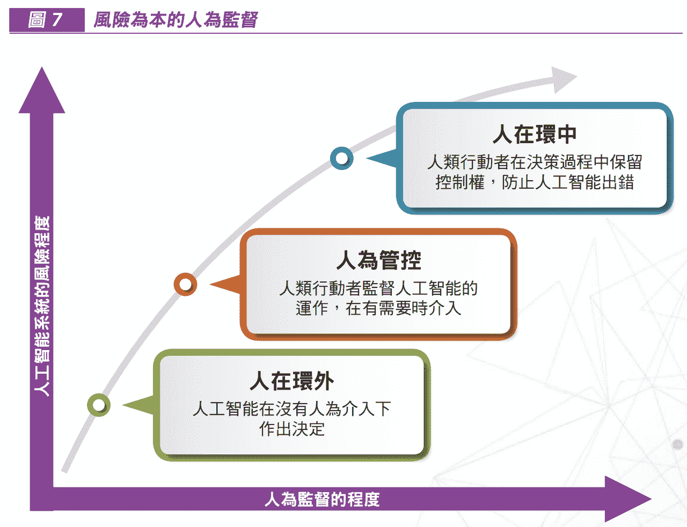

#### 核心三：全生命周期合规

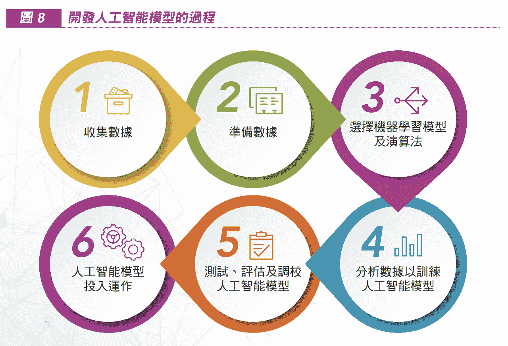

**准备数据阶段：**

确保数据质素（即大陆称的“素质”，语境中的意思与“质量”一样），數據質素對人工智能系統的公平性至為重要。

+   機構必須採取措施，確保遵從《私隱條例》的規定

+   在開發及使用人工智能時減少所使用的個人資料數量，可減低私隱風險。

+   确保数据质量（公平性）

+   妥善記錄處理數據的情況

**开发模型阶段：**

機構應了解不同機器學習演算法的特點， 揀選符合其需要的演算法。

**人工智能管理阶段：**

機構應不斷監察及檢視人工智能系統，因為應用人工智能系統的風 險因素，包括訓練數據的相關性及人工智能模型的可靠性，會隨著 時間而改變。

定期进行风险评估、定期检视、定期新數據調校及再訓練人工智能模型

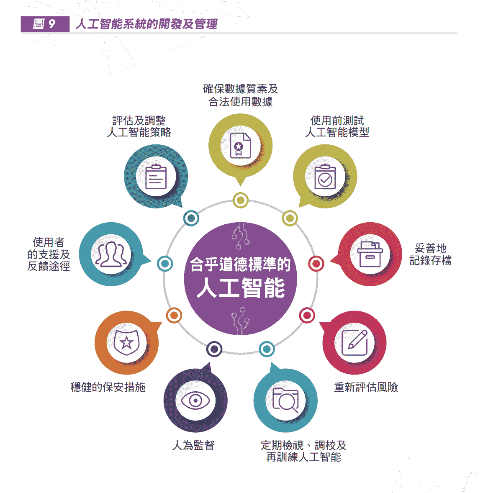

#### 核心四：與持份者的溝通及交流

持份者应该是取的stakeholder的意思

開發及 使用人工智能系統的機構應與持份者（尤其是個別的消費者及規管者）有效 地溝通及交流。有效的溝通亦是建立信任所必需的。

主要原則︰透明度與可解釋性

**【沟通】**需要披露的：

（1）是否使用人工智能系統；

（2）使用人工智能系統的目的、益處、限制及效果，除非有關披露會對商業敏感資訊造成損害

（3）人工智能系統的風險評估結果，除非有關披露會對商業敏感資訊造成損害。

**【交流】**

（1）機構亦應向個人提供途徑 讓他們改正不準確之處、作出反饋、尋求解釋、要求人為介入及／或退出 使用人工智能（如適用）。

（2）在為人工智能作出或輔助作出的決策提供解釋

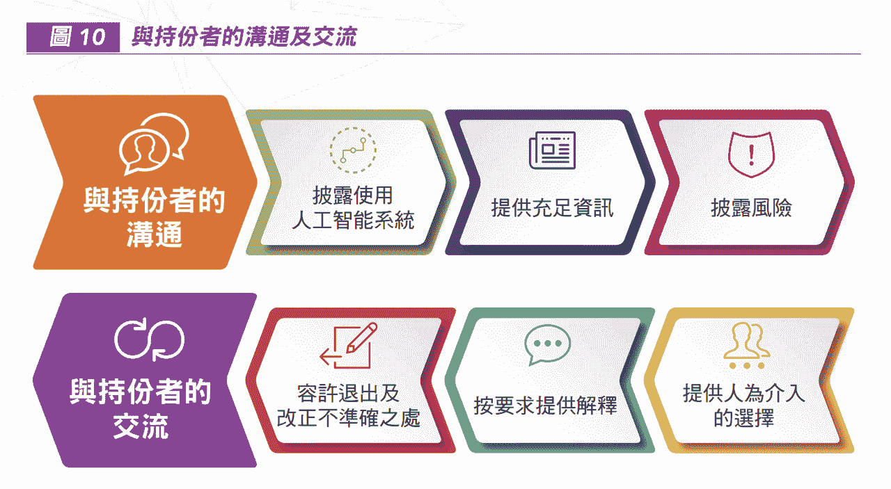

**知情的要求**

#### 自我評估核對清單

用以帮助组织检查是否完成了上述的几项建议措施。

和EDIA和流程监督模型思路相同，但是内容还是有所差距，前两者更加详细。

### 《**人工智能道德框架**》Ethical Artificial Intelligence Framework

https://www.ogcio.gov.hk/tc/our_work/infrastructure/methodology/ethical_ai_framework/

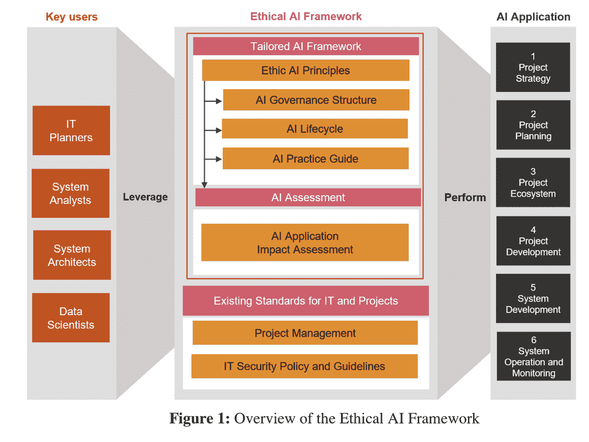

####  ETHICAL AI PRINCIPLES

**基本原则：** (1) Transparency and Interpretability and (2) Reliability, Robustness and Security

**一般原则：**(1) Fairness，(2) Diversity and Inclusion，(3) Human Oversight， (4) Lawfulness and Compliance，(5) Data Privacy， (6) Safety,，(7) Accountability,  (8) Beneficial  AI,  (9) Cooperation  and  Opennessand  (10) Sustainability  and  Just  Transition.

#### AI GOVERNANCE

AI治理的三道防线：

组织架构上

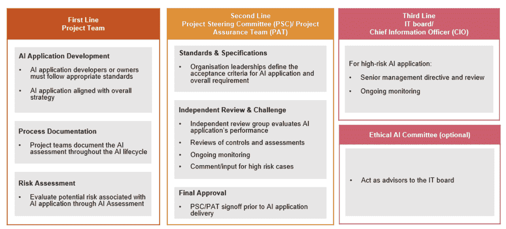

#### AI LIFECYCLE and AI PRACTICE GUIDE

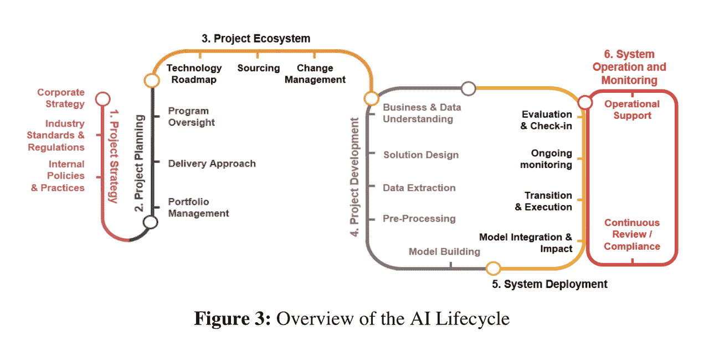

人工智能实践指南

#### AI APPLICATION IMPACT ASSESSMENT

人工智能应用影响评估应在人工智能生命周期的不同阶段对人工智能应用进行。人工智能应用影响评估为组织引入了一个系统的思维过程，使其能够从不同方面考虑个人应用的相关利益和风险，同时强调需要额外的治理活动，并确定后续行动，以确保实施所需的必要措施和控制伦理AI。

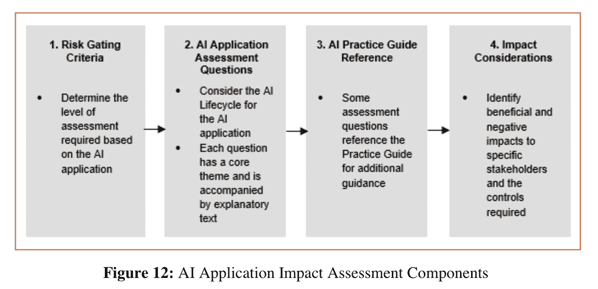

高风险的AI需要CIO或IT Board的批准

AI评估是融入在生命周期中的，不同阶段回答不同问题。

人工智能应用影响评估的结果应由PSC/PAT审查和批准。PSC/PAT应审查商业案例、潜在影响，并计划在项目进行时加以解决。

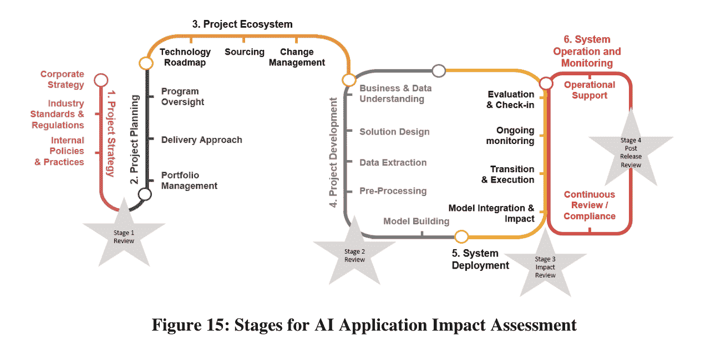

#### 香港监管者认为的高风险AI

人工智能应用：

+   是否在公众严格关注和/或经常提起诉讼的领域内？

+   例如对个人的日常生活和隐私产生重大影响的IoT应用程序

+   是否应用于新的（社会）领域（即人工智能尚未在香港使用的领域）？

+   是否具有高度自主性？是否使用在复杂的场景中？是否会做出对个人或实体有重大影响或对其产生法律后果的自动化决策？

+   是否会处理敏感个人信息？

+   是否做出复杂的决策？

+   是否涉及系统性的观察或监控？（包括视频监控、网络行为跟踪）

+   是否涉及对个人的评估或评分？

+   个人信息是否会被大规模处理？

### 香港的数据跨境

[中国香港](https://s3zdtatd2r.feishu.cn/wiki/wikcnOf7OMeWMyMlxGEyPI7Usih)

> **33.**  A data user shall not transfer personal data to a place outside Hong Kong unless—

1.  the place is specified for the purposes of this section in a notice under subsection;

1.  the user has reasonable grounds for believing that there is in force in that place any law which is substantially similar to, or serves the same purposes as, this Ordinance;

1.  the data subject has consented in writing to the transfer;

1.  the user has reasonable grounds for believing that, in all the circumstances of the case—

1.  the transfer is for the avoidance or mitigation of adverse action against the data subject;

1.  it is not practicable to obtain the consent in writing of the data subject to that transfer; and

1.  if it was practicable to obtain such consent, the data subject would give it

1.  the data is exempt from data protection principle 3 by virtue of an exemption under Part 8; or (Amended 18 of 2012 s. 2)

1.  the user has taken all reasonable precautions and exercised all due diligence to ensure that the data will not, in that place, be collected, held, processed or used in any manner which, if that place were Hong Kong, would be a contravention of a requirement under this Ordinance.

# 战略是什么？

香港成為國際創新科技中心

香港正致力成為大灣區及亞太區的數據樞紐和創新中心，以及世界級的智慧城 市。由於數據是人工智能的命脈，香港可利用及發揮其作為數據樞紐的優勢以推 動人工智能的發展。健康地發展和使用人工智能亦可大大促進香港成為創新中心 和世界級的智慧城市。

虽然香港自身的市场体量不大，但可以作为一个全球的市场推广（marketing）中心，将香港成功的案例迅速复制到全球其他市场，“对于海外的科技公司而言，香港是一个理想的平台，可以连接起粤港澳大湾区和国外的公司，因为他们是看很多长线的科研技术。”

https://zhuanlan.zhihu.com/p/565370749

粤港澳大湾区人工智能

### 香港创新科技发展蓝图

https://www.itib.gov.hk/zh-hk/publications/I&T%20Blueprint%20Book_TC_single_Digital.pdf

創新科技及工業局（創科及工業局）會聯同「引進重點企業 辦公室」，並配合 300 億元「共同投資基金」、50 億元「策略性創科基金」、落馬洲河套區港深 創新及科技園（港深創科園）和新田一帶由 2024 年起提供的土地，以及其他土地空間，聚焦吸引 優勢策略科技產業的企業落戶香港。

香港创新科技及工业局局长孙东24日在记者会上表示，特区政府于去年12月推出《香港创新科技发展蓝图》，推出四个重点方向，助力香港建设成为国际创新科技中心，包括发展数码基础建设、巩固香港科研优势、培育科技初创人才，以及发展创新科技基建。香港特区政府新闻公报显示，政府的《财政预算案》紧扣以上方向，作出相应财政措施，拨款30亿元推动前沿科技领域基础研究相关建设就是措施之一。

港交所會視乎諮詢市場的意見於 2023 年修改主板 上市規則，便利五大類型的特專科技公司註來港上市以進行融資，以吸引更多優秀科技企業 來港上市，有助香港發展成為區內新經濟企業的首選融資平台。

數據中心：香港必須鞏固其作為亞太區數據中心的優勢。由 2022 至 2026 年，數據中心可用樓面面積預期新增超過 70 萬平方米，連同 現時的 80 萬平方米，總面積達 150 萬平方米，複合年均增長率達 13%，足以應付短期需求。就中長期來說，政府會考慮增加新的土地 供應，土地來源可包括新田科技城、馬料水填海工程及《岩洞總綱圖》的 策略性岩洞區等。

# 监管

**对象：**人工智能指一系列涉及以電腦程式和機器模仿人類解難及決策能力的科技。人工 智能的應用例子包括臉容識別、語音識別、聊天機械人、數據分析、自動化決策 或建議等。人工智能科技仍在演變中，更多新的應用或會出現。

# 态度是什么？

【结合香港《有关香港虚拟资产发展的政策宣言》】

根據一份在2020年公布的研究資料，78%香港企業相信人工智能會帶來益處，並有助提升企業服務的質素和效率。由於數據是人工智能的命脈，配合《粵港澳大灣區發展規劃綱要》，健康地發展和使用人工智能可幫助香港發揮其作為區域性數據樞紐的優勢，亦可大大促進香港成為創科中心和世界級的智慧城市。

https://gbcode.rthk.hk/TuniS/news.rthk.hk/rthk/ch/component/k2/1696180-20230414.htm?share=facebook创新科技及工业局局长孙东说，留意到国家最近针对有关技术和应用提出新措施，特区政府一直保持高度关注，将继续持非常开放态度对待有关技术发展，适时作出应对。

https://m.jiemian.com/article/9235056.html

香港特区政府将保持开放的态度，紧密关注技术发展，正在与业界商量合作，在生成式AI大模型、开源功能方面对香港做出独特贡献。

此外，香港也在2月底发布的财政预算案上提出，就建立人工智能超算中心進行可行性研究，以推动本地科研和产业发展提供足够算力基础。

《道德问责框架》中提出了AI能够减小旧有风险，同时带来新的风险：

人工智能能够减小风险：

+   Credit risk and revenue modeling:

+   Fraud detection

+   Surveillance of conduct and market abuse in trading

+   Anti-money laundering (AML) compliance

人工智能产生的新风险：

+   重新识别或破坏匿名性的数据集链接

+   由于基础数据和流程中潜在的固有或潜在偏见，分析中存在不公平和歧视，因为分析可用于推断或预测个人的偏好、健康、工作表现、信用度和犯罪倾向；

+   由于自我演化的逻辑、不遵循工程师的逻辑以及最少的人力输入，解释能力受到限制；

+   缺乏透明度，因为：大数据可能无法明确数据收集目的、不透明且复杂的“黑匣子”算法、不提供理由的自动化决策；

+   个性化推荐带来的信息茧房；

+   变化速度和规模带来的不确定性：鉴于新技术的规模和差异，基于旧有经验的推导失去了意义。

+   个性化推荐让消费者无法比较服务，服务的可比性降低。

# 其他文献

+   私隐专员，《香港特区的数据治理: 合规、问责、伦理和道德》

+   PCPD，《[中小企的數據倫理道德](https://www.pcpd.org.hk/tc_chi/resources_centre/publications/files/dataethics_chi.pdf)》

+   消费者委员会，《道德與信心共融 促進電子商務人工智能發展》

+   我堂堂一个熊猫，《错过二十年后：香港的科技败局和AI未来》

+   《海通国际AI系列（8）：香港特区的人工智能产业发展现状》

+   《技术商业化落地，粤港澳大湾区人工智能走到哪一步了？》

私货

九龙城寨与赛博朋克