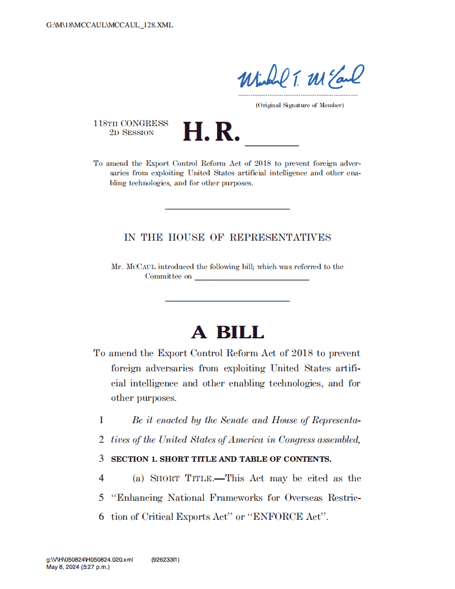
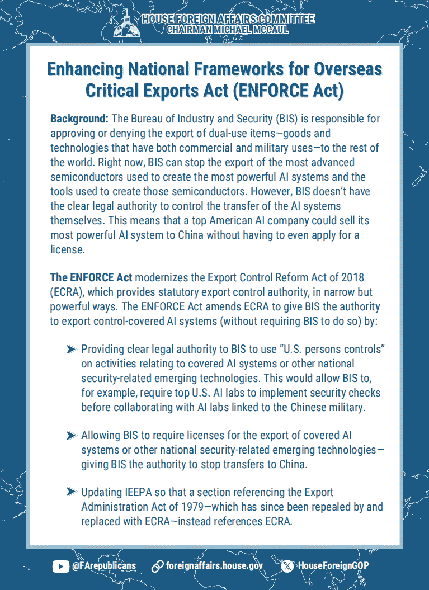
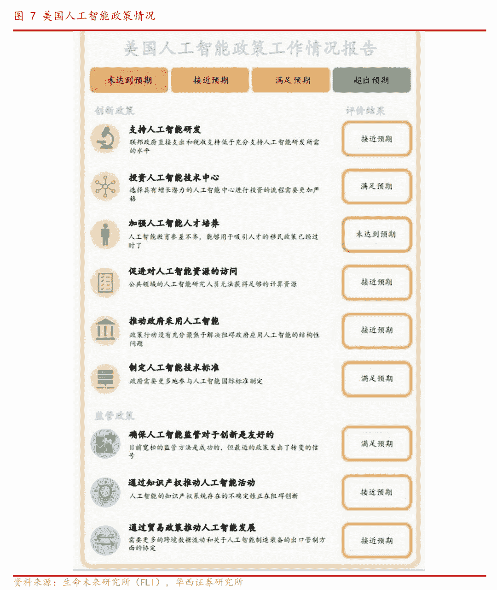

# 🇺🇸 美国

## 综述

- 来源：[https://docs.feishu.cn/docx/VpS6d9cxNorsSfxfI3mcEFldnRf](https://docs.feishu.cn/docx/VpS6d9cxNorsSfxfI3mcEFldnRf)
- Chambers：Artificial Intelligence 2023
- AI Watch：[Global regulatory tracker - United States](https://www.whitecase.com/insight-our-thinking/ai-watch-global-regulatory-tracker-united-states)
- Legal 500介绍：[United States: Artificial Intelligence](https://www.legal500.com/guides/chapter/united-states-artificial-intelligence/?_gl=1*1gkvr6l*_up*MQ..*_ga*MTY2NzczOTUxMy4xNzE3MTE5Mjc4*_ga_JFNJC5V947*MTcxNzExOTI3OC4xLjAuMTcxNzExOTI3OC4wLjAuMA..)
- [Global Legal Insight 报告：AI, Machine Learning & Big Data Laws and Regulations 2024](https://www.globallegalinsights.com/practice-areas/ai-machine-learning-and-big-data-laws-and-regulations/usa/)
- 美国、欧盟及英国对人工智能的监管与规制：<https://mp.weixin.qq.com/s/ypgcPRS_VA-8GIsIr7HTSQ>
- <https://law.ucass.edu.cn/info/1985/6865.htm>
- 《君合法评丨美国新近人工智能政策对华影响要点》
- 《美国《人工智能辅助发明的发明人指南》解析》

## 法律

| **时间** | **发布机关** | **文件** | **内容** | **相关文章** |
| --- | --- | --- | --- | --- |
| 2022年10月 | 白宫科技政策办公室（OSTP） | 《人工智能权利法案蓝图：让自动化系统为美国人民服务》（The Blueprint for an AI Bill of Rights: Making Automated Systems Work for The American People） | 旨在帮助指导自动化系统的设计、使用和部署，从而保护人工智能时代下美国公众的权利。这些原则是通过与美国公众广泛协商制定的，构建保护公民权利、公民自由和隐私的自动化系统的蓝图。 | 解读：《[人工智能权利法案蓝图综述](https://mp.weixin.qq.com/s/BpCRBwXKWnMQsXFqSFI8HQ)》 |
| 2023年1月26日 | 美国国家标准技术研究院（National Institute of Standards and Technology，NIST） | 《人工智能风险管理框架》（Artificial Intelligence Risk Management Framework，AI RMF 1.0） | 该框架旨在帮助人工智能系统的开发者、用户和评估人员更好地管理可能影响个人、组织、社会或环境的人工智能风险，促进提高人工智能系统的可信度——具体包括有效和可靠（valid and reliable）、安全（safe）、安全和弹性（secure and resilient）、负责和透明（accountable and transparent）、可理解和可解释（explainable and interpretable）、隐私增强（privacy-enhance）和公平—控制有害偏差（fair with harmful bias managed）等七大特征。 | 解读：《美国NIST《人工智能风险管理框架》评述》 |
| 2023年10月30日 | 白宫政府 | 第14110号行政命令（Executive Order 14110）《关于安全、可靠、可信地开发并与使用人工智能的行政命令（Executive Order on Safe, Secure, and Trustworthy Development and Use of Artificial Intelligence）》 | 白宫在一份声明中说，这项行政令“具有里程碑意义”，将保护美国公民隐私，促进公平和公民权利，维护消费者和工作者权益，促进创新和竞争等。 | 中文译文：<https://mp.weixin.qq.com/s/4gkILatks-NhWGPMFoBXFw> |
| 2023年12月 | 美国众议员安娜·埃修（Anna Eshoo）和唐·拜尔（Don Beyer） | 《AI基础模型透明度法案》（AI Foundation Model Transparency Act）【草案】 | 该法案将要求联邦贸易委员会（Federal Trade Commission）设定关于人工智能模型的何种信息应易于向公众提供的标准。《AI基础模型透明度法案》还将要求公司与联邦贸易委员会分享模型训练数据。 | 解读：美国《AI基础模型透明度法案》Q&A |

1. 送法上网，《【翻译】NIST人工智能风险管理框架：人工智能风险与传统软件风险的区别》
2. 网安寻路人，《NIST《人工智能风险管理框架》全文翻译》

### Protecting Consumers from Deceptive AI Act

《保护消费者免受欺骗性AI法案》

**官网：** [https://eshoo.house.gov/media/press-releases/rep-eshoo-introduces-bipartisan-bill-label-deepfakes](https://eshoo.house.gov/media/press-releases/rep-eshoo-introduces-bipartisan-bill-label-deepfakes)

2024年3月21日，美国国会议员安娜·G·埃肖（加州第16区），作为众议院人工智能核心小组的联合主席，以及美国国会议员尼尔·邓恩（佛罗里达州第2区），作为两党人工智能特别工作组的成员，提出了《保护消费者免受欺骗性AI法案》。深度伪造是通过AI生成的音频和视觉内容，通常制作时带有欺骗的意图，随着现代生成性AI工具的公开推出，它们已经大量涌现。虽然这些工具可以为社会提供增强创造力和表达的好处，但AI生成的内容可能会造成广泛的社会混乱，因为越来越难以区分“真实”和“虚假”的内容。这对于即将在2024年举行选举的美国、欧盟以及至少63个国家（这些国家的人口几乎占世界人口的一半）来说尤为紧迫，AI生成的内容可能会被用来破坏民主过程。AI生成的内容还导致了多起消费者欺骗、市场干扰、对未成年人的伤害和国家安全风险的事件。

解读：袁立志，《[美国AIGC水印法案要点及全文](https://mp.weixin.qq.com/s/pcaZ7jqBeZldE9a00iL8CA)》

### Content Origin Protection and Integrity from Edited and Deepfaked Media Act (COPIED ACT)

《编辑和深度伪造媒体内容来源保护和完整性法案》

**官网：** [https://www.commerce.senate.gov/2024/7/cantwell-blackburn-heinrich-introduce-legislation-to-combat-ai-deepfakes-put-journalists-artists-songwriters-back-in-control-of-their-content](https://www.commerce.senate.gov/2024/7/cantwell-blackburn-heinrich-introduce-legislation-to-combat-ai-deepfakes-put-journalists-artists-songwriters-back-in-control-of-their-content)

当地时间7月12日，美国参议院人工智能核心小组的联合创始人兼联合主席参议员马丁·海因里希（Martin Heinrich）、参议院商务委员会主席玛丽亚·坎特威尔（D-Wash.）和商务委员会成员玛莎·布莱克本（R-Tenn.）提出了《编辑和深度伪造媒体内容来源保护和完整性法案》（COPIED ACT）法案，旨在有效打击有害的深度伪造品的兴起。立法将围绕生成式人工智能建立新的护栏，以及让记者、艺术家和词曲作者更好地控制他们的创意内容。

解读：AIGverse，《[美国提出新的人工智能法案](https://mp.weixin.qq.com/s/B1XhWyWUoZMOOiObaXLm🐧)》

**美国田纳西州**早在2024年3月即签署了旨在保护词曲作者、表演者和其他音乐行业专业人士免受人工智能潜在危险的立法——Ensuring Likeness, Voice, and Image Security Act of 2024 (HB 2091)（《确保相似声音和图像安全（ELVIS）法案》），该法案已于2024年7月1日生效。

## 准则

| **时间** | **发布机关** | **文件** | **内容** | **相关文章** |
| --- | --- | --- | --- | --- |
| 2022年3月 | 美国国家标准技术研究院（National Institute of Standards and Technology，NIST） | 《迈向识别和管理人工智能偏差的标准》 |  | 解读：《美国NIST《迈向识别和管理人工智能偏差的标准》评述》 |

## 其他文件

| **时间** | **发布机关** | **文件** | **内容** | **相关文章** |
| --- | --- | --- | --- | --- |
| 2021年5月19日 | 国会研究服务（Congressional Research Service, CRS） | 《人工智能：背景、选定问题和政策考量》的政策分析报告 | 该报告的内容涉及很多美国政府在人工智能领域立法、行政令以及相关部门的设计和发展。 | 解读：《国会报告视角下的美国政府人工智能立法和政策考量》 |
| 2023年3月9日 | 美国商会技术合作中心（U.S. Chamber of Commerce Technology Engagement Center，C_TEC） | 《人工智能委员会报告》 | 旨在抓住该技术广泛应用下的窗口期，鼓励人工智能创新和发展的同时规避因技术进步导致的国家安全风险。 | 解读：《美国商会《人工智能委员会报告》：人工智能发展的前景预判与监管建议》 |
| 2023年5月 | 美国国会研究处 | 《生成式人工智能和数据隐私：入门指南》 | 该报告主要阐述了AIGC与数据之间的关系，并总结了AIGC使用及获取数据的方式可能引发的相关风险，如对用户个人隐私的侵犯以及知识产权和内容治理等方面可能产生的风险。在应对AIGC相关风险上，报告提出了应通过立法建立相应机制以进行相关类型的风险防范。 | 解读：《《生成式人工智能与数据隐私：入门指南》报告解读》 |

### 算法问责法案

[美国联邦《算](https://www.congress.gov/bill/116th-congress/house-bill/2231/text?q=%7B%22search%22%3A%5B%22Algorithm%22%5D%7D&r=3&s=1)[法问责法案》](https://www.congress.gov/bill/117th-congress/senate-bill/3572)[现已出台三次](https://www.congress.gov/bill/118th-congress/house-bill/5628/text)；首先是2019年由众议员 Yvette Clarke 提出，然后是2022年由参议员 Ron Wyden 提出，最后是2023年由众议员 Clarke 提出。

三次问责法案的介绍：<https://www.holisticai.com/blog/us-algorithmic-accountability-act>

- 2023：
  - 众议院自己的 Summary：[Algorithmic Accountability Act of 2023 Summary](https://www.wyden.senate.gov/imo/media/doc/algorithmic_accountability_act_of_2023_summary.pdf)
  - 法案原文：<https://www.congress.gov/bill/118th-congress/senate-bill/2892/all-info?s=1&r=54>
- 2022：挖·规则|美国发布《2022年算法问责法案》

## 出口/外贸管制

美国管制与制裁体系介绍：<https://mp.weixin.qq.com/mp/appmsgalbum?action=getalbum&__biz=MjM5ODM3MzU4Mg==&scene=1&album_id=3389196005919440897&count=3&uin=&key=&devicetype=iMac+MacBookPro16%2C3+OSX+OSX+11.7.6+build(20G1231)&version=13080812&lang=zh_CN&nettype=WIFI&ascene=14&fontScale=100>

### 对华芯片出口

2023年10月17日，美国商务部工业与安全局（Bureau of Industry and Security，以下简称“BIS”）发布了对华人工智能、半导体行业再次升级的出口管制规则（以下简称“2023规则”），进一步加强了对华出口先进芯片及半导体制造设备的限制，而之所以在其2022年10月7日对华已经推出先进计算、半导体制造及超算领域的严格管制措施（以下简称“2022规则”）之后又祭出升级版的管制规则，BIS声称是为了应对中国发展人工智能技术获取先进芯片的努力及为先进武器系统采购芯片制造设备(4)。为方便读者理解，我们将2023规则中对华人工智能产业可能产生影响的要点总结如下并进行简要的分析：

| **限制类别** | **核心内容** | **分析与建议** |
| --- | --- | --- |
| 技术指标 | 2023规则更新了芯片限制指标，2022规则是两个指标，一个是处理性能，另一个是互连带宽。而2023规则，则用“性能密度”（Performance Density）即每平方毫米的浮点运算次数及总处理性能（Total Processing Performance）来取代2022规则的指标。 | 不难发现，2023规则采用的左列三大新限制措施填补上了2022规则留下的“漏洞”，中国人工智能企业已经面临先进人工智能芯片的“断供”。据较近的新闻报导5，英伟达已经计划在2024年第二季度量产符合2023规则的人工智能芯片，但中国的人工智能企业，考虑到性能的降低和未来供应的不确定性，表达了对购买最新特供版芯片的犹豫，并且正在测试国产替代产品。 |
| 先进半导体出口限制国家的增加 | 2022规则针对先进芯片及等于或超过其指标的物项创设了许可证要求，要求该等物项向“中国和澳门”（中国包含香港）出口需获得BIS的许可证。而2023规则为了限制中国实体通过第三国规避针对中国及澳门地区的许可证限制，将前述的许可证要求扩展为向“受限国家”提供均需获得许可证。 |  |
| 增加最终用途管控 | 2023规则增加了对先进芯片及等于或超过其指标的物项的最终用途管控措施（end-use controls），即在出口商、再出口商或转让人知悉（has knowledge）上述物项最终将向总部位于或最终母公司位于中国、澳门或D:5组国家的实体提供时，只有获得许可证方能出口。 |  |
| 半导体出口管制 | 2024年3月29日，据美国联邦政府《联邦公报》，美国商务部下属工业和安全局（BIS）发布实施额外出口管制的规定，拟于4月4日生效。 | <https://mp.weixin.qq.com/s/f81VvHEA3rq_DIu1jMbalw> |

### 云服务限制（拟议）

2024年1月28日，商务部发布了《采取更多措施应对重大恶意网络活动造成的国家紧急状态》（Taking Additional Steps To Address the National Emergency With Respect to Significant Malicious Cyber-enabled Activities）。拜登政府将提议要求美国云计算公司确定外国实体是否正在访问美国数据中心以训练人工智能模型。拟议中的“了解你的客户”法规将强制要求美国云计算公司验证外国用户的身份

- 翻译：《[美商务部要求美云服务就特定AI模型训练建立KYOC和强制报告义务的拟议规则（全文翻译）](https://mp.weixin.qq.com/s/xUrowNWWXBH0PSJ6ym6DXA)》（洪延青）
- 分析：《高举轻放：美国对中企使用美国云服务的限制新规》

### 人工智能限制（拟议）

5月8日，美国国会众议院外交事务委员会主席 Michael McCaul、美国与中国共产党战略竞争特别委员会主席 John Murnar、民主党首席议员 Raj Krishnamoorthi 和民主党众议员 Susan Wild 共同提出了“增强海外关键出口限制的国家框架法案”（Enhancing National Frameworks for Overseas Restriction of Critical Exports Act，ENFORCE法案）。

https://democrats-selectcommitteeontheccp.house.gov/media/press-releases/bipartisan-coalition-introduces-monumental-bill-giving-admin-authority-export

+ 原文：

    

    [`ENFORCE-Act.pdf`](https://internal-api-drive-stream.feishu.cn/space/api/box/stream/download/all/GVx3bdJayolUyuxaQLjcioVynkf)

+ 摘要：

    

    [`ENFORCE-Act-Bill-Summary.pdf`](https://internal-api-drive-stream.feishu.cn/space/api/box/stream/download/all/V7qxbMt70o1WinxRPYNcz9UxnCh)

+ 解读：东不压桥研究院，[《美国国会立法对人工智能大模型进行出口管制》](https://mp.weixin.qq.com/s/qHNUEWWCyUcwBq4kUEEH1w)；顾登晨，《对美AI模型管制动向的一些思考》；清华，《美国公布法案准备限制开源大模型对华出口【AI国际治理知识库】》

## 投资限制（拟议）

6月21日，拜登政府下属的美国财政部发布一份长达12页的规则草案，要求对美国在半导体和微电子、量子计算和人工智能领域的某些投资进行监管，禁止或要求限制中国在 AI 和其他技术领域的投资。

美国财政部（Treasury）发布了一项拟议的规则（Notice of Proposed Rulemaking，NPRM），用以执行总统令，以应对美国对某些国家安全技术及产品在关注国家和地区的投资。该规章制定是在去年8月发布的预先通知拟议规定（Advance Notice of Proposed Rulemaking，ANPRM）的基础上推出的，现在公开征求公众意见。

《对外投资令》承认受关注国家正在利用或有能力利用某些美国对外投资，包括通常伴随这些投资并有助于企业成功的某些无形利益。《对外投资令》规定了建立新的国家安全计划的流程，以应对某些美国对外投资对受关注国家构成的威胁。在此过程中，总统将中华人民共和国以及香港特别行政区和澳门特别行政区列为受关注国家。

https://home.treasury.gov/news/press-releases/jy2421

## 执法

《美国FTC面向人工智能执法的新工具——强制公司删除算法》

《2020年国家人工智能倡议案》

《生成人工智能网络安全法案》（GAINS Act）

[《人工智能权利法案蓝图》](https://www.whitehouse.gov/ostp/ai-bill-of-rights/)

+ 中文版：[《人工智能权利法案蓝图》](https://yuanx-ai.feishu.cn/wiki/QyLPwuHg0iOgwAkzI45cvB2XnMb)

**各州的立法追踪器：**

https://epic.org/the-state-of-state-ai-laws-2023/?mkt_tok=MTM4LUVaTS0wNDIAAAGNewFXXZRaEfjdSe8VsuTM13PYvW57NtExkoh4EIpeqHQAcJW37Mc9lqSmZ_y6tQnszGlqeFLNOqD8915G_ucv4axwFtWmgNEK0E3oJubKj6nC

FTC

核心是避免算法歧视和错误

（1）2016年，卢米斯诉威斯康辛州案件，COMPAS量刑算法的歧视问题；（2）2017年，纽约州算法问责特别工作组行动，针对政府公共部门使用的算法；（3）2019年，住房与建设部诉脸书，针对算法定向广告中的种族歧视；

联邦层面：

+ 美国《算法问责法案》

+ 2020年，美国白宫（Office of Science and Technology Policy，OSTP）1月7日提出了10条监管人工智能（AI）发展和使用的原则

+ 2020年2月，美国国防部（United States Department of Defense，DoD）正式采用国防创新委员会（Defense Innovation Board）于2019年10月提出的“负责任、公平、可溯源、可信赖和可控”等人工智能伦理准则。2020年8月，美国国家标准与技术研究院（National Institute of Standards and Technology，NIST）提出4项原则，以确定人工智能所做决定的“可解释”程度。具体的4项原则为：人工智能系统应为所有输出提供相关证据或原因；人工智能系统应向个体用户提供有意义且易于理解的解释；所提供的解释应正确反映人工智能系统生成输出结果的过程；人工智能系统仅在预设或系统对其输出有足够信心的情况下运行。该工作旨在通过理解人工智能的理论能力和局限性以及通过提高人工智能使用的准确性（Accuracy）、可靠性（Reliability）、安全性（Security）、鲁棒性（Robustness）和可解释性（Explainability）来建立对人工智能系统的信任。

+ 2023年1月，美国国家标准与技术研究院（NIST）发布了《人工智能风险管理框架 1.0》，目的是为相关机构设计和管理可信赖的人工智能提供一个管理框架，从而避免产生负面后果。

州层面：

+ 2019年起，各州出台的算法相关法案（华盛顿州、伊利诺伊州、佛罗里达州、加州）

根据美国信息技术和创新基金会的数据，美国国会2015年提出有关人工智能的议案仅1项，而在2021年则达到了130项。2023年1月，美国国家标准与技术研究院（NIST）发布了《人工智能风险管理框架 1.0》，目的是为相关机构设计和管理可信赖的人工智能提供一个管理框架，从而避免产生负面后果。该框架为值得信赖的人工智能系统设定了7个特征，分别为有效和可靠、安全、保障和弹性、负债和透明、可解释和可理解、隐私加强以及公平对待有害偏见。该框架并不具备强制执行能力，目前仅停留在建议层面，仍需根据现状不断作出更新，预计会在2028年之前对人工智能相关机构开展正式的审核。

2016年，美国白宫就已经发布了《为人工智能的未来做好准备》《国家人工智能研究与发展战略计划》和《人工智能、自动化与经济》三份报告，将人工智能提升到国家战略的高度。根据2022年7月相关评估机构对美国人工智能政策的评估，投资人工智能技术中心、制定人工智能技术标准以及确定人工智能监管对创新是友好的这三项政策实施已经满足预期。

2016年以来，美国在战略层面上对人工智能持续加大关注与支持，陆续成立了国家人工智能倡议办公室、国家AI研究资源工作组等机构，各部门密集出台了如《为人工智能的未来做好准备》《国家人工智能发展战略计划》《2020年国家人工智能计划法案》等一系列人工智能战略与相关政策，内容涉及资金投入、数据资源、人才培养等各个方面。

4月11日，美国商务部就ChatGPT等人工智能技术相关的问责措施正式公开征求意见，包括具有潜在风险的新型人工智能模型在发布前是否应进行核准认证程序。同日，美国联邦贸易委员会也对监管人工智能表态。美国国家标准与技术研究院则已制定负责任地使用人工智能的方法框架，并试图在政府的AI监管工作方面扮演突出角色。

5月13日，美国白宫总统科技顾问委员会（PCAST）成立了一个生成式人工智能工作组，以帮助评估关键机遇和风险，并就如何最好地确保这些技术的开发和部署尽可能公平、负责任和安全提供意见。

白宫提出的三项人工智能新举措包括：

https://mp.weixin.qq.com/s/8rWfeLkC19NgILP5-lnoUg

1. 投资推动负责任的美国人工智能研究开发

    New investments to power responsible American AI research and development (R&D)

2. 对现有生成式人工智能系统进行公开评估

    Public assessments of existing generative AI systems

3. 政府以身作则制定政策以减轻人工智能风险并利用人工智能机遇

    Policies to ensure the U.S. government is leading by example on mitigating AI risks and harnessing AI opportunities.

## 参考文献

1. CAICT互联网法律研究中心，《域外观察|美国出口管制政策真的能扼制中国AI发展未来吗？》

2. 高隆绪，《[美国各界如何看人工智能？·上篇](https://mp.weixin.qq.com/s/IBA1tXMs3tfs9oc7pfKfaQ)》
