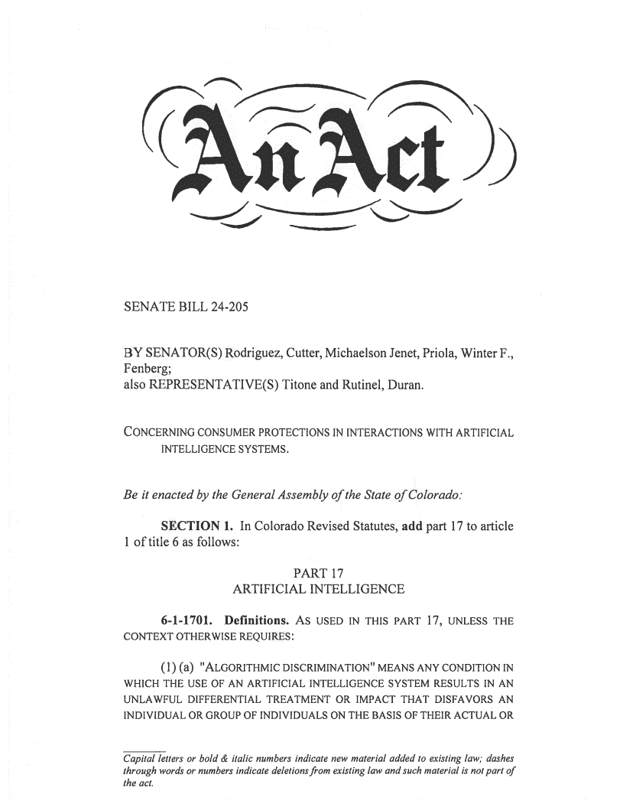
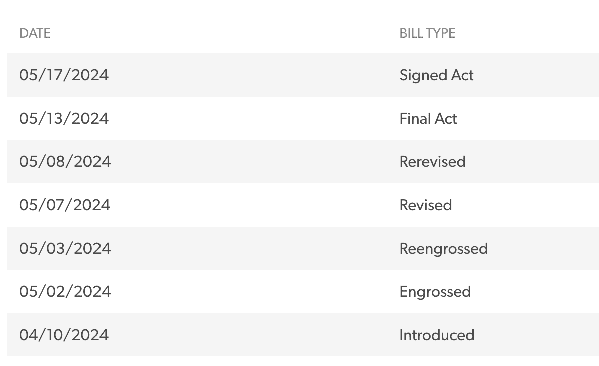

# 科罗拉多州通过关于保护与人工智能交互的消费者的法案 SB 24-205 解析

> 来源：[https://docs.feishu.cn/docx/KKpsdkEf3oca0CxtGUKcUDTpncc](https://docs.feishu.cn/docx/KKpsdkEf3oca0CxtGUKcUDTpncc)

## 作者

**Samantha**

微信：pure-truth1

科技公司法务

## 法案文本

法案原文 SENATE BILL 24-205：

[2024a_205_signed.pdf](https://internal-api-drive-stream.feishu.cn/space/api/box/stream/download/all/L6lAbMRo0oJFjyxJo2Mcfhi7nle)

**中文译本：** 沈漫，《前沿 | 美首部人工智能监管立法中译本》

**法案官方网站：**https://leg.colorado.gov/bills/sb24-205

## 解读

清华大学人工智能国际治理研究院，《科罗拉多州通过美国首部全面人工智能监管法案【AI战略知识库】》；

Lumenova，《[What You Should Know: Colorado Senate Bill 24-2](https://www.lumenova.ai/blog/colorado-senate-bill-24-205-algorithmic-discrimination-protection/)05 Algorithmic Discrimination Protection》

## 一、立法渊源

SB 24-205 是科罗拉多州新通过的法案，科罗拉多州立法在《科罗拉多州消费者保护法》第 6 篇第 I 条中增加了新的第 17 部分“人工智能”，专门应对人工智能系统与消费者交互中的各种潜在风险。该法案其实是科罗拉多州消费者保护法的新增部分，与科罗拉多州隐私法（第13部分）等其他部分共同构成了该州对消费者权益的综合保护体系。该法案聚焦在防止算法歧视影响“后果性决策”，包括与就业相关的决策。

1964年的《民权法案》（其中第七章特别禁止就业中的歧视行为）是后来所有关于职场歧视的法律框架的基础，确立了一系列保护员工免受歧视的联邦法律标准。第七章的主要条款包括禁止雇主在招聘、解雇、晋升和其他雇佣相关的决策中基于这些受保护特征进行歧视。此法案的通过标志着美国民权运动的一个重要进展，对于推动平等职场环境和减少就业歧视起到了至关重要的作用。

随着AI技术在招聘和员工管理中的广泛应用，联邦和州级政府机构开始关注到新兴技术的监管空白，以及这些技术可能引起的歧视问题及其合法性。

+   2019年，伊利诺伊州就通过了《人工智能视频面试法案》（AIVI法案），要求在求职面试过程中使用AI技术的雇主必须遵循特定的同意、透明度和数据销毁规定。这是美国首个针对视频面试中AI使用的州法律，自2020年1月1日起生效。

+   2021年，纽约市议会通过措施，为在招聘实践中使用人工智能的雇主设定了某些义务。加州公平就业和住房委员会开始考虑关于工作场所自动化决策系统的法规草案。

+   2023 年 7 月，纽约市开始执行第 144 号地方法，该法律规范雇主使用“自动就业决策工具”在纽约市做出招聘和晋升决定。该法律要求受保雇主向求职者提供使用自动就业决策工具的通知，并对此类工具进行年度偏见审计。

+   2022年5月，美国平等就业机会委员会（EEOC）发布了人工智能和算法公平倡议，并在其中的一份叫做一份关于技术和残疾歧视的技术援助文件 technical assistance document （TAD）中提出了认为雇主使用算法决策工具可能违反美国残疾人法案（ADA）的情形，要求招聘及其他就业决策中使用的软件不得有意无意的剔除残障人士，且必须为残疾的雇员和职位申请人提供合理便利。同日，美国司法部（DOJ）也发布了关注招聘过程中算法和AI使用的指导意见，提出了预防这些技术可能导致的歧视的建议。

+   2024 年 5 月 16 日，劳工部 （DOL根据第 14110 号行政命令 （EO 14110）（关于安全、可靠和可信赖地开发和使用人工智能的行政命令）的授权发布指南《人工智能和工人福祉：开发人员和雇主的原则》 以确保在工作场所负责任和透明地使用人工智能。

从上述立法动态可以看出，《科罗拉多人工智能法案》是对上述发展的响应。

## 二、**立法进程**

## 三、适用范围

### （一）直接受到影响的几类主体

该法案规范了在科罗拉多州开展业务的任何人**，主要是人工智能系**统中的两类利益相关者：开发者、部署者以及有意并实质性地修改了高风险的人工智能系统的任何实体。

+   **开发者**：指在科罗拉多州从事业务活动、开发或有意并显著修改人工智能系统的个人。他们负责使用合理的注意力来保护消费者免受可预见的算法歧视风险，向部署者或其他开发者提供必要的文档，并披露任何已知或可合理预见的风险。

+   **部署者（用户）**：指在科罗拉多州从事业务活动并部署高风险人工智能系统的个人。他们需要实施风险管理政策和程序，进行定期影响评估，并向消费者提供关于他们所交互的人工智能系统的某些通知。豁免那些员工人数少于 50 人且不使用自己的信息或数据来教授或改进正在使用的 AI 系统的部署者，或使用符合特定标准的系统的部署者。

+   **第三方/供应商角色**：如果第三方以供应商或合作伙伴的身份出现，并参与到AI系统的开发、重大修改或部署过程中，他们可能需要根据与主要责任方（开发者或部署者）的合同条款承担一定的责任。与AI系统的开发方和部署方共同配合， 确保其产品或服务符合SB 24-205 的要求。因此，在合同中，需要清晰所有参与方的产品合规责任和义务。

+   **豁免范围：**根据法案内容，第6-1-1605节详细列出了多种情况下高风险人工智能系统的使用豁免。 这里不再赘述。

+   **域外影响：****与欧**盟人工智能法案类似，“在该州开展业务”通常被广义解释，是一种针对特定事实的分析，取决于商业活动的性质和持续时间。因此，即使是在科罗拉多州没有实体存在但在该州从事商业活动的公司也可能需要遵守该法案。

法案生效以后，向消费者提供的其他披露。部署、提供、销售、租赁、许可、提供或以其他方式提供旨在与消费者交互的 AI 系统的部署者或其他开发人员必须向每个消费者披露他们正在与 AI 系统交互。

### （二）“高风险人工智能系统”的定义

首先，这些系统或技术工具必须参与在对关键领域的决策过程。例如，一个在金融服务中使用的AI系统，如果它的决策出了问题，可能会影响到数以千计的用户的信用评分、贷款申请，甚至是他们的生活质量。

其次，“实质性因素”的定义非常重要。这意味着AI系统不仅仅是一个辅助工具，它能够显著改变决策结果。举个例子，一个AI系统可以通过分析大量的数据，为医生提供诊断建议，这个建议可能会改变一个病人的治疗方案。因此，这样的系统的容错性很低。

因此，SB 24-205 明确了哪些领域的AI系统被认为是高风险的，包括教育、就业、金融、政府服务、医疗保健、住房、保险和法律服务。 监管的重点是确保这些系统在使用前必须经过严格的测试和评估，以保证它们的安全性和可靠性。

法律还排除了包括一些高风险人工智能系统不包括的几类技术（见表一），这是因为这些技术是日常使用的通用工具，例如拼写检查、数据存储和网络安全技术。这些技术的使用目的比较狭窄，它们在大多数情况下是安全且可靠的，不涉及复杂的决策过程，因此不需要法律的特殊规制。

| **排除范围** | 计算器 |
| --- | --- |
|  | 电子表格 |
|  | 网络缓存 |
|  | 互联网域名注册 |
|  | 网站托管或类似技术 |
|  | 网络技术 |
|  | 防欺诈技术（不使用面部识别技术） |
|  | 防恶意软件技术 |
|  | 防病毒技术 |
|  | 防火墙 |
|  | 网络安全技术 |
|  | 数据库 |
|  | 数据存储技术 |
|  | 启用人工智能的视频游戏 |
|  | 拼写检查技术 |
|  | 垃圾邮件和自动电话过滤技术 |
|  | 用自然语言与消费者沟通的技术（用于提供信息、推荐和回答问题） |

### **（三）“算法歧视”（Algorit**hmic Discrimination）

> **算法歧视：**即人工智能系统的使用导致对某些个人或群体的非法差别待遇或影响，这些个人或群体基于实际或感知的年龄、肤色、残疾、种族、民族、宗教、性别、退伍军人身份等特征受到不公平对待。

> Algorithmic discrimination: “Any condition in which the use of an artificial intelligence system results in an unlawful differential treatment or impact that disfavors an individual or group of individuals on the basis of their actual or perceived age, color, disability, ethnicity, genetic information, limited proficiency in the English language, national origin, race, religion, reproductive health, sex, veteran status, or other classification protected under the laws of this state or federal law.”

## **四、对相关业务的影响**

### **（一）开发者的责任**

该法案要求高风险人工智能系统（高风险系统）的开发者在使用高风险系统时必须采取合理的措施，避免算法歧视。如果开发者遵守了法案中规定的特定条款，则可以推定认为其已经采取了合理的措施。这些条款包括：

+   向高风险系统的部署者提供一份声明，披露关于高风险系统的特定信息；

+   向高风险系统的部署者提供完成高风险系统影响评估所需的信息和文件；

+   公开发布一份声明，概述开发者已经开发或做出的故意和实质性的修改内容、提供给部署者的高风险系统类型，以及开发者如何管理这些高风险系统在开发过程中或故意和实质性修改过程中可能出现的已知或合理预见的算法歧视风险；

+   在发现或接收到来自部署者关于风险的可信报告后90天内，向总检察长和已知的高风险系统部署者披露任何已知或合理预见的算法歧视风险。

### （二）部署者的责任（此处通常是B端用户）

仅适用于在部署高风险人工智能系统时始终满足以下所有要求的公司：（a） 拥有超过五十 （50） 名全职员工，（b） 不使用部署者自己的数据来训练高风险人工智能系统;以及 （c） 仅将高风险人工智能系统用于部署者披露的预期用途。

法案要求高风险系统的部署者在使用高风险系统时必须采取以下措施：

+   实施高风险系统的风险管理政策和程序，完成高风险系统的影响评估；

+   每年审查每个由其部署的高风险系统的部署情况，以确保高风险系统没有造成算法歧视；部署者或其合同第三方需要在高风险人工智能系统发生重大修改后90天内完成影响评估。部署者需保留最新的影响评估和所有相关记录，至少三年。这包括所有以前的影响评估和相关文件。

+   部署者在发现高风险人工智能系统导致算法歧视后，必须在不超过90天的时间内，向科罗拉多州总检察长发送通知，披露这一发现。部署者需要采取适当的措施来减轻和纠正算法歧视。例如，调整系统的算法、重新训练模型，或者改变数据处理和使用方式，以消除歧视性影响。

+   在使用高风险人工智能系统做出对消费者有实质性影响的决定时，部署者必须提前通知消费者，并提供系统的目的、决策的性质、部署者的联系信息以及消费者如何获取相关信息的指示。

+   提供消费者一个途径，以纠正高风险人工智能系统在做出影响深远决策时处理的任何不正确的个人数据；消费者有权要求部署着使用人工审查帮助AI纠正任何错误的或不准确的数据或输出结果。

+   公开发布声明，向消费者披露部署者目前部署的高风险系统类型，以及部署者如何管理每个高风险系统部署过程中可能出现的已知或合理预见的算法歧视风险，并且说明所收集和使用的信息的性质、来源和范围；

### ** （三） 对雇主的影响**

立法者们意识到，随着AI在筛选求职者、评估员工表现等方面的广泛应用，如果不加以规范，可能会导致系统性的不公平现象。

法案24-205明确将涉及就业机会和雇佣决定的自动化决策场景定义为高风险人工智能系统。对劳动者和应聘者提供保护。

使用人工智能工具招聘或雇用科罗拉多州居民的雇主应在接下来的 18 个月内微调他们的系统、方法和流程，需要实施风险管理政策和程序，定期评估和更新人工智能系统，识别和减轻算法歧视的风险。以避免在招聘和管理过程中通过技术对劳动者进行歧视。

## **五、 执法**

SB 24-205 赋予州总检察长独家执行权，由其负责对高风险人工智能系统的法律遵从性进行监督和执法 。法案没有提供个人诉讼的权利，这意味着个人不能直接起诉违反此法律的行为，只能由总检察长办公室进行法律行动。

总检察长的主要执行职责包括：

1.  独家执法权：总检察长是唯一有权执行该法案的政府官员。

1.  规则制定权：总检察长可以根据需要制定规则，以实现和强化法案的执行 。

1.  监督和评估：总检察长负责监督开发者和部署者的遵法情况，评估他们提交的风险管理策略和影响评估报告是否符合法律要求。总检察长可以要求开发者和部署者披露以下信息：（1）其风险管理框架的细节；（2）最新的影响评估结果；（3）详细说明过去 3 年（如果相关）或迄今为止进行的所有影响评估的记录。

1.  法案还鼓励开发者和部署者遵循由国家标准与技术研究院（NIST）发布的AI风险管理框架和国际标准化组织（ISO）/国际电工委员会（IEC）的42001标准或其他国家或国际认可的人工智能风险管理框架（前提是这些标准至少与本法案的要求同等严格或更严格）。如果开发者和部署者能证明他们的操作符合国家或国际公认的人工智能风险管理框架，那么在面临使用人工智能系统而引发的法律问题时，他们可以举证，展示他们已采取了必要的预防措施来减少风险，从而可能避免一些法律责任。

结语：尽管科罗拉多州是第一个颁布此类人工智能法规的州，但最近的美国各州法律发展都正在制定某种形式的人工智能法规，以促使公司尽快采取人工智能治理动作。本公众号将继续关注人工智能的法律问题。