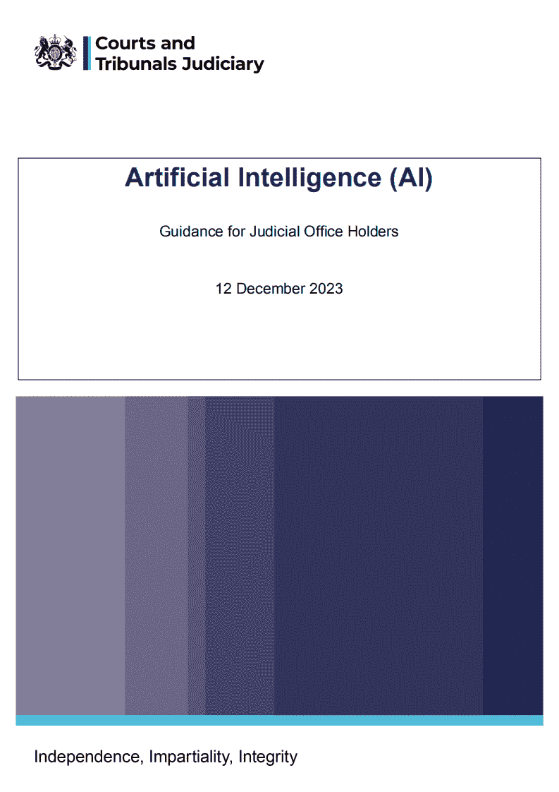
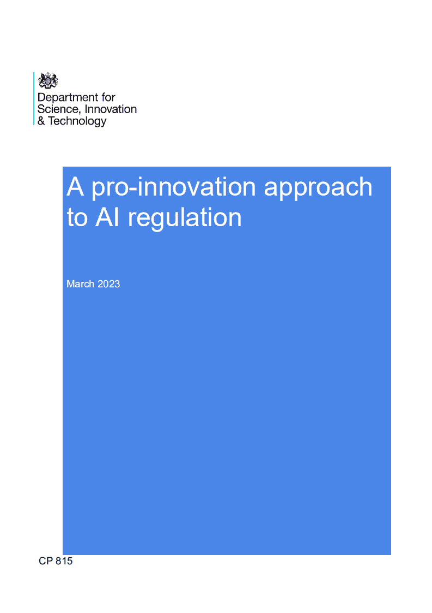

# 🇬🇧 英国

> 来源：[https://docs.feishu.cn/docx/Lgq7d1VPIoiFhcxjdVBc5X6Mnjh](https://docs.feishu.cn/docx/Lgq7d1VPIoiFhcxjdVBc5X6Mnjh)

> **综述**

> AI Watch: [Global regulatory trac](https://www.whitecase.com/insight-our-thinking/ai-watch-global-regulatory-tracker-united-kingdom)ker - United Kingdom

> Legal 500介绍：[United Kingdom](https://www.legal500.com/guides/chapter/united-kingdom-artificial-intelligence/?_gl=1*1ebj9na*_up*MQ..*_ga*MTY2NzczOTUxMy4xNzE3MTE5Mjc4*_ga_JFNJC5V947*MTcxNzExOTI3OC4xLjAuMTcxNzExOTI3OC4wLjAuMA..)[: ](https://www.legal500.com/guides/chapter/united-kingdom-artificial-intelligence/?_gl=1*1ebj9na*_up*MQ..*_ga*MTY2NzczOTUxMy4xNzE3MTE5Mjc4*_ga_JFNJC5V947*MTcxNzExOTI3OC4xLjAuMTcxNzExOTI3OC4wLjAuMA..)Artificial Intelligence

> [G](https://www.globallegalinsights.com/practice-areas/ai-machine-learning-and-big-data-laws-and-regulations/united-kingdom/)lobal Legal Insight 报告： AI, Machine Learning & Big Data Laws and Regulations 2024

根据英国政府2022年7月发布的《人工智能监管政策》，英国尚无明确规制人工智能监管的专门法，目前是通过以其他立法目的而制定的零散法规来监管人工智能。

ICO官网的人工智能板块：https://ico.org.uk/for-organisations/uk-gdpr-guidance-and-resources/artificial-intelligence/

域外立法 | 英国发布官方指南指导司法人员使用人工智能（附《指南》中文译本）

https://mp.weixin.qq.com/s/wIPs-kuhQeg9kGkJ5qU05A

[AI-Judicial-Guidance.pdf](https://internal-api-drive-stream.feishu.cn/space/api/box/stream/download/all/AMGRbD5XgoUxFMxt2TVcHsSinZM)

### 法律

| **时间** | **发布机关** | **文件** | **内容** | **相关文章** |
| --- | --- | --- | --- | --- |
| 2020年 |  | 《人工智能与数据保护指南》 | 讨论了有关在AI系统中处理个人数据的合法基础，评估和改善AI系统性能以及减轻潜在歧视以确保公平的处理个人数据。介绍和探讨了三个关键概念：AI系统的合法性、公平性和透明性。其中根据“识别系统的目的以及其与法律的关系”对合法性进行定义。根据避免“歧视和考虑个人合理期望的影响”对公平性进行定义。 | +   解读： |
| 2021年11月 |  | 《算法透明度标准》 | 提升公共部门在使用算法工具辅助决策时的透明度。该标准为公共部门应如何保证算法透明度提供了较为具体的指引，是全球最早制定的算法透明度国家标准之一。 | +   解读：《[英国《算法透明度标准》全面解读](https://mp.weixin.qq.com/s/JeryK7Mox1tg2ZJRz_LrEQ)》 |
| 2022年7月18日 | 英国数字、文化、媒体和体育部（DCMS） | 《建立一种支持创新的人工智能监管方法》（Establishing a pro-innovation approach to regulating AI） | 政策文件强调监管的合比例性，并基于人工智能的特征提出了一个促进创新的监管框架。 | +   解读：《英国《建立一种支持创新的人工智能监管方法》解读》 |
| 2022年7月 |  | 《人工智能监管政策》（AI Regulation Policy Paper） | 指导性文件。 |  |
| 2022年8月31日 | 英国国家网络安全中心（the National Cyber Security Centre， NCSC） | 《机器学习安全原则》（Principles for the security of machine learning） |  | +   解读：《[英国《机器学习安全原则》综述](https://mp.weixin.qq.com/s/xbiY0u1OLQsA09ffRyoqLA)》 |
| 2022年11月18日 | 英国信息专员办公室（ICO） | 《如何恰当且合法地使用AI及个人信息》 |  | +   翻译：《如何恰当且合法地使用AI及个人信息》全文翻译 |
| 2023年3月底 | 英国信息专员办公室（ICO） | 《支持创新的人工智能监管方式 (A pro-innovation approach to Al regulation)》 | 为人工智能发展提出意见。在一年内，有关经济与人工智能跨领域风险等级的草案也许会出台，政策还在制定更新阶段。 |  |

+   《如何确保AI系统的合法性、公平性和透明性》

+   《自动化决策中个人权利的保护：英国ICO《人工智能与数据保护指南》评述》

[a-pro-innovation-approach-to-ai-regulation-amended-web-ready.pdf](https://internal-api-drive-stream.feishu.cn/space/api/box/stream/download/all/XnBJb3O1noZQSKxHFdccMFkRnge)

### 其他文件

| **时间** | **发布机关** | **文件** | **内容** | **相关文章** |
| --- | --- | --- | --- | --- |
|  |  | [G](https://ico.org.uk/media/2617219/guidance-on-the-ai-auditing-framework-draft-for-consultation.pdf)uidance on the AI auditing framework Draft (guidance for consultation) |  |  |
| 2023年7月18日 | Ada Lovelace Institute研究所 | 《英国人工智能监管》报告 | 对英国政府目前关于人工智能监管的计划进行了分析与总结，并为英国政府人工智能监管工作的改进提出了18项建议。 | +   解读：《18项人工智能监管建议：《英国人工智能监管》报告解读》 |
| 2023年8月31日 | 科学创新和技术委员会 | 《英国人工智能治理中期报告》 | 研究人工智能对社会和经济的影响、是否及如何针对人工智能的不同应用场景进行规制、英国政府的人工智能治理路径。 | +   解读： |
| 2024年1月23日 | ICO | Generative AI first call for evidence: The lawful basis for web scraping to train generative Al models | 英国ICO近日发布的关于网络爬取公开数据用于人工智能训练的合法性问题的公开咨询。 | +   翻译：英国ICO：爬取公开数据用于人工智能训练的合法性意见公开征集（洪延青） |
|  |  |  |  |  |
|  |  |  |  |  |
|  |  |  |  |  |

+   《《英国人工智能治理中期报告》解读》

英国发布的指导性文件《人工智能监管政策》（AI Regulation Policy Paper）

作为英国上议院科技特设委员会成员（House of Lords Select Committee on Science and Technology）的议员Lord Holmes of Richmond于2023年11月23日提出了《2024年人工智能（监管）法案》。该法案内容仅有9条，核心内容是设立人工智能局，同时明确了人工智能监管应当遵循的基本原则。该法案是普通议员法案（private members’ bill）而非内阁成员（ministers）提出的公法案（public bill），因此不能代表政府的正式立场；不过，该法案在议会的推进可能也会对英国政府未来是否推动相关立法产生重要影响。该法案已于2024年3月22日完成二读。

+   原文：https://bills.parliament.uk/publications/53068/documents/4031

+   译文：《译介 | 张滢文译、苏苗罕校：英国《2024年人工智能（监管）法案》》

ICO发布Introduction to AI assurance

An introductory guide for practitioners interested in finding out how assurance techniques can support the development of responsible AI.

https://www.gov.uk/government/publications/introduction-to-ai-assurance?mkt_tok=MTM4LUVaTS0wNDIAAAGRSFObE9g55q2m91F7iEKfiwyQyR6x2rI4iUw5ouhDUlNtfuyTz3AGuY2_MSTWrbUJf4LZ-UexcqgeMkbWfJOGXtNVq87Vxf6ZBZo3_oFV8wLx

# 英国：ICO就生成式人工智能模型的准确性发起咨询

2024年4月12日，英国信息专员办公室（ICO）宣布启动关于生成式人工智能（AI）的系列咨询的第三章。其中，第三章咨询的重点是数据保护的准确性原则如何适用于生成式人工智能模型的输出，以及准确的训练数据对输出的影响。

生成式人工智能模型的输出是否应该准确？

咨询意见解释说，对生成式人工智能模型输出结果的准确性水平要求取决于模型的使用方式，对于用于对人做决策或用户依赖其作为信息来源的模型，需要较高的准确性。

咨询意见指出，开发和使用纯粹以创造为目的的生成式人工智能模型的组织不太可能将确保输出结果的准确性作为首要任务。例如，咨询意见强调，用于分流客户查询的模型需要比用于帮助开发视频游戏故事情节创意的模型保持更高的准确性。

**开发人员的义务**

为确保用于开发生成式人工智能模型的训练数据的准确性，咨询建议开发者应：

+   了解训练数据是否由准确、真实和最新的信息组成

+   了解并记录训练数据的准确性对人工智能生成模型输出的影响

+   考虑生成式人工智能模型输出的统计准确性是否足以满足模型的使用目的，以及这对数据保护准确性的影响

向部署者和最终用户明确传达上述三点，以确保在培训阶段缺乏准确性不会在部署阶段对个人造成负面影响

**部署者的义务**

咨询意见强调，生成式人工智能的部署者有责任与最终用户进行清晰的沟通，并应:

+   考虑缺乏准确的训练数据和输出可能对个人造成的影响，并在部署前降低这些风险

+   提供有关应用程序统计准确性及其预期用途的明确信息

+   监测应用程序的使用情况，以提供信息，并在必要时改进向公众提供的信息和对应用程序使用的限制

第三次咨询的意见可在2024年5月10日之前在线提交或通过电子邮件发送至generative.ai@ico.org.uk

英国金融行为监管局更新人工智能监管文件

2024年4月22日，英国金融行为监管局（FCA）更新了人工智能监管文件，以回应英国政府发布的人工智能白皮书。文件中概述了FCA对AI的监管方针，即“一般不会特定禁止或要求特定技术，而是着重于识别和降低风险，以促进人工智能在英国金融市场的安全和负责任地使用”。FCA指出，未来一年中，其将继续深入了解人工智能在英国金融市场的部署情况，确保未来监管与人工智能风险相适应。

**更多信息：**

[htt](https://www.fca.org.uk/publications/corporate-documents/artificial-intelligence-ai-update-further-governments-response-ai-white-paper)ps://www.fca.org.uk/publications/corporate-documents/artificial-intelligence-ai-update-further-governments-response-ai-white-paper

### 监管部门

英国则拟指定英国政府下设的独立机构——信息专员办公室（Information Commissioner's Office，ICO）对人工智能进行监管，目前尚不会设立新的专门的人工智能监管机构