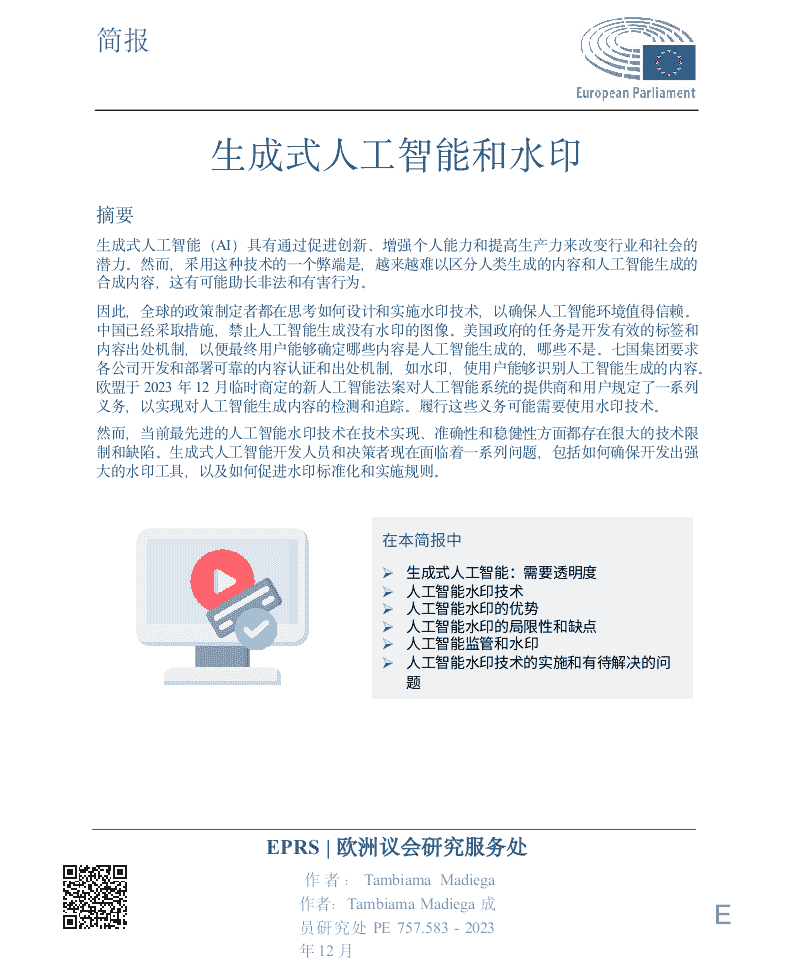
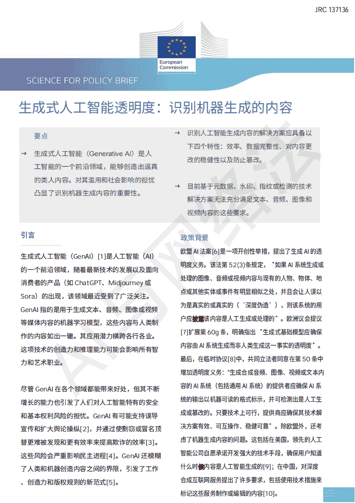

# 水印（watermarking）

> 来源：[https://docs.feishu.cn/docx/F5EIdS1yYoRwzdxtEZccL2qAnwb](https://docs.feishu.cn/docx/F5EIdS1yYoRwzdxtEZccL2qAnwb)

[EPRS_Generative AI and watermarking, 2023 zh.docx](https://internal-api-drive-stream.feishu.cn/space/api/box/stream/download/all/S5QtbaewQoUK0PxJ01rcuT9bnXU)

[EPRS_Generative AI and watermarking, 2023.pdf](https://internal-api-drive-stream.feishu.cn/space/api/box/stream/download/all/BuUBbHjVeoA3S7xqqR3cQJxAnRe)

欧盟委员会报告：《生成式人工智能透明度：机器生成内容的识别》

2024年5月21日，欧盟委员会发布《生成式人工智能透明度：机器生成内容的识别》报告，由Ronan Hamon等专家撰写，强调了随着生成式人工智能技术进步，其创造内容逼真度与人类作品难以区分，带来误导信息和版权问题，因此报告深入探讨了如何通过技术手段确保AI生成内容的透明度与可识别性，以应对这些挑战。

[生成式人工智能透明度.pdf](https://internal-api-drive-stream.feishu.cn/space/api/box/stream/download/all/YAwpbVVUZoZ7yfxgjdlc7BIinhc)