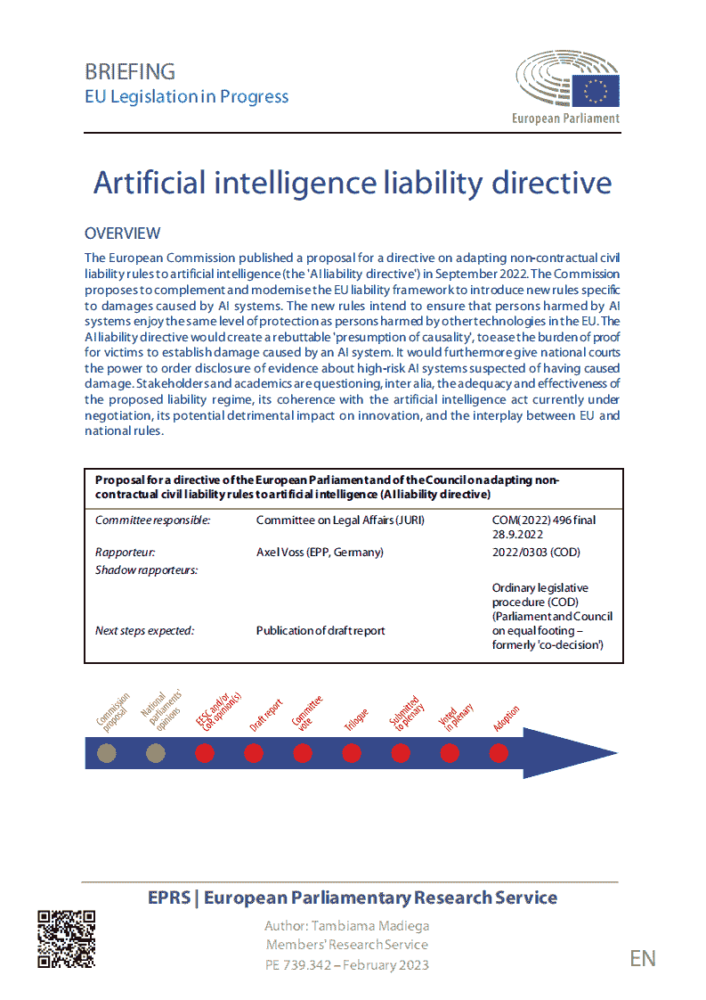
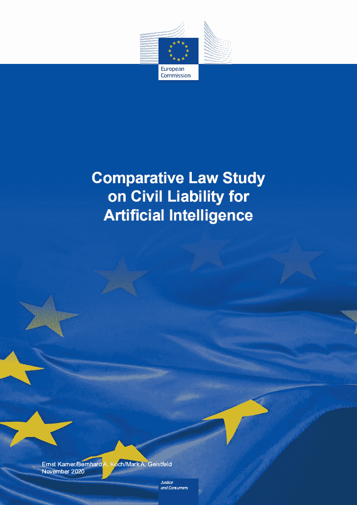
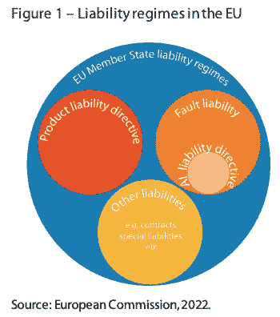
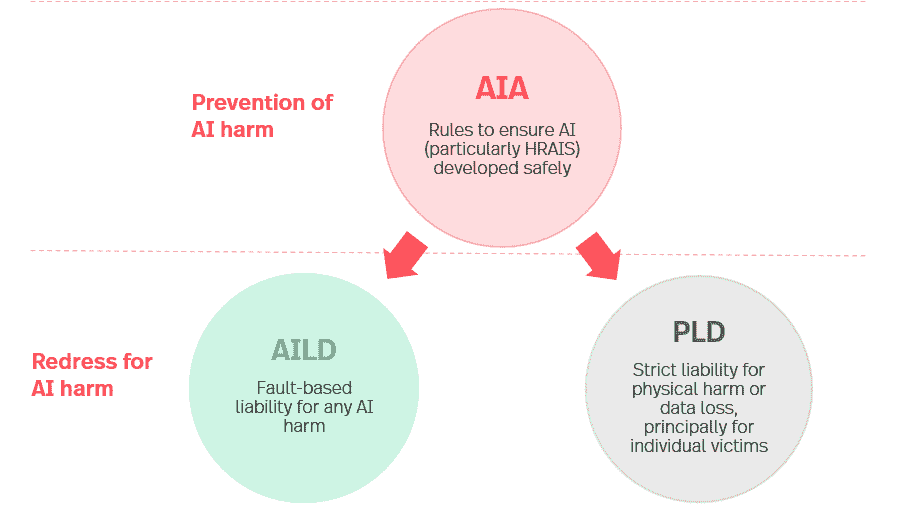
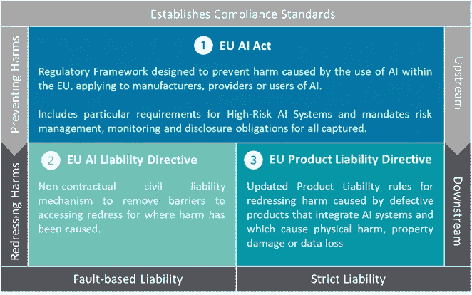
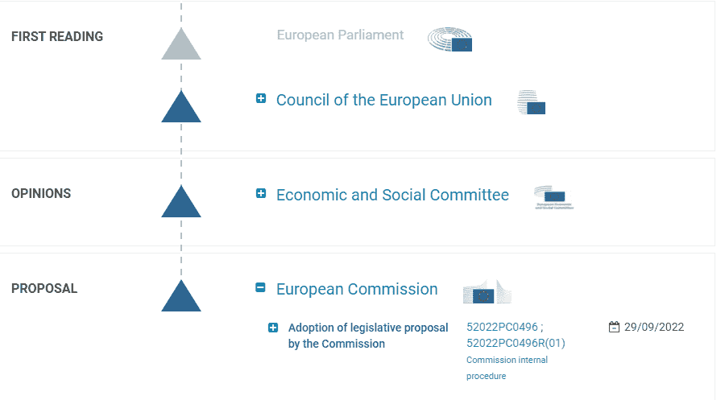
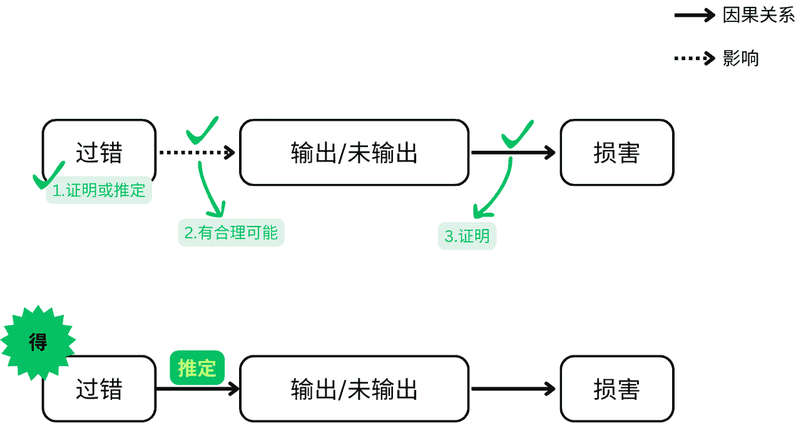

# 《人工智能责任指令》（AI Liability Directive，AILD）

> 来源：[https://docs.feishu.cn/docx/K7rpdvoMcojpGdxLY4CcMzV4nhh](https://docs.feishu.cn/docx/K7rpdvoMcojpGdxLY4CcMzV4nhh)
>
> 《人工智能责任指令》（提案）由欧盟委员会于2022年9月与《产品责任指令》修订版提案一同提出。与《人工智能法》（AIA）和其他一系列欧盟数字领域立法共同构成欧盟人工智能的法律框架。
>
> AILD旨在协调欧盟成员国人工智能系统致损的部分非合同性民事法律制度，通过引入证据披露机制与过错责任下的因果关系推定，降低请求权人可能过高的索赔成本。

## 作者

**孙政**

爱丁堡大学LLM Candidate

Pay it forward.

另外推荐一下作者的👸号：Siddartha，非常有价值。

## 法案文本

⭐ 2022年9月28日欧盟委员会提案：<https://eur-lex.europa.eu/legal-content/EN/TXT/PDF/?uri=CELEX:52022PC0496>

**中译本：**社科院法学所，[《欧盟人工智能责任指令》译文](https://mp.weixin.qq.com/s/W-HbVCpDFrmWVblrthu9aQ)

### 欧盟各机构意见

+ 2023年1月24日欧洲经社委员会意见：<https://eur-lex.europa.eu/legal-content/EN/TXT/PDF/?uri=CELEX:52022AE4704>
+ 2023年10月11日EDPS意见：<https://www.edps.europa.eu/system/files/2023-10/23-10-11_opinion_ai_liability_rules.pdf>
+ [23-10-11_opinion_ai_liability_rules.pdf](https://internal-api-drive-stream.feishu.cn/space/api/box/stream/download/all/WblqbfPX9oijPTxA9MQcgjzTnHh)

## 解读

**中文：**申军，《欧盟〈人工智能责任指令〉和〈产品责任指令〉修订版之简析》；《对欧盟〈人工智能责任指令〉的析与思》；李容佳，《人工智能治理 | 欧洲人工智能责任指令（提案）综述》；曲晓琨、尹刚，《硬币的另一面——欧盟〈人工智能责任指令〉》；朱玲凤，《AI专题｜EDPS发布对人工智能责任规则两项指令提案的意见》

**英文：**

+ [律所文章：Simmons & Simmons LLP, What is the new EU AI Liability Regime?](https://www.simmons-simmons.com/en/publications/cla2fpkgw5uj20a94oaegyszn/what-is-the-new-eu-ai-liability-regime-)
+ [学术](https://www.sciencedirect.com/science/article/pii/S026736492300081X)[论文](https://techreg.org/article/view/15772/20975)：Philipp Hacker, [The European AI liability directives – Critique of a half-hearted approach and lessons for the future](https://papers.ssrn.com/sol3/papers.cfm?abstract_id=4470725The)；Shu Li, Béatrice Schütte, [The Proposed EU Artificial Intelligence Liability Directive: Does/Will Its Content Reflect Its Ambition?](https://techreg.org/article/view/15772/20975)；Marta Ziosi et al., EU AI Liability Directive (AILD): Bridging Information Gaps
+ EPRS的简报：

[EPRS_BRI(2023)739342_EN.pdf](https://internal-api-drive-stream.feishu.cn/space/api/box/stream/download/all/CjEdbKDodoo5Ybxzox7cPVqunj4)

## 一、立法背景

为了使欧盟成为世界级的人工智能中心，并确保人工智能以人为本且值得信赖，欧洲自2021年起发布了人工智能战略以及一揽子计划。在构建值得信赖的人工智能（trust in AI）方面，欧盟委员会提出了三项法律措施，其中包括了对于民事责任框架的修订。

**欧盟政策：**[European approach to artificial intelligence](https://digital-strategy.ec.europa.eu/en/policies/european-approach-artificial-intelligence)；[WHITE PAPER On Artificial Intelligence - A European approach to excellence and trust](https://eur-lex.europa.eu/legal-content/EN/TXT/PDF/?uri=CELEX:52020DC0065) 第12-15页

欧盟委员会委托进行的比较法律研究：人工智能的民事法律责任

[comparative law study on civil liability for artificial-DS0921157ENN.pdf](https://internal-api-drive-stream.feishu.cn/space/api/box/stream/download/all/H09tbMAwNorDkWxyBSscpc4NnDc)

### 立法理由

根据上面提到的比较法律研究，在其他立法跟进之前，AI系统致损的救济仍然主要依赖各成员国国内的民事责任制度，尤其是过错责任。而受害人往往在涉及AI系统的过错责任案件中遭遇多种困难：

首先，受害人需要证明是AI系统提供者的过错造成了AI系统的输出或应输出而不输出，且这一结果造成了损害。AI系统本身具有黑箱属性，不仅在技术上难以理解，且系统通常封闭，受害者难以取证和举证。这可能使得受害人寻求救济的金钱或时间成本相较一般的过错责任案件过于高昂，使受害人失去寻求救济的动力。

欧盟层面上已经有《产品责任指令》但暂时还没有横向的过错责任指令，为了减轻受害人在涉及AI系统的过错责任民事诉讼中的举证负担，各成员国可能会采取不同方案，这会为欧盟单一市场的法律体系增加不确定性，影响跨国贸易，因此需要在欧盟层面上协调统一立法。

### 立法目标

《人工智能法》设立了事前的横向安全监管体系，而《人工智能责任指令》旨在协调欧盟法层面上部分民事责任制度，正如提案备忘录中所述，“安全与责任是一枚硬币的两面。”损害发生前，《人工智能法》可以通过监管，降低人工智能的风险，但当风险现实化为损害后，受害人将需要基于民事责任请求损害赔偿，此时《人工智能责任指令》将为受害人提供相较一般过错责任制度下更低的证明责任，以及更多的举证便利。一言以概之，AILD的目的在于通过特定制度设计合理降低受害者的举证责任，保障其能够获得有效救济，并促进可信的人工智能（trustworthy AI）在单一市场内推出，减少法律的不确定性。

### 立法基础

TFEU 114，294

最低程度的协调（minimum harmonisation），成员国可以在最低限度之上制定国内法。（AILD Recital 14）

## 二、立法进程

立法进程追踪：<https://oeil.secure.europarl.europa.eu/oeil/popups/ficheprocedure.do?lang=en&reference=2022/0303(OLP)>

<https://eur-lex.europa.eu/legal-content/EN/HIS/?uri=CELEX:52022PC0496>

欧盟委员会已将提案送至欧盟理事会和欧洲议会审议，目前还在等待欧洲议会的立场，[如果理事会同意议会立场，AILD将被通过，否则将进入二读，今年可能会有新的进展](https://www.technologyreview.com/2024/01/05/1086203/whats-next-ai-regulation-2024/)（“Negotiations for that are still ongoing and will likely pick up this year.”）

由于AILD属于欧盟指令（directive）而非欧盟条例（regulation），对个人没有直接的效力，即使通过生效也还需要由成员国转化（transpose）为国内法，相比AIA，AILD的步伐会缓慢许多。

**2025年2月11日**，欧盟委员会在2025年工作计划中宣布计划撤回AILD。

<https://commission.europa.eu/strategy-and-policy/strategy-documents/commission-work-programme/commission-work-programme-2025_en>

## 三、立法内容

### AILD的适用范围（Article 1）

AILD主要涉及两个方面：

+ Disclosure of evidence on high-risk AI system 高风险AI系统证据披露
+ The burden of proof 举证责任

另外，适用的案件必须满足以下条件：“non-contractual civil law claims for damages caused by an AI system, where such claims are brought under fault-based liability regimes”（非合同的民事损害赔偿诉讼，损害由AI系统造成，且这一诉讼基于过错责任。）。

重要的是，AILD只涉及程序问题，而不涉及实体问题，适用的案件必须涉及AI系统，并且主要是高风险AI系统。

### 关键概念（Article 2）

+ [欧盟《人工智能法案》（Artificial Intelligence Act）](https://q2rt76fo46.feishu.cn/wiki/XNynwjvoEi61Twkk8I8cOSVdnxP)要援引《人工智能法》定义的概念。
+ 人工智能系统（AI system）
+ 高风险的人工智能系统（high-risk AI system）
+ 提供者（provider）
+ 用户（user）已被最新版《人工智能法》修改为部署者（deployer）
+ 损害赔偿请求（claim for damages）：指非合同的，基于过错的（non-contractual fault-based）民事法律损害赔偿请求，此损害因AI系统之输出（output），或应输出而未能输出所造成。
+ **请求权人（claimant）**：指提起损害赔偿请求之人，包括直接受AI系统损害之人，从受害人处取得或可以代位（subrogation）行使请求权者（如保险公司，受害者的继承人），或代理受害人行使权利者。
+ 可能的请求权人（potential claimant）：指正在考虑但尚未提起损害赔偿请求的自然人或法人。
+ 注意义务（duty of care）：由成员国国内法或欧盟法设定的必要行为规范，以避免国内法或欧盟法承认的法律利益（包括生命、身体完整、财产）和基本权利的保护受到损害。

### 证据披露与推定过错（Article 3）

**（1）谁需要披露（披露主体）**

> 由《人工智能法》（AIA）定义的高风险AI系统提供者或其他相同义务承担者（见 [欧盟《人工智能法》（Artificial Intelligence Act）](https://q2rt76fo46.feishu.cn/wiki/XNynwjvoEi61Twkk8I8cOSVdnxP)；注意，AIA Art.24 产品制造商的高风险AI系统提供者义务已被删除，Art.28(1) 也有些许调整并且已变更为 Art.25(1)）。

**（2）法院命令披露之条件**

+ 基于请求：可能的请求权人或请求权人在要求披露主体披露证据遭到拒绝后，成员国法院可以基于其请求，命令披露主体披露其掌握的涉及高风险AI系统的相关证据。（Art.3(1)）
+ 可能的请求权人必须提供充足的事实与证据以支持损害赔偿请求的合理可能。（Art.3(1)）
+ 基于裁量：已提起损害赔偿请求的情况下，法院应当仅在请求权人已为取证作出成比例的努力后命令所有披露主体中的一位披露相关证据。（Art.3(2)）

**（3）披露之范围：**

+ 对可能的损害赔偿请求或已提起的损害赔偿请求必要且成比例（necessary and proportionate）的证据。（Art.3(4)）
+ 在确定什么是“必要且成比例的”，法院应考虑各方的合法权益，尤其是商业秘密和涉及公共、国家安全的涉密信息。
+ 若商业秘密需要被披露，法院应要求各方采取必要措施以保障商业秘密的秘密性。

**（4）拒绝披露命令之后果：**

> **推定过错（Art.3(5)）：**
>
> 推定违反注意义务，因而构成过错，这一推定是可被推翻的。（见下文图示中的第一步）

### 因果关系推定（Article 4）

+ 推定的是何种因果关系（Art.4(1)）：
  + （被告的过错——AI系统的输出/应输出而未输出）之间的因果关系
  + “the fault of the defendant and the output produced by the AI system or the failure of the AI system to produce an output”
+ 推定需要满足的条件（Art.4(1)）：
  + 请求权人已证明（has demonstrated）被告之过错，或法院基于被告拒绝披露证据之命令已推定被告之过错（Art.3(5)）。
  + 基于该案条件，可以认为被告之过错有合理可能（reasonably likely）影响（influence）AI系统输出/不输出。
  + 请求权人已证明被告AI系统的输出/不输出导致了（gave rise to)损害。

**如何证明高风险AI系统案件中被告之过错（Art.4(2) and (3)）——AIA不合规：**

+ **高风险AI系统提供者或其他相同义务承担者**：请求权人需要证明以下任意一项AIA不合规
  + 该AI系统涉及使用数据训练模型的方法，但不符合AIA Art.10(2)-(4)中对训练、验证和测试之要求。
  + 该AI系统不符合AIA Art.13中的透明度要求。
  + 该AI系统不符合AIA Art.14中的人类监督要求。
  + 该AI系统不符合AIA Art.15及16(a)中的适当准确性、稳健性和网络安全要求。（注意：新AIA删除了“in the light of their intended purpose”，未来的AILD也会跟进）
  + 未能及时采取必要的纠正措施以使该AI系统符合AIA的规定或酌情撤回、禁用（新AIA新增）或召回该系统。（新AIA Art.16(j)及21）
+ **高风险AI系统部署者**（注意新AIA中使用deployer替代了user）：请求权人需要证明以下任意一项AIA不合规
  + 部署者未能遵守AIA Art.26（新）中设定的“根据系统所附的使用说明使用和监测高风险AI系统”的义务，或未在必要时暂停使用（注意：新AIA删除了interrupt）。
  + 在部署者控制下，AI系统接触了与预设目的无关的数据。（违反新AIA Art.26(3)）

**例外情形：**

+ 若涉及高风险AI系统案件中，被告能够证明请求权人有合理可能获得足够的证据和专业能力以证明过错与输出间的因果关系，则法院不应推定该因果关系成立。（Art.4(4)）
+ 若涉及的是非高风险AI系统，只有在法院认为过错与输出间的因果关系对于请求权人过于难以证明，才可适用Art.4(1)推定其成立。（Art.4(5)）
+ 若被告是在个人非职业活动中使用的AI系统，唯有被告实质性地干预了AI系统操作条件或被告应该且可以决定操作条件却未能干预的情况下，法院才可以适用Art.4(1)。（Art.4(6)）

**推定可被推翻（Art.4(7)）：**

被告有权提供证据推翻Art.4(1)中的因果关系推定。

### 对本指令的审查 (Article 5)

在转化国内法期限后的五年内审查一次。

## 四、其他延伸法律

[《产品责任指令》（Directive of the European Parliament and of the council on liability for defective products，PLD）](https://q2rt76fo46.feishu.cn/wiki/B03TwtUrViUVh6kmBescnAQxneb)

AILD与PLD适用的归责体系不同，AILD注重过错责任，而PLD涉及产品缺陷致损的责任（严格责任）；PLD除程序外还涉及一些实体规则，如损害、缺陷的定义，并且这些规则必须高度协调，成员国转化国内法时不得制定更高或更低的标准。两者在人工智能致损的救济框架中各司其职，共同构成欧盟人工智能责任体系的重要部分。

## 五、学者意见

Hacker认为[AI](https://www.sciencedirect.com/science/article/pii/S026736492300081X)LD对于适用范围限缩过度，Recital 15将有人类决策，AI辅助的情形排除在外，即损害不是直接由AI系统输出导致，而是由人类的作为或不作为导致，因为理论上这里的因果关系的证明难度和没有AI系统介入的情况一样。但这可能导致AILD易被规避，例如AI系统提供者可以往AI系统输出后增加一个人类的环节，但人类不审查决策，而是一味同意AI系统的决策。（不过参照GDPR中自动化决策的判例，应该只有人类实质性介入了才可能不适用）并且，即使不考虑这个漏洞，目前完全由AI系统自动化决策的应用还是少之又少，加之AIA中的人类监督要求，AILD大多情况下可能都不会得到适用。（Philipp Hacker, The European AI liability directives – Critique of a half-hearted approach and lessons for the future）

同时，披露的证据对于可能缺少AI专业训练的当事人和法[官](https://papers.ssrn.com/sol3/papers.cfm?abstract_id=4470725The)难以理解，AILD并没有明确要求这些证据应该以便于非专业人士理解的方式呈现。AILD并没有引入普遍的举证责任倒置，即使通过Art.3获取了证据后，用这些复杂的证据来证明被告存在过错和AI输出与损害之间的因果关系仍然困难重重。因此也有学者（Marta Ziosi et al.）提出实际上理解和解释证据的负担被转移给了请求权人，更好的方案可能是提高AI系统事前的透明度和可解释性而不是在事后才可以要求披露证据。（Marta Ziosi et al., EU AI Liability Directive (AILD):  Bridging Information Gaps）

不少学者（Hacker; Li）注意到AILD并没有统一“过错”这一概念，这可能导致AILD在各成员国转化后的适[用不](https://www.sciencedirect.com/science/article/pii/S026736492300081X)[一致](https://techreg.org/article/view/15772/20975)。相较PLD，AILD只提供了最低限度的协调，只能在一定程度上改善立法碎片化。（Philipp Hacker, The European AI liability directives – Critique of a half-hearted approach and lessons for the future；Shu Li, Béatrice Schütte The Proposed EU Artificial Intelligence Liability DirectiveDoes/Will Its Content Reflect Its Ambition?）
