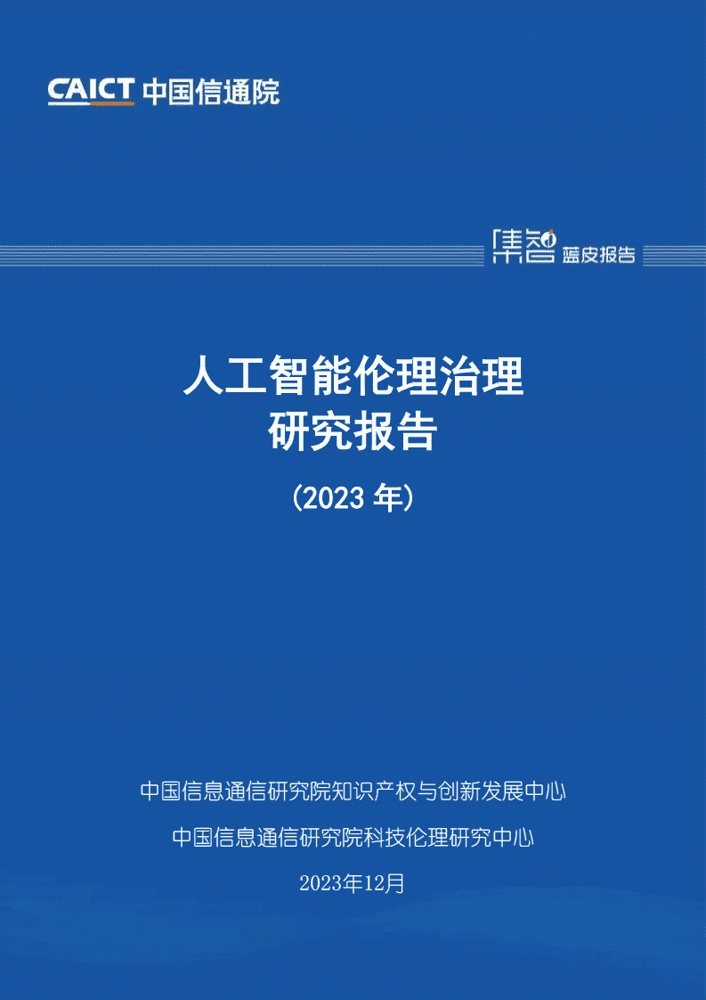
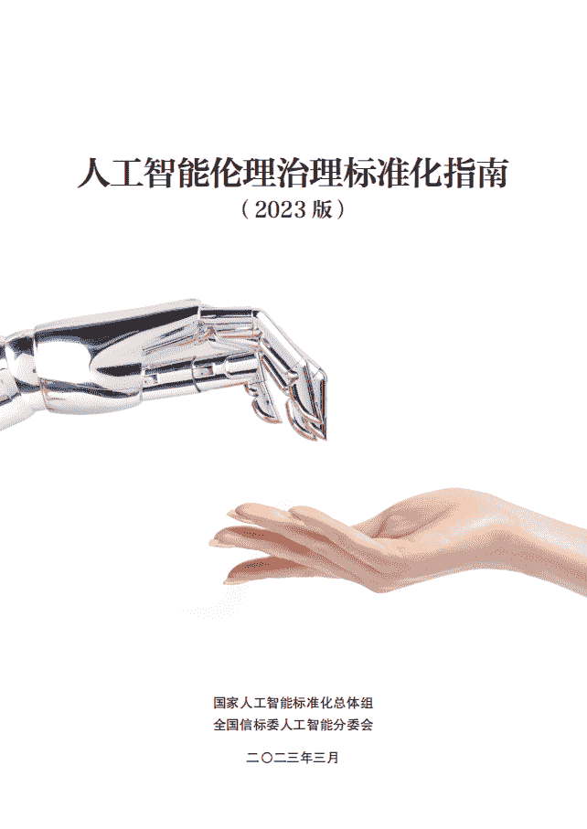
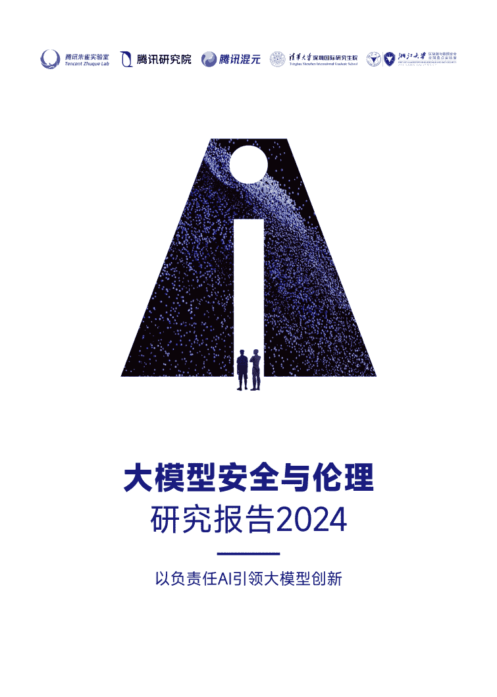
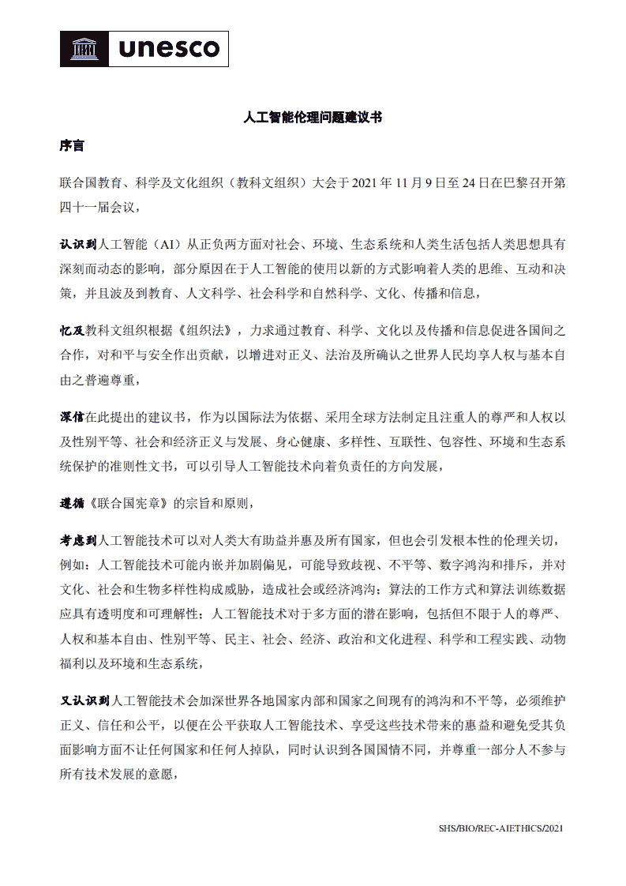
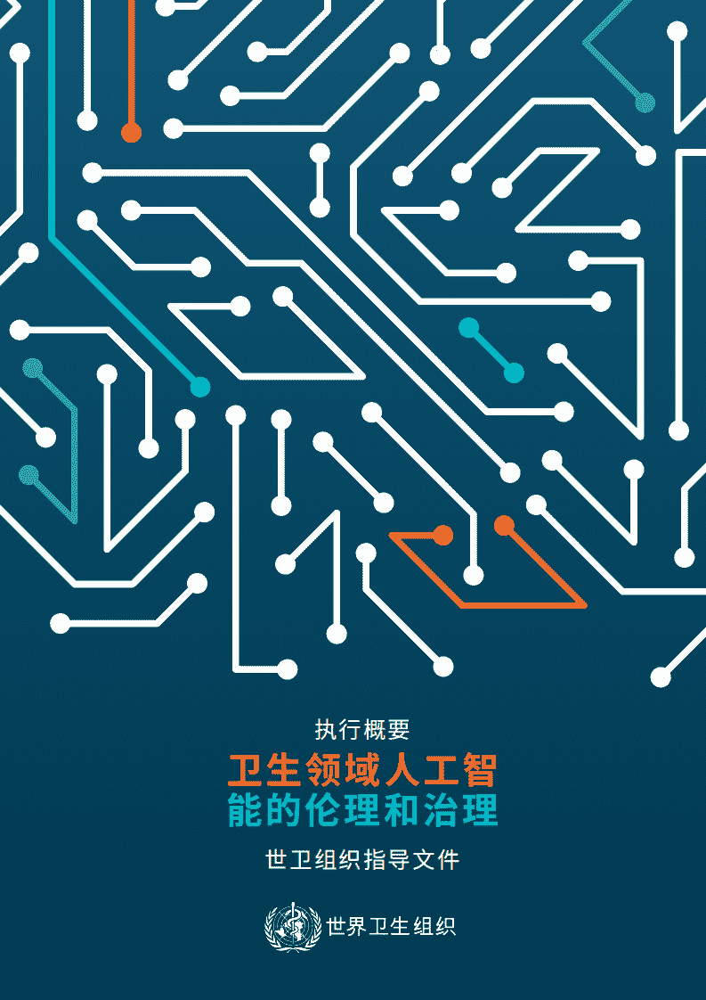

# 人工智能伦理

> 来源：[https://docs.feishu.cn/docx/X6cUdm5B6o0QWkxCK0ncVcbPnpe](https://docs.feishu.cn/docx/X6cUdm5B6o0QWkxCK0ncVcbPnpe)

# 分析文章：

周庆山 郑霞 黄国彬：《人工智能伦理规范核心原则的政策文本内容分析》

戴益斌：《[论人工智能伦理的研究进路](https://mp.weixin.qq.com/s/cRz8H4GktMnuM9zQGpYlPQ)》

总结：《[小红书 - 你的生活指南](https://www.xiaohongshu.com/explore/643e79660000000027012ec4?app_platform=android&app_version=7.91.0&author_share=1&share_from_user_hidden=true&type=normal&xhsshare=WeixinSession&appuid=63bd1fc3000000002702bbf5&apptime=1687316850&wechatWid=36ce49122163d59d4f88e4e44da695d9)》

[人工智能伦理治理研究报告（2023年） .pdf](https://internal-api-drive-stream.feishu.cn/space/api/box/stream/download/all/J4gyb9weUo25qtxuwpBcBpconLe)

[人工智能伦理治理标准化指南（2023）.pdf](https://internal-api-drive-stream.feishu.cn/space/api/box/stream/download/all/A6bxb8RbOo68hIxqGOVcVCGMnjf)

腾讯：《大模型安全与伦理研究报告2024：以负责任AI引领大模型创新》

[大模型安全与伦理研究报告2024.pdf](https://internal-api-drive-stream.feishu.cn/space/api/box/stream/download/all/NSmObafFfoos1HxgJkQcsaMXnee)

金杜：《人工智能（AI）：科技伦理治理走起》

目前欧盟、美国及英国均已出台了与人工智能相关的监管规则，科技伦理的治理是其中的重点。具体如下：

1.  **欧盟**

《人工智能法案》（Artificial Intelligence Act）作为欧盟人工智能监管体系的核心，在经历了一系列修正之后，目前将进入欧盟委员会、议会和成员国三方谈判协商的程序从而确定最终版本。《人工智能法案》是欧盟首部有关人工智能的综合性立法，其以人工智能的概念作为体系原点，以人工智能的风险分级管理作为制度抓手，以人工智能产业链上的不同责任主体作为规范对象，以对人工智能的合格评估以及问责机制作为治理工具，从人工监管、隐私、透明度、安全、非歧视、环境友好等全方位监管人工智能的开发和使用，详细规定了人工智能市场中各参与者的义务。

在伦理治理方面，《人工智能法案》强调，人工智能应该是一种以人为本的技术，不应该取代人类的自主性，也不应该导致个人自由的丧失，而应该主要服务于社会需求和共同利益，因此应提供保障措施，以确保开发和使用尊重欧盟价值观和《欧洲联盟基本权利宪章》（Charter of Fundamental Rights of the European Union）的道德嵌入式人工智能。对于AI系统的风险分级标准，《人工智能法案》将伦理风险作为考量因素，将下述类型的AI系统归为“存在不可接受风险的AI系统”，在欧盟成员国内将完全禁止该等AI系统投入市场或者交付使用：

采用潜意识技术或有目的的操纵或欺骗技术；

利用个人或社会群体的弱点（例如已知的人格特征或社会经济状况、年龄、身体精神能力）；

利用人的社会行为或人格特征进行社会评分；

在公众场所的“实时”（包括即时和短时延迟）远程生物识别系统。

此外，在评估AI系统是否属于“高风险AI系统”时，《人工智能法案》要求考量AI系统对《欧洲欧盟基本权利宪章》所保护的基本权利造成的不利影响的程度，该等基本权利包括：人的尊严、尊重私人和家庭生活、保护个人数据、言论和信息自由、集会和结社自由以及不受歧视的权利、受教育权、消费者保护、工人权利、残疾人权利、性别平等、知识产权、获得有效补救和公平审判的权利、辩护权和无罪推定、良好管理的权利。“高风险AI系统”投放市场及交付使用均受到严格的管控并需履行评估及备案等一系列要求。

1.  **美国**

美国在联邦层面尚未通过一部完整且专门的针对AI系统的法案，而是试图通过调整政府机构的权利，在现有的立法框架及监管规则内对人工智能进行规制。在伦理治理方面，目前联邦层面的合规重点主要涉及反歧视、保护数据隐私等要求。例如：

**（1）**

**《2022年算法问责法案》**

**（Algorithmic Account**ability Act of 2022）

2022年2月，美国众议院颁布了《2022年算法问责法案》，要求使用自动化决策系统做出关键决策的企业研究并报告这些系统对消费者的影响，其内容包括是否会因为消费者的种族、性别、年龄等生成对消费者有偏见或歧视性的自动决策等。该法案形成了“评估报告—评估简报—公开信息”三层信息披露机制。此外，联邦贸易委员会还将建立可公开访问的信息存储库，公开发布关于自动化决策系统的有限信息。

**（2）**

**《人工智能权利法案蓝图》**

（Blueprint for an AI Bill of Right）

2022年10月，美国白宫科技政策办公室（OSTP）颁布了《人工智能权利法案蓝图》，提出了指导人工智能的设计、使用和部署的五项原则：技术的安全性和有效性、防止算法歧视、保护数据隐私、告知及解释义务以及人类参与决策，并在技术指南部分针对五项原则中的每一项均解释了原则的重要性、原则所指引的期望以及各级政府到各种规模的公司等多种组织为维护原则可以采取的具体的实施步骤、原则的实践案例。

**（3）**

**《美国数据隐私和保护法案》**

**（**the American Data Privacy and Protection Act，“ADPPA”）

2022年6月，美国参众两院共同发布了ADPPA，ADPPA规定，如人工智能所使用的数据集涵盖个人信息、数据与隐私，则构成“覆盖算法”；使用“覆盖算法”的大数据持有人，如果对个人或群体构成相应伤害风险，并单独或部分使用“覆盖算法”来收集、处理或传输覆盖数据，则应当根据ADPPA规定的评估标准进行隐私影响评估。另外，ADPPA还对隐私政策的告知与退出机制、反偏见等内容做出了规定。ADPPA规定，企业或代表企业的服务提供商需要告知个人有“选择退出”的权利，即拒绝企业对其个人数据的收集、处理或传输。

**（4）**

《关于通过联邦政府进一步促进种族平等和支持服务不足社区的行政命令》

**（Executive Order on Further Advancing Racial Equity and Support** for Underserved Communities Through the Federal Government）

2023年2月，拜登签署了《关于通过联邦政府进一步促进种族平等和支持服务不足社区的行政命令》，规定人工智能大模型应避免由于大量输入训练数据中存在的对种族、性别、年龄、文化和残疾等的偏见而导致训练结果输出内容中存在偏见。联邦政府在设计、开发、获取和使用人工智能和自动化系统时，各机构应在符合适用法律的前提下，防止、纠正歧视和促进公平，包括保护公众免受算法歧视。

1.  **英国**

202**1年5月**，英国中央数字与数据办公室、人工智能办公室与内阁办公室联合发布了《自动决策系统的伦理、透明度与责任框架》（Ethics, Transparency and Accountability Framework for Automated Decision-Making，“ETAF”），对人工智能涉及的算法和自动化决策的伦理治理要求进行规定。ETAF强调，算法和自动化决策在上线之前应该进行严格的、受控的和分阶段的测试。在整个原型和测试过程中，需要人类的专业知识和监督来确保技术上的弹性和安全，以及准确和可靠的系统。测试时，需要考虑自动化决策系统的准确性、安全性、可靠性、公平性和可解释性。ETAF规定，企业必须对算法或自动决策系统做一个平等影响评估，使用高质量和多样化的数据集，发现和抵制所使用数据中明显的偏见和歧视。ETAF指出，算法或计算机系统应该被设计为完全可以负责和可被审计的，算法和自动化的责任和问责制度应该明确。

# 联合国：

人工智能伦理板块：https://www.unesco.org/en/artificial-intelligence/recommendation-ethics

### UNESCO组织签署AI伦理协议

联合国教科文组织2月5日表示，八家全球性科技机构和公司与联合国教科文组织签署了一项与人工智能(AI)相关的开创性协议。

根据相关协议，这些机构和公司将结合教科文组织《人工智能伦理问题建议书》中有关AI伦理的价值观和原则设计和使用AI系统。这八家全球性科技机构和公司分别是全球移动通信系统协会(GSMA)、INNIT、联想、LG AI研发(LG AI Research)、微软、摩托罗拉、赛富时和西班牙电信。

教科文组织总干事阿祖莱表示，我们得到了多个全球性科技公司在相关议题上的具体承诺。她强烈呼吁各个科技相关方以它们为榜样，这对于“构建促进公共利益的AI至关重要”。该协议在当天举行的第二届联合国教科文组织人工智能伦理问题全球论坛上签署。协议要求公司在设计、开发、购买、销售和使用AI时充分发挥自身作用，确保人权得到保障。这是私营企业首次在AI领域与联合国合作。

### **《人工智能伦理问题建议书》。**

链接：https://unesdoc.unesco.org/ark:/48223/pf0000380455_chi

[人工智能伦理问题建议书.pdf](https://internal-api-drive-stream.feishu.cn/space/api/box/stream/download/all/PHFfbc22AoTLsfxKxH5cuUkRnNe)

### **Principles for the Ethical Use of Artificial I**ntelligence in the United Nations System

联合国系统道德使用人工智能原则

这些原则是由联合国教育、科学及文化组织 (UNESCO) 和联合国秘书处信息和通信[技](https://unsceb.org/inter-agency-working-group-artificial-intelligence)术办公室 (OICT) 共同领导的[ HLCP 人工智能机构](https://en.unesco.org/artificial-intelligence/ethics)间工作组的工作流制定的。这些原则基于2021 年 11 月教科文组织大会第 41 届会议通过的《人工智能伦理建议书》 。

链接：https://unsceb.org/sites/default/files/2022-09/Principles%20for%20the%20Ethical%20Use%20of%20AI%20in%20the%20UN%20System_1.pdf

### 首份卫生领域的人工智能伦理和治理报告

世界卫生组织的《卫生领域人工智能伦理与治理》报告是多领域专家历经18个月审议的结果。该报告于2021年由世界卫生组织发布为该组织的指南，并于2022年被国际电联/世卫组织卫生领域人工智能焦点小组（FG-AI4H）批准作为其可交付成果。(29)

[卫生领域人工智能伦理与治理.pdf](https://internal-api-drive-stream.feishu.cn/space/api/box/stream/download/all/SI1CbA52mo97Rjx2u5RcJBfmn7f)

# 中国：

### 中国关于加强人工智能伦理治理的立场文件

http://geneva.china-mission.gov.cn/zclc/202211/t20221116_10976423.htm

### **《新一代人工智能伦理规范》**

https://www.most.gov.cn/kjbgz/202109/t20210926_177063.html

在2022年，中国在科技伦理领域的制度建设进入了一个新阶段。新修订的《中华人民共和国科学技术进步法》要求科技相关的企业事业单位履行科技伦理管理主体责任，建立科技伦理审查机制，开展科技伦理审查。紧接着3月份中共中央办公厅、国务院办公厅印发了《关于加强科技伦理治理的意见》特别强调了人工智能领域的科技伦理治理。该《意见》指出要在“十四五”期间，重点加强人工智能等领域的科技伦理立法研究，制定完善的规范和标准，将重要的科技伦理规范上升为国家法律法规。外交部也在10月份发布了《中国关于加强人工智能伦理治理的立场文件》，从人工智能技术监管、研发、使用及国际合作等方面提出原则性主张。

**2023年3月，由中国电子技术标准化研究院牵头，依托国家人工智能标准化总体组和全国信标委人工智能****分技**术委员会组织浙江大学、上海商汤智能科技有限公司等政产学研用等50余家单位共同编制完成《人工智能伦理治理标准化指南》。

该指南是基于中共中央办公厅、国务院办公厅的《关于加强科技伦理治理的意见》、科技部国家新一代人工智能治理专委会的《新一代人工智能伦理规范》和外交部的《中国关于加强人工智能伦理治理的立场文件》等文件中的要求而制定。

https://mp.weixin.qq.com/s/avoHMa6uzHEwcPKltzXfOw