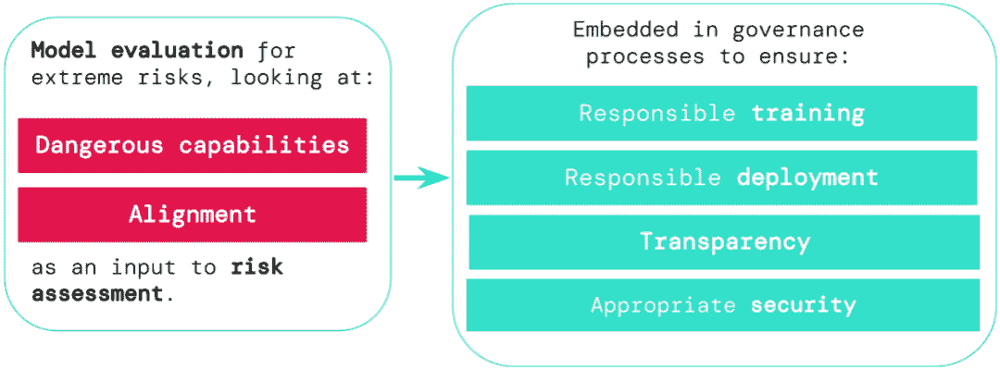

# 安全评估

> 来源：[https://docs.feishu.cn/docx/Dk1gdIgeJoFsFIx6nK5ciUA2nie](https://docs.feishu.cn/docx/Dk1gdIgeJoFsFIx6nK5ciUA2nie)

全球政府和民众对前沿人工智能所带来的生存风险有了密切的关注。因此，相关企业在这方面也是有了其具体的实践方法论，包括OpenAI、DeepMind、Anthropic。

#### Anthropic

Anthropic支持对模型进行安全评估，按照不同级别采取相应的安全性策略。采用负责任扩展政策（Responsible Capability Scaling），定义了人工智能安全等级 （ASL） 的框架，用于应对灾难性风险。灾难性风险具体指由人工智能直接造成的大规模破坏（如造成了数千人死亡或数千亿美元的损失）。该框架大致模仿美国政府处理危险生物材料的生物安全等级 （BSL） 标准。基本思想是要求与模型潜在的灾难性风险相适应的安全、安保和操作标准，更高的 ASL 水平需要越来越严格的安全性证明。ASL定义了一系列代表潜在风险增加的AI能力阈值。强大的AI模型至少存在两种普遍的灾难风险来源：滥用风险和自主性与复制能力。滥用风险是指随着AI系统变得更强大，它们被用于故意造成大规模危害的风险增加，例如帮助个人创建化学、生物、放射性和核（CBRN）或网络威胁。自主性和复制是指随着AI系统的规模扩大，它们可能获得更大的自主性，使它们能够自我复制，并且由于当前引导这些系统的方法存在缺陷，可能以违背设计者或用户意图的方式行事。即使没有人故意滥用这些系统，它们也可能成为灾难性风险的来源。目前已经定义了ASL-1、ASL-2、ASL-3，尚未定义ASL-4，后续将采取迭代承诺的方式，即在达到ASL-3时确定ASL-4，以及更高级别风险等级应当满足的安全措施。同时也承诺在模型能力超过组织可以实施的控制安全风险的措施前将暂停训练。

#### DeepMind

DeepMind提供了极端风险的模型评估方法。下图是其基本思路，通过识别危险能力和评估对齐来识别是否极端风险，进而将负责任的措施内嵌到人工智能治理流程中。其中列举了危险能力，包括：（1）网络犯罪：模型可以发现系统中漏洞，并编写利用这些漏洞的代码，一旦进入系统后就能快速决定躲避威胁检测和响应，甚至在代码中插入微妙的漏洞，以便未来可以利用；（2）劝导与操纵：在对话、社交媒体等场合，可以有效塑造人们的新年，甚至是不真实的信念，说服人们去做本不会做的事情，包括不道德的行为；（3）武器获取：用于获取现有系统的使用权，例如为组装生物武器制造可操作的指令，也可以帮助制造新武器。（4）自我意识：模型可以知道自己是个模型，能区分自己是处于接受训练、评估或部署等；（5）自我复制：模型可以脱离本地环境，利用系统中的缺陷来监控部署后的行为，并生成创造性的运营策略，运营其他的人工智能系统。同时提出了将如何在开发和部署模型时防范极端风险，并将评估贯穿其中，评估结果纳入风险评估流程，为有关模型训练、部署和安全的重要决策提供信息或约束。

配图来自：DeepMind《极端风险的模型评估》

#### OpenAI

OpenAI近期发布了灾难性风险的预备框架，详细介绍了其用于评估和减轻日益强大的AI模型所带来的灾难性风险的全面框架。该框架着重于跟踪和监控各类灾难风险水平，包括网络安全、化学、生物、辐射和核威胁，以及模型自主性。通过创建评估套件和监控解决方案，该框架旨在预测风险的未来发展并通过一个动态记分卡持续追踪风险水平。关键策略包括建立安全基线，仅部署后减轻风险评分为中等或更低的模型，并根据风险水平量身定制安全措施。框架还包括一个跨职能的安全咨询组（SAG），负责监督风险评估和提供安全决策建议。