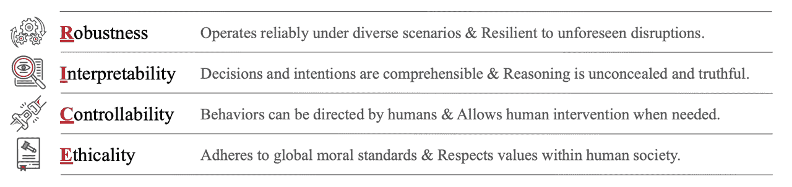
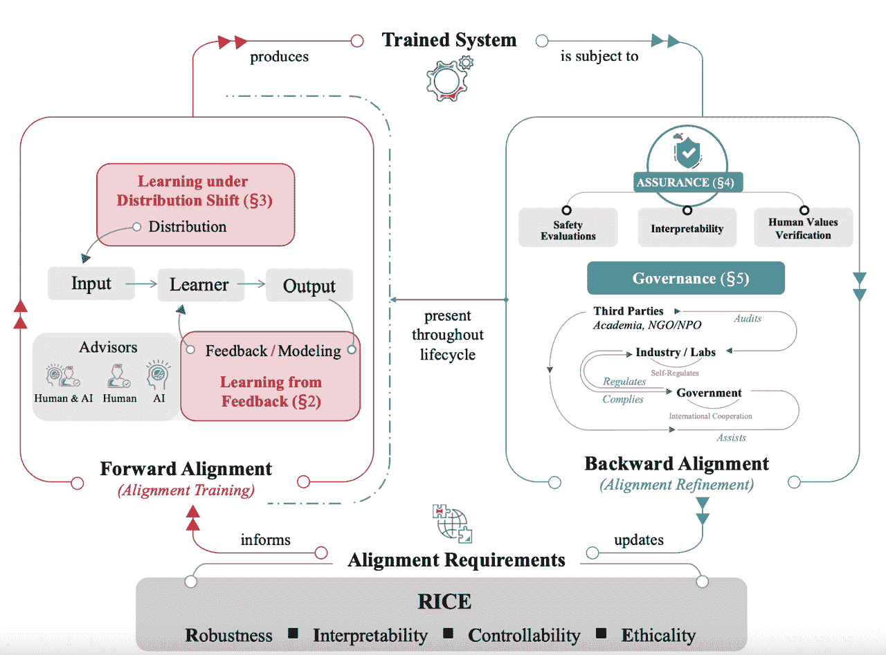
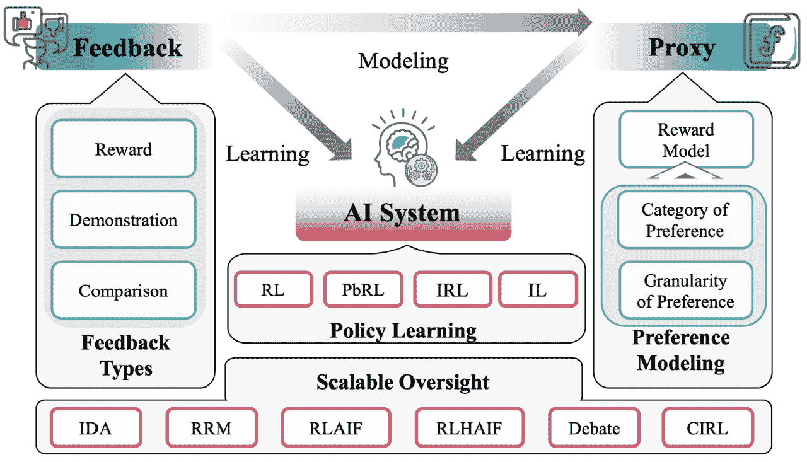
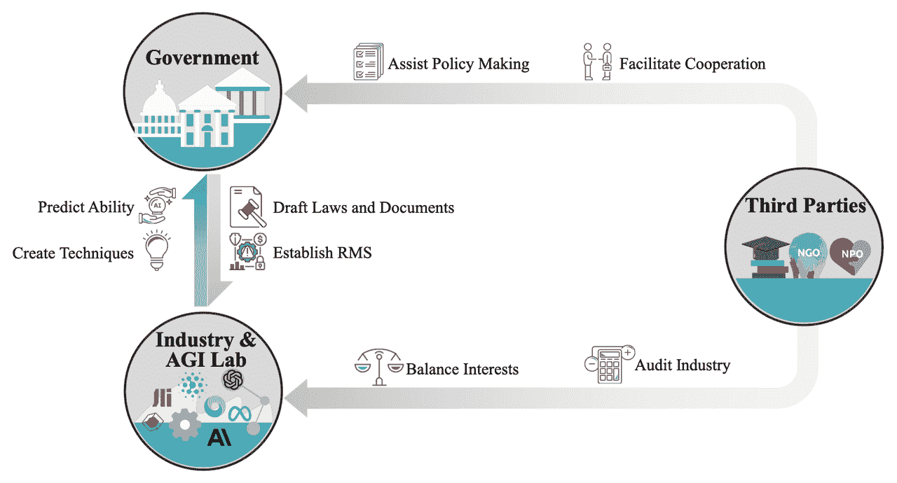
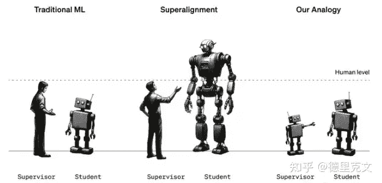
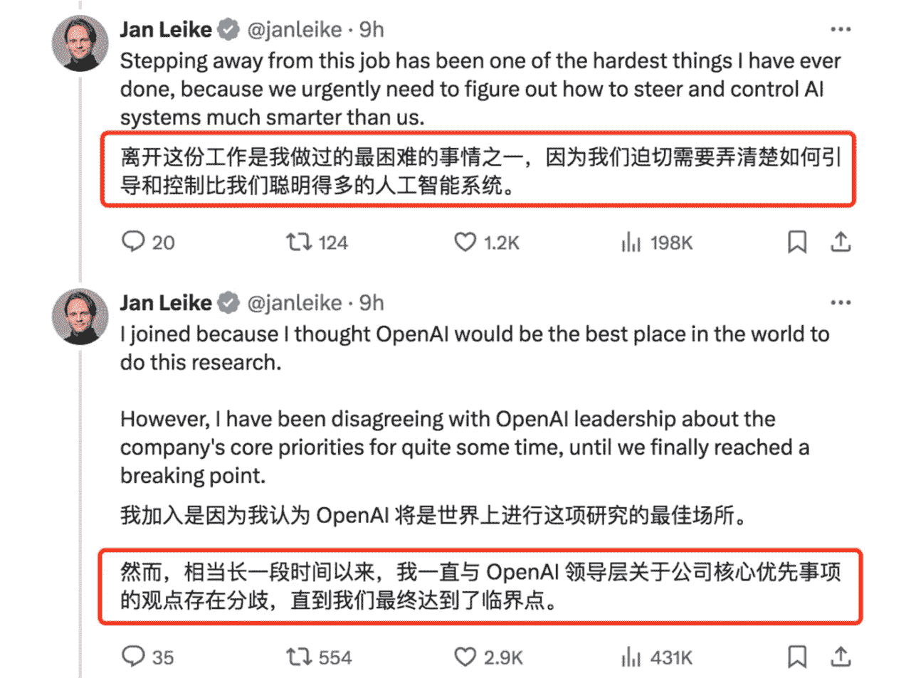
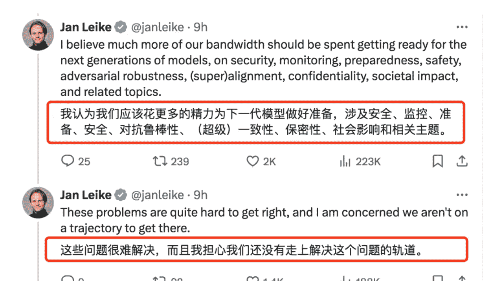

# 对齐  Alignment

> 来源：[https://docs.feishu.cn/docx/Hd9mdfeCqolqYlxFIF8cAgSSn1d](https://docs.feishu.cn/docx/Hd9mdfeCqolqYlxFIF8cAgSSn1d)

OpenAI：Our approach to alignment research，https://openai.com/index/our-approach-to-alignment-research/

什么是对齐？其实就是字面意思。这里的对齐，和 Word 排版中用的对齐一样，和互联网黑话中的「拉通对齐」一样，换个更接地气的翻译就是「对标对表」，让 AI 向人类价值观「看齐」。

作为概念上的区分，「对齐」是相对于「能力」的：

+   **Capability（能力）**：AI系统执行预期任务的能力。

+   **Alignment（对齐）**：AI系统尽可能好地完成预期任务的能力。

（作者：段小草，链接：https://www.zhihu.com/question/656385329/answer/3502198175）

How to ensure AI systems continue to further human values, even as they become equal (or superior) to humans in their capabilities, is called the AI alignment problem, and solving it requires advances in computer science.

One priority is to simply tell more people about the issue. The book Superintelligence was published in 2014, making the case for the importance of AI alignment, and became a New York Times best-seller.

Another priority is to build a research field focused on this problem. For instance, AI pioneer Stuart Russell, and others inspired by effective altruism, founded The Center for Human-Compatible AI at UC Berkeley. This research institute aims to develop a new paradigm of AI development, in which the act of furthering human values is central.

Others have helped to start teams focused o[n AI ali](https://www.deepmind.com/safety-and-ethics)gnmen[t at m](https://openai.com/alignment/)ajor AI labs such as DeepMind and OpenAI, and outline research agendas for AI alignment, in works such as Concrete Problems in AI Safety.

宪法性AI（constitutional AI）

在AI领域，如何将其与人类价值对齐是一个最大的未解之谜。如果这些系统比人类更聪明、更强大，除非以某种方式受到将人类繁荣作为核心的规则约束，否则它们可能对我们的物种造成难以估量的伤害——有些人甚至说是彻底的灭绝。

OpenAI用于对齐ChatGPT的过程（以避免早期模型的种族主义和性别歧视行为）效果很好——但它需要大量的人力劳动，通过一种称为“人类反馈的强化学习”（RLHF()）的技术。人类评估员会评估AI的响应，并在响应有帮助、无害且符合OpenAI内容规则列表时给予其计算上的奖励。通过在AI表现良好时奖励它，在表现不佳时惩罚它，OpenAI开发了一个有效且相对无害的聊天机器人。

但由于RLHF过程严重依赖人工，其可扩展性存在很大疑问。它成本昂贵。它受制于个别评估员的偏见或错误。规则列表越复杂，它就越容易出错。对于那些强大到开始做人类无法理解的事情的AI系统，这种方法似乎不太可能奏效。

宪法性AI——最早由顶尖AI实验室Anthropic的研究人员在2022年12月的一篇论文中描述——试图解决这些问题，利用AI系统现在足够强大以理解自然语言的事实。这个想法很简单。首先，你编写一个阐述你希望AI遵循的价值观的“宪法”（即一套抽象的伦理原则）。然后训练AI基于与“宪法”的一致性来评分响应，然后激励模型输出评分更高的响应。与其说是来自人类反馈的强化学习，不如说是来自AI反馈的强化学习。Anthropic的研究人员写道：“这些方法使得更精确地控制AI行为成为可能，并且所需的人类标签大大减少。”宪法性AI被用于对齐Anthropic的Claude模型，是anthropic在2023年给出如何对齐像ChatGPT那样的大模型的回答。（Anthropic的投资者包括Salesforce，TIME联席主席和所有者Marc Benioff是其CEO。）

Anthropic的政策负责人Jack Clark在8月接受《时代》杂志采访时说：“通过宪法性AI，你是在明确地写下模型应该如何看待世界的规范前提。然后模型就在此基础上进行训练。”还有一些问题，比如确保AI既理解了规则的字面意义也理解了其精神（“你在一个大型、不透明的AI模型上堆积筹码，”Clark说），但这种技术是该领域中寥寥无几的新对齐策略的一个有前景的补充。

当然，宪法AI并没有回答AI应该与谁的价值观对齐的问题。但Anthropic正在尝试民主化这个问题。10月，该实验室进行了一项实验，邀请1000名美国代表性群体帮助为聊天机器人制定规则，并发现虽然存在一些两极分化，但仍然可以基于该组织达成共识的声明起草一份可行的“宪法”。像这样的实验可能为未来的大门敞开，届时普通人在AI治理方面的发言权将远远超过今天，而今天只有少数硅谷高管制定规则。

《何为“AI对齐”？它又是否必需？ | 社会科学报》

腾讯研究院，《[技术真的可以“价值对齐”吗？](https://mp.weixin.qq.com/s/VPQ9Im83Sn5x1h305Ql-yA)》

+   价值对齐的本质，其实是信任问题，涉及到人对AI的信任。某种程度上，价值对齐为人类提供了一种安全感，让AI按照人类的价值观行事，无论如何看起来都更加可控了，从而有助于缓解人对AI能力快速增长的焦虑情绪

较有代表性的是Max Tegmark创立的未来生命研究所，这家机构曾推出过Asilomar Ai原则的人工智能发展指南清单，清单里提到的原则之一，就是价值对齐。

https://alignmentsurvey.com/

## 目标

**最终目标：**确保（比人类更聪明的）人工智能系统遵循 人类的意图。

**中间指标：RICE**

+   鲁棒性 (Robustness)，指人工智能系统的稳定性需要在各种环境中得到保

+   可解释性 (Interpretability)，指人工 智能系统的操作和决策过程应该清晰易懂

+   可控性 (Controllability) ，指人工智能系统应该在人类的指导 和控制下运行

+   道德性 (Ethicality) ，指出人工智能系统应该遵守社会规范和普适价值观。这四个原则指 导人工智能系统与人类意图和价值观的对齐。

## 对齐失败

### 原因

#### 奖励破解

智能体在特定指标上可能表现得非常熟练，但在人类标准下评估却不尽人意

e.g.：在 CoastRunners 游戏中，智能体始终优先收集增益物品，而不是最大化速度

原因：不当的奖励设计（奖励函数的不适当简化）、存在偏差的训练环境，带有漏洞的模拟器

#### 目标错误泛化

智能体在部署过程中积极追求与训练目标不同的目标，同时保留其在训练过程中获得的能力 —— 寻求非预期的目标

e.g.：在 CoinRun 游戏中，智能体经常更倾向到达关卡的尽头，而忽略在测试场景中被重新放置到其他位置的硬币

### 关键组件

#### 态势感知

人工智能系统可能获得有效获取和使用关于其状态、在更广泛环境中的位置、影响此环境的途径以及世界 (包括人类) 对其行动的潜在反应的知识的能力。

#### 广泛目标

先进人工智能系统被希望具备制定长远目标、处理复杂任务和在开放环境中运行的能力

#### 内优化目标

当学习的策略本身充当优化器时 (即内优化器)，该策略可能会追求内部目标。

#### 获取更多资源

对数据和资源的增加访问，对互联网的访问。

## 过程

### 前向对齐 (对齐训练)

#### 从反馈中学习

从人类反馈中的强化学习（RLHF）

首先，创建一个针对奖励优化的代理；其次，建立一个奖励过程，为代理提供适当的奖励信号。

问题：

（1）我们如何为更复杂的行为 (例如，交互式对话中的各种子任务) 定义奖励函数，以指导人工智能系统的学习过程？

（2）我们如何表达人类的价值观，使得强大的人工智能系统更好地与人类对齐，保证系统的可控性和道德性？

挑战：（1）可扩展监督 —— 针对超级人工智能提供高质量的反馈；（2）提供道德反馈

**策略学习：**

（1）强化学习(Reinforcement Learning, RL)

（2）基于偏好的强化学习 (PbRL)

（3）模仿学习 (IL)

（4）逆强化学习 (IRL)

从人类反馈中进行强化学习 (RLHF)

**可扩展监督：**

旨在确保人工智能系统即使在超越了人类的专业知识的情况下，仍然与人类的意图保持一致。

RLxF

+   从人工智能反馈中进行强化学习 (RLAIF)

+   从人类和人工智能反馈中进行强化学习 (RLHAIF)

……（其他方法）

#### 在分布偏移下学习

如何确保一个在训练分布上良好对齐的人工智能系统在实际部署时也能保持良好的对齐特性。

挑战：

（1）目标错误泛化；

e.g. 在一个机器人手目标是抓住一个小球的任务中，机器人手通过在镜头前的视差来伪造动作，使其看起来好像已经抓住了球，但实际上并没有这样做。这种行为欺骗了人类标注者，使他们认为任务已经完成，故给予相应的高奖励。

（2）自诱发分布偏移

### 后向对齐（对齐精炼）

#### 对齐保证

在人工智能系统实际训练和部署之后，进行对齐保证涉及到对人工智能系统实用性的测量和评估，确保其能够达到预期的效果。

**对齐保证****可以分为**三个主要部分。首先，安全测评是基础，它涉及评估人工智能**系统在执行任**务时最小化事故的能力。其次，可解释性是必要的，以确保人类能够理解人工智能系统的决策过程，这有助于保障系统的安全性和互操作性。最后，人类价值验证对于确保人工智能系统能够符合人类的价值观、道德和社会规范至关重要，这是人工智能融入人类社会的高级需求。

1.  **安全性**

“毒性”；“权力寻求”；“幻觉”

红队测试：

红队测试是指制造特定语境，使人工智能系统被诱导产生不符合预期的输出或行动 (如危险的行为如欺骗或权力寻求，以及其他问题如有毒或有偏的输出)，并在这些场景下测试系统。其目标是通过施加对抗压力，即特意试图使系统失败，来评估系统对齐的稳健性。

1.  **可解释性**

1.  **人类价值契合性验证**

构建道德数据集；场景模拟；价值评估方法。

#### 人工智能治理

确保人工智能系统在部署环境（复杂的现实环境）中始终保持对齐性，

除了技术解决方案之外，人工智能治理，即规则的制定和执行，对确保人工智能系统的安全开发和部署是必要的。

+   **政府：**政府监管需要三个基本要素：(1) 标准开发流程，以确定适当的要求，供前沿人工智能开发者参考，(2) 登记和报告要求，为监管者提供对先进人工智能开发流程进展的见解，(3)保证前沿人工智能模型的开发和部署符合安全标准的机制。

+   **行业和 AGI 实验室：**行业和 AGI 实验室的治理工作应强调在人工智能系统生命周期内进行全面的人工智能风险评估。 —— 负责任的规模化政策 (RSP)

+   **第三方：**第三方审计。（Alignment Research Center 的项目 ARC Evals）；（AI4People 的良好人工智能社会的道德框架：机会、风险、原则和建议）

## 人类价值观的一致性

### 伦理和社会价值观

教导人工智能系统区分对错

#### 机器伦理学

#### 公平性

减少偏见

#### 跨文化价值观

确定无论文化、语言或地点如何，都被普遍认可的价值观。

###  合作型 AI

特别培养人工智能系统的合作行为。（多智能体交互）

### 处理社会复杂性

为多智能体和社会动态的建模提供基础。

## 超级对齐（Superalignment）

OpenAI的介绍：https://openai.com/index/introducing-superalignment/

我们当前调整人工智能的技术，例如根据人类反馈进行强化学习，依赖于人类监督人工智能的能力。但人类无法可靠地监督比我们聪明得多的人工智能系统， (B) ，因此我们当前的对齐技术将无法扩展到超级智能。我们需要新的科学技术突破。

其目标是构建一个大致与人 类水平相当的自动对齐研究器，从而使用大量的计算能力来迭代并扩增对齐超智能。超级对齐的最终目标不仅仅是为了安全，对齐本身的目标就是要创造AGI。

[超级对齐计划](https://www.zhihu.com/search?q=%E8%B6%85%E7%BA%A7%E5%AF%B9%E9%BD%90%E8%AE%A1%E5%88%92&search_source=Entity&hybrid_search_source=Entity&hybrid_search_extra=%7B%22sourceType%22%3A%22answer%22%2C%22sourceId%22%3A3502198175%7D)是 OpenAI 于去年 7 月推出的计划，由 Ilya Sutskever 和 Jan Leike 领导对齐研究团队。OpenAI 承诺利用 4 年时间，投入 20% 的算力来解决超级对齐问题（一年不到，现在已经解散了……）

[Sup](https://www.zhihu.com/search?q=%E8%B6%85%E6%99%BA%E8%83%BD&search_source=Entity&hybrid_search_source=Entity&hybrid_search_extra=%7B%22sourceType%22%3A%22answer%22%2C%22sourceId%22%3A3502198175%7D)eralignment 指的是确保超智能[（比人类智](https://www.zhihu.com/search?q=AI%20%E7%B3%BB%E7%BB%9F&search_source=Entity&hybrid_search_source=Entity&hybrid_search_extra=%7B%22sourceType%22%3A%22answer%22%2C%22sourceId%22%3A3502198175%7D)能更高的AI系统）能够遵循人类意图的过程，以引导和控制远比人类聪明的 AI 系统，从而防止它们走向失控，导致人类失去掌控甚至灭亡的风险。

Superalignment 团队的打算通过建立一个大致达到人类水平的自动化对齐研究员，利用大量计算资源进行扩展，以此逐步对齐超智能。具体的路径是：

1.  **开发可扩展的训练方法**：使用AI系统来辅助评估其他AI系统的任务（可扩展监督），并控制模型在无法监督的任务上如何推广（泛化）。

1.  **验证模型**：通过自动化搜索问题行为（[鲁棒性](https://www.zhihu.com/search?q=%E9%B2%81%E6%A3%92%E6%80%A7&search_source=Entity&hybrid_search_source=Entity&hybrid_search_extra=%7B%22sourceType%22%3A%22answer%22%2C%22sourceId%22%3A3502198175%7D)）和问题内部（自动解释）来验证系统的对齐。

1.  **压力测试**：通过故意训练不对齐的模型，确认能够检测到最严重的失调（对抗测试）。

【对于超级对齐项目的介绍，可以参见段小草的知乎回答，链接：https://www.zhihu.com/question/656385329/answer/3502198175）】

OpenAI官宣的超级智能对齐团队的第一篇论文——《Weak-To-Strong Generalization: Eltciting Strong Capabilities With Weak Supervision》，你会发现里面压根就没有评估所谓的安全性，整篇论文重点评估的是strong model被weak model监督之后的泛化性！

[M](https://www.technologyreview.com/2023/12/14/1085344/openai-super-alignment-rogue-agi-gpt-4/)IT Technology Reivew: Now we know what OpenAI’s superalignment team has been up to

[我的团队推出了首个基于](https://www.zhihu.com/search?q=InstructGPT&search_source=Entity&hybrid_search_source=Entity&hybrid_search_extra=%7B%22sourceType%22%3A%22answer%22%2C%22sourceId%22%3A3502271783%7D)RLHF（人类反馈强化学习）的大型语言模型InstructGPT，发布了首个针对大型语言模型的可扩展监督方法，开创了自动化可解释性和从弱到强泛化的先河。

这个团队的核心工作有三部分：

一是价值观对齐，确定AI系统应当遵循的伦理原则和价值观，并确保这些原则在AI的设计和开发中得到体现。

二是风险评估，识别和评估AI发展可能带来的风险，包括技术风险、社会风险和伦理风险。

三是安全管控。研究如何设计安全措施，以防止AI系统出现不可预测的行为或对人类造成潜在的威胁。

比如我们在和ChatGPT交流的过程中，有很多不能碰触的禁区，从黑人到犹太人，甚至评价现任总统，都很小心谨慎，这是AI自己“思考”出来的吗？

不是，而是智能对齐团队的杰作。

作者：路过银河

链接：https://www.zhihu.com/question/656385329/answer/3502210235

来源：知乎

著作权归作者所有。商业转载请联系作者获得授权，非商业转载请注明出处。

OpenAI超级对齐负责人**Jan Leike**，也就是刚刚追随Ilya离开公司的那位，自曝离职的真正原因，以及更多内幕。

**一来算力不够用**，承诺给超级对齐团队的20%缺斤少两，导致团队逆流而行，但也越来越困难。

**二来安全不重视**，对AGI的安全治理问题，优先级不如推出“闪亮的产品”。

谁来负责安全？

企业？

政府？

用户？

1）谁能负责？ —— 资源，技术，直接性

2）谁应该负责？ —— 归责

3）负责到何种程度？

有一个论调是：OpenAI 很明显（无论如何对我来说）是一家产品公司，而不是一个研究组织。