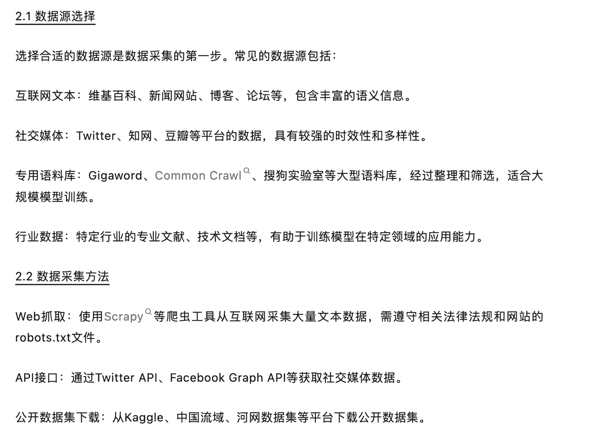

# 数据集

> 来源：[https://docs.feishu.cn/docx/HnMSdoE7aoJulSxOWiacmjrsnib](https://docs.feishu.cn/docx/HnMSdoE7aoJulSxOWiacmjrsnib)

在利用和应用大型语言模型（LLM）时，适当的 Datasets发挥着至关重要的作用。Datesets（Datasets）为LLM提供了广泛的语言样本，能够帮助模型理解和生成高质量的文本内容。

因此，通过选择质量高、多样性强且规模适宜的Datasets，可以提升LLM的性能和适应能力，以更好地满足各种语言任务和应用的需求。

通常而言，Datasets的构建非常关键，因为它需要收集来自不同领域、不同来源的大量文本样本。这些样本可以包括书籍、新闻文章、学术论文、互联网文档、社交媒体帖子以及其他公开可用的文本资源。通过使用这些多样性的文本样本，LLM可以学习到丰富的语言知识和模式，从而提高其理解和生成文本的能力。

以 CC（Common Crawl）和 C4 数据集的对比为例，CC 是一个有 400TB 的公共网络抓取数据集，包含了互联网上数十亿网页，内容非常广泛但未经清洗。而 C4 则是对 CC 进行了过滤噪声、重复内容等清洗后的 305GB 数据集。

## 数据集来源

（《[一起聊聊大模型数据集的那点事](https://mp.weixin.qq.com/s/P-R9_l5QCSJkn3TfELxwxg)》

现阶段，国内外的大模型研发和应用火的不能再火，那这些大模型公司，他们用于大模型的数据集一般都是怎么来的呢？根据我的了解以及对一些大模型的公司咨询，基本有以下几个获取途径：

1.  **公开数据集**：很多大模型数据集是公开发布的，可以从相关网站或者数据存储库里直接下载，这里有 ImageNet、COCO、OpenAI GPT-3 这些都是可以在对应的官网上进行下载。中国去年也出现了数据集的交易平台，不过数据集的质量以及共享交易的规范我持保留意见，这里不做评价。国内现在“吹”大模型数据集的公司有很多是之前做数据标注的公司，当前都是壳子或者皇帝的新衣，没看到具体可应用于实际场景的大模型数据集，数据堂可能做的相对比较好点，这里涉及到大模型数据集的需求是怎么确定的，下一篇文章我会重点介绍。

开源数据集：[大模型时代，数据为王，在哪里寻找开源数据集？](https://q2rt76fo46.feishu.cn/wiki/IX7OwO4EaigW4ikDIjact4nenmh)

1.  **学术研究机构**：许多学术研究机构会公开发布他使用的数据集，或者通过合作和共享的方式向其他研究者提供数据，可以直接和这些机构联系咨询数据集获取的可能性。

1.  **开源社区或竞赛平台**：有许多数据科学竞赛平台，比如 Kaggle、DrivenData 等会提供大模型数据集给参与者使用，此外，开源社区也会常常共享各种类型的数据集，可以通过 GitHub 搜索相关项目。

1.  **合作伙伴**：如果在学术界或者业界有资源，可以尝试与其他大模型研究团队、机构或者公司建立合作关系，彼此共享数据集或者共同收集数据，这种双向合作是可以帮助获取到更多、更丰富的数据。

1.  **数据采集和标注**：也可以通过数据服务提供商或者自行采集数据并对采集到的数据进行数据清洗和标注，这里会涉及到网络爬虫、传感器数据采集、数据标注等方面，下一篇文章我也会重点介绍在大模型数据集中的技术性工作都有哪些。

1.  **购买数据**：目前市场上有一些提供大模型数据集的数据服务公司，比如数据堂，可以联系他们进行数据集采买，但是需要确定可以合法使用这些数据，并且遵守相关的数据许可协议和法律法规。

对有大模型数据集需求的公司来说，务必注意数据的质量、隐私和安全的问题，务必确保数据的使用符合法律法规和伦理规范，并且尊重数据提供方的权利和条件。

**如何选择开源中文数据集？**

以上几类数据集在开源社区中发挥了重要作用，为中文AI领域的研究和发展提供了丰富的资源。如何选择开源中文数据集？用户可以从以下几个方面考虑：

**第一，数据领域。**根据项目需求，选择对应领域的数据集。例如，如果是针对自然语言处理的研究，可以选择文本分类、情感分析等相关的数据集；如果从事计算机视觉领域，可以选择图像识别、目标检测等数据集。

**第二，数据规模。**根据项目需求和计算资源，选择适当规模的数据集。较大的数据集通常能提供更丰富的信息，但同时也需要更多的计算资源进行训练。在计算资源有限的情况下，可以考虑使用较小规模的数据集。

**第三，数据质量。**检查数据集的质量和可靠性。开源数据集可能存在数据缺失、错误、不规范等情况，因此在使用前需要仔细评估数据质量。你可以参考其他用户的使用经验、查看数据集的评论和评分等方式来了解数据集的质量。

**第四，数据来源。**选择来自可靠来源的数据集。一些知名的开源数据集仓库，如 UCI 机器学习库、Kaggle、Amazon's AWS Datasets 等，提供了丰富的中文数据集。此外，还有一些专门收集中文数据集的网站，如火柴先生的博客等。

**第五，数据授权。**确保所选数据集符合你的使用需求。开源数据集通常遵循开源协议，如 CC 协议（Creative Commons），你需要了解协议的具体要求，确保在项目中的应用符合规定。

第六，数据集格式：检查数据集的格式是否适合你的项目。常见的数据集格式有 CSV、TXT、JSON、XML 等，你需要确保数据集格式与你的项目工具和算法兼容。

第七，相关工具和资源：了解该数据集是否有相应的工具和资源支持。例如，一些数据集可能已经有预处理工具、特征工程工具、模型训练脚本等，这些都能帮助你更快地应用数据集到项目中。

综合以上因素，根据自己的项目需求和计算资源，选择合适的开源中文数据集。在实际应用中，可能需要尝试多个数据集，以找到最适合自己项目的数据。

## 数据采集

## **如何选择开源中文数据集**

（《一文读懂如何选择开源大模型的中文数据集》）

如何选择开源中文数据集？用户可以从以下几个方面考虑：

**第一，数据领域。**根据项目需求，选择对应领域的数据集。例如，如果是针对自然语言处理的研究，可以选择文本分类、情感分析等相关的数据集；如果从事计算机视觉领域，可以选择图像识别、目标检测等数据集。

**第二，数据规模。**根据项目需求和计算资源，选择适当规模的数据集。较大的数据集通常能提供更丰富的信息，但同时也需要更多的计算资源进行训练。在计算资源有限的情况下，可以考虑使用较小规模的数据集。

**第三，数据质量。**检查数据集的质量和可靠性。开源数据集可能存在数据缺失、错误、不规范等情况，因此在使用前需要仔细评估数据质量。你可以参考其他用户的使用经验、查看数据集的评论和评分等方式来了解数据集的质量。

**第四，数据来源。**选择来自可靠来源的数据集。一些知名的开源数据集仓库，如 UCI 机器学习库、Kaggle、Amazon's AWS Datasets 等，提供了丰富的中文数据集。此外，还有一些专门收集中文数据集的网站，如火柴先生的博客等。

**第五，数据授权。**确保所选数据集符合你的使用需求。开源数据集通常遵循开源协议，如 CC 协议（Creative Commons），你需要了解协议的具体要求，确保在项目中的应用符合规定。

第六，数据集格式：检查数据集的格式是否适合你的项目。常见的数据集格式有 CSV、TXT、JSON、XML 等，你需要确保数据集格式与你的项目工具和算法兼容。

第七，相关工具和资源：了解该数据集是否有相应的工具和资源支持。例如，一些数据集可能已经有预处理工具、特征工程工具、模型训练脚本等，这些都能帮助你更快地应用数据集到项目中。

综合以上因素，根据自己的项目需求和计算资源，选择合适的开源中文数据集。在实际应用中，可能需要尝试多个数据集，以找到最适合自己项目的数据。