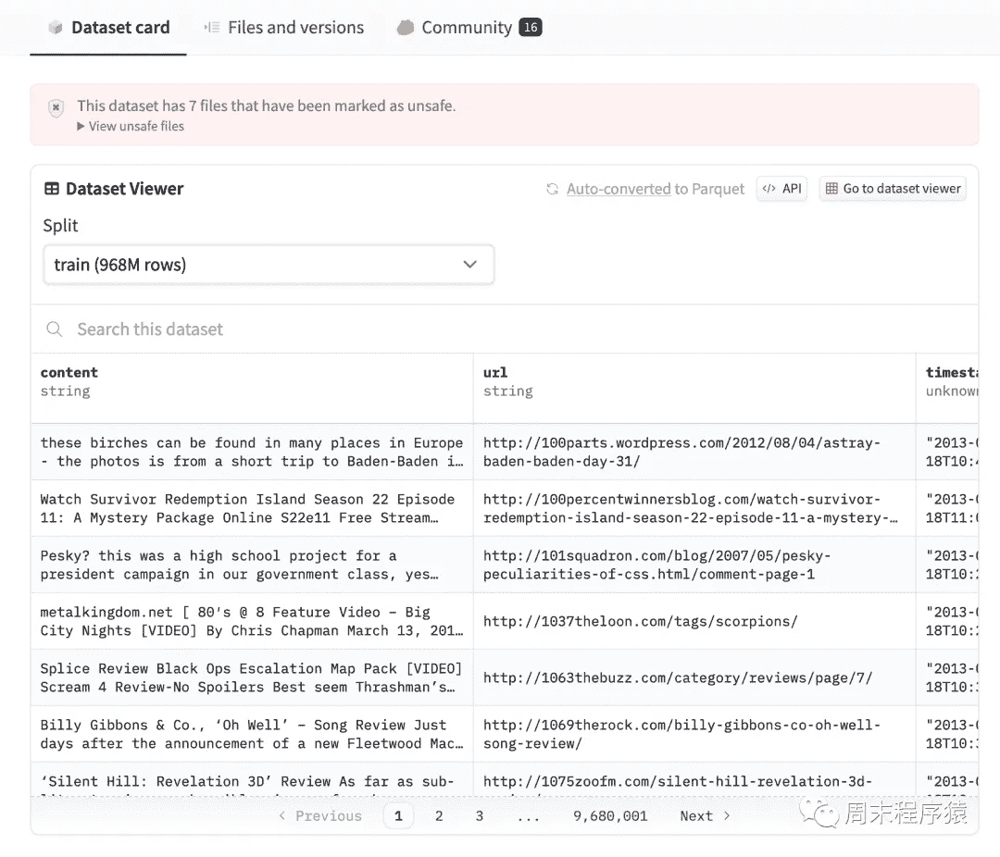
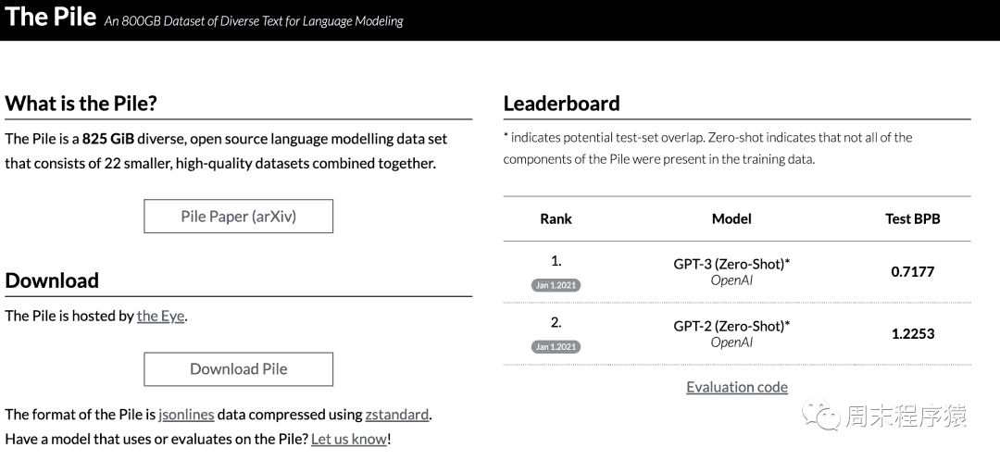
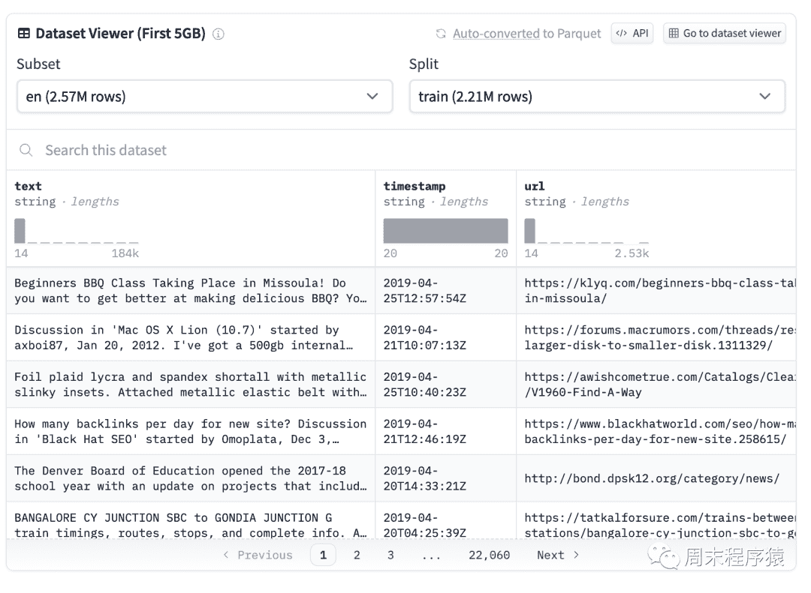
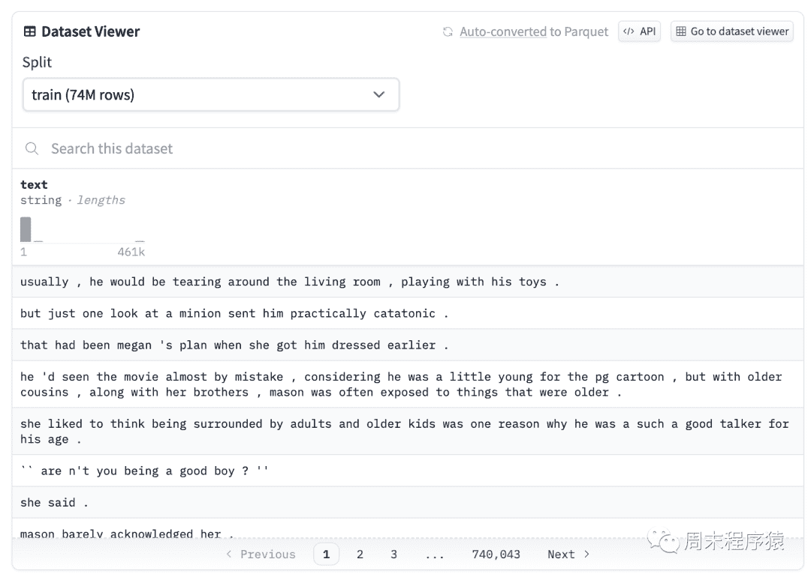
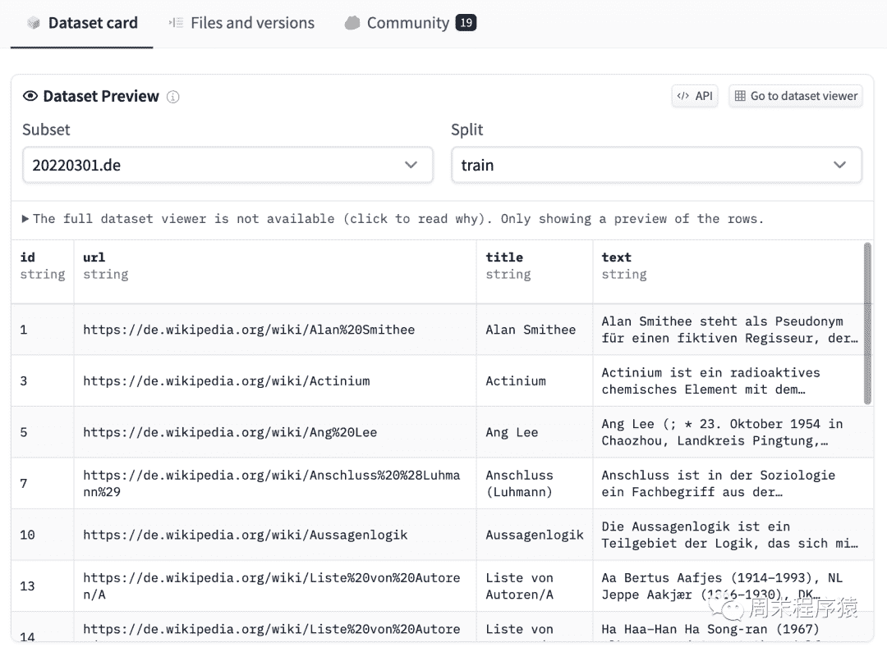
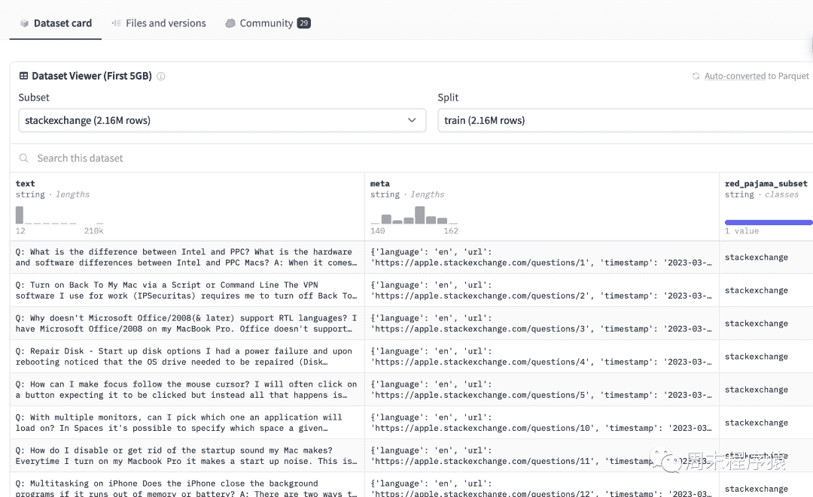
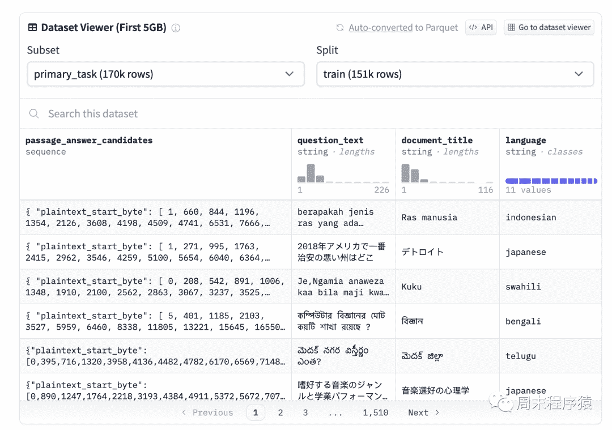
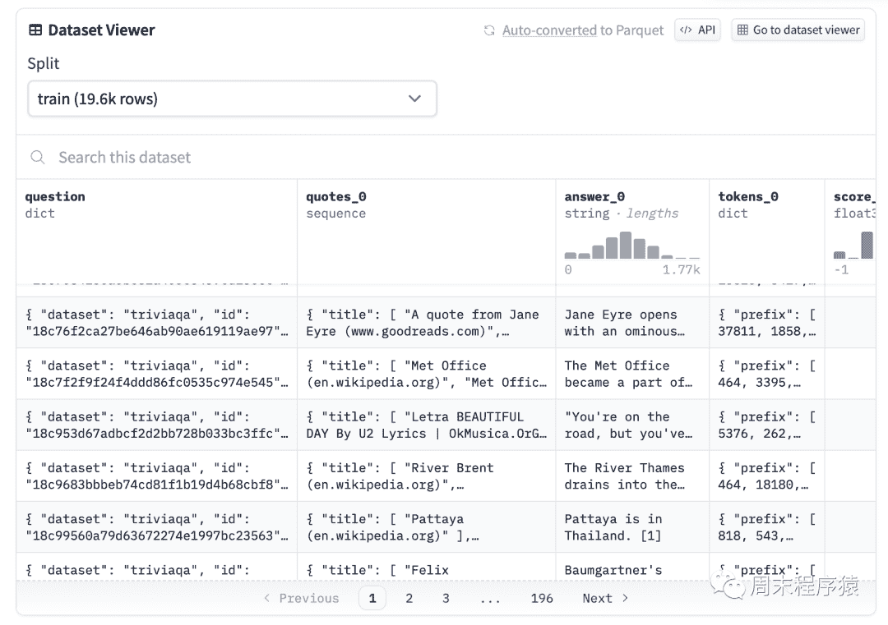
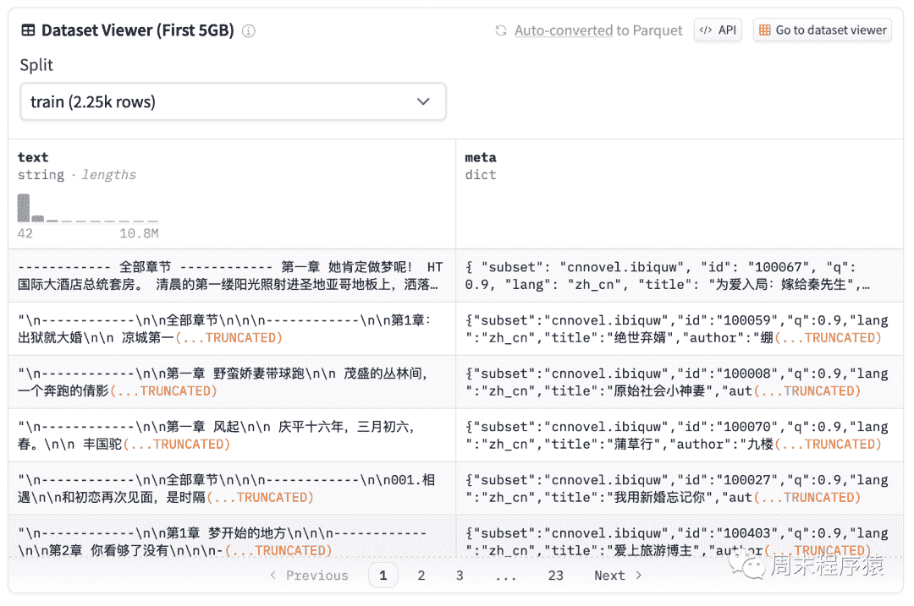
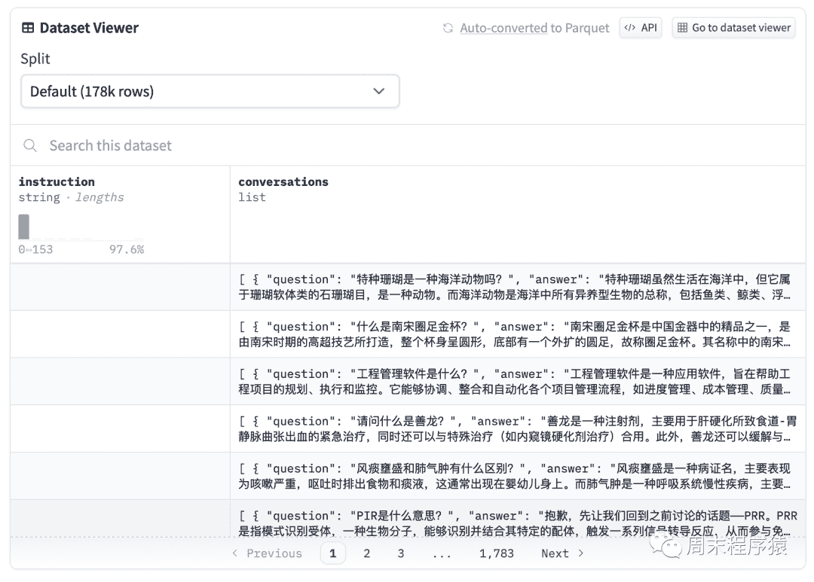

# ChatGPT|大语言模型训练有哪些开源数据集?

> 来源：[https://docs.feishu.cn/docx/Ff1BdgMuJok8z7x0b7Acupofn3d](https://docs.feishu.cn/docx/Ff1BdgMuJok8z7x0b7Acupofn3d)
>
> 🔗 原文链接：[https://mp.weixin.qq.com/s/OFwKbeuNIn8p3JvFa8LUlg](https://mp.weixin.qq.com/s/OFwKbeuNIn8p3JvFa8LUlg)
>
> ⏰ 剪存时间：2024-06-03 22:12:20 (UTC+8)
>
> ✂️ 本文档由 [飞书剪存](https://www.feishu.cn/hc/zh-CN/articles/606278856233?from=in_ccm_clip_doc) 一键生成

原创 周末程序猿 周末程序猿 2023-12-29 12:01 广东

最近在尝试从0开发大语言模型，其中数据集是开发好的模型的必备条件，目前国外的huggingface，国内的modelscope等平台都有一些数据集，但是毕竟信息量太大，这里我整理了一部分，需要的可以自取，后续也会做一个类似的网站，将相关的数据集分类放上去。

## 第一部分：英文数据集

### 1、Common Crawl

- 数据量：数百 TB 级别的数据
- 数据内容：数十亿网页中提取的 TB 级原始网络数据，每月都会爬取新的数据
- 下载地址：https://commoncrawl.org/get-started

### 2、RefinedWeb

- 数据量：1TB 左右，9.68亿条数据
- 数据内容：Common Crawl 数据集的大量经过重复数据删除和过滤的标记语料库，它是为较小规模但高质量的数据集训练 Falcon-40B 模型而开发的
- 下载地址：https://huggingface.co/datasets/tiiuae/falcon-refinedweb
- 国内访问：https://hf-mirror.com/datasets/tiiuae/falcon-refinedweb

### 3、Pile

- 数据量：825GB的语料库
- 数据内容：由22个不同的数据集整理而成，大部分来自学术或专业来源，GPT-Neo、LLaMA 和 OPT 模型采用该数据
- 下载地址：https://pile.eleuther.ai/

### 4、C4

- 数据量：750GB的英文语料库
- 数据内容：它使用启发式方法，仅提取自然语言数据，同时删除所有乱码文本，C4还进行了大量重复数据删除以提高其质量，MPT-7B 和 T5 等语言模型是使用 C4 进行预训练的
- 下载地址：https://huggingface.co/datasets/c4
- 国内访问：https://hf-mirror.com/datasets/c4

### 5、Starcoder Data

- 数据量：783GB的代码，86种编程语言
- 数据内容：Starcoder Data是一个以编程为中心的数据集，Salesforce CodeGen、Starcoder 和 StableCode 使用 Starcoder 数据进行训练
- 下载地址：https://huggingface.co/datasets/bigcode/starcoderdata
- 国内访问：https://hf-mirror.com/datasets/bigcode/starcoderdata

### 6、BookCorpus

- 数据量：9.85亿字，包含11000册书籍
- 数据内容：BookCorpus主要是图书语料，该数据集用于训练 RoBERTA、XLNET 和 T5 等
- 下载地址：https://huggingface.co/datasets/bookcorpus
- 国内访问：https://hf-mirror.com/datasets/bookcorpus

### 7、ROOTS

- 数据量：1.6TB的多语言数据集，59 种语言的文本组成
- 数据内容：创建用于训练 BigScience 大型开放科学开放多语言 (BLOOM) 语言模型，ROOTS 使用来自 Common Crawl、GitHub Code 和其他众包计划的大量重复数据删除和过滤数据
- 下载地址：https://arxiv.org/abs/2303.03915

### 8、wikipedia

- 数据量：19.88GB文章数据
- 数据内容：维基百科数据集是来自维基百科网站，经过清理的文本数据整理而成的，它用于训练 Roberta、XLNet 和 LLaMA 等大模型
- 下载地址：https://huggingface.co/datasets/wikipedia
- 国内访问：https://hf-mirror.com/datasets/wikipedia

### 9、RedPajama

- 数据量：1TB多语言数据集
- 数据内容：复制于 LLaMa 数据集的开源项目，它包含从 Common Crawl、C4、GitHub、书籍和其他来源提取的 1.2 万亿token，用于训练模型 MPT-7B 和 OpenLLaMA
- 下载地址：https://huggingface.co/datasets/togethercomputer/RedPajama-Data-1T
- 国内访问：https://hf-mirror.com/datasets/togethercomputer/RedPajama-Data-1T

### 10、MultiWOZ

- 数据量：10.4k行的英文语料库
- 数据内容：它由涉及餐馆、酒店、出租车、火车、公共汽车、警察、景点和医院等服务的对话组成，对话由不同的对话行为、槽位和值构成，为各种自然语言处理任务提供丰富的上下文
- 下载地址：https://huggingface.co/datasets/multi_woz_v22
- 国内访问：https://hf-mirror.com/datasets/multi_woz_v22

### 11、IMDb

- 数据量：519MB的英文语料库
- 数据内容：MDb数据集可用于与文本分类相关的任务，特别是情感分类，它主要关注英语，被归类为单语数据集，该数据集适用于训练用于情感分析和其他相关自然语言处理任务的机器学习模型
- 下载地址：https://huggingface.co/datasets/pietrolesci/imdb
- 国内访问：https://hf-mirror.com/datasets/pietrolesci/imdb

### 12、`hotpot_qa`

- 数据量：100k行问答数据集
- 数据内容：`hotpot_qa` 数据集适合开发和评估多跳问答模型，它可用于训练模型来理解和回答需要对多条信息进行推理的复杂问题
- 下载地址：https://huggingface.co/datasets/hotpot_qa
- 国内访问：https://hf-mirror.com/datasets/hotpot_qa

### 13、`drop`

- 数据量：77.4k行英文问答数据集
- 数据内容：该数据集适用于与问答相关的任务的训练模型，包括提取式和抽象式问答，它可用于开发能够理解并回答基于给定段落的问题的系统
- 下载地址：https://huggingface.co/datasets/drop
- 国内访问：https://hf-mirror.com/datasets/drop

### 14、`tydiqa`

- 数据量：170k行多语言问答数据集
- 数据内容：`tydiqa` 数据集可用于开发和评估多语言问答模型，特别是在抽取式问答领域，其多样化的语言覆盖范围使其适合需要多语言支持的跨语言理解和应用的研究，该数据集的结构和内容对于语言研究、自然语言处理和旨在理解问题并生成类似人类回答的机器学习模型也可能很有价值
- 下载地址：https://huggingface.co/datasets/tydiqa
- 国内访问：https://hf-mirror.com/datasets/tydiqa

### 15、`webgpt_comparisons`

- 数据量：19.6k行英文数据
- 数据内容：该数据集是为训练符合人类的偏好的问答数据
- 下载地址：https://huggingface.co/datasets/openai/webgpt_comparisons
- 国内访问：https://hf-mirror.com/datasets/openai/webgpt_comparisons

### 16、`OASST1`

- 数据量：84.4k行，35种不同语言的数据集
- 数据内容：`OASST1` 是一个人工生成、人工注释的助理式对话语料库，由35种不同语言的161,443条消息组成，注释有461,292个质量评级，从而超过10,000个带完整注释的对话树
- 下载地址：https://huggingface.co/datasets/OpenAssistant/oasst1
- 国内访问：https://hf-mirror.com/datasets/OpenAssistant/oasst1

### 17、Stanford Human Preferences Dataset (SHP)

- 数据量：385k行数据集
- 数据内容：该数据集包含 18 个不同主题领域的问题回答，每个示例都是一个 Reddit 帖子，其中包含一个问题/说明以及该帖子的一对置顶评论
- 下载地址：https://huggingface.co/datasets/stanfordnlp/SHP
- 国内访问：https://hf-mirror.com/datasets/stanfordnlp/SHP

### 18、`databricks-dolly-15k`

- 数据量：15,000条语料库
- 数据内容：dolly 的微调指令集
- 下载地址：https://huggingface.co/datasets/databricks/databricks-dolly-15k
- 国内访问：https://hf-mirror.com/datasets/databricks/databricks-dolly-15k

### 19、AmericanStories

- 数据量：2000万份美国图书馆
- 数据内容：从美国历史报纸图像中提取的完整文章文本的集合，它包括来自美国国会图书馆维护的公共领域美国编年史馆藏的近 2000 万份扫描件
- 下载地址：https://huggingface.co/datasets/dell-research-harvard/AmericanStories
- 国内访问：https://hf-mirror.com/datasets/dell-research-harvard/AmericanStories

### 20、`WebGLM-QA`

- 数据量：43k的问答数据集
- 数据内容：`WebGLM-QA` 是用于训练 WebGLM 生成器模块的数据集，它由 43,579 个用于训练分割的高质量数据样本、1,000 个用于验证分割的高质量数据样本和 400 个用于测试分割的高质量数据样本组成
- 下载地址：https://huggingface.co/datasets/THUDM/webglm-qa
- 国内访问：https://hf-mirror.com/datasets/THUDM/webglm-qa

### 21、`stackoverflow-posts`

- 数据量：6000万篇帖子，35G大小英文语料数据源
- 数据内容：该数据集包含 2023 年 6 月 14 日之前提交到 StackOverflow 的所有帖子，格式为 Markdown 文本
- 下载地址：https://huggingface.co/datasets/mikex86/stackoverflow-posts
- 国内访问：https://hf-mirror.com/datasets/mikex86/stackoverflow-posts

### 22、`PRM800K`

- 数据量：800K数学英文数据集
- 数据内容：用于针对数学数据集中的问题生成模型解决方案
- 下载地址：https://github.com/openai/prm800k

### 23、`FinNLP`

- 数据量：英语、中文语料数据
- 数据内容：开源原始金融文本数据，包括新闻、社交媒体等
- 下载地址：https://github.com/AI4Finance-Foundation/FinNLP

## 第二部分：中文数据集

### 1、`CNNovel125K`

- 数据量：125,000部中文小说的数据集
- 数据内容：`CNNovel125K` 包含小说是从中文小说托管网站 ibiquw.com 下载的，该数据集包含每本小说的全文，包括所有章节。它主要用于文本生成模型的无监督训练，但也可能对其他与文本相关的任务有用
- 下载地址：https://huggingface.co/datasets/RyokoAI/CNNovel125K
- 国内地址：https://hf-mirror.com/datasets/RyokoAI/CNNovel125K

### 2、DuReader 2.0

- 数据量：超过30万个问题
- 数据内容：该数据集包含超过 30 万个问题和相应的人工生成答案，适合开发和测试问答系统，这些系统可以设计为使用从提供的文档中提取的特定信息来响应用户查询，该数据集可用于训练和评估旨在理解和解释中文书面文本的模型。这可能包括总结段落、识别关键细节和理解文本上下文等任务
- 下载地址：https://huggingface.co/datasets/HongzheBi/DuReader2.0
- 国内地址：https://hf-mirror.com/datasets/HongzheBi/DuReader2.0

### 3、Linly-预训练-数据集

- 数据量：3.4GB中英文语料
- 数据内容：Linly 系列模型使用的中文预训练数据集，包括 `ClueCorpusSmall`、CSL news-crawl 等
- 下载地址：https://huggingface.co/datasets/Linly-AI/Chinese-pretraining-dataset
- 国内地址：https://hf-mirror.com/datasets/Linly-AI/Chinese-pretraining-dataset

### 4、MOSS SFT 数据

- 数据量：110万条中英文对话语料
- 数据内容：MOSS 团队收集和开发的会话数据集，它为每个数据条目都贴上了有用、忠诚和无害的标签
- 下载地址：https://github.com/OpenLMLab/MOSS/tree/main/SFT_data

### 5、COIG

- 数据量：178k中文通用领域对话语料
- 数据内容：基于中文的数据集，它包含通用 QA、中文考试、代码等领域，其质量由人工注释者检查
- 下载地址：https://huggingface.co/datasets/BAAI/COIG
- 国内地址：https://hf-mirror.com/datasets/BAAI/COIG

### 6、`CBook-150K`

- 数据量：15万本书中文图书
- 数据内容：此语料集合基于网上开源的 MD5 图书链接获取
- 下载地址：https://github.com/FudanNLPLAB/CBook-150K

### 7、`nlp_chinese_corpus`

- 数据量：104万个词条，250万篇新闻，150万个百科问答，410万个社区问答，520万个中英文平行语料
- 数据内容：包括维基百科、百度百科、百度问答、一些论坛问答和新闻语料库
- 下载地址：https://github.com/brightmart/nlp_chinese_corpus

### 8、中文心理健康支持对话数据集

- 数据量：55,165k心理对话数据集
- 数据内容：ChatGLM2-6B LoRA 指令微调得到，数据集通过扩展真实的心理互助 QA 为多轮的心理健康支持多轮对话，提高了通用语言大模型在心理健康支持领域的表现，更加符合在长程多轮对话的应用场景

下载地址：https://github.com/qiuhuachuan/smile

### 参考

(1) https://github.com/glgh/awesome-llm-human-preference-datasets

(2) https://github.com/Zjh-819/LLMDataHub?tab=readme-ov-file

(3) https://kili-technology.com/large-language-models-llms/9-open-sourced-datasets-for-training-large-language-models

(4) https://kili-technology.com/datasets
