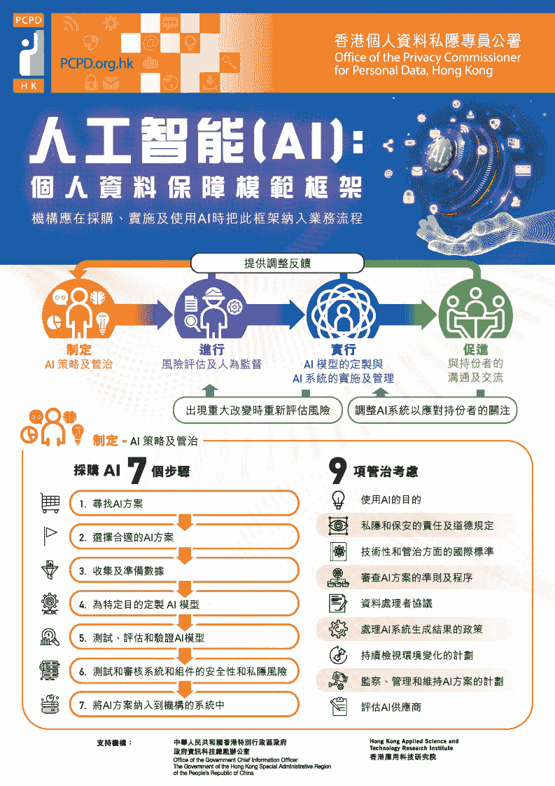
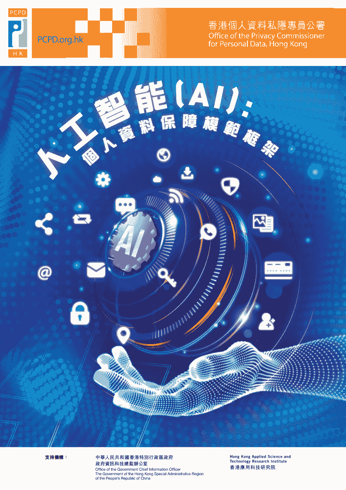

# 人工智能中的个人信息保护合规

> 来源：[https://docs.feishu.cn/docx/Pk1Pdl8dSo0PuvxP4SqcFjCRnbb](https://docs.feishu.cn/docx/Pk1Pdl8dSo0PuvxP4SqcFjCRnbb)

## 来自监管方的指南

朱玲凤，《全集在此：一站式掌握AI数据保护的法律框架与实践案例》

#### GDPR与AI之间的关系

奥地利数据保护机构：关于GDPR与AI Act关系的声明

+   2024年5月28日，奥地利数据保护机构DSB发布了《关于GDPR与AI Act关系的声明》

+   中文翻译：《奥地利数据保护局发布GDPR与AI法案关系的声明》

法国发布关于人工智能系统开发的首份建议

2024年4月8日，法国数据保护机构（CNIL）发布关于人工智能系统开发的首份建议，用于支持人工智能生态系统中的相关参与者严格遵守GDPR等个人数据保护的相关法律。建议主要包含以下内容：确定人工智能系统的目的、确定人工智能系统开发者的职责、确定允许开发者处理个人数据的法律依据、开发者重复使用数据时进行测试和验证的要求、执行数据保护影响评估的要求等。

**更多信息：**

[https://www.cnil.fr/fr/ia-la-cnil-publie-ses-premieres-rec](https://www.cnil.fr/fr/ia-la-cnil-publie-ses-premieres-recommandations-sur-le-developpement-des-systemes-dintelligence)ommandations-sur-le-developpement-des-systemes-dintelligence;

[ht](https://www.cnil.fr/fr/developpement-des-systemes-dia-les-recommandations-de-la-cnil-pour-respecter-le-rgpd)tps://www.cnil.fr/fr/developpement-des-systemes-dia-les-recommandations-de-la-cnil-pour-respecter-le-rgpd

翻译：AI+智读｜法国CNIL发布了AI系统开发的数据保护指南之二

德国数据保护机构发布AI和数据保护指南

全文翻译：https://mp.weixin.qq.com/s/sG7a6RIDZhoC5AFiojXW5Q

香港私隐专员公署发布《人工智能 (AI)：个人资料保障模范框架》

https://mp.weixin.qq.com/s/mq-NDM4SlgmFDR3D-Qxiag

[leaflets_protection_framework.pdf](https://internal-api-drive-stream.feishu.cn/space/api/box/stream/download/all/Zs1ubGDWtoUeqRxnlbJcB1vlnDb)

[ai_protection_framework.pdf](https://internal-api-drive-stream.feishu.cn/space/api/box/stream/download/all/K1vwbHerCoDwC2xOim4cwukHnXb)

AI技术的发展带来了新的个人信息隐私问题。为应对这些不断演变的隐私风险，韩国隐私事务的主要执法机构——个人信息保护委员会(PIPC)于2023年8月发布了《人工智能时代个人信息安全使用指南》。PIPC倡导以原则为导向的监管方法，旨在促进AI行业发展，同时最大程度防范个人信息泄露风险。

2024 年 3 月 22 日，法国数据保护机构 (CNIL) 发布《GDPR 实践指南-个人数据安全2024》

### 法国CNIL《AI系统开发的数据保护指南》

**点击跳转原文**[**（上）**](http://mp.weixin.qq.com/s?__biz=Mzg2NTU1NjgzMQ==&mid=2247484706&idx=3&sn=274c861e3b900730c1685686195a112b&chksm=ce590512f92e8c047d13ba0ea51f5a6399974732a8b10804b3b589f985f211ab24b1ef811506&scene=21#wechat_redirect)**、**[**（中）**](http://mp.weixin.qq.com/s?__biz=Mzg2NTU1NjgzMQ==&mid=2247484706&idx=2&sn=b4733271fba18baab3c687e394b733ae&chksm=ce590512f92e8c0441c8c2c9629a605cc267008a527a72f382886abf10982bde2c927c417159&scene=21#wechat_redirect)**、**[**（下）**](http://mp.weixin.qq.com/s?__biz=Mzg2NTU1NjgzMQ==&mid=2247484706&idx=1&sn=3cb059e285ea1ecc102e8d080cb9c5bb&chksm=ce590512f92e8c0461c827cecca87d5e531bf244cd39135d206b24ecb7c6f930c95f084b22f8&scene=21#wechat_redirect)

**推荐语**：法国CNIL的指南为AI领域的数据保护提供了一个全面的蓝图。它不仅涵盖了数据保护的基本原则，还深入探讨了AI系统开发全周期中的合规性问题。特别是，它提供了关于如何进行数据保护影响评估（DPIA）的详细指导，这是评估和降低AI系统风险的关键步骤。此外，指南中关于建立持续监控机制的建议，确保了AI系统在整个生命周期中的合规性。这份指南是法律专业人士、技术专家和业务决策者不可或缺的资源，无论是在公共还是私营部门，都能提供宝贵的指导。

### 法国国民议会《关于AIGC在个人数据保护和使用生成内容方面的挑战的信息报告》

2024年2月14日，法国国民会两名议员菲利普·普拉达尔（Philippe Pradal）和斯特凡纳·朗博（Stéphane Rambaud）就生成式人工智能问题向国民议会提交了该份报告。这份83页的报告全称《关于生成式人工智能在个人数据保护和使用生成内容方面的挑战的信息报告》，分为三大部分，其中穿插33条政策建议（附于文后）。报告总论部分回应了生成式人工智能带来的机遇与风险，第一部分着重讲述欧洲层面的法规制定模式与风险，第二部分则是为法国国家层面的政策行动提出建议。本文将聚焦于报告的第一二部分，解读议员对生成式人工智能问题的立场与主张。

https://mp.weixin.qq.com/s/-4mOU7iZdFoB_O1wxi-gDg

### **荷兰《数据抓取指南》**

[**点击跳转原文**](http://mp.weixin.qq.com/s?__biz=Mzg2NTU1NjgzMQ==&mid=2247484710&idx=1&sn=e03554f141d47427a7035b03b00bbb17&chksm=ce590516f92e8c00102c3220f36cd3f0afa2c675dab2ecbc554c6fe740ba602f46df697c3bac&scene=21#wechat_redirect)

**推荐语**：荷兰的数据抓取指南专注于网页抓取活动中的个人数据保护，这是数据保护领域的一个特殊而重要的议题。该指南深入分析了网页抓取技术可能带来的隐私风险，并提供了如何在遵守GDPR的前提下进行网页抓取的指导。它特别强调了合法利益作为法律依据的条件，这对于私人组织和个人在评估网页抓取合法性时至关重要。该指南是任何涉及网页抓取活动的组织和个人的重要参考资料，尤其是在考虑其合法性和隐私保护措施时。

### **德国《AI和数据保护指南》**

[**点击跳转原文**](http://mp.weixin.qq.com/s?__biz=Mzg2NTU1NjgzMQ==&mid=2247484768&idx=1&sn=4258d0455cb0f704b8b13629251b6d76&chksm=ce590550f92e8c462a36357a8c5b0bd1b9294df579567b4456caa779fb2717d49b918bb283a7&scene=21#wechat_redirect)

**推荐语**：德国的AI和数据保护指南为AI应用的数据保护法律要求提供了深入的见解。它不仅讨论了AI应用的合法性基础，还涉及了自动化决策的限制和系统开放性与封闭性的选择，这些都是AI领域中的关键议题。指南中的透明度要求和员工培训的重要性，强调了组织在实施AI解决方案时必须考虑的伦理和社会责任。对于希望确保其AI应用符合数据保护法规的组织来说，这份指南是一个宝贵的资源。

### **英国ICO《关于AI监管的战略方法》与《**关于数据保护应用于AIGC指南征求意见》

**点击跳转原文**[**《战略方法》**](http://mp.weixin.qq.com/s?__biz=Mzg2NTU1NjgzMQ==&mid=2247484864&idx=1&sn=1540cfe601e1475db47ae02c8d4e511c&chksm=ce5905f0f92e8ce6a07f289a3528d82cb2fc82316615159884de8f78d2043283ef291fcf6363&scene=21#wechat_redirect)**、**[**《AIGC指南征求意见》**](http://mp.weixin.qq.com/s?__biz=Mzg2NTU1NjgzMQ==&mid=2247484904&idx=1&sn=cca30a104ec28b403862674fd98c7ff0&chksm=ce5905d8f92e8cce6616aed3fd188a8c34a5d77f12b30ecdc54631d018071f6973a80b25d081&scene=21#wechat_redirect)

**推荐语**：英国ICO的文档为AI监管提供了一个战略框架，特别关注了数据保护原则在AI领域的应用。通过公开征求意见，ICO展示了其在制定AI监管政策时的开放性和包容性。这些文档不仅为政策制定者提供了宝贵的指导，也为公众参与AI监管讨论提供了机会。ICO的方法强调了在AI发展中平衡创新与个人隐私保护的重要性，对于任何对AI伦理和法律挑战感兴趣的读者来说，这些文档都是必读的资料。

### 奥地利《GDPR与AI法案关系》

[**点击跳转原文**](http://mp.weixin.qq.com/s?__biz=Mzg2NTU1NjgzMQ==&mid=2247484695&idx=1&sn=5f5098c21658445332aa9bf398e02e2a&chksm=ce590527f92e8c316ed7693020f2ebfa0a9d3cb80b33bc458314f7cfcc0451195cdce4542b59&scene=21#wechat_redirect)

**推荐语**：奥地利数据保护机构的声明为理解GDPR与新兴的AI法案之间的关系提供了关键的视角。它明确指出，即使在AI法案生效后，GDPR在处理个人数据时仍然具有重要意义。该声明对于理解AI系统开发和部署中的合法性基础和数据处理的合法性要求至关重要。它还强调了数据保护法在新技术发展中的作用，为那些希望在遵守GDPR的同时开发和运营AI系统的组织提供了指导。

### **瑞典《AI与GDPR的指南》**

[**点击跳转原文**](http://mp.weixin.qq.com/s?__biz=Mzg2NTU1NjgzMQ==&mid=2247484385&idx=1&sn=3d8fd8afc07bcb2b1db62e9b945e657c&chksm=ce5903d1f92e8ac78300d5c0251fc8dd056ec3df1dcc22145bdc770e3ad4ae87b937c68393bc&scene=21#wechat_redirect)

**推荐语**：瑞典个人信息保护机构（IMY）发布的指南为AI与GDPR的结合提供了通俗易懂的介绍。它不仅解释了AI技术的基础，还详细阐述了AI开发和使用过程中应遵守的GDPR要求。这份指南的独特之处在于它如何将技术概念与法律要求相结合，为AI开发者和使用者提供了实用的指导。它强调了在AI项目中考虑数据保护的重要性，确保了创新与个人隐私权之间的平衡。

### EDPS《生成式AI数据合规指引》

**点击跳转数据何规《****E**DPS发布生成式AI数据合规指引》

**推荐语**：EDPS发布的指引为欧盟机构在使用或开发生成式AI工具时提供了数据保护的指导。这份指引的独特之处在于它如何将数据保护的原则应用于生成式AI的具体场景，包括风险评估、数据保护影响评估（DPIA）和数据主体权利的保障。它强调了在AI系统的整个生命周期中维护数据保护的重要性，并提供了实用的建议，以帮助欧盟机构在遵守EUDPR的同时，充分利用生成式AI的潜力。

2024年6月3日，欧盟数据保护监督机构（EDPS）发布了《生成式人工智能与EUDPR：EDPS就生成式人工智能数据保护的首份指南》，为欧盟组织、部门、办公室和机构（EUIs）提供了使用生成式人工智能系统处理个人数据时应如何遵守数据保护义务的建议及指示。该指南明确，欧盟组织机构原则上可以在符合EUDPR的条件下开发、部署和使用生成式人工智能系统提供公共服务。同时，该指南还对生成式人工智能的定义、数据保护官（DPOs）的作用、数据保护影响评估（DPIA）、数据最小化原则、数据准确性原则、自动化决策等问题作了说明。该指南将在发布后12个月内完成更新、完善和拓展，以提供生成式人工智能开发和实施过程中所需的更多要素。

原文：https://www.edps.europa.eu/system/files/2024-06/24-06-03_genai_orientations_en.pdf

### EDPB调查ChatGPT报告

**点击跳转数据何规**《EDPB调查ChatGPT报告》

**推荐语**：EDPB对Chat GPT的调查报告提供了对大型语言模型（LLM）数据处理活动的全面审查。报告的独特之处在于它如何从多个角度（合法性、公平性、准确性、透明性、数据主体权利）评估LLM的合规性。这对于理解AI技术在实际应用中的数据保护挑战至关重要。报告的深入分析为监管机构、技术开发者和数据保护专业人士提供了宝贵的见解，帮助他们更好地理解AI技术的数据保护要求。

### ICO调查Snap AI功能裁定书

[**点击跳转原文**](http://mp.weixin.qq.com/s?__biz=Mzg2NTU1NjgzMQ==&mid=2247484894&idx=1&sn=b80bba09bc76db6191365431dc778418&chksm=ce5905eef92e8cf8d0ed10c913e8e7309a0392d60b80aa0f7dc2314d6a091ea68a2a5992735a&scene=21#wechat_redirect)

**推荐语**：ICO对Snap AI功能的调查裁定书展示了监管机构如何细致地评估AI功能的数据保护合规性。裁定书深入探讨了Snap AI功能在处理个人数据时的合法性基础、DPIA的执行以及对儿童的保护措施。这份裁定书的独特之处在于它如何结合具体的技术细节和法律要求，为AI应用的数据保护合规性提供了明确的指导。它对于任何希望确保其AI产品符合数据保护法规的组织来说，都是一份重要的参考资料。