# 用户数据

> 来源：[https://docs.feishu.cn/docx/DuledyMVjoPMvdxplZmc1nl4nOe](https://docs.feishu.cn/docx/DuledyMVjoPMvdxplZmc1nl4nOe)

养兔子的好人，《如何合规地用用户输入信息进行训练》

1.  已经被用于训练的数据可以撤回吗？

已经参与训练的数据是无法从模型里撤回来的

模型可以理解为：公式（模型结构）+系数（参数）+checkpoint下的预训练的结果，最后训练好的沉淀下来的模型就是个这，每一次实时训练的时候，会基于喂进去的数据和训练方法对结构和/或参数发生变化，然后在模型达到一定标准的时候选一个“节点”把它固定下来。但如果要追溯“这一条训练数据”进去影响的到底是哪一个，是哪一层级的结构、哪几个系数、在哪个时刻发生了变化，那是非常非常难的

1.  如果训练数据造成了侵权如何消除影响？技术上可以做到恢复如初吗？

模型遗忘（Machine unlearning）领域这两年进展比较多，主要就是针对3的诉求。实际不是删除，而是最小化相应数据对模型输出的影响，最好是几乎没有影响。有不同的实现路径，但大部分都是前沿探究，暂时不易工程落地。

## 法律规定

> 《生成式人工智能服务安全基本要求》

> **5.1 语料来源安全要求**

> c）语料来源可追溯方面：4）将使用者输入信息当作语料时，应具有使用者授权记录。

> **7 安全措施要求**

> c）当收集使用者输入信息用于训练时：

> 1）应为使用者提供关闭其输入信息用于训练的方式，例如为使用者提供选项或语音控制指令；关闭方式应便捷，例如采用选项方式时使用者从服务主界面开始到达该选项所需操作不超过4次点击；

> 2）应将收集使用者输入的状态，以及 1）中的关闭方式显著告知使用者。

用户输入的信息会因为关联性构成个人信息，但其敏感程度通常属于一般个人信息，因此原则上使用用户输入的信息直接进行模型训练也构成个人信息处理活动，需要取得用户的同意。这可能是5.1条要求企业具有使用者授权记录规定的原因。一般通过隐私政策进行统一地“告知-同意”即可满足要求。

而《生成式人工智能服务安全基本要求》还要求企业提供关闭方式（opt-out），这是附加的额外要求。当然如果从撤回同意的角度来思考这件事，那么这个要求本身也是大模型企业作为个人信息处理者的应尽之责。好消息是，国标没有限制关闭的实现方式，因此最低水位来说，“在隐私政策里告知用户可以通过客服平台或发送行权邮件的形式来提出关闭请求”也是可以被接受的。

## 实例

### 通义千问

《通义产品用户协议》的知识产权章节

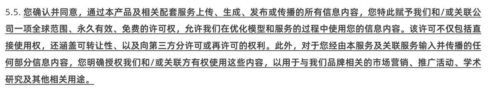

【没有明确提出一个退出的渠道】

### 文心一言

《文心一言用户协议》的知识产权和其他权利章节

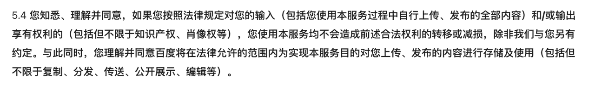

### 豆包

《用户协议》的知识产权章节

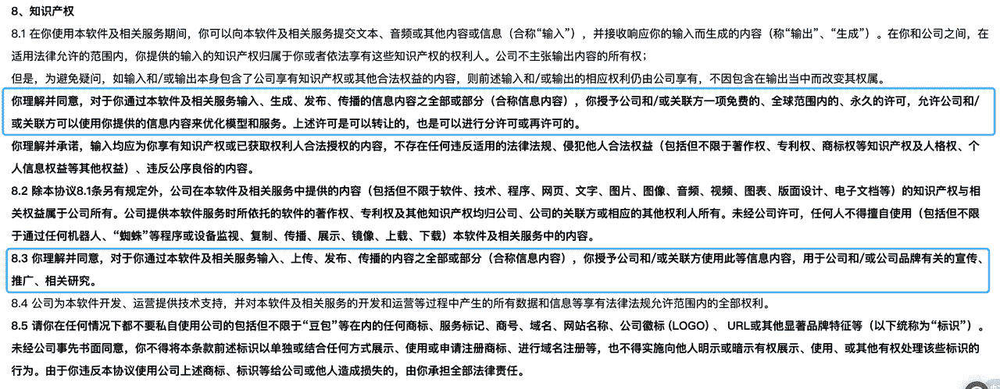

《隐私政策》

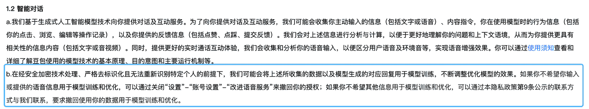

提供了“改进语音服务”

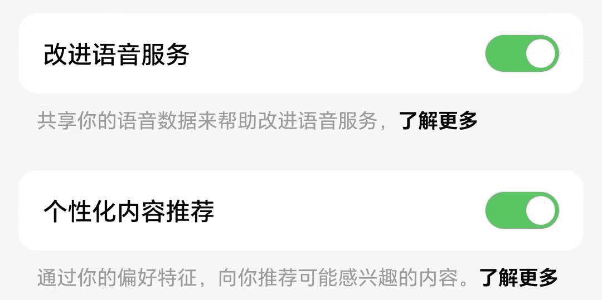

### 智谱清言

《智谱清言用户协议》中“智谱清言的权利和义务”章节

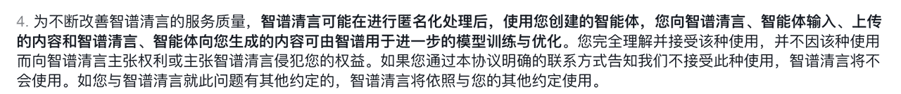

《智谱清言隐私政策》

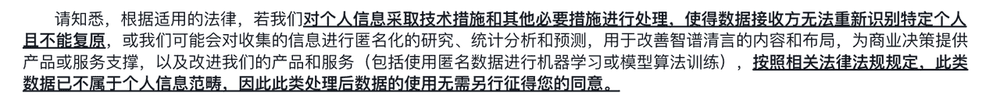

【非个人信息？】

讯飞星火

《讯飞开放平台用户服务协议》的用户使用规范章节

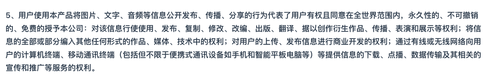

【看起来像是从知识产权权利的角度进行了规定】

《讯飞开放平台隐私政策》

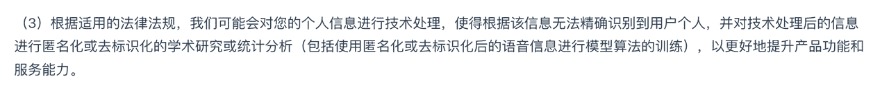

【去标识化?匿名化？—— 没有提供退出的渠道】

### 腾讯元宝

《腾讯元宝用户服务协议》的“知识产权与其他权利”章节

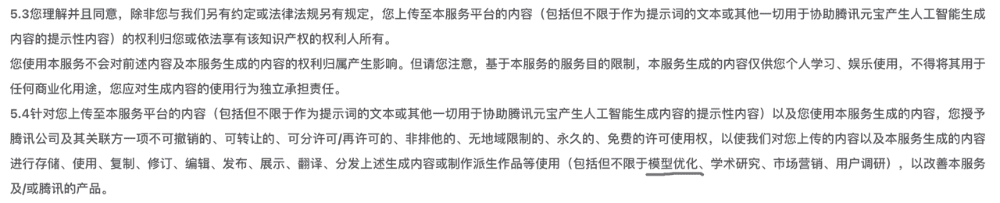

《腾讯元宝隐私政策》

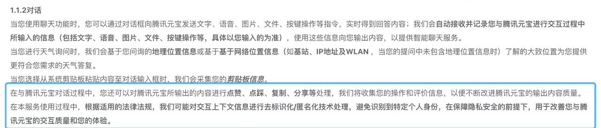

【去标识化?匿名化？—— 没有明确提供退出的渠道】

### 天工AI

《天工用户服务协议》的“知识产权”章节

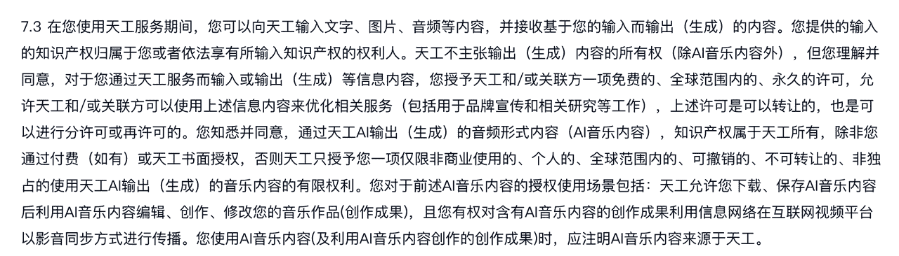

《天工隐私政策》

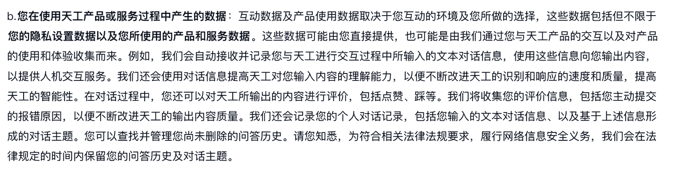

【没有明确提供退出的渠道】

### Kimi

从服务协议和隐私政策中未披露其会使用用户数据进行训练。

## 域外参考

谷歌的Gemini，OpenAI的ChatGPT，以及Anthropic的Claude在告知层面和用户行权层面提供了一些新的参考和思路。

### Gemini

**告知：**《[Gemini 应用隐私信息中心](https://support.google.com/gemini/answer/13594961?visit_id=638550487483603030-865826335&p=pn_gemini_apps&rd=1#your_data&zippy=%2C%E4%BB%80%E4%B9%88%E6%98%AF-gemini-%E5%BA%94%E7%94%A8)》

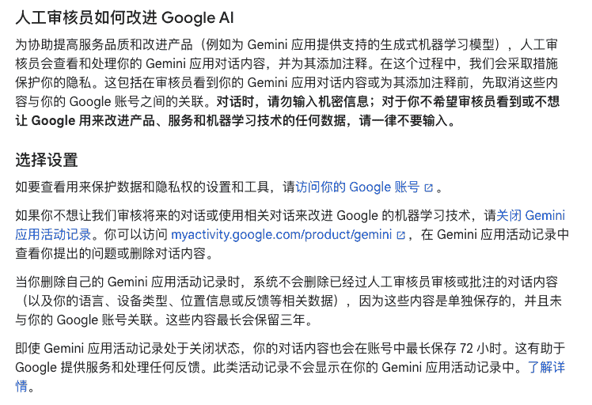

**退出方式**

应用活动记录 -

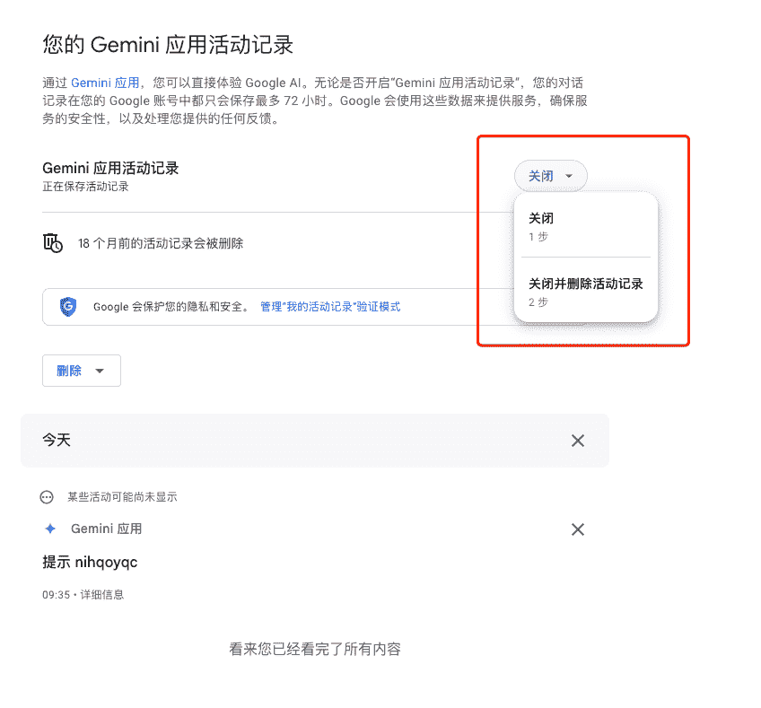

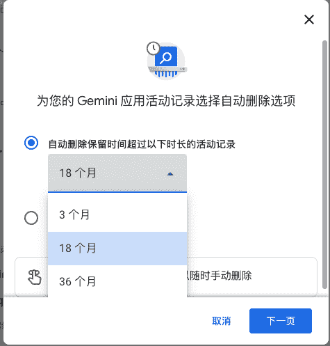

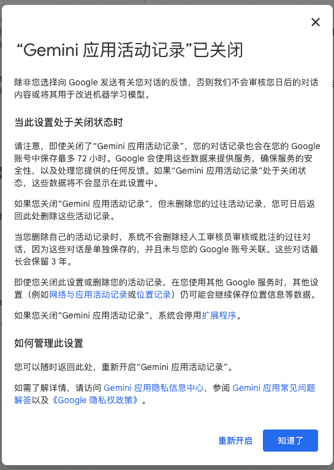

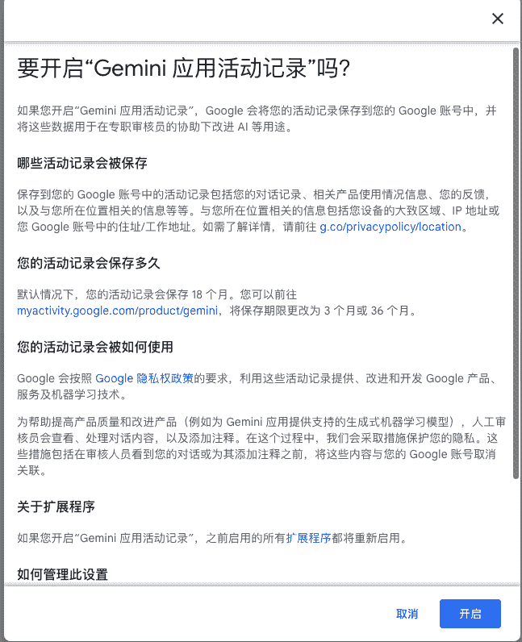

关闭通知

开启通知

**会使用哪些数据：**活动记录包括您的对话记录、相关产品使用情况信息、您的反馈，以及与您所在位置相关的信息等等。与您所在位置相关的信息包括您设备的大致区域、IP 地址或您 Google 账号中的住址/工作地址。

**如何使用：**人工审核员会查看、处理对话内容，以及进行数据标注。在审核人员看到您的对话或为其添加注释之前，Google将这些内容与用户的 Google 账号取消关联【去标识化？】。目的是帮助提高产品质量和改进产品（例如为 Gemini 应用提供支持的生成式机器学习模型）。

当用户删除自己的活动记录时，系统不会删除经人工审核员审核或批注的过往对话，因为这些对话是单独保存的，并且未与您的 Google 账号关联。这些对话最长会保留 3 年。

**关闭和删除的权利：**对话记录也会在您的 Google 账号中保存最多 72 小时。Google 会使用这些数据来提供服务，确保服务的安全性，以及处理您提供的任何反馈。

### ChatGPT

**告知**

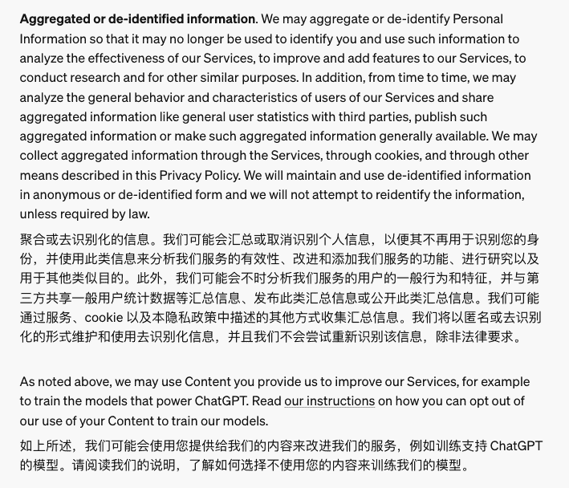

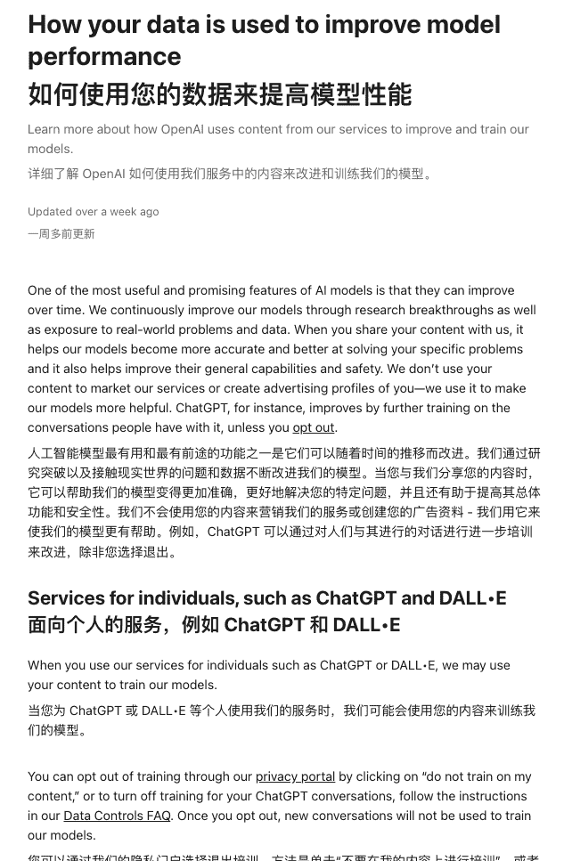

隐私政策

https://openai.com/policies/privacy-policy/

Privacy FAQ中专门设置了针对使用用户数据训练模型的说明：https://help.openai.com/en/articles/5722486-how-your-data-is-used-to-improve-model-performance

**退出方式：**

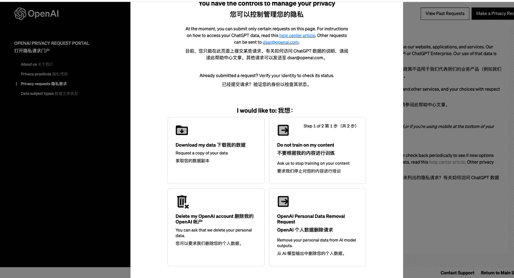

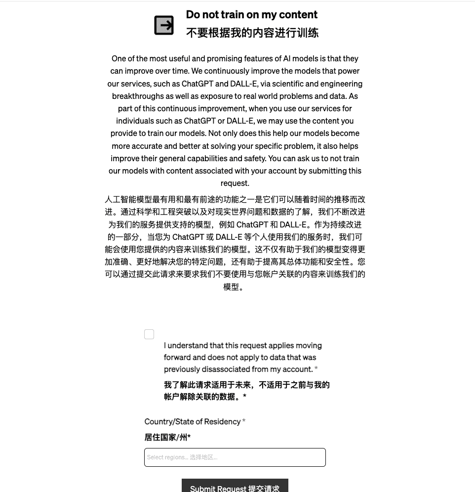

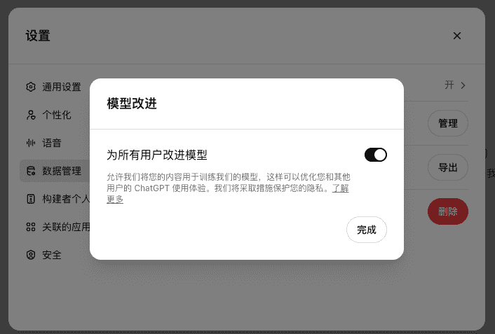

隐私保护平台上设置了控制选项

https://privacy.openai.com/policies?modal=take-control&name=open-ai-privacy-request-portal#privacy-requests

首先会验证身份，然后再提出请求

【但是要求必须提供居住的国家信息，有点奇怪】

设置 - 模型改进

### Claude

**告知**

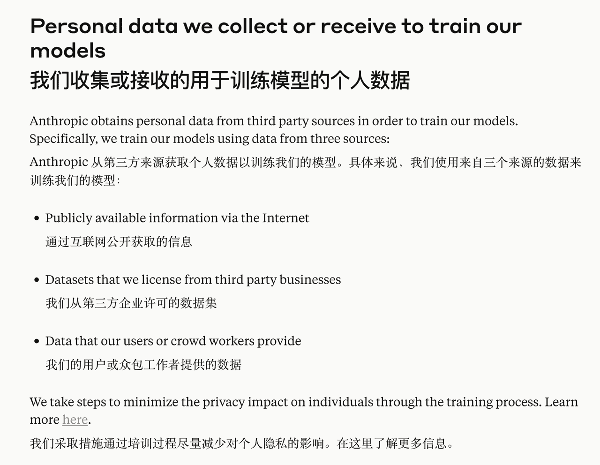

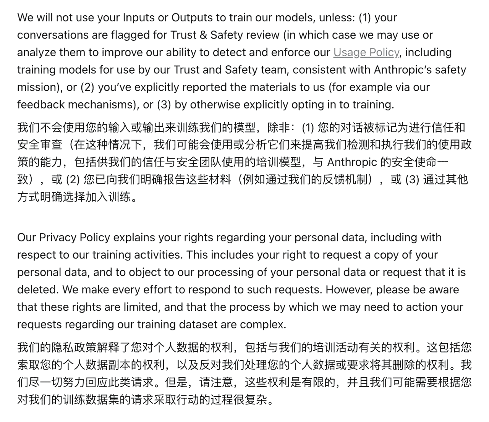

隐私政策：https://www.anthropic.com/legal/privacy

How do you use personal data in model training?

https://support.anthropic.com/en/articles/7996885-how-do-you-use-personal-data-in-model-training

【有限地训练，且还可能是opt-in】

## 案例

### Meta案

Meta 在 5 月5 月 22 日起，

底向英国的 Facebook 和 Instagram 用户发送电子邮件，通知他们将于 6 月 26 日生效的隐私政策变更。他们声称 Meta 现在将“依赖于合法利益这一法律基础”来使用个人信息进行人工智能开发。此外，虽然 Meta 告知用户他们有权提出异议，但并未承诺会自动尊重这些异议。一旦用户的数据被公司使用，可能是不可逆的，因此无法追溯地适用同意

自5 月 22 日起，我们已向欧洲的用户发送了超过 20 亿条应用内通知和电子邮件，解释我们正在做的事情。这些通知包含一个反对表单的链接，让人们有机会反对他们的数据被用于我们的人工智能建模工作。

2024年6月6日，noyb敦促11个数据保护机构立即停止Meta滥用个人数据进行人工智能训练。

2024年6月6日，挪威消费者委员会向挪威数据保护机构提起投诉

2024年6月x日，英国信息专员办公室（ICO）向Meta提出了“暂停和审查使用 Facebook 和 Instagram 用户数据来训练生成性人工智能的计划的请求”。爱尔兰数据保护委员会（DPC）代表欧洲数据保护机构向Meta提出暂停训练计划的请求，并与Meta进行了深入的沟通。

2024年6月13日，北莱茵-威斯特法伦州数据保护机构（LDI NRW）建议用户及时反对Meta AI使用个人数据

2024年6月14日，德国汉堡数据保护局提示用户对Meta使用个人数据训练AI提出异议。

2024年6月14日，DPC和Meta在官网上发布了双方的合作以及暂停计划的官方声明。同时，Meta回复了ICO的请求。

2024年7月15日，英国开放权利组织（ORG）发现Meta在宣布暂停计划后，并未暂停隐私政策的修订或更改现有的隐私政策。于是，ORG向ICO请求Meta暂停计划，并要求ICO为英国居民提供与欧盟各国数据保护机构同等标准的保护。ORG指控Meta违反了英国GDPR的第5（1）和（2）条、第6（1）条、第6（4）条、第9（1）条、第12条、第13条等条款。

在我们通知的开发过程中，我们审查了行业同行的做法以及我们之前的政策更新通知。因此，我们使我们的表单比其他在欧盟提供生成性人工智能的公司更容易找到、阅读和使用：只需三次点击即可访问，并且需要填写的字段更少。为了进一步帮助理解，我们还设计了更易于低阅读年龄的人士访问，尽管我们并没有在 18 岁以下欧洲人的账户内容上训练我们的 Llama 模型。

我们尊重所有欧洲的异议。如果在 Llama 训练开始之前提交了异议表格，那么该人的数据将不会用于训练这些模型，无论是在当前的训练轮次还是未来的训练中。

为了明确，我们的目标是基于 18 岁以上的欧洲人选择在 Meta 的产品和服务上公开分享的信息，构建有用的功能，例如公开帖子、公开评论或公开照片及其说明。模型可能会基于人们公开分享的帖子进行训练，但这并不是每个人信息的数据库，也不是为了识别任何个人。相反，这些模型是通过查看人们的信息来识别模式，例如理解口语短语或地方性参考，而不是识别特定的人或他们的信息。

根据Meta的新隐私政策，Meta将使用所有公开的帖子、评论和照片来自用户的AI应用程序进行训练。该公司对于AI技术背后的具体内容非常含糊。根据其自己的声明，它涉及到“生成性AI特性和体验的全部，包括Meta AI和AI支持的创意工具以及这些功能所基于的模型”。从解释中可以清楚地看出，AI支持的功能不仅适用于用户，也适用于公司。

在使用个人数据进行AI训练时，Meta希望依据GDPR第6条(1)(f)项的合法利益作为法律依据，并简要提及开发和改进其产品的目的。欧盟数据保护机构目前正在澄清合法利益是否可以作为法律依据，以及是否需要数据主体的明确同意。总体而言，Meta的计划引发了众多法律问题，包括与透明度相关的，这些问题需要在整个欧盟统一解决。

**处理基础**：与许多在使用欧洲人数据训练大型语言模型的行业同行一**样，为了**在欧盟进行这项工作，我们将依赖“合法利益”的法律基础，以遵守欧盟的通用数据保护条例（GDPR）。我们认为，这一法律基础是在处理公共数据以训练人工智能模型所需规模时，最合适的平衡，同时尊重人们的权利。

+   Facebook的澄清和暂停计划的官宣：https://about.fb.com/news/2024/06/building-ai-technology-for-europeans-in-a-transparent-and-responsible-way/

+   meta的拒绝表单：https://www.facebook.com/help/contact/1266025207620918

+   noyb的投诉：https://noyb.eu/en/noyb-urges-11-dpas-immediately-stop-metas-abuse-personal-data-ai

+   德国汉堡数据保护局的提示：[A](https://datenschutz-hamburg.de/fileadmin/user_upload/HmbBfDI/Datenschutz/Informationen/240612_PM_AI_Training_with_personal_data_Insta_Facebook_EN.pdf)I training with personal data on Instagram and Facebook

+    北莱茵-威斯特法伦州数据保护机构的建议：https://www.ldi.nrw.de/trainingsdaten-fuer-meta-ki

+   爱尔兰DPC的合作声明：[The DPC's Engage](https://www.dataprotection.ie/en/news-media/latest-news/dpcs-engagement-meta-ai)ment with Meta on AI

+   [ICO的接收Meta回复的声明：Statement in respon](https://ico.org.uk/about-the-ico/media-centre/news-and-blogs/2024/06/statement-in-response-to-metas-plans-to-train-generative-ai-with-user-data/)se to Meta's plans to train generative AI with user data

+   ORG的投诉：[O](https://www.openrightsgroup.org/press-releases/org-complaint-to-ico-about-meta-privacy-policy-changes/)RG complaint to ICO about Meta privacy policy changes

6月10日：Meta宣布在6月26日前如果用户不申请退出，将使用用户在Facebook、Instagram上公开数据进行训练AI。

德国汉堡数据保护局提示用户对Meta使用个人数据训练AI提出异议； 北莱茵-威斯特法伦州数据保护机构建议用户及时反对Meta AI使用个人数据。

https://mp.weixin.qq.com/s/Kcn3YjulIn2t6u-S34g01A

https://mp.weixin.qq.com/s/EGFHOxPhZtSSbcBxFwyU5w

法律分析：《Meta改变隐私政策使用个人数据训练AI大模型被投诉，相关法律问题分析》

https://mp.weixin.qq.com/s/Kcn3YjulIn2t6u-S34g01A

7月2日，巴西数据保护局要求美国Meta公司不得使用巴西用户数据训练生成式人工智能模型。Meta公司旗下有“脸书”“照片墙”等社交平台。

https://mp.weixin.qq.com/s/K3NLutHAJwnPUuHWkDPPlA

惊天大逆转：巴西居然撤回一个对Meta使用社交数据训练AI的禁令

https://mp.weixin.qq.com/s/mD8arRFPgun0JmcZpQGymQ

澳大利亚：没有选择退出的选项

https://mp.weixin.qq.com/s/04-tlpayr5UC0rVmn6ej5A

### X 案

爱尔兰数据保护委员会DPC要求X暂停人工智能训练活动

新闻：https://www.forbes.com/sites/antoniopequenoiv/2024/07/26/x-quietly-begins-training-ai-assistant-grok-with-user-posts-how-to-disable-the-feature/

也没有修改设置

隐私政策中没有披露，大概率也是合法利益

2024年8月8日，爱尔兰数据保护委员会（DPC）宣布，DPC与X（原Twitter）签订了一项协议，要求X在2024年5月7日至2024年8月1日期间暂停对X平台上EU/EEA用户发布的公开帖子中包含的个人数据进行处理。

DPC强调X处理个人数据的目的是训练其人工智能系统“Grok”。DPC提及，DPC根据2018年《数据保护法》第134条向高等法院提出申请后与X协商一致达成了该协议。具体而言，《数据保护法》第134条允许DPC在迫切需要保护数据主体的权利和自由时向高等法院申请发布一项命令，要求数据控制者暂停、限制或禁止处理个人数据。

跟随 Meta 的脚步，埃隆·马斯克的 X 本周悄然调整了设置，让公司的 AI 系统——Grok——可以访问所有用户**的帖**子。有一**种方法可以**防止 Gro**k 获取**[你的](https://x.com/settings/grok_settings)帖子；然而，你无法通过移动应用执行此操**作。你需要使**用桌面电脑访问 X 的 设置；选择 隐私和安全，然后选择 Grok，最后取消选中该框。或者直接点击 这里 直接进入正确的设置页面。（如果你有与 Grok 的对话记录，也可以通过点击 删除对话记录 来删除它。）

据TechCrunch 2024年8月12日报道，埃隆·马斯克 (Elon Musk) 旗下的社交媒体平台X因未经个人同意擅自使用欧盟用户数据而遭到了一系列的隐私投诉。奥地利、比利时、法国、希腊、爱尔兰、意大利、荷兰、波兰和西班牙的数据保护机构均收到了针对X的隐私投诉，投诉指出X在未明确告知用户并征得用户同意的情况下，自动收集了用户数据并用于训练生成式AI聊天机器人Grok。投诉详细列出了X的多项违规行为，包括未清晰说明如何使用数据进行AI训练、所收集的数据超出必要范围、以及可能无充分理由地处理了敏感数据。爱尔兰数据保护委员会 (DPC) 已经针对X的AI模型训练处理采取了一些行动，并向爱尔兰高等法院提起法律诉讼，寻求禁令以迫使其停止使用数据。

此次事件再次引发了对大型科技公司数据保护问题的关注，尤其是在AI技术日益普及的背景下如何确保用户数据的合规使用和安全。

https://mp.weixin.qq.com/s/Qv0IY9EPfMJ_kTM65YQ8Xg

新闻全文：https://www.dataprotection.ie/en/news-media/press-releases/dpc-welcomes-xs-agreement-suspend-its-processing-personal-data-purpose-training-ai-tool-grok

Grok训练数据的介绍：https://help.x.com/en/using-x/about-grok

那一片数据星辰，《[AI训练风波：爱尔兰DPC对X平](https://mp.weixin.qq.com/s/RxV15Dy7zut0L43Q1-ER1w)台Grok使用公开帖子训练AI按下暂停键》

Twitter/X 将使用用户帖子训练 AI，这一次用户无法退出

Twitter/X 此前的服务条款已经声明它会使用用户内容训练其 AI 模型，但允许用户选择退出，新的服务条款用户无法退出。新服务条款将于 11 月 15 日生效。

X社交数据训练AI案件诉讼落幕：以X同意永久终止使用社交数据训练为结局！

https://mp.weixin.qq.com/s/mBdSK8QoJ5pTvK__UQ_onw

### **OpenAI案**

2024年5月23日，欧盟EDPB发布一篇重磅报告——《ChatGPT工作组的工作报告》（“报告”）。

在训练数据的收集环节，针对网络爬取的公开数据，《ChatGPT工作组的工作报告》特别指出并原则上同意OpenAI提出的《通用数据保护条例》第6条第（1）款第（f）项法律基础，即“合法利益”作为该类数据处理的合法性基础（也包括用户自行公开的敏感个人信息）。OPENAI曾公开发文，称其“只使用互联网上免费和公开的公开信息”。需要注意的是，虽然OpenAI在ChatGPT中提供了用户开关选项，但其仍将用户输入提示词和模型输出内容的合法性基础也纳入“合法利益”而不是用户“同意”。

### Linkedin 案

ICO声明LinkedIn暂停使用英国用户数据训练AI

LinkedIn作为全球领先的职业社交平台,近期因使用用户数据训练人工智能(AI)模型引发争议。2024年9月，LinkedIn更新了其隐私政策,明确表示可能会使用用户数据来训练AI模型，但这一做法在未经用户明确同意的情况下实施,引发了用户、隐私倡导者和监管机构的广泛关注和批评。

**更多信息：**[https://mp.weixin.qq.com/s/ez](https://mp.weixin.qq.com/s/ezJZaZ2QvUBVTG_0CSQ9vg)JZaZ2QvUBVTG_0CSQ9vg

1.

**大模型训练并不依赖用户个人信息**

（阿里研究院： ）

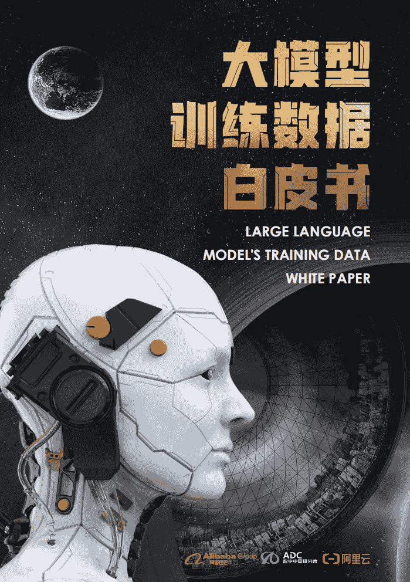

[大模型训练数据白皮书.pdf](https://internal-api-drive-stream.feishu.cn/space/api/box/stream/download/all/PEFGbDzx3opm0ixGWbacTOpBnvh)

与以前的决策类人工智能相比，以大模型为代表的生成式人工智能的技术特征有明显差异。大模型是模拟人类的思维活动方式生成人类可以理解和使用的内容，而训练数据也是基于世界知识，对语料库等知识性内容有强烈需求，因此大模型训练阶段不依赖个人信息等原始数据。此外，为保证生成内容与人类价值观对齐，业界往往利用强化学习，通过纳入人工标注等机制优化表达，使模型生成内容更接近于人类认知。因此大模型对于用户数据并不依赖，而对专业化、高质量语料的知识性内容依赖大。由此看出，随着技术的演进，对训练数据的需求类型也有所不同。

然而，有很多人对此仍存在误解。根据第三方专业机构测评显示，超过 60% 的受访者误选了 “盗取、泄露个人隐私数据的安全风险” 作为大模型的最主要风险点。与一般看法相反，过量的个人数据会负面影响大模型的能力，而过于个性化的应用也将增加大模型的运算负担。对此，OpenAI 负责人 Sam Altman 表示，ChatGPT 不需要用户的个人数据，用户可以选择删除其与 ChatGPT 的交互历史；类似的，我国目前主流大模型在提供用户隐私保护的基础上，并不过度收集和使用用户个人信息，并允许用户控制和删除其与大模型交互的对话和提供的内容。

当然，在大模型的推理阶段，如果用户恶意诱导，尽管有相应的模型安全机制，仍不能完全避免个人信息泄露的问题。但可以明确的是，大模型在训练阶段并不依赖个人信息。