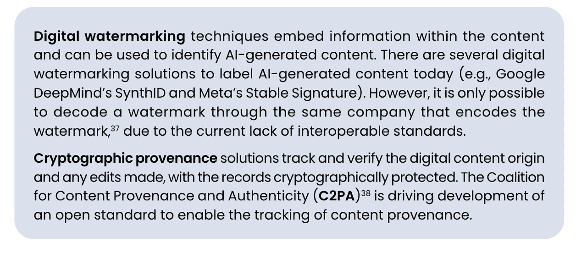

# AI与水印

> 来源：[https://docs.feishu.cn/docx/O3dPdZPJ9opFRmxEI3Vcw3Z6nnd](https://docs.feishu.cn/docx/O3dPdZPJ9opFRmxEI3Vcw3Z6nnd)

AI标识分显式标识和隐式标识，个人感觉隐式标识是G更看重的，直接起到了追溯的能力。清朗行动AI标识已经发了，并且算法备案中其实有对溯源性标识的要求。国标最近可能也要征求意见了，稍微关注下这个吧，清朗行动套深合算法的规定和算法备案自评估的要求，challenge企业隐标没做也合理

AI生成的标识，和隐形水印目的不太一样。一个是为了提醒用户甄别；一个是为了溯源，出问题了可以追责。

DeepMind推出AI水印工具，防篡改能力更强

Douyin（抖音）要求用户在发布任何AI生成内容时应用特定的数字水印，以符合《深度合成管理规定》第17条的要求：https://bbci.magich5page.com/magic/eco/runtime/release/645907a43592e704dcc222be?

美国：

美国七大AI巨头签署协议：为AI生成内容加水印（附公告全文）

AI水印法案诞生！美国COPIED禁止未经授权的大模型数据预训练

[美国AIGC水印法案要点及全文](https://mp.weixin.qq.com/s/pcaZ7jqBeZldE9a00iL8CA)

## 预防AI使用的水印：

AI声音侵权：配音演员的隐秘战争与声音水印的救赎

【技术教程】去除AudioJungle音频水印

字节跳动安全中心-暗水印实践技术分享

腾讯朱雀实验室推出“隐形”水印，助力打击 AI 模型盗取行为，https://www.infoq.cn/article/cC4tKHWfSSgNoZhIjBjs

张凌寒 贾斯瑶，《人工智能生成内容标识制度的逻辑更新与制度优化》

《人工智能生成内容模型的数字水印技术研究进展》

根据现有研究，AIGC数字水印技术主要分为三大类：模型确权水印、生成内容水印和样本保护水印。

+   **模型确权水印**：旨在保护专有大模型的权益，可以分为白盒水印和黑盒水印。白盒水印通常需要访问模型本身，而黑盒水印则不需要。

+   **生成内容水印**：用于追踪版权和预防AIGC内容的潜在危害，包括内生水印和外置水印。内生水印是生成过程的一部分，更为稳固；外置水印则是在内容生成后添加的。

+   **样本保护水印**：确保模型训练样本的可追溯性和安全性，分为验证水印和扰动水印。

Huggingface:人工智能水印技术入门：工具与技巧

OpenAI推AI图片检测工具，AI生成内容将被打上“认证水印”，https://m.thepaper.cn/newsDetail_forward_27296286

1.  多模态合成内容安全标识平台GCmark：浙江大学区块链与数据安全全国重点实验室研发了基于数字水印技术的多模态合成内容安全标识平台GCmark。该平台旨在落实AIGC标识相关法律法规，促进AIGC规范应用，为图片、视频等生成内容提供安全标识。

1.  深度伪造内容检测平台DeepReal2.0：北京科技企业瑞莱智慧发布了一款名为DeepReal2.0的生成式人工智能内容检测平台，能够识别人工智能生成的图像、音视频及大语言模型生成的文本等内容，从而有效打击新型诈骗行为。

1.  OpenAI的AI生成内容识别器：OpenAI推出了一个区分人类作品和AI生成文本的识别工具，尽管其分类器目前的准确性只有26%，但这一工具已经上线并开始使用，用于识别ChatGPT、GPT-3等模型生成的内容。