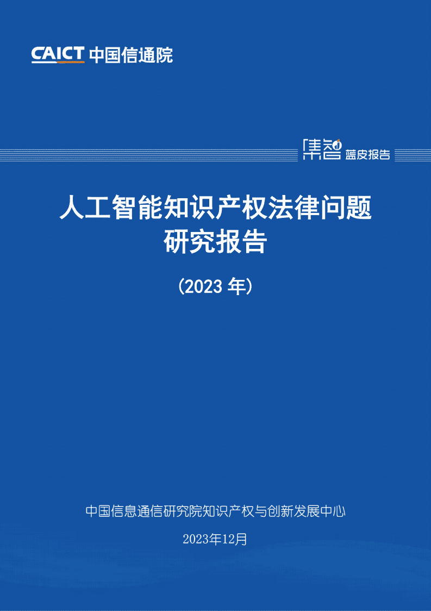

# 知识产权保护

> 来源：[https://docs.feishu.cn/docx/ImOvduRMRobzjUxnMVHcG5c8nKb](https://docs.feishu.cn/docx/ImOvduRMRobzjUxnMVHcG5c8nKb)

[信通院人工智能知识产权法律问题研究报告（2023年）.pdf](https://internal-api-drive-stream.feishu.cn/space/api/box/stream/download/all/Q6EWbkOD5ocbxaxrghHcxNtOngd)

[可令 AI 模型“输入狗生成猫”，黑客展示为训练数据](https://www.youxia.org/2023/10/109167.html)集“下毒”的 Nightshade 工具

马克·莱姆利 | 生成式人工智能如何颠覆版权（中译版），https://mp.weixin.qq.com/s/WKKf40ZthPSCVTWzgSKB-A

美国专利商标局发布《基于人工智能的工具的实践使用指南》

2024年4月11日，美国专利商标局（USPTO）发布《基于人工智能的工具的实践使用指南》，概述了USPTO的现有的政策和规则，讨论了利用人工智能起草提交给USPTO的文件应如何适用这些政策和规则，并提出了与使用人工智能系统有关的保密和国家安全问题。USPTO规定AI使用时应遵守以下规则：（1）文档起草时须遵循USPTO政策和相关义务；（2）AI协助申请人向USPTO提交文件，需要自然人在文件上签名；（3）使用AI访问USPTO IT系统时需遵守法律及政策；（4）使用AI时须注意信息保密及国家安全；（5）USPTO禁止在诉讼程序中或在访问USPTO IT系统时以任何方式（包括AI）进行欺诈或蓄意不当行为，违反者将受法律惩处。

**更多信息：**[http](https://www.federalregister.gov/documents/2024/04/11/2024-07629/guidance-on-use-of-artificial-intelligence-based-tools-in-practice-before-the-united-states-patent)s://www.federalregister.gov/documents/2024/04/11/2024-07629/guidance-on-use-of-artificial-intelligence-based-tools-in-practice-before-the-united-states-patent

| 2024年1月23日 | ICO | Generative AI first call for evidence: The lawful basis for web scraping to train generative Al models | 英国ICO近日发布的关于网络爬取公开数据用于人工智能训练的合法性问题的公开咨询。 | +   翻译：英国ICO：爬取公开数据用于人工智能训练的合法性意见公开征集（洪延青） |
| --- | --- | --- | --- | --- |

### 企业的版权盾实践

[版权盾](https://q2rt76fo46.feishu.cn/wiki/Weh9wFcgrieWkjknl0hcLkOynvd?fromScene=spaceOverview)