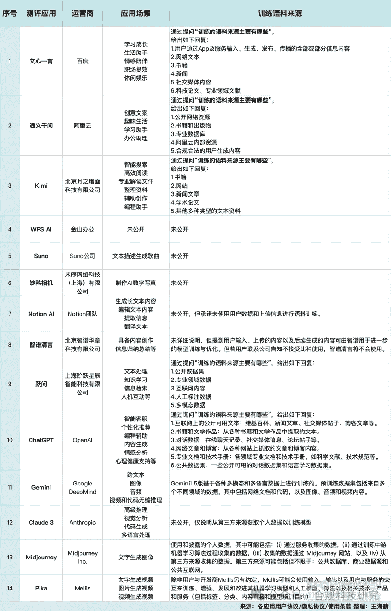
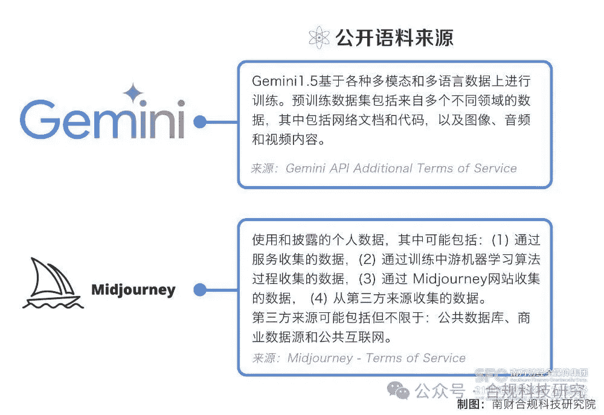

# 知识产权公示义务

> 来源：[https://docs.feishu.cn/docx/Mm7ydjuEJouRzkxDiS1cKGtEn5f](https://docs.feishu.cn/docx/Mm7ydjuEJouRzkxDiS1cKGtEn5f)

## 法律

> 《生成式人工智能服务安全基本要求》 5.2

> b）知识产权方面：

> 1）应设置语料以及生成内容的知识产权负责人，并建立知识产权管理策略；

> 2）语料用于训练前，应对语料中的主要知识产权侵权风险进行识别，发现存在知识产权侵权等问题的，服务提供者不应使用相关语料进行训练；例如，语料中包含文学、艺术、科学作品的，应重点识别语料以及生成内容中的著作权侵权问题；

> 3）应建立知识产权问题的投诉举报渠道；

> 4）应在用户服务协议中，向使用者告知使用生成内容时的知识产权相关风险，并与使用者约定关于知识产权问题识别的责任与义务；

> 5）应及时根据国家政策以及第三方投诉情况更新知识产权相关策略；

> 6）宜具备以下知识产权措施：

> — 公开语料中涉及知识产权部分的摘要信息；

> — 在投诉举报渠道中支持第三方就语料使用情况以及相关知识产权情况进行查询。

## 实例

《[百度、阿里、月之暗面等14款AI应用实测](https://mp.weixin.qq.com/s/-d7sQLxLuRUjzzXPD9hopQ)，哪一款版权保护合格了？｜AI版权战事④》

### 训练数据来源：

