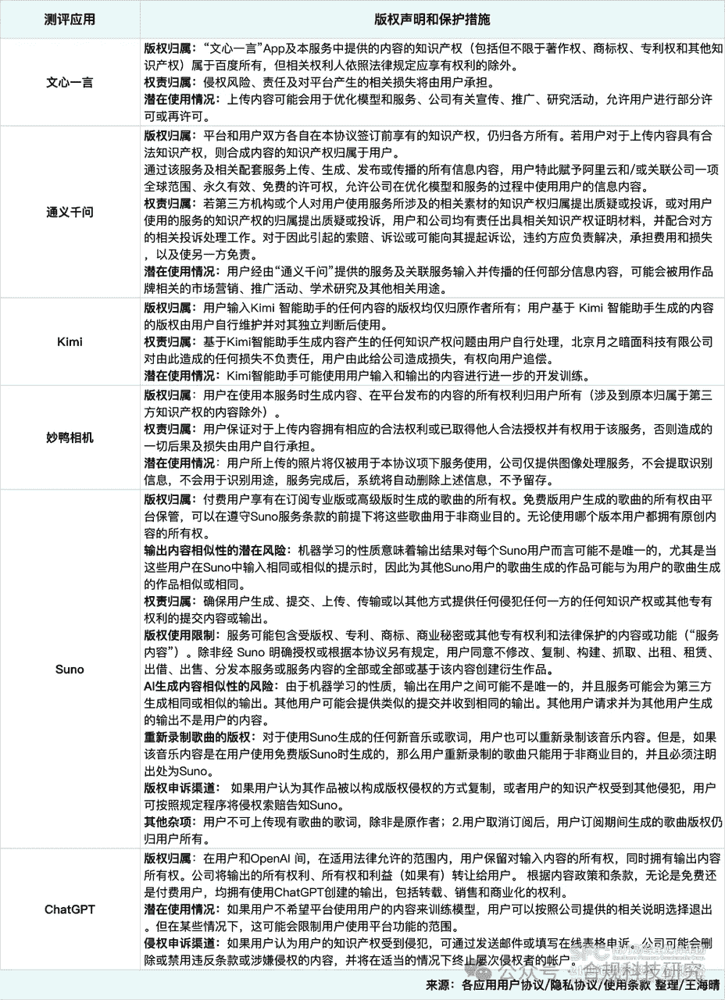
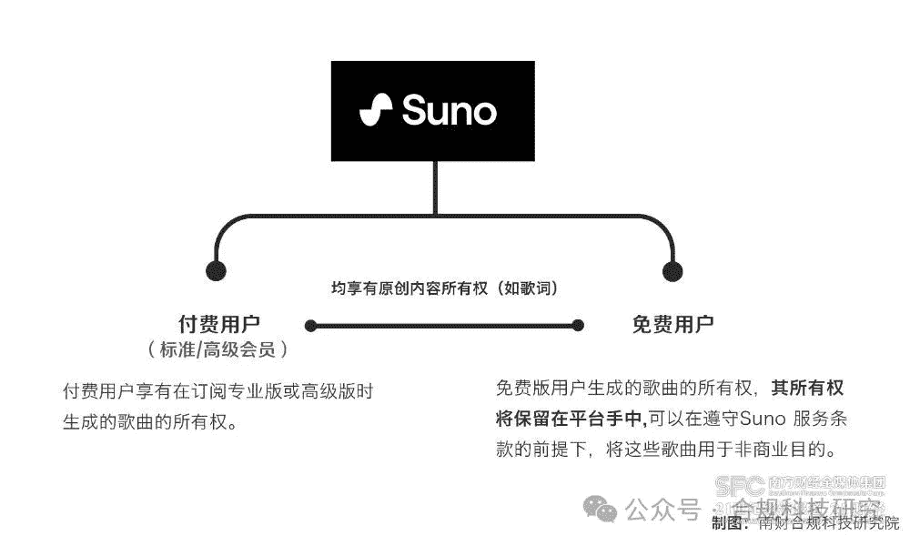

# 生成内容版权归属

> 来源：[https://docs.feishu.cn/docx/AK55dum8DoxBDDxaYBvci1cdnoc](https://docs.feishu.cn/docx/AK55dum8DoxBDDxaYBvci1cdnoc)

## 实例

除了训练语料的具体来源，在本次测评过程中，21记者发现，多数应用也在用户协议或隐私政策中，交代了通过生成式AI应用上传、生成、发布或传播的内容，其版权归属、侵权责任认定，以及应用对用户生成内容的潜在使用情况。

版权**归属方面，有部分应用认定生成内容的版权属于开**发者所有。如文心一言，其用户协议便提到，在App及服务中提供的内容的知识产权属于开发者百度所有，相关权利人依照法律规定应享有权利的除外。另一方面，若用户在使用服务过程中产生了侵权风险，相关责任以及对平台造成的损失则需要用户侧承担。

而在Kimi、Suno、妙鸭相机等应用的用户协议中，对版权归属的划分则更加偏向用户一侧。

如Kimi在其协议中指出，**用**户在应用中输入的任何内容的版权均仅归原作者所有，而用户基于应用生成的内容的版权，由用户自行维护并对其独立判断后使用。

近期大热的音频生成应用Suno，则依照用户付费与否，对两类用户的版权归属进行区分。Suno在平台常见问题FAQ界面中提到，在遵守服务条款的前提下，订阅专业版或高级版的用户，享有付费身份下生成的歌曲的所有权；而用户使用平台提供的免费服务生成的歌曲，其所有权将保留在平台手中，但用户可将这些歌曲用于非商业目的。

与此同时，由于Suno也支持用户上传歌词，创作含人声的歌曲，其在FAQ中也强调，无论是付费或非付费用户，都拥有原创内容的所有权。同时，除歌词版权人外，用户也被明确要求不可上传已公开发布的歌曲歌词，否则将被视为侵权。

AI视频应用Pika在其使用条款中的表述则相对保守。条款中指出，Pika开发商Mellis不主张保管用户在平台内生成内容的所有权，前提是要求用户内容不侵犯、违反或挪用第三方知识产权等各项专有权利。

此外，作为AI写真小程序的妙鸭相机，则直接明确除了归属于第三方知识产权的内容，用户在使用服务时生成内容、在平台发布的内容的所有权利，均归用户方所有。同时，用户需要在使用服务前保证，对于上传内容拥有相应的合法权利，或已取得他人合法授权并有权用于该服务，否则造成的一切后果及损失由用户自行承担。

值得关注的是，一些AI应用还为用户提供了作品侵权的申诉渠道及相关保护措施。Suno、ChatGPT、Pika、Midjourney都提供了用户如遇作品侵权可向平台内进行申诉的渠道，平台将于一定限期内对侵权内容进行处理。其中，Pika和ChatGPT还指出，将对屡次侵权的用户采取终止账户使用权限的措施。