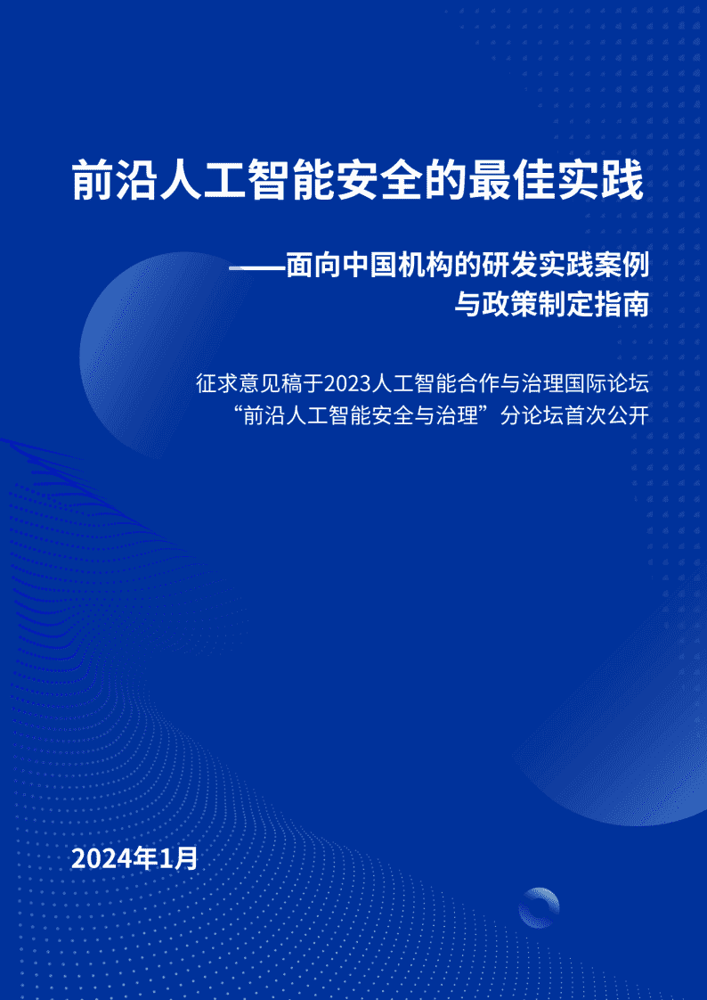
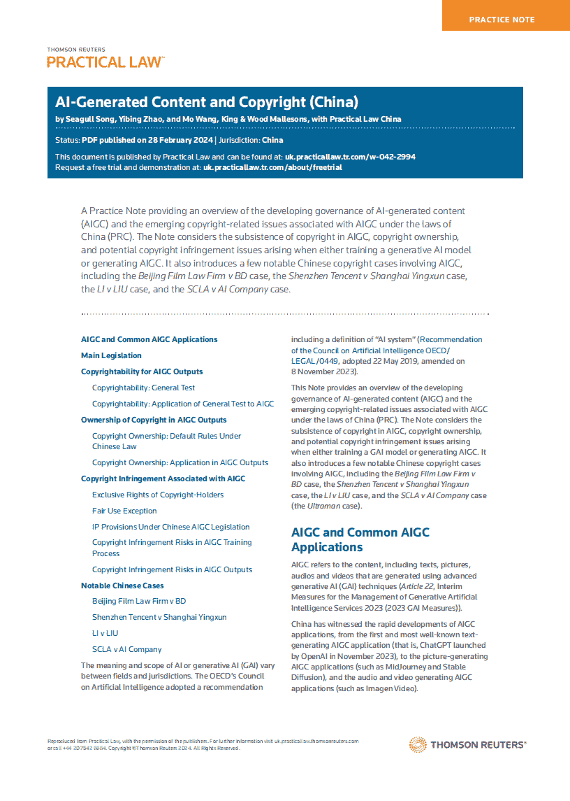
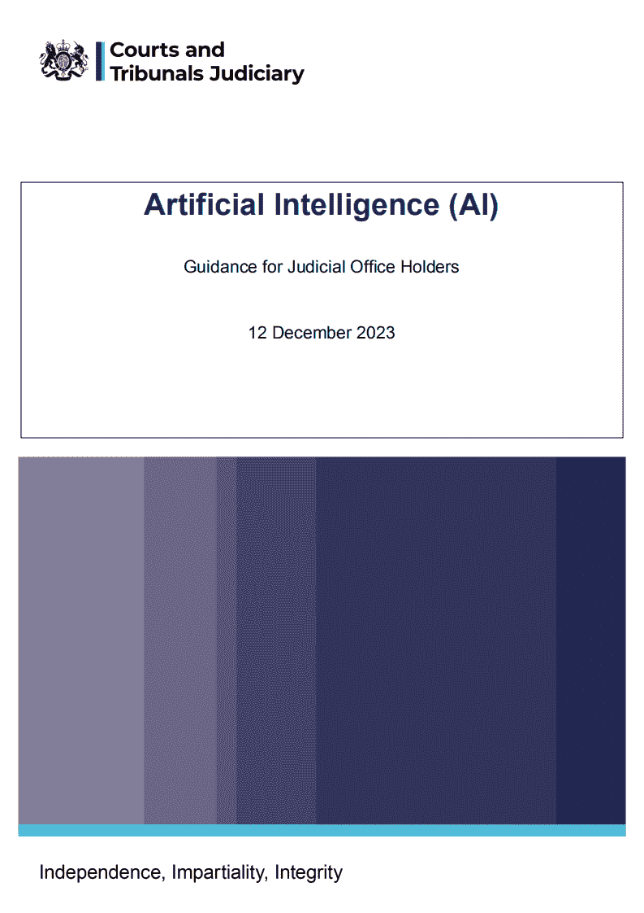
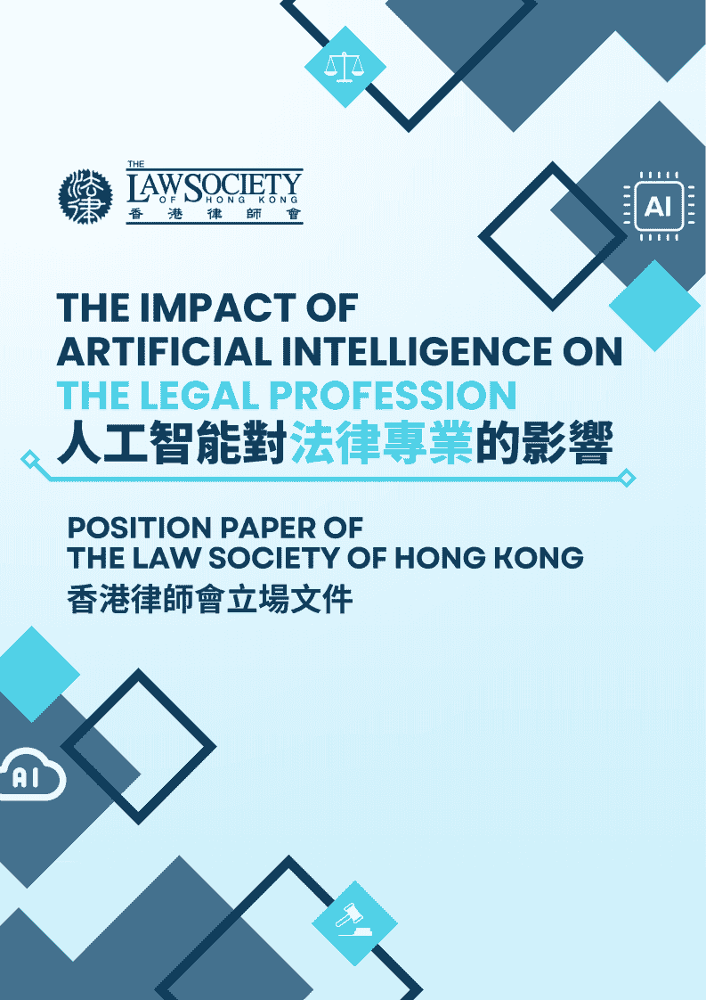

# 学习资料来源推荐

> 来源：[https://docs.feishu.cn/docx/KoYDd1v89oaOQ6xWAgQcp2LrnJg](https://docs.feishu.cn/docx/KoYDd1v89oaOQ6xWAgQcp2LrnJg)

# 一、网站

[网站推荐：AI专题网站](https://s3zdtatd2r.feishu.cn/wiki/WdrpwZjYziXL9Aksj1LcEh2AnZe)Law Hub已经做过一个初步的整理，具体可以参见 。

## 域外法律综述类

想要了解域外地区人工智能监管的概况，推荐两个网站，能够给你带来一个较为全景式的视野。

### **White & Case’s AI Watch: Globa**l regulatory tracker

这是White & Case伟凯律师事务所官网做的一个Al tracker版块，主要梳理不同地区的AI监管有关的内容。

**地址：**https://www.whitecase.com/insight-our-thinking/ai-watch-global-regulatory-tracker?utm_source=linkedin&utm_medium=amplify

### **Chambers：Artifici**al Intelligence 2023

Chmabers每年都会邀请全球各地的律师对本地区的法律进行综述和介绍。2023年新增了人工智能法的板块，包含13个地区。

**地址：**https://practiceguides.chambers.com/practice-guides/artificial-intelligence-2023

## 政策检索类

### **OECD.AI**

这是世界经合组织的网站，在网站的resources - policies项下可以选择不同行业领域的AI法案现状，比如科技+AI、劳动+AI等。在具体行业领域下可以再通过地图选择具体国家，比如科技+AI（美国地区）可以筛选出以下内容。缺点是，不全面，且有些杂乱。不仅包含了纯监管规定，也包含了一些鼓励性政策，所以用起来没有特别方便。

**地址：**https://oecd.ai/en/

## 资讯类

### **IAPP：AI Governance **Dashboard newsletter

IAPP组织了一个周报，免费订阅的。订阅之后，它会每周给你发送一周内全球与AI监管或合规相关的立法、执法动态，以及一些主要企业的动作。主要集中于欧美。还是不错的。

**地址：**https://iapp.org/about/ai-governance-center/

# 二、公众号

由于中国互联网的特性，很多优质内容都会发布在各家的公众号上，所以这构成了学习资料来源的主力。

## 机构资讯类

### **人工智能社会治理协同创新中心**

同济大学法学院牵头成立的研究中心，定期会发表国内外法律的解读、翻译等。

### **AIGverse**

目测应该是一些青年学者合作创办的一个公众号，会发布一些前沿的资讯和自己的研究成果，然后也有一些学者自己的专栏。不过最近好像研究的专栏文章少了很多，hh。

### AI与网络法

姚志伟老师团队的公众号，会分享人工智能领域最前沿的资讯和学者文章，并会对法律、司法案例等材料进行翻译与解读。内容很扎实。姚老师自己的研究也会发布在这个号上，很值得学习。

### 苏州信息安全法学所的智库AI法律报道组

每十天半个月会发布一期“全球AI法律新闻说”，整理全球AI监管资讯。

**地址：**https://mp.weixin.qq.com/mp/appmsgalbum?__biz=Mzg5NTA5NTMzMQ==&action=getalbum&album_id=1710754833793613834&scene=173&subscene=&sessionid=undefined&enterid=0&from_msgid=2247497245&from_itemidx=1&count=3&nolastread=1#wechat_redirect

### 世界人工智能大会“一周AI”

每周会发布人工智能领域届的重要资讯，从非法律的角度看这个领域的发展与变化。

## 个人研究类

### **“送法上网”的人工智能专栏**

史博士的个人号，时不时会更新一些他的研究、翻译。一般内容都挺有意思的，重点是长度都不长，hhh。

**地址：**https://mp.weixin.qq.com/mp/appmsgalbum?action=getalbum&__biz=MzI4MzQwMTQ2MA==&scene=24&album_id=1575680245154807815&count=3&uin=&key=&devicetype=iMac+MacBookPro16%2C3+OSX+OSX+11.7.6+build(20G1231)&version=13080712&lang=zh_CN&nettype=WIFI&ascene=14&fontScale=100

### “那一片数据星辰”的人工智能专栏

朱玲凤老师的个人号，同样干货满满。不仅有对热点法律问题的研究解读，还有对于人工智能生活化场景的观察，很有意思。

**地址：**https://mp.weixin.qq.com/mp/appmsgalbum?__biz=Mzg2NTU1NjgzMQ==&action=getalbum&album_id=3135749414234406919&scene=173&subscene=227&sessionid=1710642259&enterid=1710642264&from_msgid=2247484371&from_itemidx=1&count=3&nolastread=1#wechat_redirect

### **东不压桥研究院**

南极土著老师会时不时对于热点问题作出犀利而又深入的点评，几乎篇篇都能带来十足的知识输入，算是列为必看资料之一。而且南极土著老师经常会从国际竞争/国际法视野入手，相比于单一法域中的分析方法，能带来很多新鲜的观点。

### 礼士蛮

最近突然进入视野的某位大佬（推测）的公众号。公众号里的内容和视角都比较新颖，值得一个推荐位。

…………………………………………………………………………………………………………………………………………………………………………

**待整理：**

刘烨 | 揭开“算法的面纱”:关于构建算法解释框架的思考，https://mp.weixin.qq.com/s/kXI-chiqznmcxZvPSW53RQ

赵精武丨从过程控制到结果归责：算法透明义务与算法问责机制的分野，https://mp.weixin.qq.com/s/niwntEd5cTio0ox0yXLxSA

Hugging Face有一篇Create Reproducible Pipelines，原理讲得不多，但给了可复现Stable Diffusion的完整解决思路。Stable Diffusion和Transformer的可复现性分析都是可实现的，只是做起来确实麻烦。之后如果考虑AIA的GPAI部分，有些内容也算是密切相关

国际数据保护月系列 —— AI 合规是指什么？，https://mp.weixin.qq.com/s/1z2J2TdorLNxyZvOxWOfJA

[前沿人工智能安全的最佳实践——面向中国机构的研发实践案例与政策制定指南-1.pdf](https://internal-api-drive-stream.feishu.cn/space/api/box/stream/download/all/DRJRbX5E1oUPmAxJHkecoxojnNe)

奥睿推出“Gen AI政策生成器” — 为客户提供专业定制的生成式人工智能工具使用政策，https://mp.weixin.qq.com/s/BiQGgUAl7v2hU3NVdHrudA

外交事务：美国的人工智能对华竞争错到离谱，https://mp.weixin.qq.com/s/FQRZj74cZ2s_gPguYpJClQ

[AI-Generated+Content+and+Copyright+(China).pdf](https://internal-api-drive-stream.feishu.cn/space/api/box/stream/download/all/BEM7bELAvoaG5FxgTeNcXgXHnxb)

英国公布司法人员使用AI的官方指南《人工智能司法指南》

[AI-Judicial-Guidance.pdf](https://internal-api-drive-stream.feishu.cn/space/api/box/stream/download/all/URmZbgckRo35x6x982zcX7bHnxT)

香港律师会发布《人工智能对法律专业的影响》立场文件，https://mp.weixin.qq.com/s/75qHVuZAZmWwDWyY2ehAXw

[LSHK Position Paper_AI_TC.pdf](https://internal-api-drive-stream.feishu.cn/space/api/box/stream/download/all/BlvXbG327olYsgxSMDBchs3dnI8)

人工智能工具在整个社会的使用持续增加，其与法院的相关性也在增加。所有司法人员都必须意识到潜在的风险。为此，英国法院系统组织了一个工作组制定并于2023年12月12日发布了《司法人员使用人工智能指南》（AI Guidance for Judicial Office Holders），以帮助法官、法官助理、书记员和其他司法辅助人员使用人工智能。

https://mp.weixin.qq.com/s/_Pdj_pPlI7OsPNsMjW1CWw

重磅|联合国通过首个人工智能全球决议草案（全文），https://mp.weixin.qq.com/s/H8XTGF1R2kf165A0ADRjsg

新加坡发布《关于在AI推荐和决策系统中使用个人数据的咨询指南》

2024年3月1日，新加坡个人数据保护委员会（PDPC）发布了《关于在AI推荐和决策系统中使用个人数据的咨询指南》。该《咨询指南》不具有法律强制力，但在执行《个人数据保护法》时，PDPC 可能会采取与《咨询指南》一致的立场。该《咨询指南》主要包含：如何使用个人数据来训练或开发人工智能，在征求同意时向消费者提供信息的指南，开发人工智能系统的第三方需遵守的义务，以及遵守PDPA要求的实践指南。

**更多信息：**[https://www.pdpc.gov.sg/guidelines-and-consultation/2024/02/advis](https://www.pdpc.gov.sg/guidelines-and-consultation/2024/02/advisory-guidelines-on-use-of-personal-data-in-ai-recommendation-and-decision-systems)ory-guidelines-on-use-of-personal-data-in-ai-recommendation-and-decision-systems