# AI 是什么？

> 来源：[https://docs.feishu.cn/docx/TkPhdO4RvoXHsqx1AR1cOsJ7nPq](https://docs.feishu.cn/docx/TkPhdO4RvoXHsqx1AR1cOsJ7nPq)

参考资料：

+   华西证券研究所，https://pdf.dfcfw.com/pdf/H301_AP202304201585627803_1.pdf

+   南财的AI契约论

+   Google cloud：什么是人工智能，https://cloud.google.com/learn/what-is-artificial-intelligence?hl=zh-cn

+   吴军，《智能时代》

+   吴军，《数学之美》

+   尼克，《人工智能简史》

+   泳鱼，《一文概览人工智能(AI)发展历程》，知乎，https://zhuanlan.zhihu.com/p/375549477

+   【深度好文】AI与深度学习简史【1956-2024】:一文理清AI的前世今生，https://mp.weixin.qq.com/s/wQhTXHqDYCLMmS1NJ_aodQ

+   人工智能发展简史，https://www.aminer.cn/ai-history

+   一文看懂人工智能、机器学习……区别，https://zhuanlan.zhihu.com/p/86794447

+   强烈安利这个科普视频，介绍了什么是机器学习：https://www.bilibili.com/video/BV1tP4y1y7KW/?spm_id_from=333.337.search-card.all.click&vd_source=699d1c8167563e6ed661f6c4380b959f

# 什么是人工智能？

很有趣的推文：https://mp.weixin.qq.com/s/QaDzAORX7Fs4NzquX4SkEw；https://mp.weixin.qq.com/s/1LNIDiXOeLTLUxpjbFSJuw；https://mp.weixin.qq.com/s/KvUWVfP6dQsPNXggEETiJw；

https://mp.weixin.qq.com/s/F0mV42ZkimU_tqGvo3jhdA

很棒的AI人工智能知识库，https://easyai.tech/ai-definition/

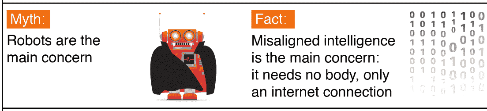

https://futureoflife.org/ai/benefits-risks-of-artificial-intelligence/

**大目标：**从计算机科学出现之时，科学家就开始探讨计算机是否能有“智能”。

1950年，英国科学家艾伦图灵发表了论文讨论创造出具有真正智能的机器的可能性，并提出了著名的图灵测试：如果一台机器能够与人类展开对话而不能被辨别出其机器身份，那么称这台机器具有智能。

扩展人类智能

**小目标：**让计算机能做越来越多的事情 —— 计算机（机器）能够做什么？

机器，办事情，自动化

人工智能是一个构建能够推理、学习和行动的计算机和机器的科学领域，这种推理、学习和行动通常需要人类智力，或者涉及超出人类分析能力的数据规模。

艾伦·图灵的定义可归入"像人类一样行动的系统"类别。

然[而，在这个定义](https://www.csee.umbc.edu/courses/471/papers/turing.pdf)出现之前数十年，人工智能对话的诞生要追溯到艾伦·图灵 (Alan Turing) 于 1950 年出版的开创性作品"计算机器与智能" (PDF, 89.8 KB)（链接位于 IBM 外部）。 在这篇论文中，通常被称为“计算机科学之父”的图灵提出了以下问题：“机器能思考吗？” 他在这篇文章中提供了一个测试，即著名的“图灵测试”，在这个测试中，人类询问者试图区哪些文本响应是计算机做出的、哪些是人类做出的。

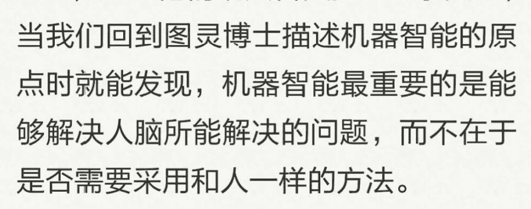

**四个阶段**

1.  **反应式机器**：有限的 AI，仅根据预编程规则对不同类型的刺激做出反应。不使用内存，因此无法通过新数据进行学习。1997 年击败国际象棋冠军加里·卡斯帕罗夫的 IBM 深蓝超级计算机就是反应式机器的一个例子。

1.  **有限内存**：大多数现代 AI 都被视为具有有限内存的 AI。它可以通过使用新数据（通常是通过人工神经网络或其他训练模型）进行训练，从而使用内存随着时间的推移而改进。深度学习是机器学习的一部分，被视为具有有限内存的人工智能。

1.  **心智理论**：心智理论 AI 目前不存在，但研究正在实现其可能性。它描述了可以模拟人类思维并具有与人类相同的决策能力的 AI，包括识别和记忆情感以及在社交场合中像人类一样做出反应。

1.  **自我意识**：自我意识 AI 比心智理论 AI 前进了一步，它描述了一种神秘的机器，这种机器知道自己的存在并具有人类的智力和情感能力。与心智理论 AI 一样，自我意识 AI 目前也不存在。

分为，强人工智能 与 弱人工智能

弱人工智能与通用人工智能（AGI）

弱人工智能 / 窄人工智能（ANI）：因为它只能根据其编程和训练来执行一组范围狭窄的操作。

像人类一样能认知，思考，判断：模拟人类的智能——像人类一样能认知，思考，判断的智能软件。这是人工智能学科一开始就有的梦想。这样的智能也叫做“通用人工智能”（Artificial General Intelligence， AGI）， 或“强人工智能”。

简单分类  —— 至于什么是真正的AGI，吵得不可开交。

# 如何实现智能？

【如何让机器做更多事情】

在人工智能的发展过程中，不同时代、学科背景的人对于智慧的理解及其实现方法有着不同的思想主张，并由此衍生了不同的学派，影响较大的学派及其代表方法如下：

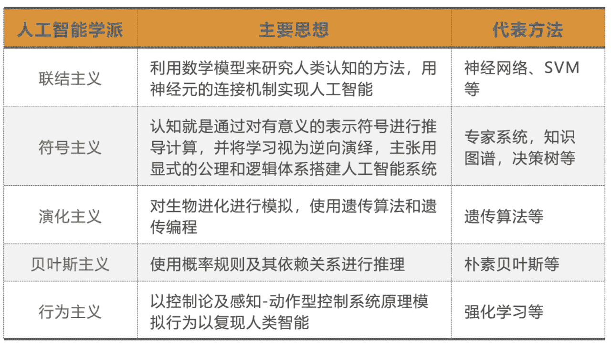

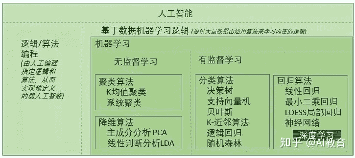

### 感知机

1957年,弗兰克·罗森布拉特（Frank Rosenblatt）在一台IBM-704计算机上模拟实现了一种他发明的叫做“感知机”（Perceptron）的神经网络模型。

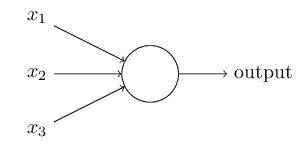

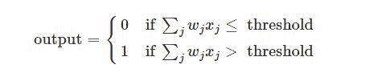

它是一种通过权衡输入信息的重要性来决定你的输出。

就是数学函数

人工智能的统计派或神经网络派和逻辑派或符号派之争是从 1956 年达特茅斯会议开始的。

机器翻译历来是人工智能的试金石之一，就像在 1996 年之前的计算机下棋。机器翻译的早期实践都源于乔姆斯基的理论，但近来的突破却是基于统计的方法。乔姆斯基认为统计的方法不“优雅”（elegant），只是模仿而不是理解。会骑自行车不算理解，对自行车为什么不倒，能说清道理，才算理解。谷歌的研发总监诺维格（Peter Norvig）为统计方法辩护时说：简单的模型（如乔姆斯基理论，以及后来的各种改进版本）不能解决复杂的问题，人工智能的进一步发展必须两条腿走路。

乔姆斯基对人工智能的批评的核心在于“可解释性”。AlphaGo 不能解释自己下棋的路数，算不算会下棋呢？也可以反过来说，只有解释了，人类才能从中得到洞见，学习知识。

### 符号主义

定理证明 —— 自动定理证明机器

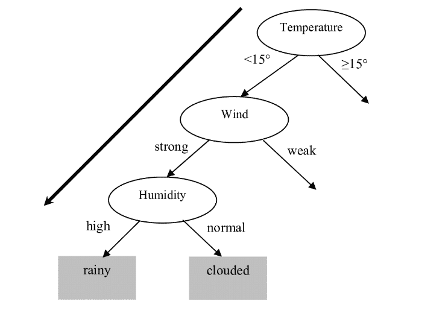

决策树

#### 专家系统

https://web.xidian.edu.cn/xtwang/files/5f87f75526376.pdf

专家系统（Expert Systems）是AI的一个重要分支，同自然语言理解，机器人学并列为AI的三大研究方向。它的定义是使用人类专家推理的计算机模型来处理现实世界中需要专家作出解释的复杂问题，并得出与专家相同的结论，可视作“知识库(knowledge base)”和“推理机(inference machine)” 的结合。

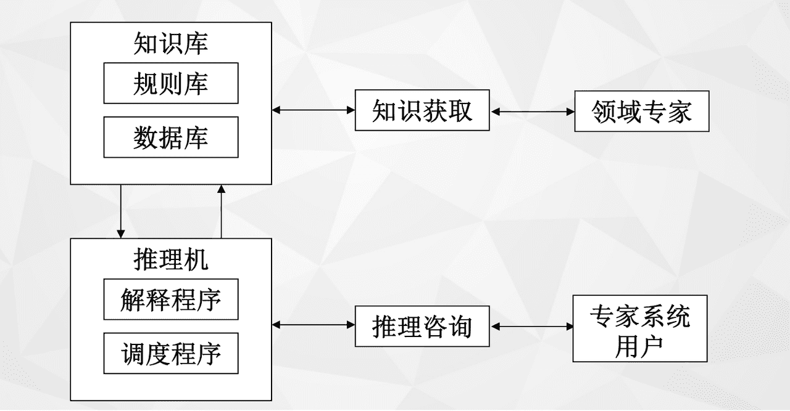

知识库：将知识转化为决策规则；推理机：运算逻辑（算法）

实现专家系统的前提条件： 如何把人类的知识表示成一个计算机程序系统的知识库中的知识 —— 知识表示

**专家系统与机器学习的区别：**

专家系统是人去“读”数据，“理解”数据，继而“抽象”出数据中的规则，进行建模。整个模型从材料到设计到施工都靠人力堆砌。

而后两者是模型在假设空间内，靠模型自身迭代寻找最优解，人只需要提供材料（特征）和结构（模型选择），最后施工由模型自身迭代完成；后两者区别在于一个靠启发式算法求解，一个靠凸优化理论求解。

作者：爱睡觉的KKY

链接：https://www.zhihu.com/question/266615893/answer/395131479

来源：知乎

著作权归作者所有。商业转载请联系作者获得授权，非商业转载请注明出处。

**典型的专家系统案例**

MYCIN：https://zhuanlan.zhihu.com/p/580745886

#### 知识图谱

专家系统的延续

2012年，谷歌正式发布谷歌知识图谱Google Knowledge Graph），它是Google的一个从多种信息来源汇集的知识库，通过Knowledge Graph来在普通的字串搜索上叠一层相互之间的关系，协助使用者更快找到所需的资料的同时，也可以知识为基础的搜索更近一步，以提高Google搜索的质量。

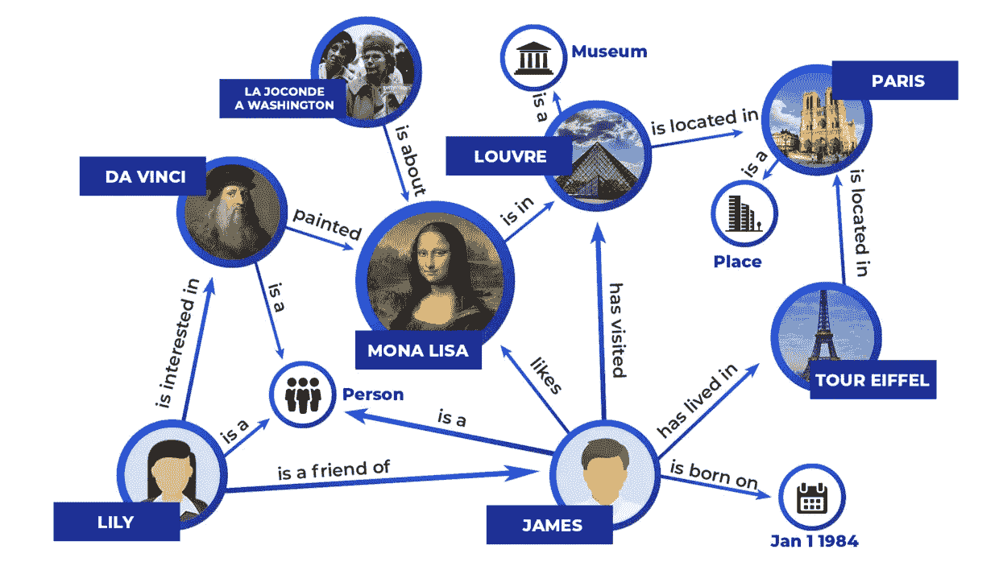

### 连接主义

神经网络

神经网络研究的后一个大突破是在 1957 年。康奈尔大学的实验心理

学家罗森布拉特（Frank Rosenblatt）在一台 IBM-704 计算机上模拟实现了一

种他发明的叫作“感知机”（Perceptron）的神经网络模型。

所谓深度学习就是用很多层神经元构成的神经网络达到机器学习的功能。

如果一层网络是一个函数的话，多层网络就是多个函数的嵌套。

### 机器学习

https://easyai.tech/ai-definition/machine-learning/

**机器学习研究和构建的**是一种特殊算法（而非某一个特定的算法），能够让计算机自己在数据中学习从而进行预测。

数据 + 算法/模型

**机器学习的基本思路**

1.  把现实生活中的问题抽象成数学模型，并且很清楚模型中不同参数的作用

1.  利用数学方法对这个数学模型进行求解，从而解决现实生活中的问题

1.  评估这个数学模型，是否真正的解决了现实生活中的问题，解决的如何？

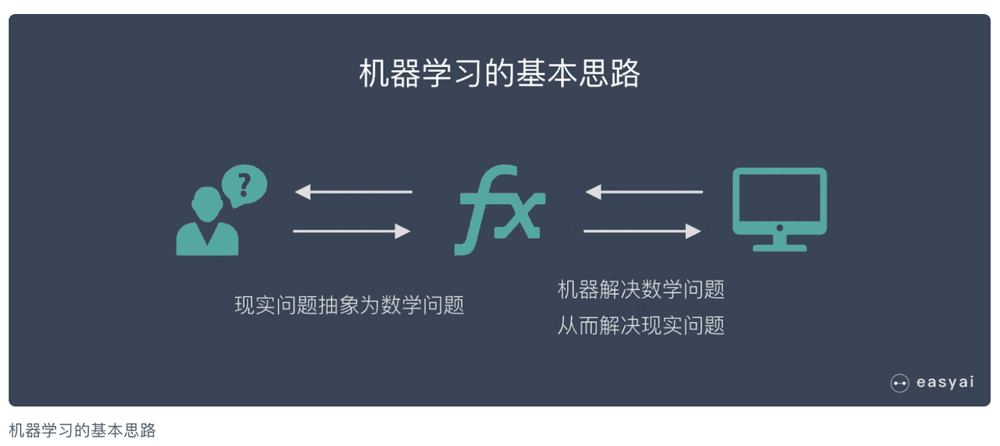

机器学习在实际操作层面一共分为7步：

1.  收集数据

1.  数据准备

1.  选择一个模型

1.  训练

1.  评估

1.  参数调整

1.  预测（开始使用）

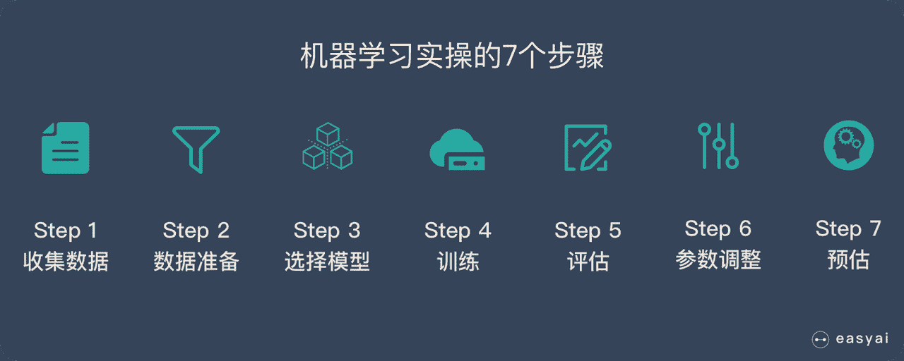

人工智能分阶段，分流派，分不同的技术

产生不同的问题

有限内存人工智能是利用新数据进行训练，进而[随着时间的推移而改](https://cloud.google.com/learn/artificial-intelligence-vs-machine-learning?hl=zh-cn)进的 AI。机器学习是人工智能的一个子集，它使用算法训练数据来获取结果。

机器学习（训练）需要使用到大量的数据。

学习/训练方式：监督式学习；非监督式学习；强化学习。

强化学习和监督学习、无监督学习 最大的不同就是不需要大量的“数据喂养”。而是通过自己不停的尝试来学会某些技能。

**监督学习：**

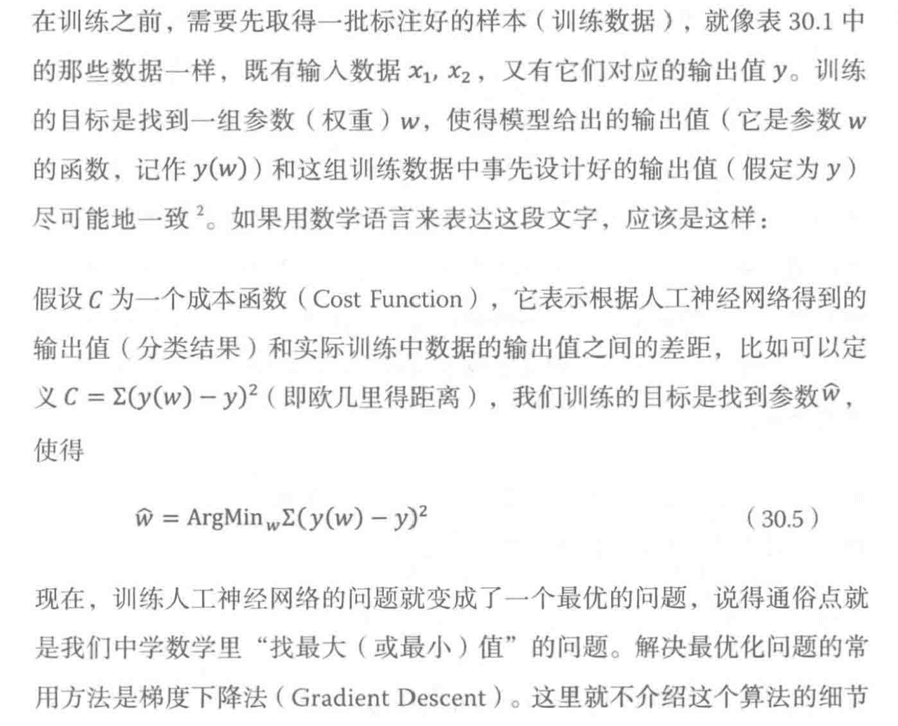

强化学习的最好的例子就是Alpha Go Zero

训练模型 —— 人工神经网络

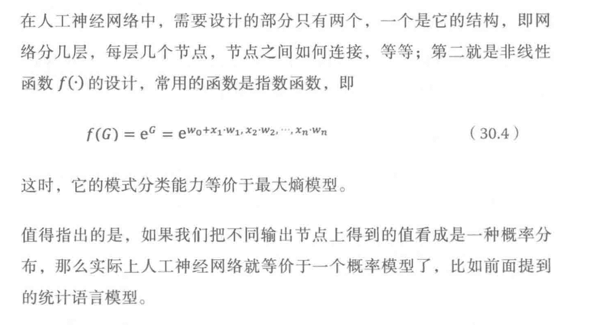

**人工神经网络与贝叶斯网络：**

共同点：

1.  它们都是有向图，每一个节点的取值只取决于前一级的节点，而与更前面的节点无关，也就是说遵从马尔可夫假设。

1.  它们的训练方法相似，这一点从上面的介绍中就能够看出来了。

1.  对于很多模式分类问题，这两种方法在效果上相似，也就是说很多用人工神经网络解决的问题,也能用贝叶斯网络解决,反之亦然但是它们的效率可能会不同。如果把人工神经网络和贝叶斯网络都看成是统计模型，那么这两种模型的准确性也是类似的。

1.  它们的训练计算量都特别大，大家在使用人工神经网络时要有心理准备。

差别：

1.  人工神经网络在结构上是完全标准化的，而贝叶斯网络更灵活Google大脑选用人工神经网络，就是因为看中了它的标准化这一特点

1.  虽然神经元函数为非线性函数，但是各个变量只能先进行线性组合，最后对一个变量（即前面组合出来的结果）进行非线性变换，因此用计算机实现起来比较容易。而在贝叶斯网络中，变量可以组合成任意的函数，毫无限制，在获得灵活性的同时，也增加了复杂性。

1.  贝叶斯网络更容易考虑（上下文）前后的相关性，因此可以解码一个输人的序列，比如将一段语音识别成文字，或者将一个英语句子翻译成中文。而人工神经网络的输出相对孤立，它可以识别一个个字但是很难处理一个序列，因此它主要的应用常常是估计一个概率模型的参数，比如语音识别中声学模型参数的训练、机器翻译中语言模型参数的训练等，而不是作为解码器

找模型，适配数据，找到最适合的模型 —— 机器学习

用多个简单的模型来模拟真实情况，而非直接使用最精确的模型

如果实现，通过大量数据的拟合和修正

对数据的利用在目前人工智能领域有十分重要的地位 —— 数据驱动来解决问题

数据是当今机器智能水平提高的重要支柱

#### 深度学习

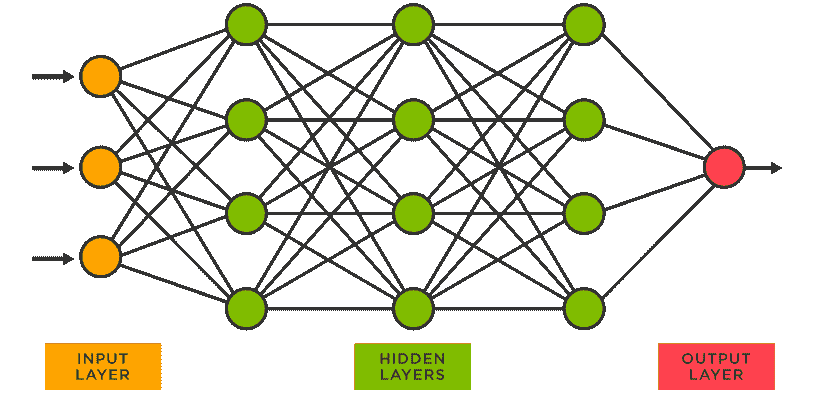

深度学习的概念源于人工神经网络的研究，但是并不完全等于传统神经网络。

不过在叫法上，很多深度学习算法中都会包含”神经网络”这个词，比如：卷积神经网络、循环神经网络。

所以，深度学习可以说是在传统神经网络基础上的升级，约等于神经网络。

传统机器学习的特征提取主要依赖人工，针对特定简单任务的时候人工提取特征会简单有效，但是并不能通用。

深度学习的特征提取并不依靠人工，而是机器自动提取的。这也是为什么大家都说深度学习的可解释性很差，因为有时候深度学习虽然能有好的表现，但是我们并不知道他的原理是什么。

卷积神经网络(CNN)

生成对抗网络（GAN）

残差网络（ResNet）

### 切比雪夫大数定律

这个公式的含义是，当样本数足够多时，一个随机变量(比如观察到的各个年龄段观众的比例)和它的数学期望值(比比如真实情况下所有看电影的观众中不同年龄段的比例)之间的误差可以任意小(小于不等式右边的数值)。

从理论上证明当观察到的数据量足够多了以后，随机性和噪声的影响可以忽略不计。

### 达特茅斯会议

大家对“人工智能”这个词一开始并没取得完全共识。纽厄尔和司马贺一直主张用“复杂信息处理”这个词，以至他们发明的语言就叫 IPL（Information Processing Language）。

1958 年，在英国国家物理试验室（NPL）召开了“思维过程机器化”（Mechanization

of Thought Process）会议，

# 算法

解决问题的方法

简单的说，算法就是：解决问题的手段，并且是批量化解决问题的手段。

菜谱就是一种“算法”，只要按照菜谱的方法做，就能做出对应的菜。

### 什么是算法黑箱

### 哥德尔不完全性定理

大[数学家](https://baike.baidu.com/item/%E5%AE%8C%E5%A4%87%E6%80%A7?fromModule=lemma_inlink)[希尔伯特](https://baike.baidu.com/item/%E5%85%AC%E7%90%86%E7%B3%BB%E7%BB%9F?fromModule=lemma_inlink)[向全世](https://baike.baidu.com/item/%E7%9B%B8%E5%AE%B9%E6%80%A7?fromModule=lemma_inlink)界的数学家抛出了个宏伟计划，其大意是建立一组公理体系，使一切数学命题原则上都可由此经有限步推定真伪，这叫做公理体系的“完备性”；希尔伯特还要求公理体系保持“独立性”（即所有公理都是互相独立的，使公理系统尽可能的简洁）和“无矛盾性”（即相容性，不能从公理系统导出矛盾）。

哥德尔证明：任何无矛盾的公理体系，只要包含初等算术的陈述，则必定存在一个不可判定命题，用这组公理不能判定其真假。也就是说，“无矛盾”和“完备”是不能同时满足的！这便是闻名于世的哥德尔不完全性定理。

每个数学系统都存在一些语句永远无法被证明。

[他证明](https://www.zhihu.com/search?q=%E5%85%AC%E7%90%86%E9%9B%86&search_source=Entity&hybrid_search_source=Entity&hybrid_search_extra=%7B%22sourceType%22%3A%22answer%22%2C%22sourceId%22%3A1346097249%7D)了任何一个你假定的能作为数学基础的公理集都不可避免地是不完备的：总有一些关于数的事实不能被这些公理证明。他还说明甚至没有任何一个候选的公理集能够证明其自身的一致性。

他的不完备定理意味着不存在一个对万事万物皆适用的数学理论，可证明性和正确性也无法统一。数学家可以证明的内容取决于他们的初始假设，而非所有答案所依据的基本事实。

作者：叶青杰

链接：https://www.zhihu.com/question/27528796/answer/1346097249

来源：知乎

著作权归作者所有。商业转载请联系作者获得授权，非商业转载请注明出处。

### 希尔伯特第十问题

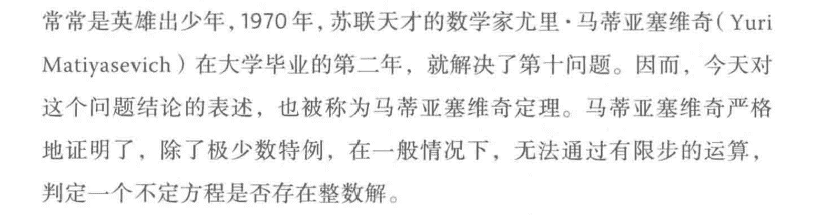

### 人工智能边界

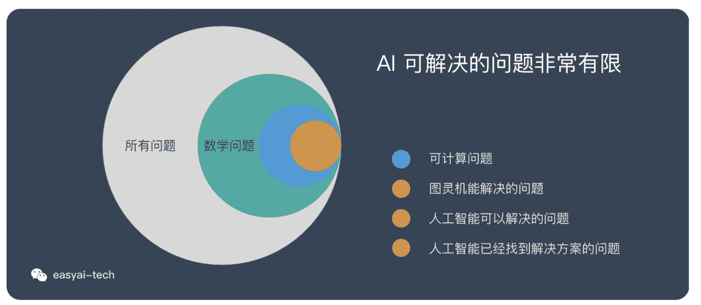

可计算问题

# 人工智能与普通的计算机程序之间的区别？

人工智能是计算机程序的一种。

那么它和普通计算机程序之间的区别是什么？ —— 问题核心在于，我们为什么需要监管AI？需要监管哪些类型的AI？

区别：反正公开网络暂时没有找到。

# 为什么我们需要监管人工智能？

1965年，古德（I. J. Good）发表了一篇对人工智能未来可能对人类构成威胁的文章，可以算“AI威胁论”的先驱。他认为机器的超级智能和无法避免的智能爆炸最终将超出人类可控范畴。后来著名科学家霍金、发明家马斯克等人对人工智能的恐怖预言跟古德半个世界前的警告遥相呼应。

Pause Giant AI Experiments: An Open Letter，https://futureoflife.org/open-letter/pause-giant-ai-experiments/

we must ask ourselves: Should we let machines flood our information channels with propaganda and untruth? Should we automate away all the jobs, including the fulfilling ones? Should we develop nonhuman minds that might eventually outnumber, outsmart, obsolete and replace us? Should we risk loss of control of our civilization?

信息真实性；舆论；失业；机器人的智能超越人类；文明失控

解决方案：人工智能实验室和独立专家应该利用这次暂停，共同开发和实施一套用于高级人工智能设计和开发的共享安全协议，并由独立的外部专家进行严格审计和监督。这些协议应确保遵守它们的系统是安全的，无可置疑

AI 治理系统。这些至少应包括：专门负责 AI 的新的和有能力的监管机构；监督和跟踪高性能人工智能系统和大量计算能力；出处和水印系统，以帮助区分真实与合成并跟踪模型泄漏；强大的审计和认证生态系统；人工智能造成的伤害的责任；为技术人工智能安全研究提供强大的公共资金；以及资源充足的机构来应对人工智能将造成的巨大的经济和政治破坏（尤其是对民主的破坏）。

FIL：policymaking in the phause

国家安全（人工智能被别有用心之人利用）

算法造成的歧视问题

Nations around the world have employed both hard regulation and international consensus to ban the use and development of biological weapons, pause human genetic engineering, and establish robust government oversight for introducing new drugs to the market.

AI被用作武器中 —— 自动武器（autonomous weapon）

2022 年，研究人员表明，一个旨在生成治疗药物的模型可以用来生成新型生化武器。OpenAI 的系统卡片记录了如何提示 GPT-4 诱骗 TaskRabbit 工作人员完成验证码验证。最近，一则悲惨的新闻报道报道了一个人在与 GPT 克隆人“对话”后如何自杀。

OpenAI、Anthropic 和 Deepmind 等实验室领导的公开评论都承认存在这些风险，并呼吁进行监管。

# 哪些地方会出问题？

目前针对ChatGPT为代表的生成式AI监管难题集中在训练模型数据合规、虚假信息治理、“提供者”责任分配等方面。

3月底，在ChatGPT热潮中，美国亿万富翁埃隆·马斯克和人工智能领域顶尖专家、图灵奖得主约书亚·本吉奥等人联名签署了一封公开信，呼吁暂停开发比GPT-4更强大的AI系统至少6个月，称其“对社会和人类构成潜在风险”。

信中连续抛出四个疑问：我们是否应该让机器用宣传和谎言淹没我们的信息渠道？我们是否应该让所有的工作自动化，包括那些令人满意的工作？我们是否应该发展最终可能在数量上超过我们、在智能上超越我们、能够淘汰并取代我们的非人类思维？我们应该冒着失去对我们文明控制的风险吗？

公开信还呼吁开发人员和政策制定者合作，大幅加快强大的AI治理系统的开发。这其中至少应当涉及监管机构、审计和认证系统、监督和追踪高性能AI系统、人工智能造成伤害后的责任问题、为AI技术安全研究提供公共资金等方面。

# 如何规制？

# 算法规制手段

制度 —— 事后转化为问责的依据

1.  信息管理手段

1.  信息披露制度

1.  披露程度从高到低 —— 源代码（美国纽约市2017年的算法法案；加拿大2019年的自动化决策指令）到原理和设计信息

1.  欧盟AP29指南 —— 算法透明

1.  日常监督手段

1.  日常的算法评估制度

1.  算法审计制度

# 结合国家环境和政策，进行监管的地区研究

# 心智

推荐硅谷101的E102期《硅基文明能否取代碳基文明？聊聊AI的心智与数字化生命》