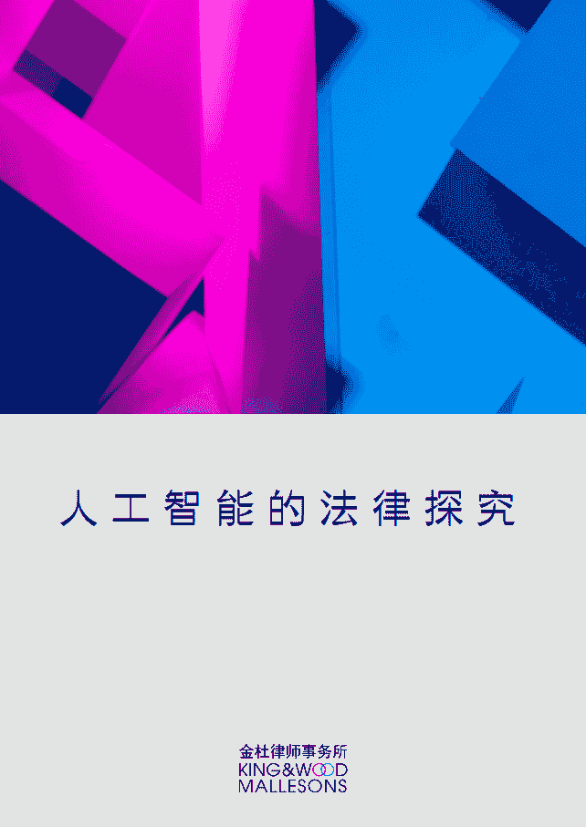

# 文章囤积

> 来源：[https://docs.feishu.cn/docx/ICAXdWeKNoZUXUxmLnOcXHzvnfc](https://docs.feishu.cn/docx/ICAXdWeKNoZUXUxmLnOcXHzvnfc)

重磅！Open AI发布ChatGPT 安全方法，https://mp.weixin.qq.com/s/NV3X1HEEC8_4RNACCCoM9w

抢鲜看：OpenAI CEO国会听证会书面证词中文版，https://mp.weixin.qq.com/s/XOgP08GxGz7S289IKNA6Lw

Huggingface：一张估值20亿的“笑脸”，正在拆掉OpenAI的围墙，https://mp.weixin.qq.com/s/uaIljNnF_TJjOnIzn6o5cw

大规模语言模型（LLMs）的六大风险分析，https://mp.weixin.qq.com/s/sROwmrnGZCVNpxR9fCXPDw

AIGC相关法律问题初探——模型层和应用层，https://mp.weixin.qq.com/s/hsh0fe1QKRF4LFUoT1PqEA

赵精武，王鑫，李大伟，刘艾杉，周号益：ChatGPT——挑战、发展与治理，https://mp.weixin.qq.com/s/zivkcdjdjVv15Kn1Es7IuA

GPT工作原理：面向政策制定和法律规制的介绍【学习笔记】，https://mp.weixin.qq.com/s/Ag4Kfr1Pf6-00cdoSdQSvQ

学术｜张欣：生成式人工智能的算法治理挑战与治理型监管，https://mp.weixin.qq.com/s/UsNewuxNWYD2wnsZVhyNtw

赵精武：生成式人工智能应用风险治理的理论误区与路径转向，https://mp.weixin.qq.com/s/PiRmahs3mb9Fa_lg5w9MeA

中国生成式人工智能内容责任主体规制的不足及完善路径——生成式人工智能内容风险的法律规制系列之一，https://mp.weixin.qq.com/s/hpI6_mkd3IjdjwFSp2hvHA

洪延青，《生成式人工智能服务管理暂行办法》部分安全要求的建议合规要点，https://mp.weixin.qq.com/s/21IQJoe3P4vX3PBm-thL2Q

周维明｜生成式人工智能法律监管的认识误区及匡正，https://mp.weixin.qq.com/s/zUfWwYk9KFNGDeCfFSXqrw

[人工智能的法律探究0424v2.pdf](https://internal-api-drive-stream.feishu.cn/space/api/box/stream/download/all/SWBkbdju3oOGGLxAPqDcd6QYn4g)

### 域外

周雪静｜生成式人工智能国内外监管形式解读，https://mp.weixin.qq.com/s/5vZGlimLF-qTCHLovbMQnA

中欧AI立法同期突破：为ChatGPT设置“红绿灯”？，https://mp.weixin.qq.com/s/nqq3x2-fsFVEb5hiAN5WwA

AI治理的国际实践观察，https://mp.weixin.qq.com/s/OuE8gzPDy6oMqBC0Trv_sw

### 伦理

专题·人工智能安全 | 人工智能伦理审查与监管初探，https://mp.weixin.qq.com/s/DJ6p1yahEyLYHe-ah-s0zg

**The AI Ethics Revolutio****n— A Brief Timeline，https://medium.com/women-i**n-ai-ethics/the-ai-ethics-revolution-a-timeline-276593eef416

### 对齐

AI大模型价值对齐：是什么，为什么，怎么做？，https://mp.weixin.qq.com/s/i5bk4_wrw_zQRs_Ho8vTDQ

### 负责人

迈向负责任 AI：中国 AI 治理趋势与展望，https://mp.weixin.qq.com/s/xhjanAsuV5wbOENdSPdlgw