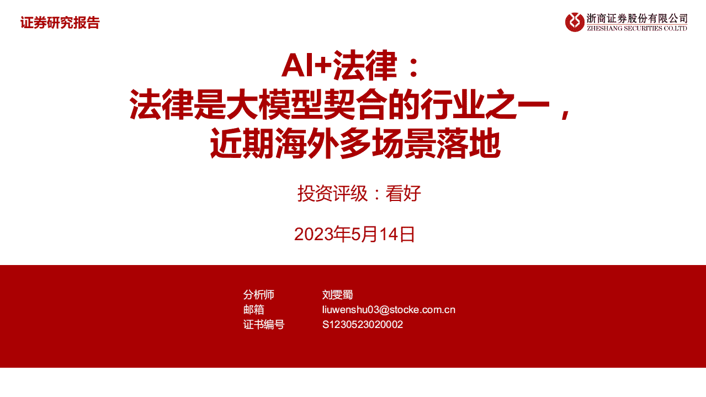

# 参考文献

> 来源：[https://docs.feishu.cn/docx/ZxeHd1tudo9Yrtx8DwOcT2Kfn9b](https://docs.feishu.cn/docx/ZxeHd1tudo9Yrtx8DwOcT2Kfn9b)

很棒的AI人工智能知识库，https://easyai.tech/ai-definition/

《[四万字长文带你了解为什么超级大佬们都如](https://mp.weixin.qq.com/s/dzH0OeNtRKdiCwy9zKvqnA)此警惕人工智能？Ilya到底在害怕什么？》

## 人工智能的历史

+   图灵的计算机与智能：[h](https://blog.csdn.net/qq_40061206/article/details/108782502)ttps://blog.csdn.net/qq_40061206/article/details/108782502

+   达特茅斯会议：[https://zhuanlan.z](https://zhuanlan.zhihu.com/p/378822954)hihu.com/p/378822954

## 人工智能的技术

### 神经网络

+   A neural network playground,

[https://playground.tensorflow.org/#activation=tanh&batchSize=10&dataset=circle&regDataset=reg-plane&learningRate=0.03&regularizationRate=0&noise=0&networkShape=4,2&seed=0.20307&showTe](https://playground.tensorflow.org/#activation=tanh&batchSize=10&dataset=circle&regDataset=reg-plane&learningRate=0.03&regularizationRate=0&noise=0&networkShape=4,2&seed=0.20307&showTestData=false&discretize=false&percTrainData=50&x=true&y=true&xTimesY=false&xSquared=false&ySquared=false&cosX=false&sinX=false&cosY=false&sinY=false&collectStats=false&problem=classification&initZero=false&hideText=false)stData=false&discretize=false&percTrainData=50&x=true&y=true&xTimesY=false&xSquared=false&ySquared=false&cosX=false&sinX=false&cosY=false&sinY=false&collectStats=false&problem=classification&initZero=false&hideText=false

### 自然语言处理（NLP）

+   [自然语言处理 NLP 发展简史](https://www.oschina.net/news/117939/history-of-nlp)

+   Eliza：https://www.masswerk.at/elizabot/

+   [了](https://blog.csdn.net/qq_41458274/article/details/127175228)解语言模型Model Language，NLP必备：https://blog.csdn.net/qq_41458274/article/details/127175228

### Stable Defusion

+   编年史：[https://zhuanlan.z](https://zhuanlan.zhihu.com/p/651613931)h[ihu.com/p/651613931；h](https://www.51cto.com/article/745026.html)t[tps://www.51cto.com/article/745](https://cloud.tencent.com/developer/article/2286452)026.html；https://cloud.tencent.com/developer/article/2286452

+   视频：https://zhuanlan.zhihu.com/p/624458233

### Transformer

[https://zhuanlan.z](https://zhuanlan.zhihu.com/p/338817680)hihu.com/p/338817680

### 大语言模型介绍

[https://zhuanlan.z](https://zhuanlan.zhihu.com/p/622518771)hihu.com/p/622518771

### 多模态学习介绍

[h](https://imzhanghao.com/2022/10/27/multimodal-learning/)ttps://imzhanghao.com/2022/10/27/multimodal-learning/

### Deepmind

https://36kr.com/p/2179433920293123

算法黑箱：

《一文读懂“黑盒”大模型的可解释性》

### 法律 x 大模型：

+

[浙商证券-AI+法律行业：法律是大模型契合的行业之一，近期海外多场景落地-230514.pdf](https://internal-api-drive-stream.feishu.cn/space/api/box/stream/download/all/MP7NblNbAojUvQxfnXLc9lIvn3y)

+   ChatLaw法律大模型

+   官网地址：https://www.chatlaw.cloud/

+   论文地址：https://arxiv.org/pdf/2306.16092.pdf

+   GitHub 地址：https://github.com/PKU-YuanGroup/ChatLaw

### 书籍资料：

《生命3.0》电子书链接：https://pan.baidu.com/s/19eyQ8qCNZc-AKhsJr69KMQ 提取码: vxnw

《千脑智能》电子书链接： https://pan.baidu.com/s/1RlWcFmePRW26XBlRRdE1ag 提取码: we8u

《AI 3.0》电子书链接： https://pan.baidu.com/s/1Zyn51xfKfBiNYP8MQRDJ4w 提取码: nwu4

《元宇宙与数字经济》电子书链接： https://pan.baidu.com/s/1gxejdPhe_xceNJnHIqyTxg 提取码: 5b97

《AIGC：智能创作时代》电子书链接：https://pan.baidu.com/s/11PE_U2u4a8UYIGeFc5LM-w 提取码: 1f6m

《第二次机器革命》电子书链接： https://pan.baidu.com/s/1Md7sDTpxFxUv4XVdrAoEWg 提取码: pczp

《人工智能简史》电子书链接：https://pan.baidu.com/s/1vDduSumonN0j6NwEwMPQCA 提取码: b75m

《AI极简经济学》电子书链接： https://pan.baidu.com/s/1e_rFNvj2-xy-nNj9_c3w7A 提取码: fwpn

《深度学习革命》电子书链接：https://pan.baidu.com/s/1hJVfNaxb22I5cpnL6D9DFg 提取码: s4r3

《AI新生：破解人机共存密码——人类最后一个大问题》

电子书链接：https://pan.baidu.com/s/1MmoQVM9aco7R0gcSXqdfUQ 提取码: rfea

《人工智能（第4版）：现代方法》电子书链接：https://pan.baidu.com/s/16PZulc1WJybwLSs92Yqg-A 提取码: snev

### 其他材料

1.  **《Moore's Law for Eve**rything（万物摩尔定律）》【必看】

> OpenAI 的创始人 Sam 的文章“万物摩尔定律”在探讨AI的技术革命会给未来带来什么变化。

> 简单来说，**他**认为AI会逐渐取代人类的工作，将商品中劳动力和服务的成本降低甚至归零，进而大幅降低商品的成本，提高购买力。

> 不过，我认为信息革命的最后，会受到能源的限制，在能源没有大突破的情况，很可能是造成了更大的两极分化。有了能源革命，才可能会有更大的突破。下一期（《鹅库2310｜AI 革命的畅想终会遇到能量的瓶颈》）松鹅来写写这里的想法。

> ——《鹅库2309｜从 Tiktok 听证想到 AIGC》

1.  《State of GPT（GPT的现状）》【必看】

演讲者 Andrej 是 OpenAI 的创始成员，在微软的 Build 大会上仔细讲了 GPT 的情况，每个流程，由浅入深，40 分钟非常值得。

不知道这个稿子会不会是“让 GPT 给高中生解释 GPT 的原理”来的。

原视频地址（B 站有字幕版）：

https://build.microsoft.com/en-US/sessions/db3f4859-cd30-4445-a0cd-553c3304f8e2

1.  《压缩下一个Token——通向超过人类的智能》

如果已经对 GPT 的原理有一些大概的理解，想要有更深刻更抽象的理解，可以看这篇关于“压缩”的文章。

原文地址：

https://zhuanlan.zhihu.com/p/619511222

1.  《为什么所有GPT-3复现都失败了？使用ChatGPT你应该知道这些》

> OpenAI 发布了 ChatGPT 以后，大家都在好奇究竟有多大的差距。这篇文章仔细分析了有哪些可能的原因导致目前所有 GPT-3 的复现都没有达到预期的效果。

> 文章也列举了有哪些任务适合 GPT-3，有哪些不适合。我们的想象力很丰富，但在最终落地的场景上效果如何，以及选择大模型是不是商业上合理的选择（边际成本过高等）还都是疑点。

> ——《鹅库2305｜AI 会修改自己的代码吗？》

5. 《人工智障 2 : 你看到的AI与智能无关》

> **这是一篇2019年1月份的旧文**，到现在已经过去了四年。就像我之前说的一样，那个时候大家完全没看到AGI出现的可能，所有的人工智能都是建构在产品经理定的一条条规则之上。时间到了现在，有很多事情变化了，重新读这篇文章很有意思。

> 这篇文章写的很不错，神奇是10w+的文章，居然只有1个朋友读过，不确定是不是公众号的Bug...

> ——《鹅库2306｜语言本就贫瘠，它只是思维的投影》

### Prompt Engineering

1.  OpenAI 官方《GPT最佳实践》

OpenAI 官方推荐的 Prompt 指南，OpenAI 本身也是对 Prompt 理解最深刻、对 AI 能力使用最多的公司。有很多有价值的建议

地址：

https://platform.openai.com/docs/guides/gpt-best-practices

1.  吴恩达的《ChatGPT Prompt Engineering》

吴恩达在机器学习领域的资料质量都很不错，在本科的时候就已经看过他的一些课程了。B 站有字幕版本。

原视频地址：

https://www.deeplearning.ai/short-courses/chatgpt-prompt-engineering-for-developers/

### **文章合集**

1.  **通往AGI之路**

这个资料集可能是我看到的覆盖最广的一个合集了，整理在飞书文档上，推荐收藏。

http://waytoagi.com/

1.  Long Form Reads @Dan Hock

Dan 整理了科技和商业很多经典的文章，值得多花一些时间看看。

https://www.danhock.com/long-form-reads

1.  GPT/AIGC/LLM/NLP/ChatGPT 学习笔记 @遥行

前两周一个偶然的机会在线下遇到了遥行，聊到一半，他突然掏出手机流畅地打开了一个文章，给我看了下面这张图，当时一个大震惊。把相关主题的内容都整合在了一起，是一个大资料包。

https://gofurther.feishu.cn/docx/Enofdl25BotoVrxth8ec4rNBn5c

重磅！Open AI发布ChatGPT 安全方法，https://mp.weixin.qq.com/s/NV3X1HEEC8_4RNACCCoM9w

抢鲜看：OpenAI CEO国会听证会书面证词中文版，https://mp.weixin.qq.com/s/XOgP08GxGz7S289IKNA6Lw

Huggingface：一张估值20亿的“笑脸”，正在拆掉OpenAI的围墙，https://mp.weixin.qq.com/s/uaIljNnF_TJjOnIzn6o5cw

大规模语言模型（LLMs）的六大风险分析，https://mp.weixin.qq.com/s/sROwmrnGZCVNpxR9fCXPDw

AIGC相关法律问题初探——模型层和应用层，https://mp.weixin.qq.com/s/hsh0fe1QKRF4LFUoT1PqEA

赵精武，王鑫，李大伟，刘艾杉，周号益：ChatGPT——挑战、发展与治理，https://mp.weixin.qq.com/s/zivkcdjdjVv15Kn1Es7IuA

GPT工作原理：面向政策制定和法律规制的介绍【学习笔记】，https://mp.weixin.qq.com/s/Ag4Kfr1Pf6-00cdoSdQSvQ

学术｜张欣：生成式人工智能的算法治理挑战与治理型监管，https://mp.weixin.qq.com/s/UsNewuxNWYD2wnsZVhyNtw

赵精武：生成式人工智能应用风险治理的理论误区与路径转向，https://mp.weixin.qq.com/s/PiRmahs3mb9Fa_lg5w9MeA

中国生成式人工智能内容责任主体规制的不足及完善路径——生成式人工智能内容风险的法律规制系列之一，https://mp.weixin.qq.com/s/hpI6_mkd3IjdjwFSp2hvHA

洪延青，《生成式人工智能服务管理暂行办法》部分安全要求的建议合规要点，https://mp.weixin.qq.com/s/21IQJoe3P4vX3PBm-thL2Q

周维明｜生成式人工智能法律监管的认识误区及匡正，https://mp.weixin.qq.com/s/zUfWwYk9KFNGDeCfFSXqrw

[人工智能的法律探究0424v2.pdf](https://internal-api-drive-stream.feishu.cn/space/api/box/stream/download/all/D4dcbUGezoOJkhxliHUcU3UPnie)