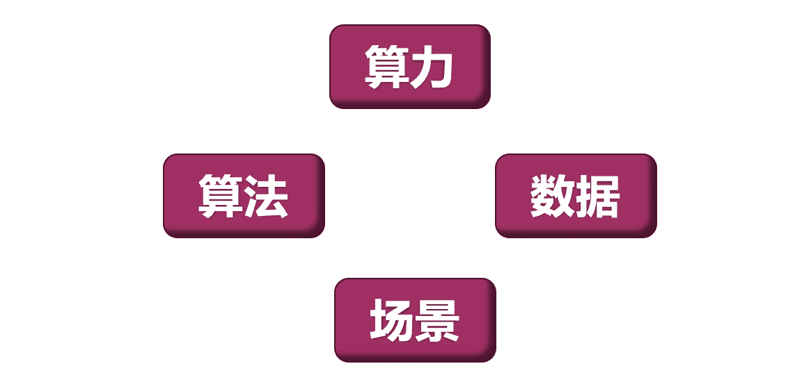

# 人工智能治理知识库

# 人工智能治理体系

> 来源：[https://docs.feishu.cn/docx/QqzfdSKdlokroBxxPUsctYrinMh](https://docs.feishu.cn/docx/QqzfdSKdlokroBxxPUsctYrinMh)

对于人工智能治理体系的两个判断：

1.  人工智能治理体系：大治理（伦理、技术、安全、法律）和小治理（法律治理）都是一个多模块的体系。不会像民法的潘德克顿体系一样，从一个枝丫上开枝散叶，而一定是多个模块同时发力，在各自领域内。

1.  各国都会有自己的人工智能，也会有自己的标准和要求。区域性色彩会愈发浓厚。要不要管。哪些要管。怎么管。各国都会有自己的答卷。

### 1、人工智能的结构要素

PS：朱悦老师的拆解：（1）数据，基准，表征；（2）模型架构和训练；（3）模型部署和推理

