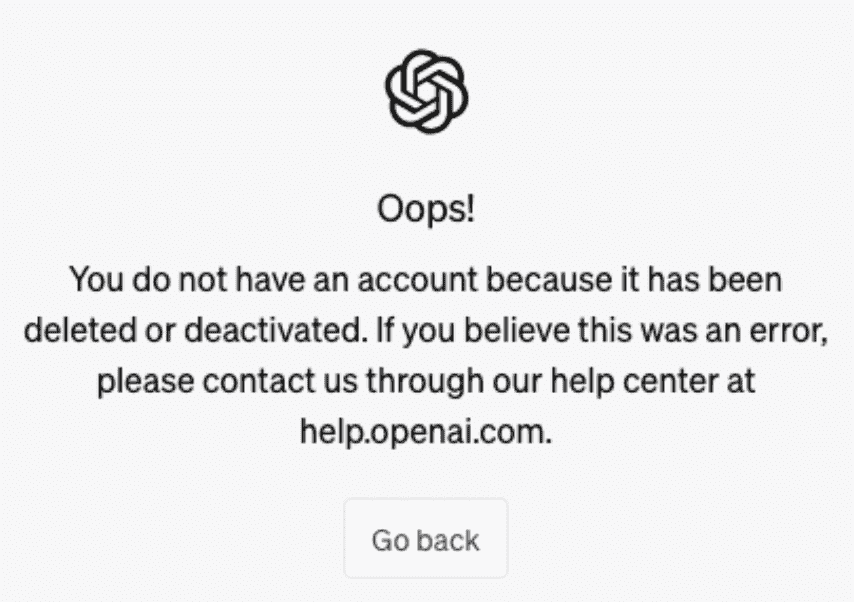
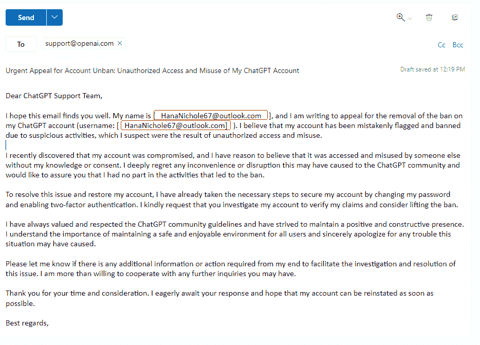
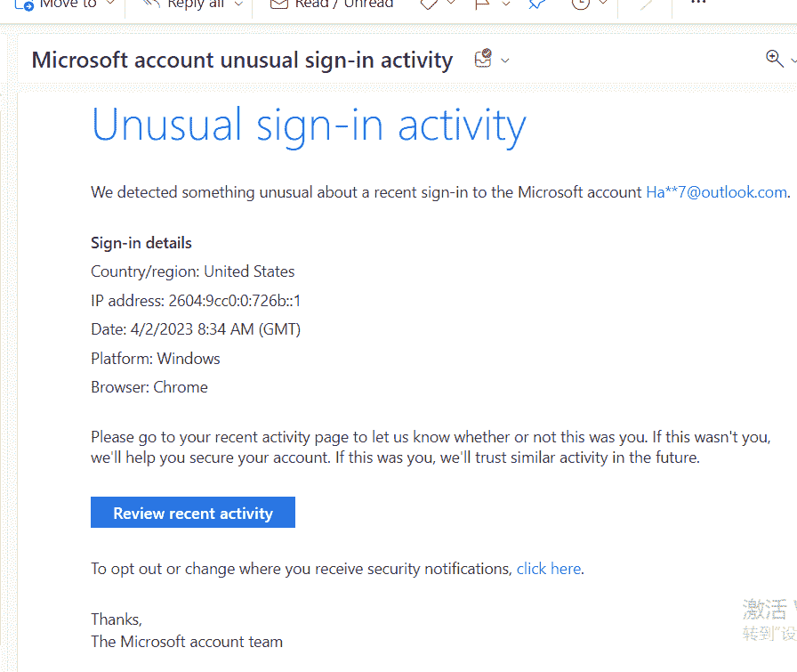
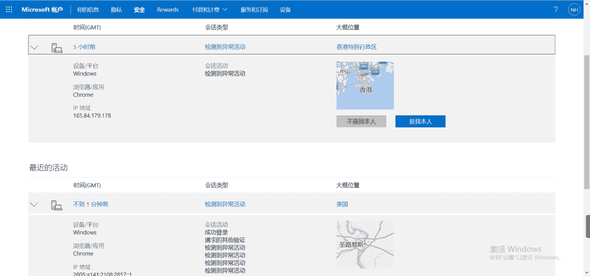
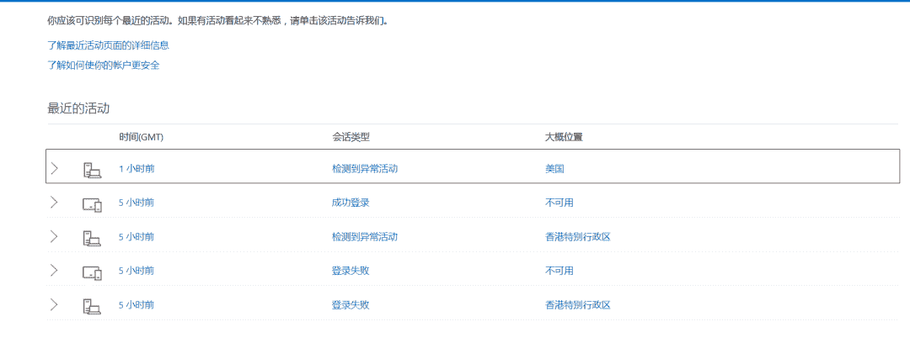
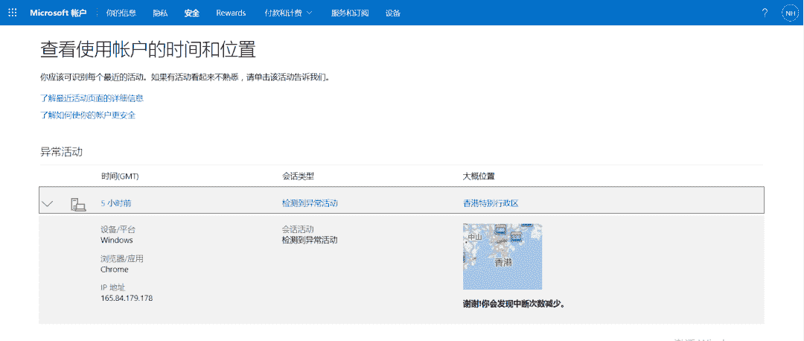

# 5、ChatGPT 账号解封教程

> 来源：[https://my.feishu.cn/docx/Zrpdd8U3Ao5Vv8xqmt9cB2qNn0c](https://my.feishu.cn/docx/Zrpdd8U3Ao5Vv8xqmt9cB2qNn0c)

账号封禁状态：

# 解封操作：

## 第一步：需要写封邮件告诉官方这是误会

•

把邮箱账号和姓名复制到中英文模板

•

登录其他的邮箱，利用这个邮箱发送模板到需要申诉的邮箱：support@openai.com

信件中文内容：

主题：紧急呼吁解禁帐户：未经授权访问和滥用我的 ChatGPT 帐户

亲爱的 ChatGPT 支持团队

我希望你能收到这封电子邮件。我的名字是[你的邮箱名字]，我写信是希望取消对我的 ChatGPT 帐户（用户名：

[你的邮箱名字]）的禁令。我认为我的帐户因可疑活动而被错误标记和禁止，我怀疑这是未经授权访问和滥用的结

果。

我最近发现我的帐户遭到入侵，我有理由相信它在我不知情或未同意的情况下被其他人访问和滥用。我对这可能给

ChatGPT 社区造成的任何不便或中断深表歉意，并向您保证我没有参与导致禁令的活动。

为解决此问题并恢复我的帐户，我己采取必要步骤通过更改密码和启用双因素身份验证来保护我的帐户。我恳请您

调查我的帐户以核实我的说法并考虑解除禁令。

我一直重视并尊重 ChatGPT 社区准则，并努力保持积极和建设性的存在。我理解为所有用户维护一个安全和愉快

的环境的重要性，并对这种情况可能造成的任何麻烦深表歉意。

如果我需要任何其他信息或采取任何行动以促进调查和解决此问题，请告诉我。我非常原意配合您的任何进一步询

问。

感谢您的时间和考虑。我热切地等待您的回复，并希望我的帐户能尽快恢复。

此致

敬礼

当然发送的时候最好是英文版的：（复制不了可在本文最下方下载获取）

> Subject:Urgent Appeal for Account Unban:Unauthorized Access and Misuse of My ChatGPT

> AccountDear ChatGPT Support Team,

> hope this email finds** you well.M**y name is[Your Name], andl am writing to appeal for the

> removal**of the** ban on my ChatGPT account（username:[邮箱地址]）。l believe that my

> account has been mistakenly flagged and banned due to suspicious activities, which I suspect were

> the result of unauthorized access and misuse.

> I recently discovered that my account was compromised,and I have reason to believe that it was

> accessed and misused by someone else without my knowledge or consent. I deeply regret any

> inconvenience or disruption this may have caused to the ChatGPT community and would like to

> assure you that I had no par tin the activities that led to the ban.

> To resolve this issue and restore my account, I have already taken the necessary steps to secure my

> account by changing my password and enabling two-factor authentication.kindly request that you

> investigate my account to verify my claims and consider lifting the ban.

> I have always valued and respected the ChatGPT community guidelines and have strived to maintain

> apositive and constructive presence. I understand the importance of maintaining a safe and

> enjoy ableenvironment for all users and sincerely apologize for any trouble this situation may have

> caused.

> Please let me know if there is any additional information or action required from my end to facilitate

> the investigation and resolution of this issue. I am more than willing to cooperate with any further

> inguiries you may have.

> Thank you for your time and consideration. I eagerly await your response and hope that my account

> can be reinstated as soon as possible.

> Best regards

## 第二步：等待官方回复

让你确认你的活动轨迹，这个时候，你要告诉官方，这个绝壁是一个骗局，请官方爸爸给条条活动路。

收到这个邮件，兄弟们淡定的点进去，有一个地图，是香港的 IP

大家懂得，🪜不稳定就会出现节点变化的情况，点进去地图你就知道了，有香港的 IP 记录

## 第三步：官方二次交涉

让你确认你的活动轨迹，明确告诉官方，未曾使用过香港 IP，不知道为什么会被检测到，请官方明鉴并给予解封。

二次交涉需要多次发送请求，可以用 Ch©tGPT 帮你生成 3 封解封邮件，分时多次投递给官方邮箱，情节不严重的一

般 3 次就可以顺利解封，邮件参考内容如下。

主题：我从未使用过香港的 IP 地址，请官方给予解封

尊敬的客服：

我发现我的 Chatgpt 账户被封了，但是我向您保证，我从未使用过香港的 IP 地址。我非常确定我未曾使用过该地区

的 IP 地址，并且我一直遵守着 Chatgpt 的规定和要求。我非常重视我的账户和与 Chatgpt 的合作，因此我希望能够

得到官方的支持和帮助，以解决这个问题。

我需要官方对账户封禁的原因进行明确说明，同时也希望能够尽快解封我的账户。我相信，这个问题是可以通过有

效的沟通和合作来解决的。

谢谢您的耐心阅读，期待您的回复。

此致

敬礼

当然发送的时候最好是英文版的：（复制不了可在本文最下方下载获取）

> **[你的邮箱]**

> I have never used an IP address from Hong Kong.Please unblock my account as soon as possible.

> Respected Customer Service,

> I have discovered that my Chatgpt account has been blocked, but I assure you that I have never used

> an IP address from Hong Kong. I am positive that I have never used an IP address from that region,

> and I have always followed the rules and requirements of Chatgpt. I value my account and the

> partnership with Chatgpt,and I hope to receive your support and assistance in resolving this issue.

> I need an explanation from the company as to why my account has been blocked,and I also hope

> that my account can be unblocked as soon as possible. I believe that this issue can be resolved

> through effective communication and cooperation.

> Thank you for your time and attention to this matter. I look forward to hearing back from you soon.

> Sincerely.

> **[Your Email]**

> 邮件信息下载👇🏻

夸克云盘下载（链接跳转或扫码下载）

我用夸克网盘分享了「ChatGPT 解封邮件。txt」，点击链接即可保存。打开「夸克 APP」在线查看，支持多种文档格式转换。

链接：https://pan.quark.cn/s/19e1dfbae672

