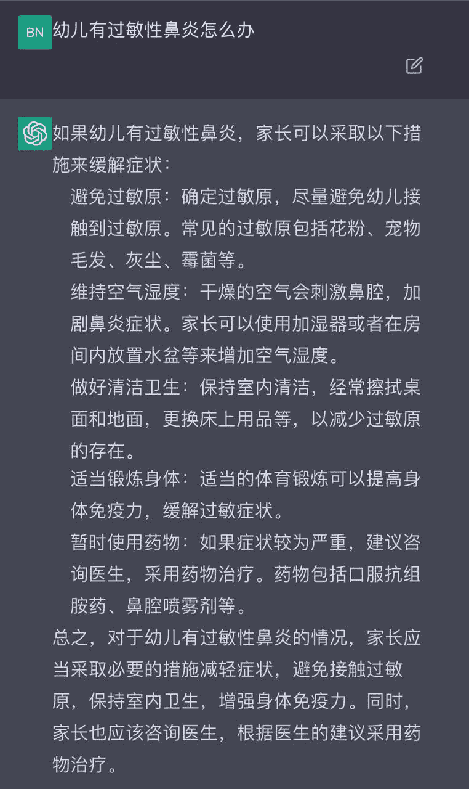
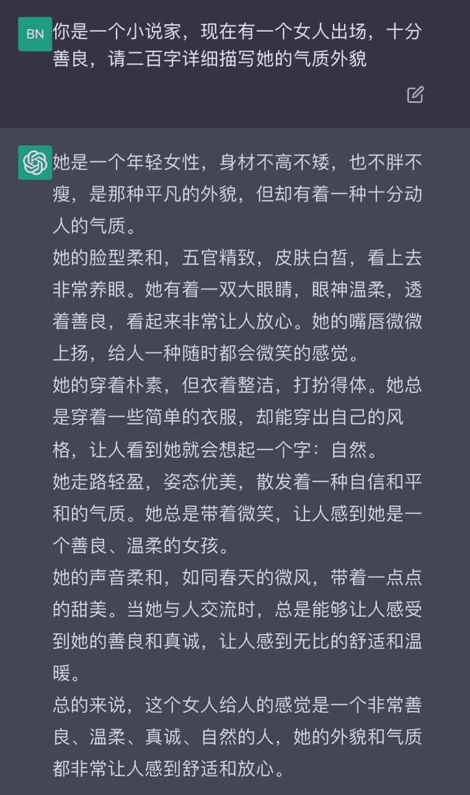
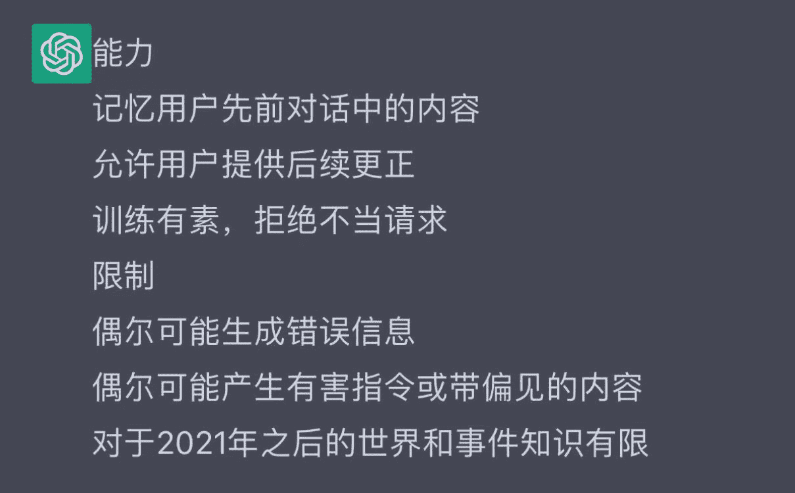
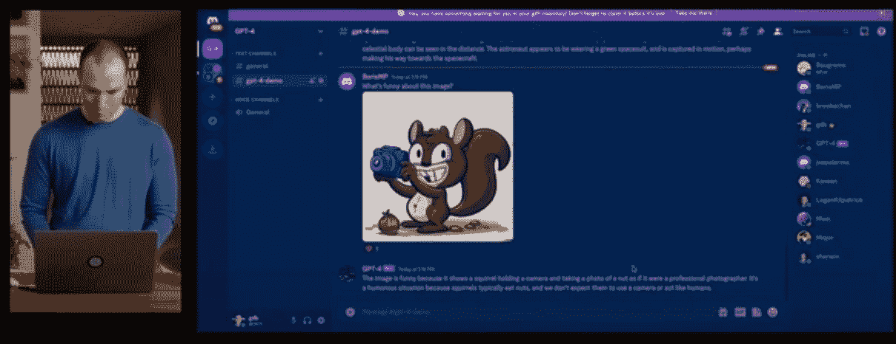

# 8、ChatGPT 逆天的能力

> 来源：[https://my.feishu.cn/docx/G7GsdNXmzoxQZSxnZAicqWgdnWf](https://my.feishu.cn/docx/G7GsdNXmzoxQZSxnZAicqWgdnWf)

**两个小例子**

咱们先通过两个实际例子看下 ChatGPT 的能力。

你是一个新手宝妈，孩子有过敏性鼻炎，晚上睡觉总是张嘴，偶尔还打呼噜，搜了小红书、知乎、宝宝树里的各种知识，寻医问药好几个月，今天试试问问 ChatGPT：幼儿有过敏性鼻炎怎么办？

你会发现，这简直赶上儿童医院的专家水准了，跟你费几个月精力研究出来的知识一样！

你是一个网络小说写手，今天需要描写一个新出场的女性，问问 ChatGPT：请描写一个善良女性的气质外貌。

非常不错，改一改就是个很不错的小说角色了！

## **逆天的六大能力**

除了能作为儿科专家，网络写手，那 ChatGPT 还有哪些逆天能力呢？ChatGPT 自己的描述非常简单和谦虚：

总结下：记性好，知错能改，不做坏事😄。有点抽象，具体来说，作为人工智能语言模型，它有六大能力：

### **1 语言表达能力**

可以使用多种语言进行交流，并能够理解和生成自然语言的语句和文本。

### **2 语言翻译能力**

可以将一种语言的文本翻译成另一种语言的文本，例如将中文翻译成英文或将英文翻译成中文。

### **3 自然语言处理能力**

能够识别和分析自然语言文本中的语法、语义和情感信息，并根据这些信息进行推理和生成回答。

### **4 文本生成能力**

能够基于输入的提示或条件生成自然语言的文本，例如生成故事、新闻报道、简历等。

### **5 知识储备能力**

可以对各个领域的知识进行储备，并能够在需要时利用这些知识来回答问题和生成文本。

### **6 图像处理能力**

GPT4 可以直接输入图像，并令其用语言描述图像内容，还可以基于图片向其提问题

总之，作为一个语言模型，具备强大的自然语言处理、翻译和文本生成能力，同时也具备丰富的知识储备，可以为人们提供多方面的帮助和支持。

## **能力分析**

大家可能会好奇它是怎么做到的？以前的人工智能都在干啥，为啥像人工智障一样？这要从 NLP 的历史和 ChatGPT 的历史聊起。

NLP 就是自然语言处理（ Natural Language Processing），它的发展阶段及商用场景如下：

20 世纪 50 年代到 70 年代，基于规则，用于机器翻译，效果不佳。

20 世纪 70 年代到 21 世纪初，基于统计，做到了语音识别。

2008 年到 2019 年，基于深度学习，简单对话的聊天机器人和 google 翻译。

2020 年至今，基于 Transformer 和大规模预训练数据，发展出了 GPT-3、ChatGPT。

从 2018 年起，OpenAI 就开始发布生成式预训练语言模型 GPT（Generative Pre-trained Transformer），可用于生成文章、代码、机器翻译、问答等各类内容。每一代 GPT 模型的参数量都爆炸式增长，2019 年 2 月发布的 GPT-2 参数量为 15 亿，在 2020 年 5 月，OpenAI 发布了 GPT-3，它已经是世界上最先进的自然语言生成模型。GPT-3 具有 1750 亿个参数。最新的 GPT4 模型规模达到了 6000 亿个参数。

GPT 的参数是指模型中的权重和偏置，类似于咱们学过的中学生物里神经元上的连接，人脑大约有 860 亿个神经元，GPT 没有公布它的模型里神经元的个数，但上千亿个参数基本接近于人脑了，还有 1 万个 V100 GPU （价值上亿美元）组成的高性能网络集群，怪不得它如此厉害！

## **总结及小作业**

ChatGPT 可能是你遇到的最聪明的 AI 助手，它可以记住以前的对话，它说的不对的地方允许你纠正训练，可以对话可以做翻译，有推理能力，能写故事，懂人类各种领域的知识，使用得当，可以大大提高我们的工作效率。

今天的小作业，看你能完成几个？完成的质量如何？

1、 用 ChatGPT 写一篇 500 字的科幻小说

2、 实践一下 ChatGPT 的六大能力

3、 安装 python，让 ChatGPT 帮你写一段代码，可以在本地运行，实现简单的英语对话