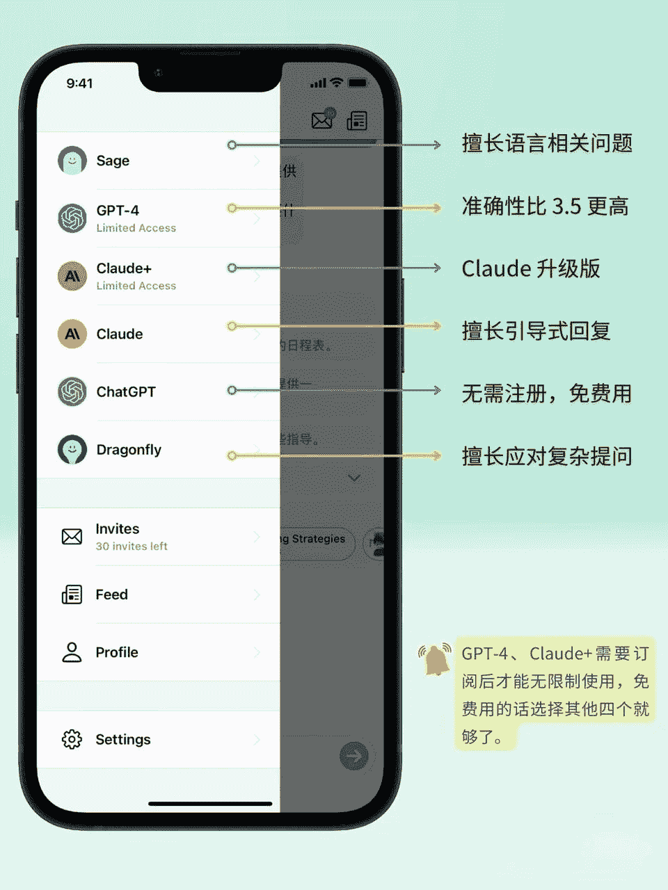
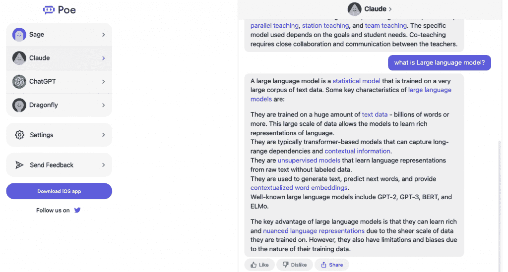

# 9、POE：集成四大模型的聊天机器人（GPT4+Claude100k ）

> 来源：[https://my.feishu.cn/docx/NBz9dKgCLozp6cxaoAAceyRknmb](https://my.feishu.cn/docx/NBz9dKgCLozp6cxaoAAceyRknmb)

**官网链接：**https://poe.com/

[**点击获取**](https://7t82qtu91d3.typeform.com/to/ZWwsiJDc)** ****Poe**** 注册和订阅**

ChatGPT 人工智能（AI）聊天机器人三个月爆红，

推出两个月就宣布突破 1 亿活跃用户，是史上最快用户破亿的应用程序。

由于 ChatGPT 可以短时间内利用 AI 技术解答用户问题，例如撰写邮件、翻译、作诗、改善程序代码等，不少人都纷纷欲试；

昨晚，跟华中师范大学的同仁一起分享《ChatGPT 教学科研应用》，不少朋友急不可耐地想要上手去试试。

然而，ChatGPT 现阶段需要外国手机号码认证，国内目前没有办法使用。

不过，借助 OpenAI 开放的 API，在国内已经有不少的类 ChatGPT 如雨后春笋般地涌现出来，尽管使用的模型可能是 GPT3，但是总归是可以让大家体验一回，用还是可以使用的！

今天跟您推荐一款应用，也是超级赞啊！

它可以让我们每个人从聊天机器人四大天王中随意选择，酷炫吧！

而且，而且，现阶段，它还是免费的。

她就是：POE。

Poe 是 Quora 旗下应用程序。

Quora 是一个知识问答社交网络平台，成立于 2009 年，总部位于美国加利福尼亚州山景城。

用户可以在 Quora 上提问，也可以回答其他用户的问题，这些问题和答案都可以按主题进行分类，方便用户查阅。

目前，Quora 是一家拥有 14 年历史的社交网络公司，帮助用户通过挖掘其他用户的知识来找到问题的答案，是知乎类知识问答平台的鼻祖。

Quora 是一个非常流行的学习、分享和社交平台，是世界上最大的知识问答网站之一，其宗旨是让人们共享知识、问答互动。

我们还是说回 Poe。

Poe 具备聊天机器人功能，而且由 ChatGPT 所属公司 OpenAI、以及 Google Anthropic 的技术支持，而且只需要本地手机和电子邮件认证即可开户，所以，大家不妨玩玩先。

在 Poe 中整合了 Sage， ChatGPT， Claude，以及 Dragonfly，聊天机器人四大天王。让每一个用户可以选择使用其中的任何一个。

Sage、ChatGPT、Claude 和 Dragonfly 都是非常流行的聊天机器人，它们各有特色。其中，

Sage 是一个基于机器学习的聊天机器人，能够识别自然语言并做出智能回答。Sage 通过自然语言处理和对话管理技术来实现对话的自然流畅和个性化，同时支持多种语言。Sage 较为擅长语言相关的工作，例如创作文章，做摘要等。

ChatGPT 是由开放人工智能（OpenAI）公司开发的一种聊天机器人，能够利用人工智能技术快速解答用户的问题，包括邮件、翻译、作诗、改善程式码等。ChatGPT 的独特之处在于其拥有先进的深度学习算法，可以逐步提高自己的回答质量，同时也支持多种语言，是目前知名度最高的聊天机器人。

Claude 是一种由思科系统开发的聊天机器人，旨在为网络安全和网络统一通信提供全面支持。Claude 较擅长对话相关的工作，能够在问题不清晰时，主动向用户提问。

Dragonfly 是由 IBM 开发的聊天机器人，其特点是可以使用多种形式的对话方式，例如文字聊天、语音聊天和图像聊天等。较擅长提供正确和可信的信息，并且会拒绝不合规的提问。Dragonfly 还可以根据用户的需要提供精准的回答，支持多语言，适用于多种场景。

总之，这四种聊天机器人各有其特点，用户可以根据自己的需求选择使用