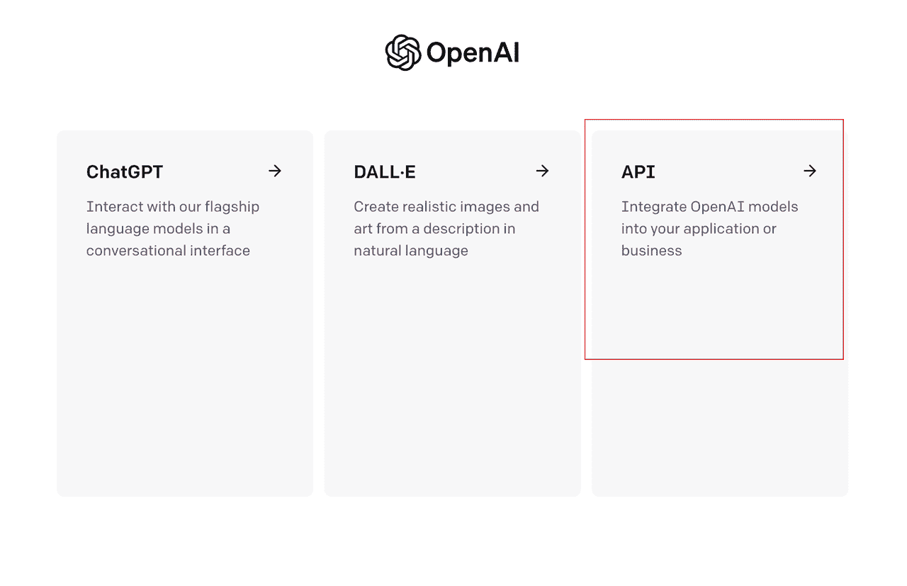
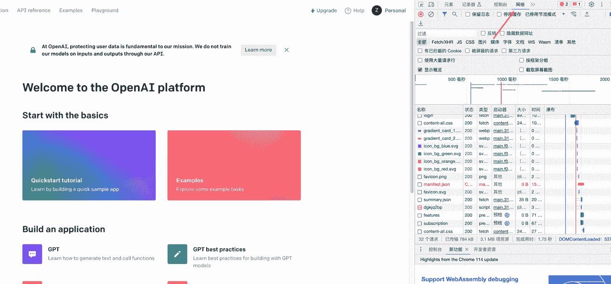
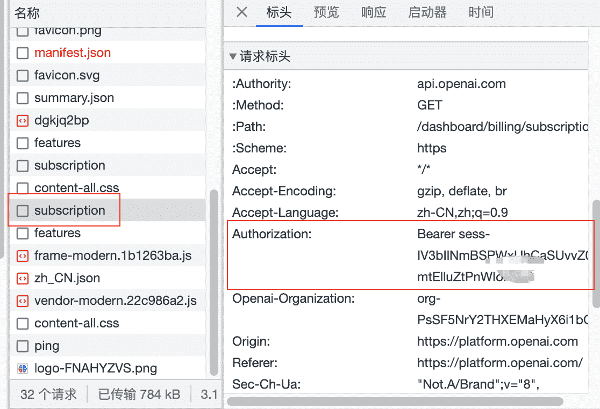
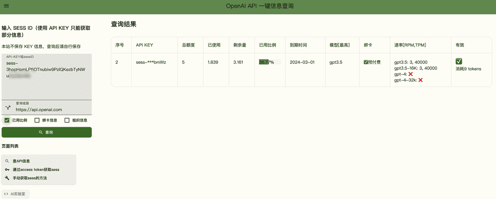

# 13、OpenAI API Checker 使用指南-获取 SESS ID

> 来源：[https://my.feishu.cn/docx/IRJ6d87Q1oplnYxFaFKctZg1ntd](https://my.feishu.cn/docx/IRJ6d87Q1oplnYxFaFKctZg1ntd)

> OpenAI API 一键批量查询余额：OPENAI.AIGC369.COM

> 官方查询接口已更新，需输入SESS ID才可以显示全部信息，获取方法如下

# 一、登录

https://openai.com/

# 二、进入 API 页面

# 三、按 F12 打开控制台，选择网络选项卡，并刷新网页

# 四、获取 SESSID

选择 subscription 这个名称，右边找到 Authorization（subscription 有可能出现两个，选择有 Authorization 的一个即可）

# 五、复制 SESSID 前往查询

> 注意格式为【sess-IV3bIlNmBSPWxUhCaSUvxxxxxtElluZtPnWIokWM】

