# 国内现象级 AI 产品

> 来源：[https://my.feishu.cn/docx/MHird8A6to0EPHxg7esco2Jhnzb](https://my.feishu.cn/docx/MHird8A6to0EPHxg7esco2Jhnzb)

# 国内 AI 大事件总览

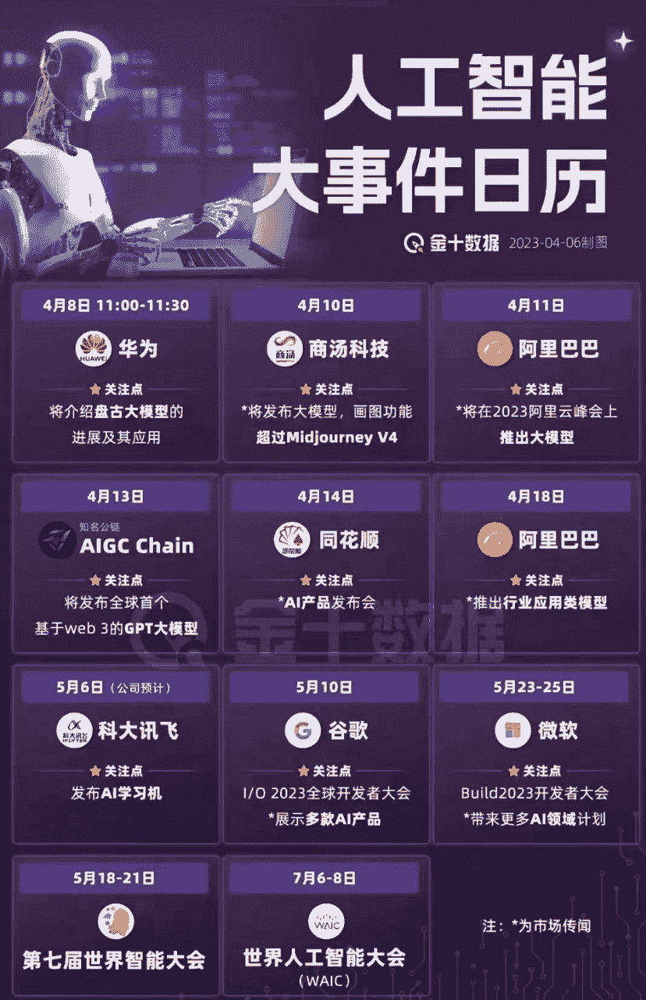

# 豆包

> 申请地址：https://www.doubao.com/

#### 字节跳动推出的人工智能,经过大规模推广,在吸引公众众注意力方面具有优势，

#### 其在多个平台上的声量较高,搜索指数不断上升,SaaS访问量稳定在千万级别,

#### APP下载量快速增长,是国内首个达到3000万级别的大模型产品。

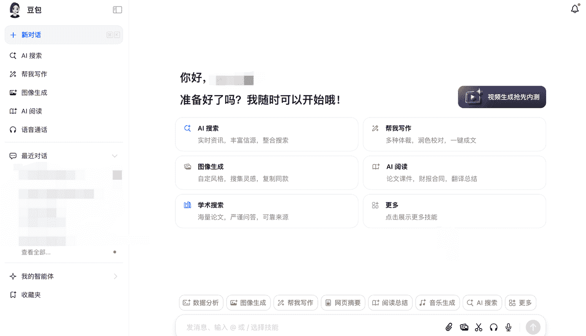

# kimi智能助手

> 申请地址：https://kimi.moonshot.cn/

#### 作为国内 AI 初创企业的 “独角兽” 产品，在 2024 年受到广泛关注，

#### 其 SaaS 平台访问量和 APP 下载量表现出色，覆盖多种平台，赢得了广泛的用户青睐，

#### 特别是年轻用户群体。

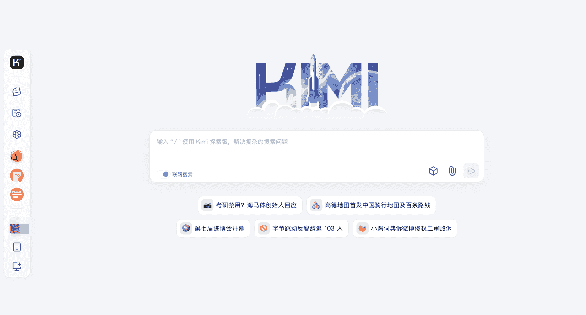

# 智谱 ChatGLM

> 申请地址：https://chatglm.cn/main/alltoolsdetail?lang=zh

#### 智谱 AI 的产品，在过去一年中完成了四次技术升级，

#### 支持 2000 + 生态合作伙伴和 1000 + 大模型规模化应用，其 GLM - 4 系列模型支持长达 128k 的上下文窗口长度，

#### 单次提示词可以处理的文本量相当于 300 页纸面文本。

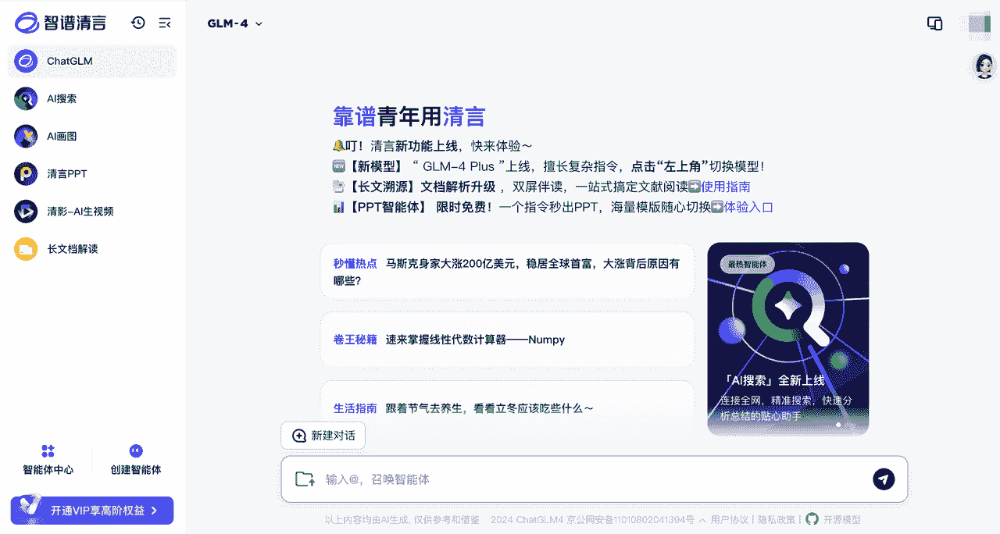

# 科大讯飞-星火模型

> 申请地址：https://xinghuo.xfyun.cn/

#### 在文本生成、语言理解和数学能力等方面表现出色，多项技术指标达到甚至超越 ChatGPT。

#### 例如，它能够快速理解问题核心与提问意图，并迅速给予高质量的答复，无论是回答日常问题、

#### 进行文本创作，还是解决数学问题等都能应对自如。

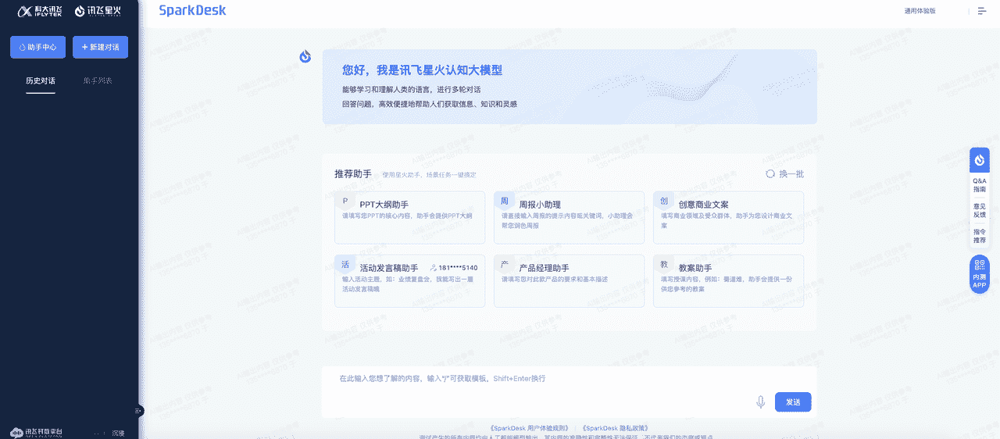

# 百度文心一言

#### 百度推出的人工智能产品，依托百度强大的搜索引擎网络分发能力、品牌信誉和商业动力，

#### 迅速占据市场优势，成为国内企业和消费者首选的 AI 对话产品之一。

#### 文心大模型的日均调用次数增长迅速，文心一言的使用率在国产大型语言模型中处于领先地位。

## 如何申请-文心一言（个人/企业）

+   [自 2023 年 3 月 16](http://yiyan.baidu.com/) 日起，个人用户可以通过访问 yiyan.baidu.com ，点击『立即体验』参与排队。

+   企业用户可通过百度搜索“百度智能云”进入官网，申请预约文心一言 API 接口调用服务。

+   这个是企业侧：[h](https://cloud.baidu.com/survey_summit/wenxin.html?track=C816552)ttps://cloud.baidu.com/survey_summit/wenxin.html?track=C816552

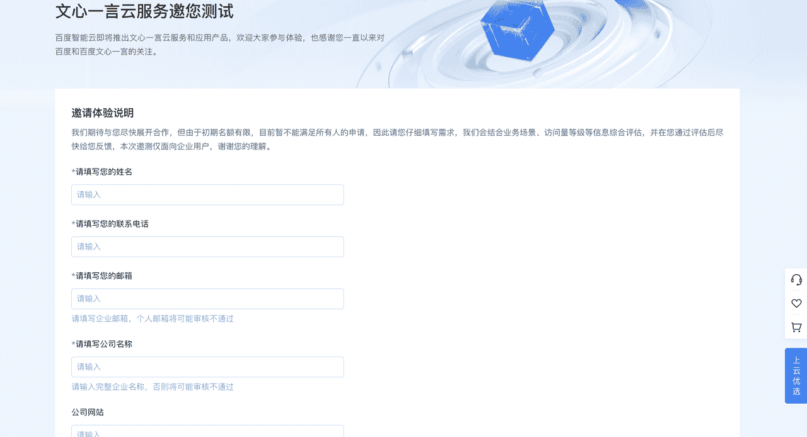

# 通义千问

> 申请地址：https://tongyi.aliyun.com/

#### 通义千问是阿里云自主研发的功能强大的大语言模型。它不仅可以进行基础的自然语言对话，还具备诸多特色功能。例如，用户可以使用文档解析功能，

#### 在通义千问官网或 APP 上传多种格式的文档，包括 PDF、Word、HTML 等，它能处理超万页的极长资料，无论是单个长篇文档的问答，还是对多达 100 份不同文档的跨文档分析、摘要创作都能轻松应对。

####

#### 百宝袋功能则是预先提供针对不同场景的小应用集合，如创意文案类可生成短视频剧本、祝福语等；办公助理类能协助撰写营销文案、制作 PPT 大纲等；学习助手类可帮助解答学习疑问；趣味生活类能提供高情商回复、健身计划等。

####

#### 其 AI 语音对话功能让用户可以直接通过语音提问，APP 中还提供温柔、幽默、严谨、亲切四种音色选择。此外，还有能根据用户上传照片生成舞蹈视频的 “通义舞王” 功能，为用户带来独特的娱乐体验。

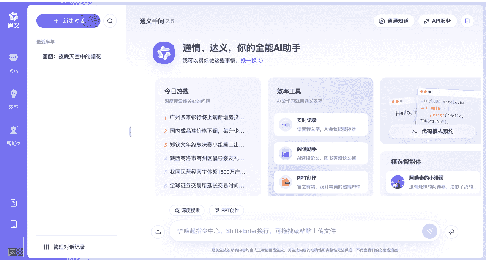

# 昆仑万维

> 官宣地址

> [https://mp.weixin.qq.com/s/yi](https://mp.weixin.qq.com/s/yikVXp2sda4frtl_TrSKzw)kVXp2sda4frtl_TrSKzw

> 申请地址

> [天工官网](https://tiangong.kunlun.com/)

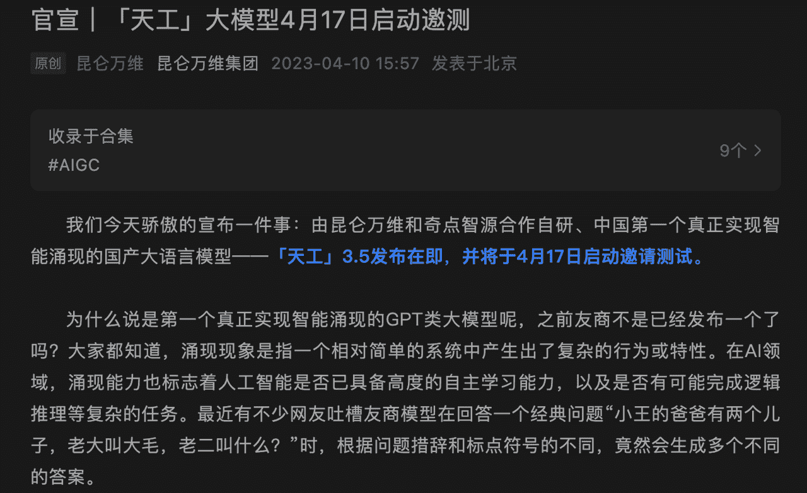

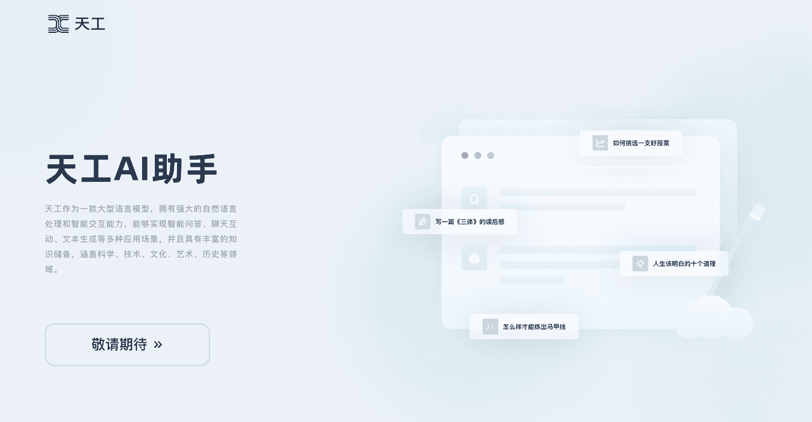

# 360

> 申请地址：https://www.so.com/zt/invite.html#/

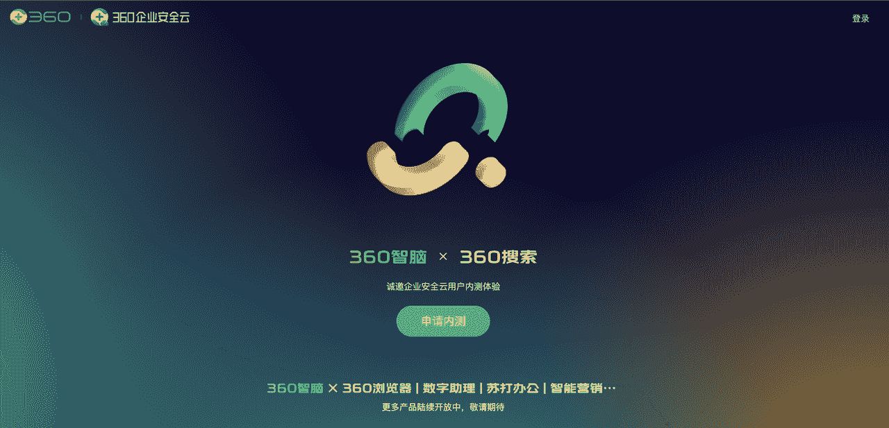

# 商汤

> 文章地址：[https://mp.weixin.qq.com/s/Qo](https://mp.weixin.qq.com/s/QoQwfuzttBMxLgjVZLYI4w)QwfuzttBMxLgjVZLYI4w

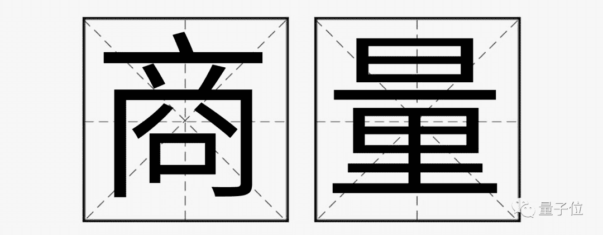

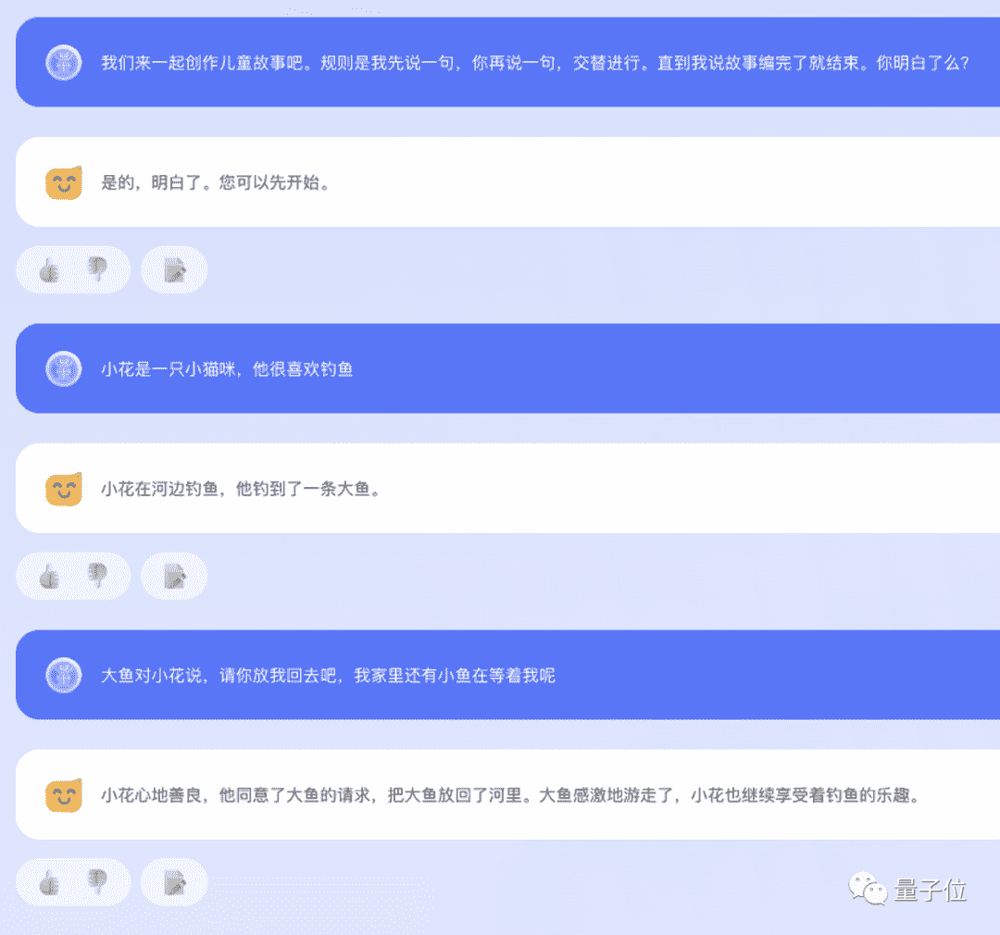