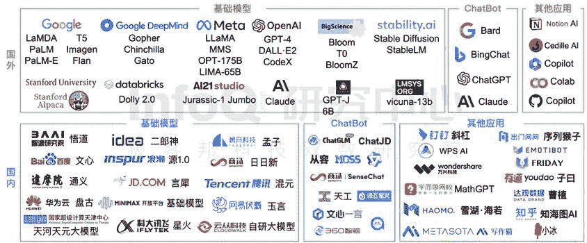
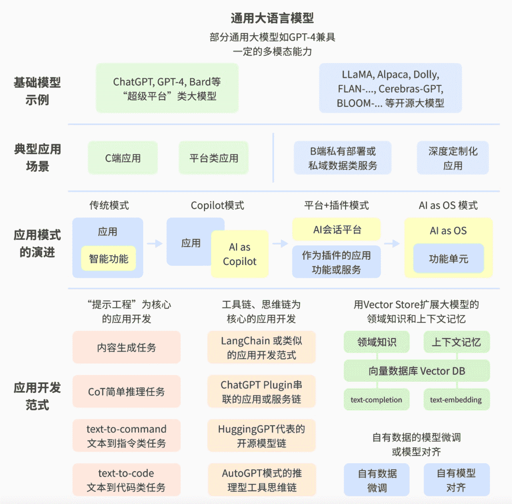
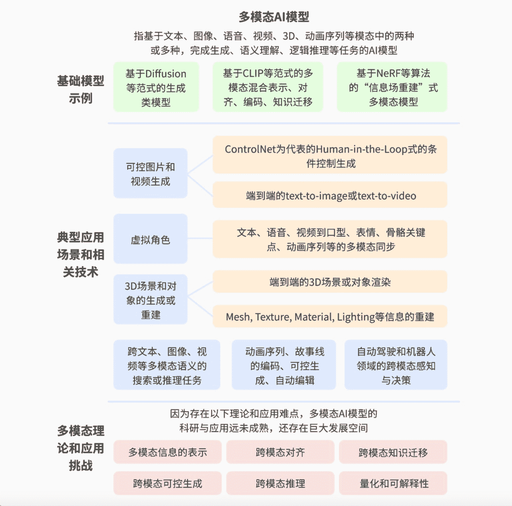
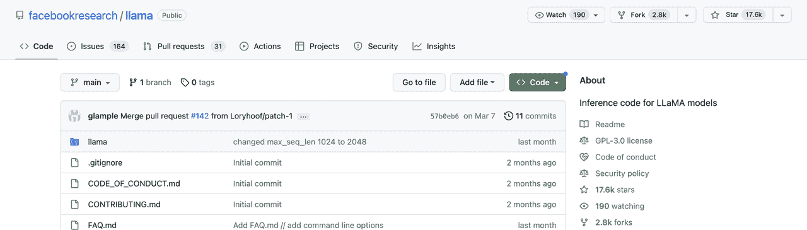
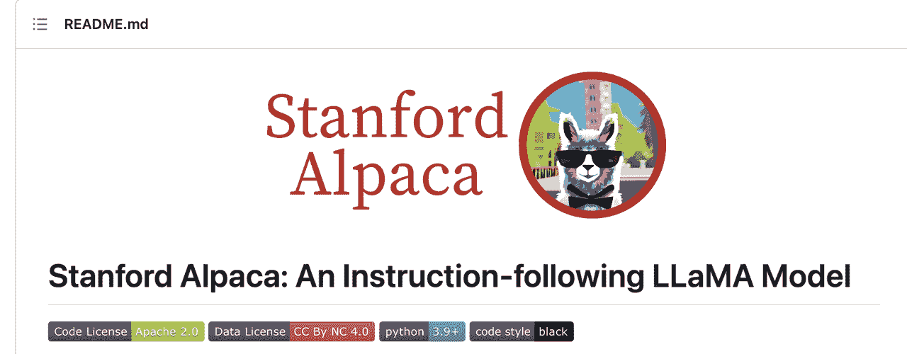
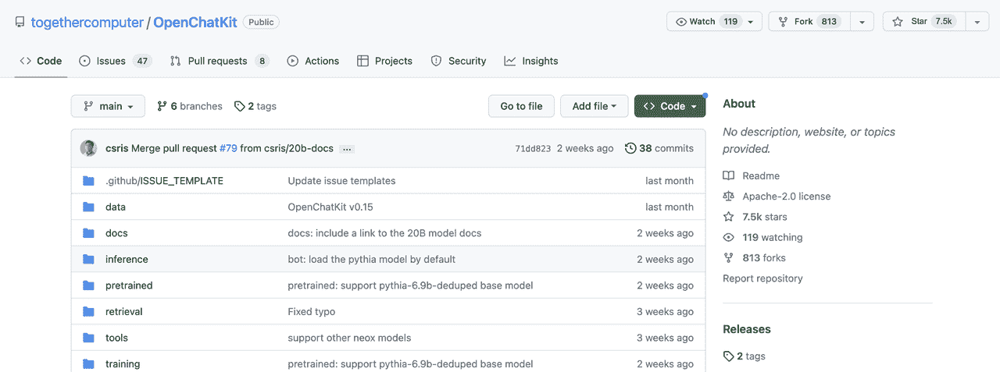
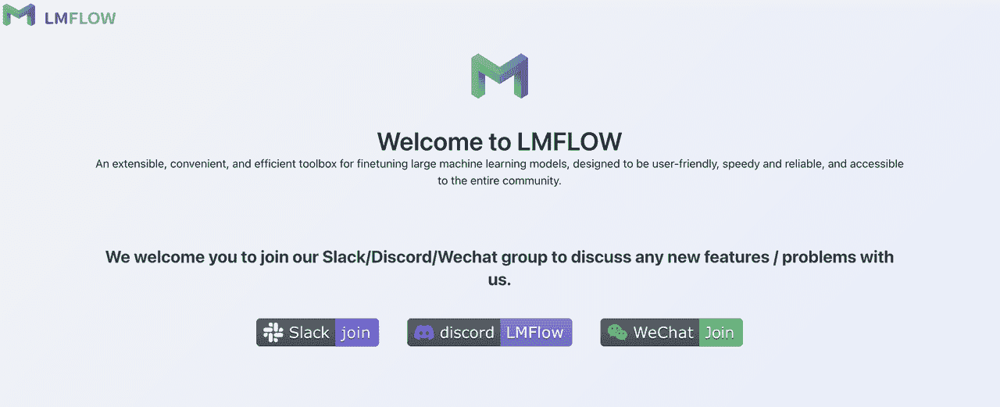

# 开源模型系列

> 来源：[https://my.feishu.cn/docx/Co2VdR299oChrdxQNpncTL4snth](https://my.feishu.cn/docx/Co2VdR299oChrdxQNpncTL4snth)

# 清华-ChatGLM-6B：开源双语对话语言模型

> ChatGLM-6B 是一个开源的、支持中英双语的对话语言模型，基于 General Language Model （GLM） 架构，具有 62 亿参数。结合模型量化技术，用户可以在消费级的显卡上进行本地部署（INT4 量化级别下最低只需 6GB 显存）。 ChatGLM-6B 使用了和 ChatGPT 相似的技术，针对中文问答和对话进行了优化。经过约 1T 标识符的中英双语训练，辅以监督微调、反馈自助、人类反馈强化学习等技术的加持，62 亿参数的 ChatGLM-6B 已经能生成相当符合人类偏好的回答。

+   开源地址：[Gi](https://github.com/THUDM/ChatGLM-6B)tHub - THUDM/ChatGLM-6B: ChatGLM-6B：开源双语对话语言模型  | An Open Bilingual Dialogue Language Model

+   模型下载地址-HF：THUDM/chatglm-6b · Hugging Face

+   模型下载地址-清华：[chatglm-6b](https://cloud.tsinghua.edu.cn/d/fb9f16d6dc8f482596c2/)

+   安装教程：[【](https://www.bilibili.com/video/BV1E24y1u7Go/?vd_source=c0fb5179e3784a49b13d51f98ab73ad0)ChatGLM】本地版 ChatGPT？6G 显存可用！ChatGLM-6B 清华开源模型一键包发布 可更新_哔哩哔哩_bilibili

+   A webui for ChatG[LM made by THUDM.:  ht](https://github.com/Akegarasu/ChatGLM-webui)tps://github.com/Akegarasu/ChatGLM-webui

# Meta-LLAMA

+   Meta 发布了人工智能大语言模型 LLaMA，包含 70 亿、130 亿、330 亿和 650 亿这 4 种参数规模的模型。其中，最小的 LLaMA 7B 也经过了超 1 万亿个 tokens 的训练。

+   [Inference code for LL](https://github.com/facebookresearch/llama)aMA models: https://github.com/facebookresearch/llama

+   Port of F[a](https://github.com/ggerganov/llama.cpp)cebook's LLaMA model in C/C++: GitHub - ggerganov/llama.cpp: Port of Facebook's LLaMA model in C/C++

+   中文 [LLaMA&Alpaca 大语言模型+本地 CPU](https://github.com/ymcui/Chinese-LLaMA-Alpaca) 部署 （Chinese LLaMA & Alpaca LLMs）： https://github.com/ymcui/Chinese-LLaMA-Alpaca

# **S**tanford Alpaca: An Instruction-following LLaMA Model

+   Code and documentation to train Stanford's[ A](https://github.com/tatsu-lab/stanford_alpaca)lpaca models, and generate the data.: GitHub - tatsu-lab/stanford_alpaca: Code and documentation to train Stanford's Alpaca models, and ge

+   **A**[**lpaca: A Strong, Replicable **](https://crfm.stanford.edu/2023/03/13/alpaca.html)Instruction-Following Model:  https://crfm.stanford.edu/2023/03/13/alpaca.html

# OpenChatKit（前 OpenAI 团队打造）

OpenChatKit 是一个由前 OpenAI 研究员共同打造的开源聊天机器人平台。它包含了训练好的大型语言模型、定制配方和可扩展的检索系统，可以帮助用户快速构建高精度、多功能的聊天机器人应用。其中，最核心的组件是一个经过微调的、具有 200 亿参数的语言模型——GPT-NeoXT-Chat-Base-20B。这个模型基于 Eleuther[AI 的 GPT-NeoX 模型，重点调整了多轮对话、](https://github.com/togethercomputer/OpenChatKit)问答、分类、提取和摘要等多项任务，并使用了 4300 万条高质量指令进行训练。这使得 OpenChatKit 在处理聊天对话时可以提供高精度、流畅的回答。除此之外，OpenChatKit 还提供了定制配方的功能，可以帮助用户根据自己的数据集微调模型，以提高模型在特定任务上的表现。另外，该平台还提供了可扩展的检索系统，可以从文档存储库、API 或实时更新信息源等多个来源中检索信息，以提供更全面的回答。https://github.com/togethercomputer/OpenChatKit

# 港科大开源模型：LMFlow

此软件包旨在为大型模型调整提供简化和用户友好的流程。其功能可作为用户参考并供用户使用。然而，需要注意的是，数据和预训练模型的准备工作完全由用户负责。本软件包不保证用户准备组件的准确性、完整性、适用性或合法性。用户必须了解并承担与模型和数据准备相关的所有风险和责任，并在使用本软件包之前获取法律、商业和技术建议。该流程不应对用户不当准备数据和预训练模型所导致的任何直接、间接、特殊、偶然或后果性损害负责。

我们提供的检查点仅供研究目的使用，包括英文和中文版本。这些检查点包含 ChatGPT 语言模型生成的结果。我们不支持或鼓励将这些检查点用于商业目的的分发或使用。这些检查点的用户应当负责确保正确和适当地使用它们。

还需要强调的是，模型生成的结果是基于概率模型，与此流程没有直接关系。本流程不保证结果的准确性、可靠性、适用性和合法性。因此，在依赖模型生成的结果之前，用户还必须了解与结果相关的风险和责任，并寻求法律、商业和技术建议。该流程不应对用户依赖模型生成的结果所导致的任何直接、间接、特殊、偶然或后果性损害负责。

Github: [https://github.com](https://github.com/OptimalScale/LMFlow)/OptimalScale/LMFlow

网页体验：https://lmflow.com/