# MJ 和 SD 目前的变现渠道

> 来源：[https://my.feishu.cn/docx/DrqHdi0OkoCKMwxVbU5cH9jLnLd](https://my.feishu.cn/docx/DrqHdi0OkoCKMwxVbU5cH9jLnLd)

本文谈谈目前 AI 人工智能绘画目前最容易的变现形式，也早就不是秘密了，因为门槛很低，实际上变现的路子真的真的很多，我会在适当的时候慢慢放出来。先来张最近用 Midjourney 跑的图。

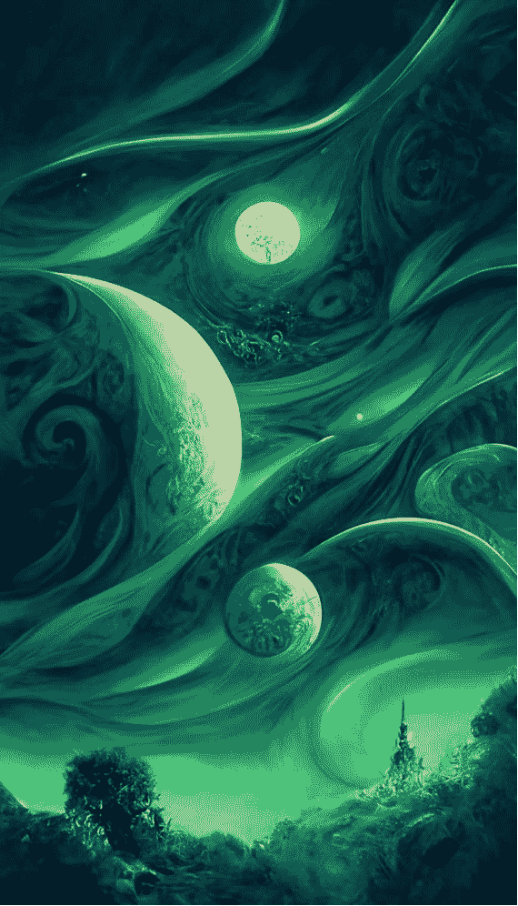

很有苹果封面的感觉。

**赠送一个描述词：**

green and blue and white planet in a starry sky, intricate details, in the style of Alphonse Mucha and Michael Whelan and art station, cream, dark green, de-noise, magical, lush, mystic, fantasy, art nouveau, 4k.

照顾一下英文短板的童鞋，就把 prompt 翻译成中文：

星空中的绿色、蓝色和白色星球，复杂的细节，阿尔方斯·穆查和迈克尔·惠兰的风格，艺术网站，奶油色，深绿色，去噪，神奇，繁茂，神秘，幻想，新艺术，4k

当中颜色的单词修改一下，会有不同的神奇效果，这就是 midjourney 的神奇之处，好了，不扯淡了，进入正题。

目前 midjourney 或 disco diffusion 变现的大多是抖音的壁纸号，我从 19 年开始做的抖音，壁纸号在短视频平台流量虽好，但个人认为，这条赛道特别卷，上限不高，明明有变现得更好的项目，不过面对其他行业来说，门槛较低，毕竟一组描述词，一天挂着能产出一个号一个星期的作品量了。

网上关于抖音变现的攻略写得比较少，可以理解为目前仍是风口，都在闷声发大财，虽然我也做知识付费，但是这壁纸号的玩法，拿出来收费未免也太坑人了……

所以我决定，直接上教程……

**一、准备抖音号**

这一块不用多说，每个人应该都有抖音号，如果你是抖音的重度爱好者，隔三差 五都有刷视频的那种，那么只需要把原来自身生活化的视频隐藏，修改头像昵称，就可以开始做了。

如果不怎么刷抖音，在开始发壁纸之前，需要 3 天的养号期，养号即是养账号的活跃度，活跃度能使初始作品播放正常（500 左右播放量）

养号的方法：每天刷视频的总时长超过三小时，一般是刷首页推荐的视频一个半小时，看直播一个半小时，夹杂着互动方式和真人行为检测，点赞评论转发或者收藏音乐地点等，还有一个重磅的独门养号秘籍，举报视频或直播，一定要有效举报，也就是抖音官方反馈举报生效，这样你的账号会被抖音判断为真人号，起码不是工作室批量养号。

**二、入驻壁纸平台**

如下图都是壁纸平台，出现在图中都是比较有名的，但有名不代表一定靠谱。

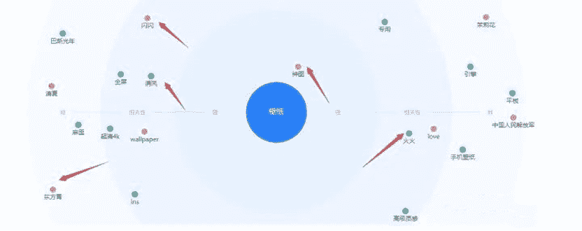

抖音上能轻易找到的，很多都是店大欺客型，有的入驻要收费（特别不合理，为什么帮你平台赚钱还要交钱），有的会偷偷扣量，最好找那种不是那么知名的壁纸平台入驻，在抖音放大镜处输入“壁纸小程序”，有很多小壁纸平台可供入驻，建议先了解他们的收益机制再入驻。

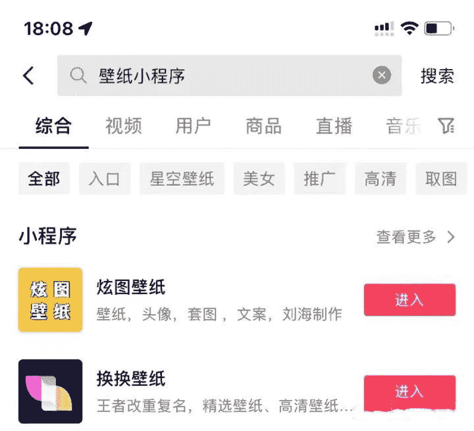

**三、作品发布细节**

1、目前抖音对图文抖音仍有扶持，最好选择时下热点蹭热度关联，具体的做法是在放大镜处查看每日抖音的热榜，选择与热榜上的话题创作图片，只要图片本身和标题有类似关联的话，很容易蹭到流量，经过测试，通过这个入口蹭到 100W 播放。只是这种流量属于泛流量，适合新手快速突破，如果运营了一段时间的账号，不建议操作。

每月抖音都会扶持一些话题，如“适合中秋节的文案”、“九月你好”等等，如果是中秋节，那么我们选择与之相关的明月，玉兔等关键词进行 AI 绘图。

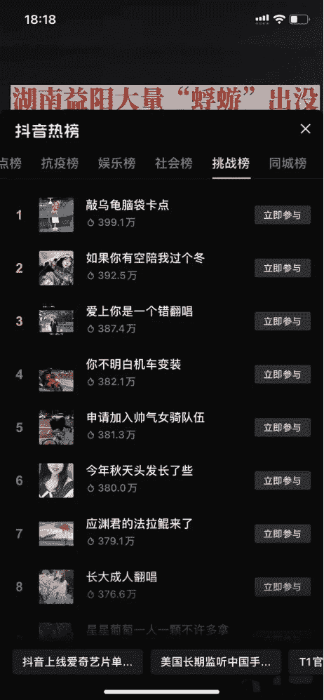

2、抖音作品的标题

标题甚至比图片更重要，尤其壁纸号更需要一个好的标题，标题决定了作品的互动数据，如果起不来就别提上热门了，标题平常可以多关注一些鸡汤文案号或者治愈系的号，建立起自己的素材库，在发图时能找到与图片相对关联的文案发出去。

新号每十个作品中，可以用这一个这样的文案：大数据是不会骗人的，当你刷到这条视频，说明你将要时来运转，福气临门。

PS：这种文案不可以多用，很容易把标签打混乱。一般账号做不起来时，用这种方法死马当活马医。因为喜欢这种文案的，都是偏年长的人群，这类人不怎么好做变现。

3、抖音的推送机制

抖音新号要做起来需要一个周期，一般 10 个作品当中会有一两个作品流量特别好的，这两个作品影响了下 10 个作品的基础播放的层级，比如说一个新号上面发了 10 个作品，其中有一两个作品达到万播，那么下 10 个作品，可能每个作品至少给你 500-1000 的播放量，再如有一两个作品达到十万播，那么下 10 作品，每个作品基础播放或许就是 5K-1W 了。

运用好这个机制，把各个方面做到极致，基本上都能上热门。

4、账号垂直度说明

想入手抖音，需要提前对账号进行定位，就算是壁纸号，也有很多细分领域的，如动漫治愈风，则吸引的一般是偏年轻的女性群体，比较传统的山水画，吸引的是中老年人群体。只有风格定位下来后再去输出内容，才有可能把自己的账号打造成高价值的账号。

四、AI 智能绘图

你要阳春白雪还是下里巴人？

阳春白雪，高端的艺术，俗人是看不懂的，有时候做出一张艺术感满满的图片，不一定代表在抖音就能火，还是需要迎合群众的口味，正能量、治愈、少女心的图片，才有更多的机率上热门。

很多人对上热门没有概念，说句不夸张的，一个热门，只要做好引导的情况下，引流到私域甚至一个晚上五六百人加入。

midjourney：使用这个平台出的图，一天是可以轻轻松松高产的，就我试了很久的修仙场景，一组描述词成片率都很高，一个小时可以产出一个星期的量了。

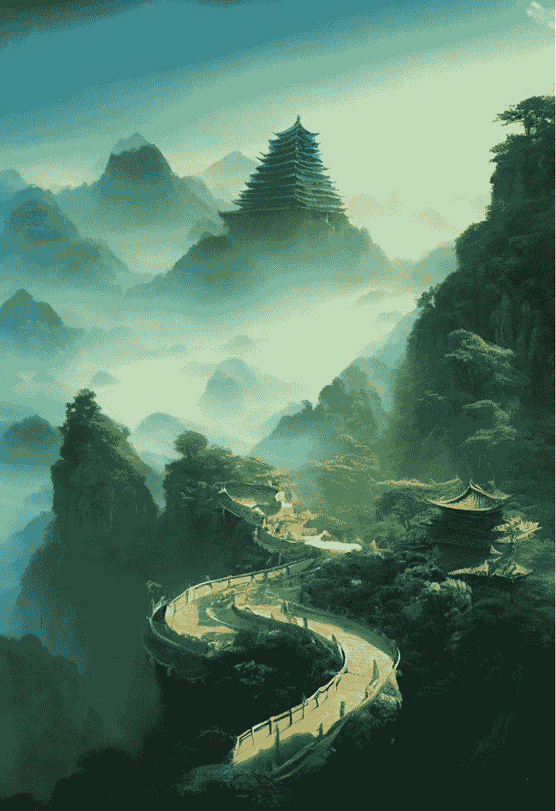

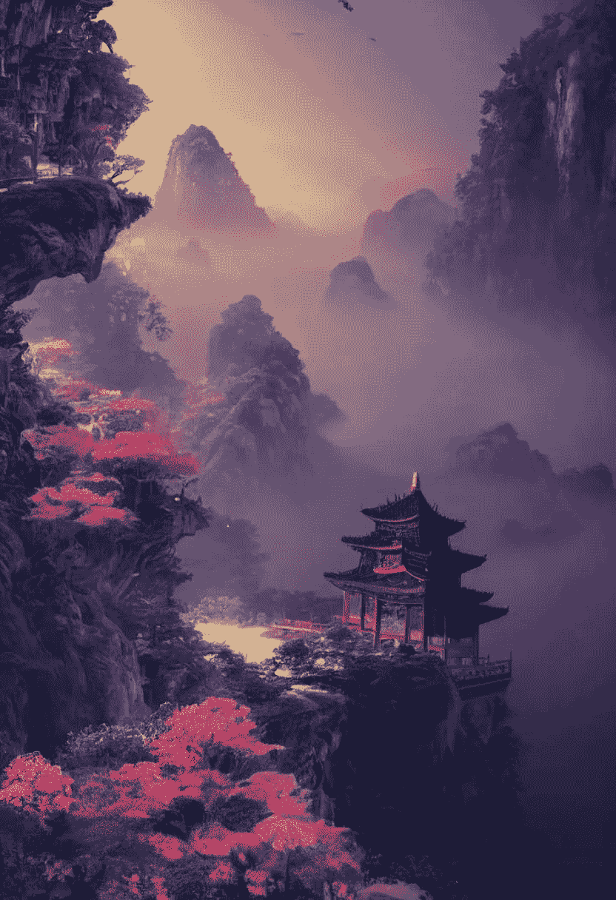

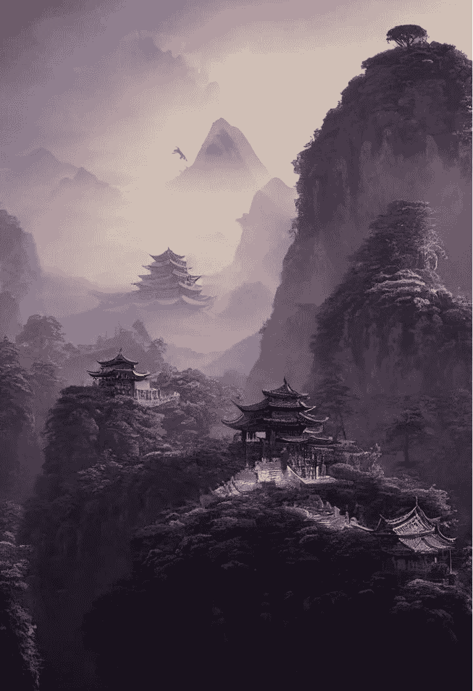

disco diffusion：相比 midjourney，我更喜欢谷歌的这个 AI 智能绘画平台，每次出图就像是开盲盒一样，而且上限很高，有时候出的图真的特别惊叹。

下面这张图片是我在写这篇文章的时候出的图，虽说有特别多的瑕疵需要优化，但明显这个构图我很喜欢，我把这张图片起名为“白日飞升”。

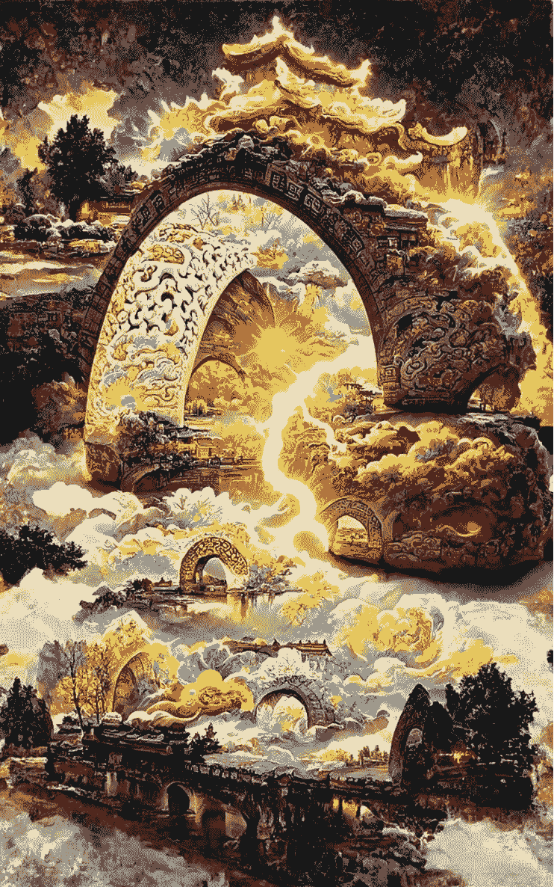

五、总结

短视频变现无疑是普通人最容易接触到的 ai 智能绘画的风口，曾经看过一篇文章，说是网上教你赚钱的，不一定赚钱，如果真要找项目，得去观察一些创投融资网站，看看资本的热钱现在扎堆往哪个领域投，资本是逐利的，这方面比你，比我都敏感得多。

梳理一下时间线，你看是不是这么回事：

都是资本牵头把一个盘子做大，先是扎克伯格提出元宇宙概念，并把名字改为 meta；

接着 NFT 数藏平台大火，

AI 智能绘画上线。

AI 确实要火了，9 月份是一个高潮，看来他们都准备好了，

百度“文心”已经开放了，免费使用，支持中文，在画二次元头像方面独树一帜，但图片的版权归版，完全归百度。

Tiamat 也在这篇文章之后的半个月内公测，这个平台是国内目前最好的 AI 人工智能绘画平台了，特别擅长画宫崎骏老爷子风格的图个人看法。据说公测后采取会员制，月卡挺贵的，248RMB，都快比上 midjourney 了，但 midjourney 图片的版权完全归创作者，而 Tiamat 是要享受图片版权收益分成的，可以理解为，创作者与 tiamat 是共同创作作品的。

最后送上一段描述（midjourney）：

A beautiful red rose garden, starry night, serene landscape, silcence, by beeple, Hiroshi Sugimoto, artstation.

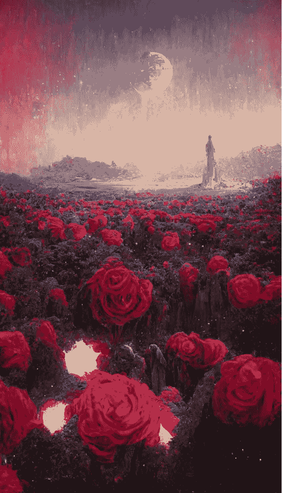

最后，推荐一个免费入驻的小程序

# SD 变现：艺术字

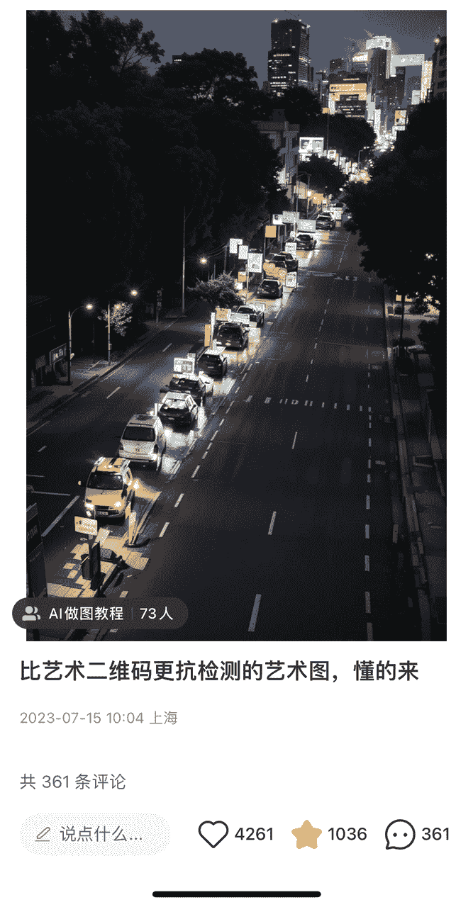

前有艺术二维码，后有赛博朋克机车，这几天这种光影文字又开始火起来了。

制作起来，倒也不是很难。主要就是运用 Stable Diffusion 的 ControlNet 插件。

### 光影文字

•跑图必备的基础模型：diffusion_pytorch_model 或 beautifulRealistic_v60

•ControlNet 的模型：今天我们用的这个 Brightness 模型比较特殊，他不是官方的 ControlNet 的模型。需要我们自己下载，文件已经在前面分享的网盘里面。

•下载后将此模型放入 autodl-tmp/models/controlnet/ 文件夹下面。

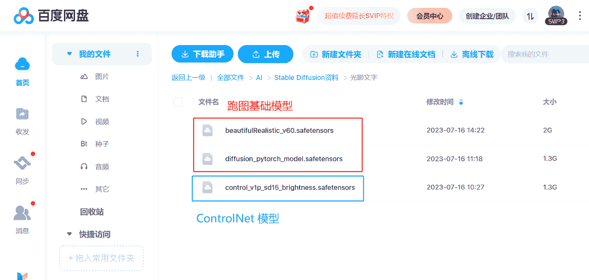

链接：[h](https://pan.baidu.com/s/1rNUXlbqoqK6Vy_zquD-8MA?pwd=6666)ttps://pan.baidu.com/s/1rNUXlbqoqK6Vy_zquD-8MA?pwd=6666

提取码：6666

### SD 参数配置

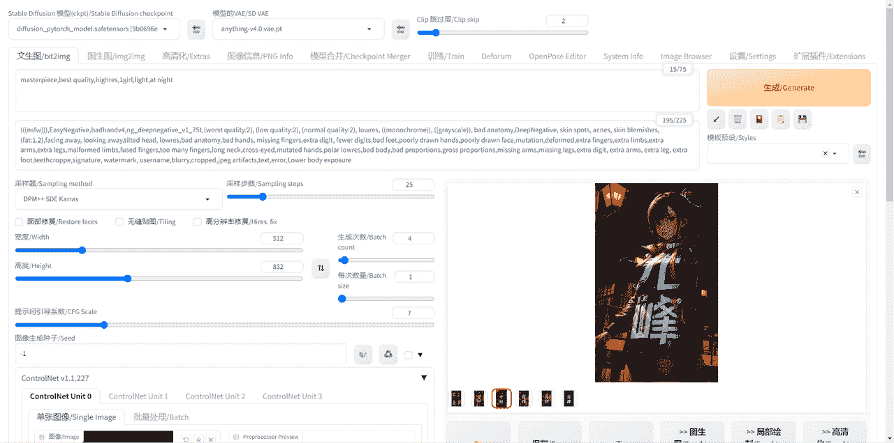

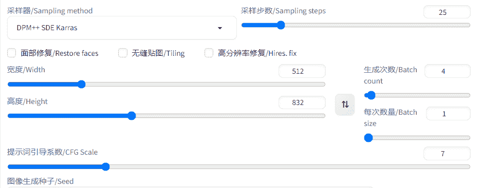

**S**table Diffusion 模型(ckpt)/Stable Diffusion checkpoint：diffusion_pytorch_model

采样器/Sampling method：DPM++SDE Karras

采样步数/Sampling steps：一般选择 25-30 之间

**宽度和高度**：根据自己图片宽高比自己设定，我这里是横图 832:512，竖图 512:832

生成次数/Batch count：4，每次抽卡个数

#### 提示词

从不同渠道收集了 3 个提示词。

##### 提示词1

**正向提示词：**

A melancholic autumn scene in a vast flower field,a gentle breeze rustling through the dry grass,fallen leaves scattered among the flowers, a bittersweet atmosphere, a moment of quiet contemplation,1girl,long hair,white_skirt, high-waist_shorts, outfit ,roses,(dynamic angle:1.1),vivid,Soft and warm color palette, delicate brushwork, evocative use of light and shadow, wide shot,subtle details in the wilting flowers,high contrast,color contrast

在一片广阔的花田中，一个忧郁的秋天场景。微风拂过干草，落叶散落在花丛之间，弥漫着一种苦乐交织的氛围。这是一个静谧思考的时刻。画面中有一个女孩，长发、白裙、高腰短裤和装饰着玫瑰花。(动态角度: 1.1)色彩生动而柔和温暖，精致的笔触展现出光影效果，并以宽广镜头呈现。凋零花朵中微妙的细节与高对比度、色彩对比相得益彰。

##### 提示词2

**正向提示词：**

High quality photography works, perspective, shooting on the overpass, fair skin, full body photos, cute (little girl robot), gorgeous colors, manipulator, short, pink big eyes (starry eyes), Pigtail with gradually light pink, sweet and happy style, dynamic ten foot running posture, (walking on the glass walkway), (artificial intelligence), warm background, soft (light effect), lipstick light pink, (eyes) camera close-up, Prism effect, white armor adorned with colored circles, (cartoon humanoid mechanical art style), deep red Lolita skirt style

高品质摄影作品，透视，在天桥上拍摄，皮肤白皙，全身照片，可爱（小女孩机器人），艳丽的色彩，机械手，短，粉红色的大眼睛（星光眼睛），逐渐浅粉色的辫子，甜美快乐的风格，动感的十脚跑步姿势，（走在玻璃栈道上），（人工智能），温暖的背景，柔和的（光效），口红浅粉色，（眼睛）相机特写，棱镜效果，白色盔甲饰有彩色圆圈，（卡通人形机械艺术风格），深红色洛丽塔裙子风格

##### 提示词3

**正向提示词：（我主要用这个）**

**master**piece,best quality,highres,street,light,at night

这里主要换不同的提示关键词（**street**），例如女孩，沙滩，大海等，其他的可以不变。

**反向提示词：**

(((nsfw))),EasyNegative,badhandv4,ng_deepnegative_v1_75t,(worst quality:2), (low quality:2), (normal quality:2), lowres, ((monochrome)), ((grayscale)), bad anatomy,DeepNegative, skin spots, acnes, skin blemishes,(fat:1.2),facing away, looking away,tilted head, lowres,bad anatomy,bad hands, missing fingers,extra digit, fewer digits,bad feet,poorly drawn hands,poorly drawn face,mutation,deformed,extra fingers,extra limbs,extra arms,extra legs,malformed limbs,fused fingers,too many fingers,long neck,cross-eyed,mutated hands,polar lowres,bad body,bad proportions,gross proportions,missing arms,missing legs,extra digit, extra arms, extra leg, extra foot,teethcroppe,signature, watermark, username,blurry,cropped,jpeg artifacts,text,error,Lower body exposure

#### ControlNet 参数配置

**1）先用**其他图片编辑器（PS，可画等）做好黑底白字垫图。

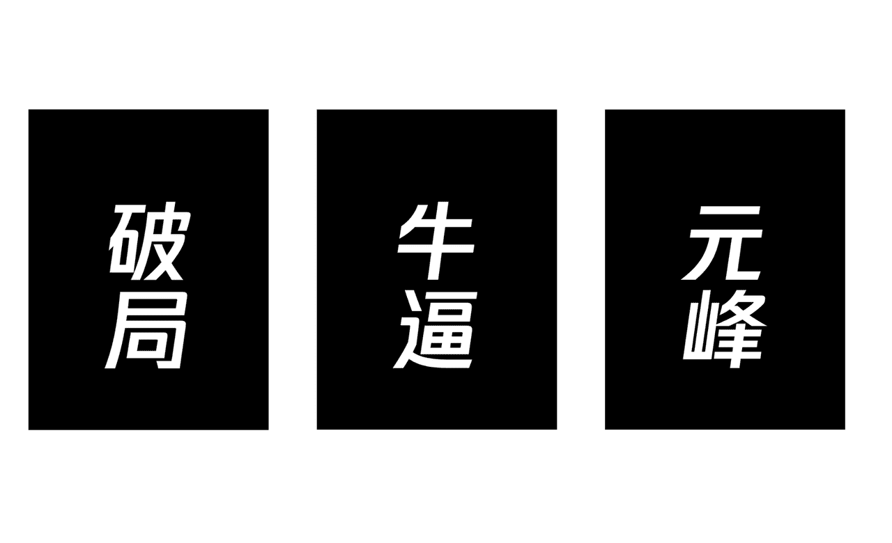

2）设置参数

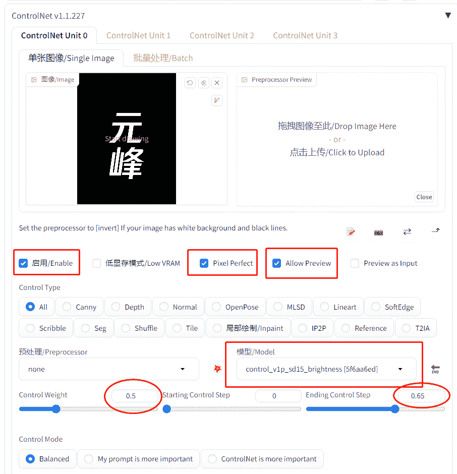

**启用**：勾选

**完美像素模型**：勾选

**允许预览**：勾选

**预处理**：none，不用选

**模型**：control_v1p_sd15_brightness.safetensors（刚刚从云盘下载的）

接下来是最重要的两个参数，**Control Weight **和 Ending Control Step。

**Control Weight：** 建议 **0.4-0.65**。我这里也调整了好多次，这里数值越大，图案就会越明显，但相对的，文字和图片的融合度也会越差。可以自己多试，比较复杂的文字为了出效果可以调高点，简单的图案可以调低点。

Ending **Control **Step：这个参数建议 0.6-0.75，代表着 ControlNet 什么时候停止介入，数值越大后面留给模型处理融合的时间就越少，文字融合度就会变差，数值越小模型介入过早就会破坏已有的结构导致看不清文字。也得多尝试，跟你图案的复杂程度也有关系。

#### 高清化图像

选中图片，点击 **高清化**。

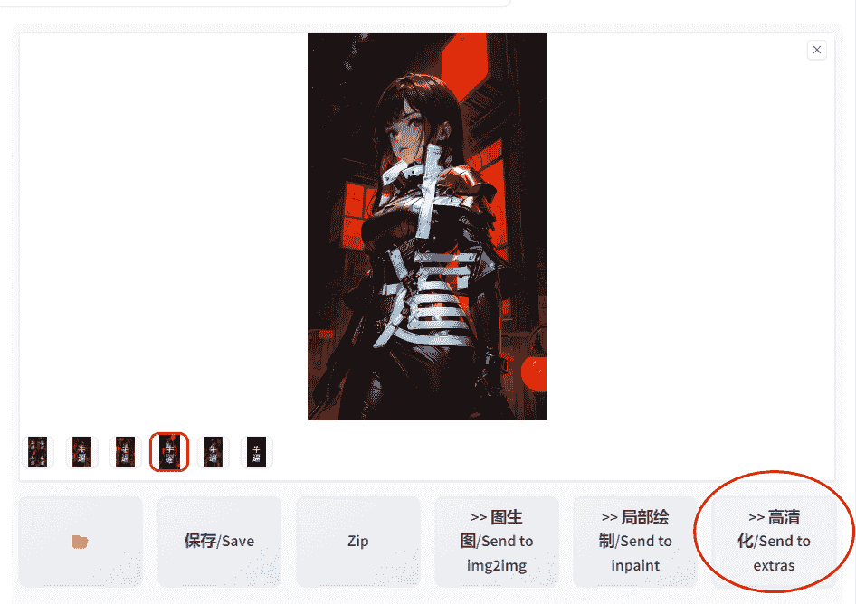

**缩放比例/Resize：**2倍或者4倍还是其它倍，自己设置

**放大模型：**R-ESRGAN 4X+

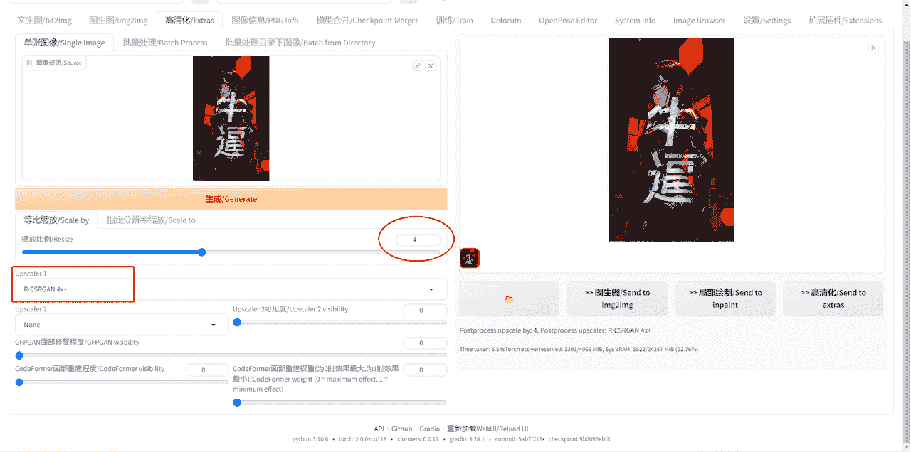

完成之后，下载右边高清图即可。

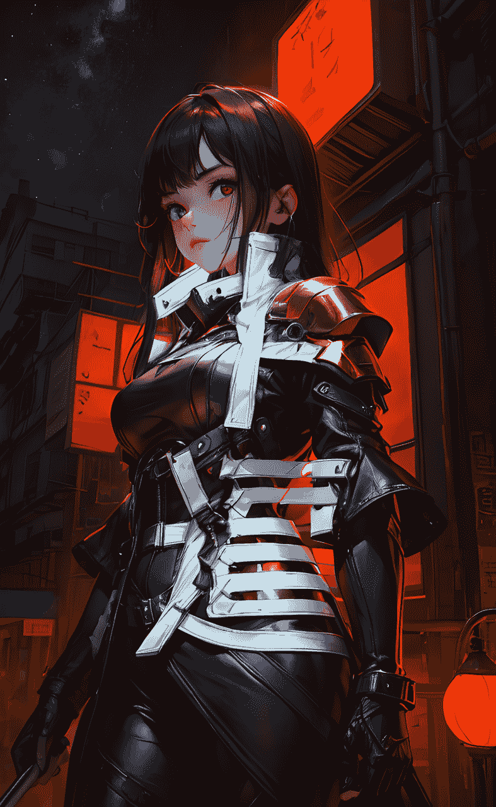

# 海报艺术字

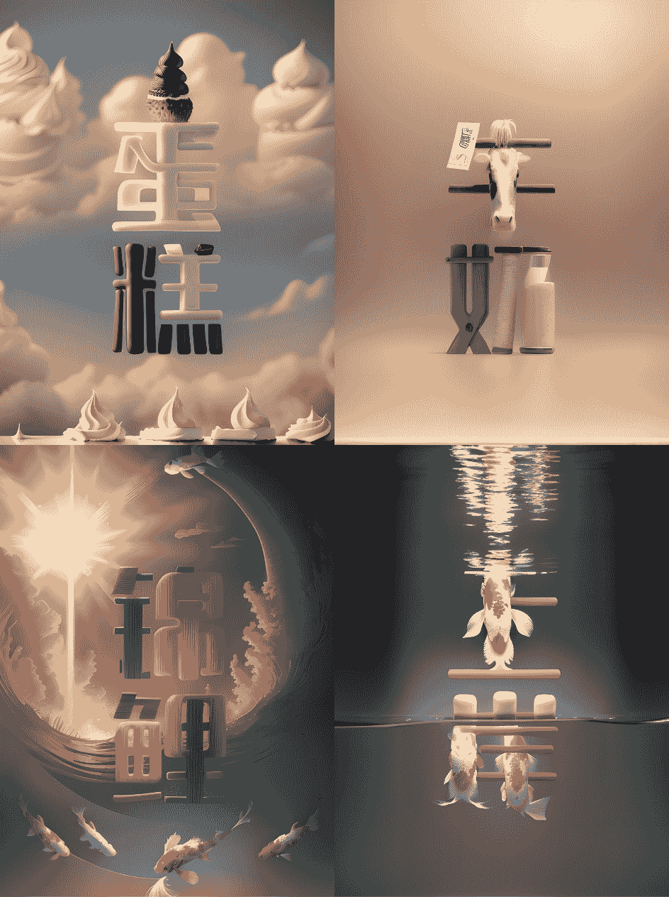

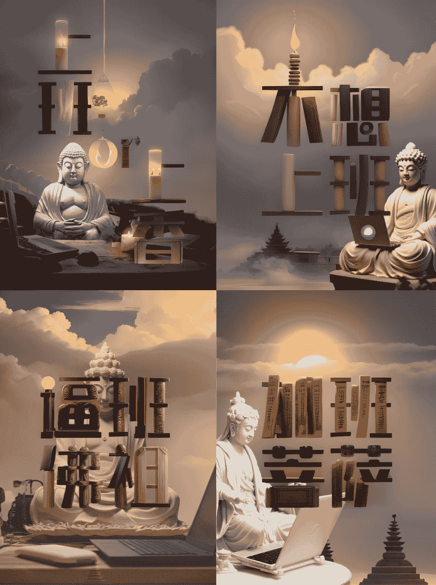