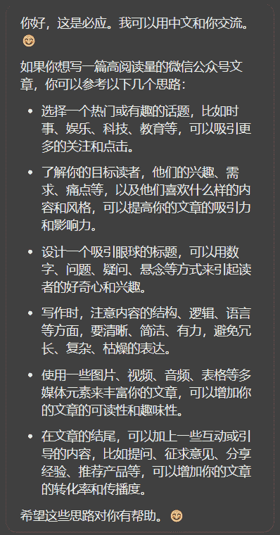
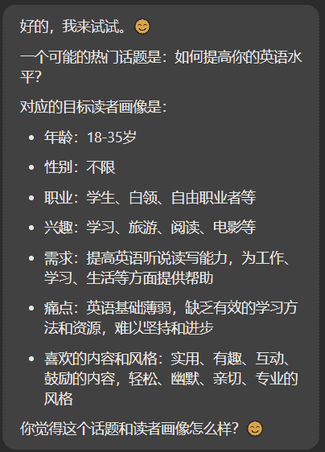
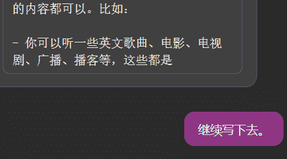
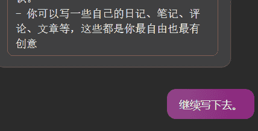
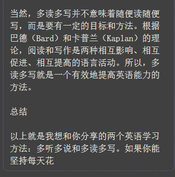
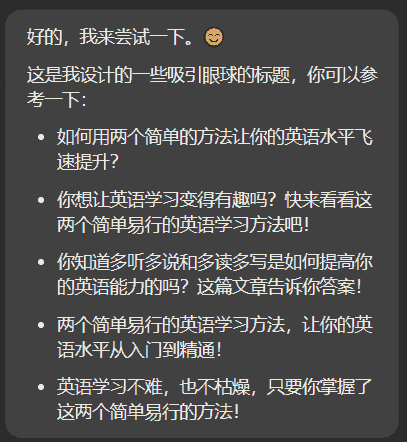

# 5分钟成为自媒体达人

> 来源：[https://my.feishu.cn/docx/YmEMdukbeopKuJxCj8gcQ3I3nhf](https://my.feishu.cn/docx/YmEMdukbeopKuJxCj8gcQ3I3nhf)

## 前言

本节课我们来探索如何使用GPT帮助我们成为自媒体达人，快速赚到一个小目标！在此之前，我们需要先做些准备工作~

首先是平台选取，写文章第一件事就是要保证内容的有效性和准确性，不然就成为营销号了嘛，所以我在此推荐newbing平台，这是一款微软基于GPT打造的，基本功能都是一样的，但是多了一个制胜法宝，它可以给写出的文章添加数据来源。

其次是一步到位，要让小白最快成为自媒体大佬，同时还要当一个轻轻松松的甩手掌柜，让GPT打工，自己来数钱，躺着成为通吃赢家。

最后还要尽可能少干预，让我们的参与尽量减少，保证一个原则“能不干的坚决不干，能少干的坚决不多干”，打造懒人的极致流水线😎

今天，我们还要带大家完成一项**大**挑战，既然GPT那么厉害，那当然要榨干所有性能啦，向长文本自媒体平台公众号发起挑战，我们要在下班回家的地铁上完成！

## 3 2 1 go~

### 1.梳理思路

本着能不想就不想的原则，把任务丢给AI，让它自己选题自己写吧，想让它产出完美文章，我们也需要一步一步来引导，最终成文才会好。先转变为创造力模式，让AI脑洞大开，帮咱梳理以下写作思路。

那我们先来学习一下如何选题吧：

Prompt：假如你想写一篇高阅读量的微信公众号文章，你会有什么思路，如何确定写作选题和写作风格

我们可以保存输出，这类文字是良好的Prompt，指挥它干活的时非常好用

### 2.选择话题

下一步，咱就按着给出的思路一点不改的去创作

Prompt：那你选一个热门或有趣的话题，用来吸引更多的关注和点击，并且给出对应的目标读者画像吧

看起来输出效果还不错，没想到直接戳中了教培行业

### 3.内容生成

同时考虑到这个模型对英文比较熟悉，估计生成的文章比较精准，那我们今天就选这个题目了，接下来就是设计标题和文章内容了

Prompt：那你根据这个话题，并结合读者画像，生成一篇微信公众号的文章吧。要求：你的名字叫小G，不要保证文字多样性，要包含一些实用性建议，同时当你提出方案时要结合现有经典的著名的学术理论并尽量标注引用，文章题目要足够具有吸引力。写作时，注意内容的结构、逻辑、语言等高级写作技巧，要清晰、简洁、有力，避免冗长、复杂、枯燥的表达。（大家注意，这里融合了它之前生成的prompt效果会好很多~）

刚刚打了个盹，这AI又去摸鱼了，不愧是高级工具，学到摸鱼精髓了

竟然还没写完！？可真是个话痨，我已经不喜欢看了，我可是把他给我的要求全都给他了，这个文章也太长了，正好在接下来的文字润色和优化中改掉这些小毛病吧。

### 4.内容优化

正常来说勤快的作者修改一下已经可以出文了，但是懒人原则一定要贯彻到底，甚至一个字都不想改，再把任务丢回去给本老板重做，顺便再优化以下内容。

Prompt：我觉得要缩短二分之一，要保留精华，保留基本结构，重新缩写，并且要对文章进行SEO优化，还要适当增加文章的趣味性，使文章内容符合中文习惯，至少参考十篇同类型的中文网络文章处理以上操作。

写的还行，继续让他补充完就可以进行最终加工了

### 5.添加图片

加一些图片进去~更加符合读者的阅读习惯，同时不被海量文字淹没，这里有大学问，可以从本系列其他课程详细学习。

Prompt：我现在要在这篇文章中加一些生动的图片，请你给出多元化的十条建议，同时使图片内容或风格与文章搭配。

这里摘录四条最终采用的回复：

在文章的开头，你可以加一张你自己的头像或者签名，这样可以增加你的个人形象和信任度。

在介绍方法一：多听多说时，你可以加一张你正在听英语或者说英语的照片，或者一张你和英语伙伴交流的照片，这样可以增加你的实践性和亲和力。

在介绍方法二：多读多写时，你可以加一张你正在读英语或者写英语的照片，或者一张你和英语伙伴交流的照片，这样可以增加你的实践性和亲和力。

在文章的结尾，你可以加一张Dr.

Seuss的照片或者他的名言的图片，这样可以增加你的引用性和感染力

### 6.取个标题文章

Prompt：（跟它之前告诉我的一样）设计一个吸引眼球的标题，可以用数字、问题、疑问、悬念等方式来引起读者的好奇心和兴趣。

优秀的标题正是文章的点睛之笔

### 7.结束

地铁到站，文章写完，回家发表，睡觉赚钱！

## 其他的自媒体渠道

由于上文已经重复过整个流程了，这里仅介绍一下内容生成部分~

### 知乎

考虑到知乎回答都具有一定的专业性，并且要求高准确性，我们要选择精确模式，这样可以保证回答是在充分检索互联网信息后生成的，正确性得到了一定的保证，以下就是我尝试生成关于快速减肥的文案~